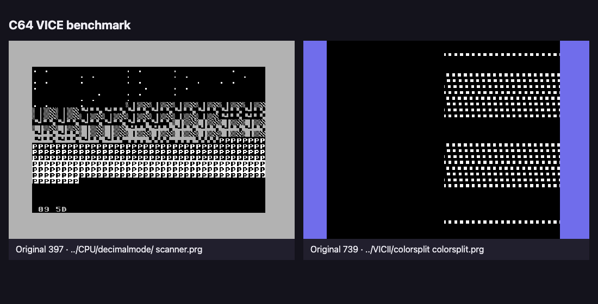
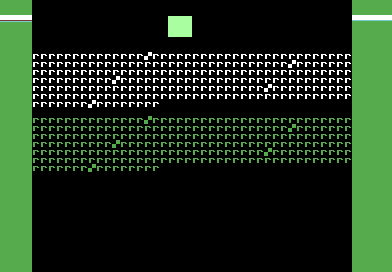
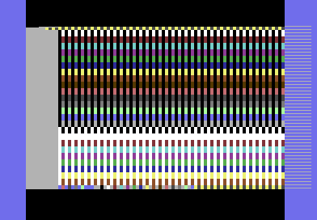

# scene.graphics C64 testbench

[scene.graphics](https://scene.graphics/) provides a Commodore 64 emulator written in safe Rust and a custom KERNAL written in 6502 assembly. The C64 engine and KERNAL are mathematically proven across the 6510 CPU, VIC-II video, SID audio, REU, disk drives and input devices to satisfy its formal specifications. Its custom KERNAL is written in 6502 assembly, with proofs checked against the assembled ROM. It is written from scratch against the Commodore 64 technical specification.

 scene.graphics is designed to protect users from malicious guest programs and emulator bugs. The C64 core runs in a WebAssembly sandbox with no host imports. At startup, the engine randomizes the placement of large allocations within WebAssembly linear memory while preserving the deterministic C64 memory map. The player verifies the engine, ROMs and boot snapshots against signed manifests anchored to a pinned Ed25519 key.

 The scene.graphics Cloud backend streams deltas between machine snapshots directly to the client. In the bandwidth comparison, the stream used roughly 2% of the bandwidth of 720p YouTube video, a 45–50× reduction. Because they are tiny, leaving generous space for local storage and offline use. Portable clients sign and verify all memory caches using their own unique device keys.

The player uses those memory deltas to restore exact points in program execution allowing the player to resume at a specific given timestamp. The emulator generates the audio and video locally, preserving the original signals without lossy encoding. In production, playback skips the boot sequence and starts from a verified snapshot captured at the first audible or visible change.

This repository benchmarks the current C64 emulator used by scene.graphics in production across its entire device fleet against the [VICE test suite](https://github.com/libsidplayfp/VICE-testprogs).

## Run the tests

Requires Node.js 22+, Python 3, curl and a little bit of internet.

```sh
sh scene-c64-live-vice.sh ./results
```

For a quick check, run cases 0 and 739:

```sh
sh scene-c64-live-vice.sh ./smoke 0 739
```

The preview opens after the download. The terminal prints its address if the browser does not open. Set `C64_LIVE_PREVIEW=0` for a terminal-only run.



Repeat the command to resume an interrupted download. Once the tests start, use a fresh output directory for another run.

## Benchmark results

**scene.graphics passed 1,304 of 1,392 applicable cases (93.7%)** on WASM `e63b54f1…`. Its verdicts matched native for all 1,544 originals. The remaining applicable cases were 43 failures and 45 missing references. The CLI tests the binary the site serves at the time and prints its SHA-256.


[Full results by case](vice-results.csv) · [All 313 screenshot cases](screenshots/README.md)

A full run writes its score to `results/run/qualification.json` and per-case receipts to `results/run/receipts/`. The signed release and tested binary are saved in `results/run/website/`. A run of selected cases reports its pass count.

### Comparison with published results

33 cases have a unique path and program in this suite and visible exit-code verdicts for both Denise and x64sc.

| Emulator | Passed | Cases |
| --- | ---: | ---: |
| scene.graphics | 32 | 33 |
| Denise Git, 4 Dec 2025 | 33 | 33 |
| VICE x64sc r45942 | 28 | 33 |

[Compare the 33 cases](vice-wiki-overlap.csv). The wiki omits many rows and does not publish the ROM hashes or cycle budgets for these entries. [VICE Testbench C64 results](https://vice-emu.pokefinder.org/wiki/Testbench#C64)

<details>
<summary>Published full-run totals</summary>

The case sets and configurations vary by run.

| Emulator and build | Passed | Cases counted | Score | Programming language | KERNAL |
| --- | ---: | ---: | ---: | --- | --- |
| **scene.graphics** `e63b54f1…` | **1,304** | **1,392** | **93.7%** | **Safe Rust** | **In-house replacement (6502 assembly)** |
| Denise Git, 4 Dec 2025 | 1,305 | 1,348 | 96.8% | C++ | Configurable ROM |
| emu64 20251205 | 514 | 1,162 | 44.2% | C++ | C64 ROM image |
| Frodo 20251205 | 809 | 1,099 | 73.6% | C++ | C64 ROM image |
| Hoxs64 1.1.2.7 | 938 | 996 | 94.2% | C++ | External C64 ROM image |
| Kernal64 C128 in C64 mode 1.8.6_b1 | 956 | 1,236 | 77.3% | Scala | Bundled ROM, replaceable |
| Kernal64 C64 1.8.6_b1 | 961 | 1,236 | 77.8% | Scala | Bundled ROM, replaceable |
| Micro64 build 719 | 884 | 1,214 | 72.8% | Unverified | Unverified |
| Turbo Chameleon 64 9r, cartridge | 1,061 | 1,170 | 90.7% | FPGA (HDL unverified) | Host C64 ROM or configured image |
| Turbo Chameleon 64 9r, standalone | 917 | 1,228 | 74.7% | FPGA (HDL unverified) | Configurable ROM |
| Ultimate64 1.45 | 789 | 1,014 | 77.8% | FPGA (VHDL) | User-flashable ROM (Hyperspeed option) |
| VICE x128 in C64 mode r45942 | 1,092 | 1,308 | 83.5% | C | Commodore ROM, replaceable |
| VICE x64 r45942 | 1,129 | 1,354 | 83.4% | C | Commodore ROM, replaceable |
| VICE x64sc r45942 | 1,272 | 1,354 | 93.9% | C | Commodore ROM, replaceable |
| YACE 2.2.0.47 | 470 | 860 | 54.7% | Unverified | Commodore ROM required |
| Z64K C128 in C64 mode, 14 Apr 2025 | 1,120 | 1,253 | 89.4% | Java | Unverified |
| Z64K C64, 14 Apr 2025 | 1,169 | 1,253 | 93.3% | Java | Unverified |

The scene.graphics score comes from this repository’s [recorded results](vice-results.csv). Other scores come from the [VICE Testbench](https://vice-emu.pokefinder.org/wiki/Testbench#C64). KERNAL describes the documented ROM setup. The wiki does not identify the exact ROM used in each run.

Implementation and ROM references · [Denise](https://github.com/piciji/denise) · [emu64](https://github.com/ThKattanek/emu64) · [Frodo](https://github.com/cebix/frodo4/tree/main) · [Hoxs64](https://github.com/davidhorrocks/hoxs64) · [Kernal64](https://github.com/abbruzze/kernal64) · [Micro64](https://blog.rosseaux.net/page/986c1ab5667d2dfa6ef552e6dd42fe27/micro64) · [Turbo Chameleon 64](https://wiki.icomp.de/wiki/Chameleon_FAQ) · [Ultimate64 core](https://github.com/GideonZ/1541ultimate) · [Ultimate64 ROM setup](https://github.com/GideonZ/1541u-documentation/blob/master/u64/getting_started.rst) · [Hyperspeed KERNAL](https://github.com/GideonZ/1541u-documentation/blob/master/howto/installing_310i.rst) · [VICE source](https://sourceforge.net/p/vice-emu/code/HEAD/tree/trunk/vice/src/) · [VICE ROM settings](https://vice-emu.sourceforge.io/vice_7.html) · [YACE64](https://www.yace64.com/Help.html) · [Z64K](https://www.z64k.com/)

</details>

## Benchmark examples

The examples are from WASM `e63b54f1…`.

| Original | Case | What it tests | Result |
| ---: | --- | --- | --- |
| 238 | `arrb.prg` | Undocumented `ARR #imm` combines an AND with a rotate and has its own flag behavior. | Pass at 20,312,607 cycles |
| 239 | `aneb.prg` | Undocumented `ANE #imm` exercises a chip-dependent accumulator result. | Pass at 65,019,244 cycles |
| 462 | `shxy3.prg` | Undocumented indexed stores. On a page crossing, the masked value can also determine the write address. | Pass at 5,067,151 cycles |
| 515 | `ciaflag.prg` | CIA FLAG behavior with a 1581 drive and the original D81 mounted. | Pass at 160,823,749 cycles |
| 733 | `bitmap.prg` | VIC-II colour fetch behavior in bitmap mode. | 0 of 104,064 pixels differ |
| 1447 | `xfertiming-cmp.prg` | Transfer timing with a 512 KiB REU. | 0 of 104,064 pixels differ |

**Undocumented indexed stores · original 462**

[](screenshots/opcode-shxy3.png)

The C64 screen is shown above. The test passes when the program writes `$00` to `$D7FF`.

**VIC-II bitmap colour fetch · original 733**

[](screenshots/frames/0733.png)

**512 KiB REU transfer timing · original 1447**

[](screenshots/frames/1447.png)

## VICE Testbench comparison matrix

The matrix combines the C64 cases shown in the VICE wiki. Blank cells mean the wiki publishes no verdict for that system and case. The wiki omits cases, so the matrix does not give overall pass rates. [VICE Testbench revision 6458](https://vice-emu.pokefinder.org/vicewiki/index.php?title=Testbench&oldid=6458#C64)

The scene.graphics column uses the recorded WASM rc1 results. Cases are paired by directory, program, mounted media, test type and identifiable settings. An em dash in that column indicates that the published row could not be paired with a single case. The wiki does not list every run setting.

Pass links open the matching evidence line. The index cites the recorded scene.graphics run or the wiki’s published verdict for that system and case.

| Path | Chip | Type | scene.graphics WASM rc1 | denise git 4.12.2025 | x64sc r45942 | hoxs64 1.1.2.7 | z64k (c64) 14 April 2025 | TC64 9r (cartridge) | z64k (c128/c64) 14 April 2025 | x128 (c64) r45942 | x64 r45942 | U64 1.45 | kernal64 (c64) 1.8.6_b1 | kernal64 (c128/c64) 1.8.6_b1 | TC64 9r (standalone) | frodo 20251205 | micro64 1.00.2018.03.16 (build 719) | yace 2-2-0-47 | emu64 20251205 |
| --- | --- | --- | --- | --- | --- | --- | --- | --- | --- | --- | --- | --- | --- | --- | --- | --- | --- | --- | --- |
| `../C64/raminitpattern/darkstarbbstest.prg` |  | exitcode | [pass](comparison-evidence.txt#L7) | [ok](comparison-evidence.txt#L8) | [ok](comparison-evidence.txt#L8) | [ok](comparison-evidence.txt#L8) | fail | [ok](comparison-evidence.txt#L8) | fail | [ok](comparison-evidence.txt#L8) | [ok](comparison-evidence.txt#L8) | [ok](comparison-evidence.txt#L9) | [ok](comparison-evidence.txt#L9) | [ok](comparison-evidence.txt#L9) | [ok](comparison-evidence.txt#L9) | [ok](comparison-evidence.txt#L9) | fail | fail | [ok](comparison-evidence.txt#L9) |
| `../C64/raminitpattern/typicaltest.prg` |  | exitcode | [pass](comparison-evidence.txt#L10) | [ok](comparison-evidence.txt#L11) | [ok](comparison-evidence.txt#L11) | fail | [ok](comparison-evidence.txt#L11) | [ok](comparison-evidence.txt#L11) | [ok](comparison-evidence.txt#L11) | [ok](comparison-evidence.txt#L11) | [ok](comparison-evidence.txt#L11) | [ok](comparison-evidence.txt#L12) | [ok](comparison-evidence.txt#L12) | [ok](comparison-evidence.txt#L12) | [ok](comparison-evidence.txt#L12) | fail | fail | [ok](comparison-evidence.txt#L12) | [ok](comparison-evidence.txt#L12) |
| `../C64/autostart/defaults/test.prg` · Load as `TEST` |  | exitcode | fail | [ok](comparison-evidence.txt#L13) | [ok](comparison-evidence.txt#L13) | fail | fail | fail | fail | [ok](comparison-evidence.txt#L13) | [ok](comparison-evidence.txt#L13) | fail | fail | fail | fail | fail | fail | fail | fail |
| `../C64/autostart/defaults/test.prg` (`test.d64`) · Load as `TEST` |  | exitcode | fail | [ok](comparison-evidence.txt#L14) | [ok](comparison-evidence.txt#L14) | fail | fail | fail | fail | [ok](comparison-evidence.txt#L14) | [ok](comparison-evidence.txt#L14) | fail | [ok](comparison-evidence.txt#L15) | fail | fail | fail | fail | fail | fail |
| `../general/Lorenz-2.15/src/trap17.prg` | PAL | exitcode | [pass](comparison-evidence.txt#L16) | [ok](comparison-evidence.txt#L17) | [ok](comparison-evidence.txt#L17) | [ok](comparison-evidence.txt#L17) | [ok](comparison-evidence.txt#L17) | [ok](comparison-evidence.txt#L17) | fail | fail | [ok](comparison-evidence.txt#L17) | timeout | [ok](comparison-evidence.txt#L18) | fail | [ok](comparison-evidence.txt#L18) | n/a | [ok](comparison-evidence.txt#L18) | fail | fail |
| `../general/fuxxortest/test-fuxxored.prg` |  | exitcode | fail | [ok](comparison-evidence.txt#L19) | [ok](comparison-evidence.txt#L19) | timeout | timeout | timeout | timeout | timeout | timeout | timeout | timeout | timeout | timeout | timeout | [ok](comparison-evidence.txt#L20) | timeout | timeout |
| `../general/fuxxortest/ef2-inst2.prg` |  | exitcode | [pass](comparison-evidence.txt#L21) | [ok](comparison-evidence.txt#L22) | [ok](comparison-evidence.txt#L22) | [ok](comparison-evidence.txt#L22) | [ok](comparison-evidence.txt#L22) | [ok](comparison-evidence.txt#L22) | [ok](comparison-evidence.txt#L22) | fail | fail | [ok](comparison-evidence.txt#L23) | fail | fail | [ok](comparison-evidence.txt#L23) | [ok](comparison-evidence.txt#L23) | [ok](comparison-evidence.txt#L23) | n/a | fail |
| `../general/fuxxortest/ef2-inst3.prg` |  | exitcode | [pass](comparison-evidence.txt#L24) | [ok](comparison-evidence.txt#L25) | [ok](comparison-evidence.txt#L25) | [ok](comparison-evidence.txt#L25) | [ok](comparison-evidence.txt#L25) | [ok](comparison-evidence.txt#L25) | [ok](comparison-evidence.txt#L25) | fail | fail | [ok](comparison-evidence.txt#L26) | [ok](comparison-evidence.txt#L26) | [ok](comparison-evidence.txt#L26) | [ok](comparison-evidence.txt#L26) | fail | [ok](comparison-evidence.txt#L26) | n/a | fail |
| `../general/fuxxortest/ef2-inst4a.prg` |  | exitcode | [pass](comparison-evidence.txt#L27) | [ok](comparison-evidence.txt#L28) | [ok](comparison-evidence.txt#L28) | [ok](comparison-evidence.txt#L28) | [ok](comparison-evidence.txt#L28) | fail | fail | fail | fail | fail | [ok](comparison-evidence.txt#L29) | fail | fail | [ok](comparison-evidence.txt#L29) | [ok](comparison-evidence.txt#L29) | n/a | fail |
| `../general/fuxxortest/ef2-inst4c.prg` |  | exitcode | [pass](comparison-evidence.txt#L30) | [ok](comparison-evidence.txt#L31) | [ok](comparison-evidence.txt#L31) | [ok](comparison-evidence.txt#L31) | [ok](comparison-evidence.txt#L31) | [ok](comparison-evidence.txt#L31) | [ok](comparison-evidence.txt#L31) | timeout | timeout | [ok](comparison-evidence.txt#L32) | fail | fail | [ok](comparison-evidence.txt#L32) | timeout | [ok](comparison-evidence.txt#L32) | n/a | timeout |
| `../CPU/Acid800/cpu_timing.prg` | PAL | exitcode | [pass](comparison-evidence.txt#L33) | [ok](comparison-evidence.txt#L34) | [ok](comparison-evidence.txt#L34) | [ok](comparison-evidence.txt#L34) | fail | [ok](comparison-evidence.txt#L34) | fail | [ok](comparison-evidence.txt#L34) | [ok](comparison-evidence.txt#L34) | [ok](comparison-evidence.txt#L35) | [ok](comparison-evidence.txt#L35) | [ok](comparison-evidence.txt#L35) | fail | n/a | [ok](comparison-evidence.txt#L35) | [ok](comparison-evidence.txt#L35) | [ok](comparison-evidence.txt#L35) |
| `../CPU/cpuport/test1.prg` |  | exitcode | [pass](comparison-evidence.txt#L36) | [ok](comparison-evidence.txt#L37) | [ok](comparison-evidence.txt#L37) | [ok](comparison-evidence.txt#L37) | [ok](comparison-evidence.txt#L37) | [ok](comparison-evidence.txt#L37) | fail | [ok](comparison-evidence.txt#L37) | [ok](comparison-evidence.txt#L37) | [ok](comparison-evidence.txt#L38) | [ok](comparison-evidence.txt#L38) | [ok](comparison-evidence.txt#L38) | [ok](comparison-evidence.txt#L38) | [ok](comparison-evidence.txt#L38) | fail | timeout | [ok](comparison-evidence.txt#L38) |
| `../CPU/sha/shaabsy2.prg` | PAL | exitcode | [pass](comparison-evidence.txt#L39) | [ok](comparison-evidence.txt#L40) | [ok](comparison-evidence.txt#L40) | [ok](comparison-evidence.txt#L40) | [ok](comparison-evidence.txt#L40) | [ok](comparison-evidence.txt#L40) | [ok](comparison-evidence.txt#L40) | fail | fail | [ok](comparison-evidence.txt#L41) | [ok](comparison-evidence.txt#L41) | [ok](comparison-evidence.txt#L41) | [ok](comparison-evidence.txt#L41) | n/a | [ok](comparison-evidence.txt#L41) | fail | fail |
| `../CPU/sha/shaabsy3.prg` | PAL | exitcode | [pass](comparison-evidence.txt#L42) | [ok](comparison-evidence.txt#L43) | [ok](comparison-evidence.txt#L43) | [ok](comparison-evidence.txt#L43) | [ok](comparison-evidence.txt#L43) | [ok](comparison-evidence.txt#L43) | [ok](comparison-evidence.txt#L43) | fail | fail | [ok](comparison-evidence.txt#L44) | [ok](comparison-evidence.txt#L44) | [ok](comparison-evidence.txt#L44) | [ok](comparison-evidence.txt#L44) | n/a | fail | fail | fail |
| `../CPU/sha/shaabsy4.prg` | PAL | exitcode | [pass](comparison-evidence.txt#L45) | [ok](comparison-evidence.txt#L46) | [ok](comparison-evidence.txt#L46) | [ok](comparison-evidence.txt#L46) | [ok](comparison-evidence.txt#L46) | [ok](comparison-evidence.txt#L46) | [ok](comparison-evidence.txt#L46) | fail | fail | [ok](comparison-evidence.txt#L47) | [ok](comparison-evidence.txt#L47) | [ok](comparison-evidence.txt#L47) | [ok](comparison-evidence.txt#L47) | n/a | fail | fail | fail |
| `../CPU/sha/shaabsy5.prg` | PAL | exitcode | [pass](comparison-evidence.txt#L48) | [ok](comparison-evidence.txt#L49) | [ok](comparison-evidence.txt#L49) | [ok](comparison-evidence.txt#L49) | [ok](comparison-evidence.txt#L49) | [ok](comparison-evidence.txt#L49) | [ok](comparison-evidence.txt#L49) | fail | fail | fail | [ok](comparison-evidence.txt#L50) | [ok](comparison-evidence.txt#L50) | [ok](comparison-evidence.txt#L50) | n/a | fail | fail | fail |
| `../CPU/sha/shazpy2.prg` | PAL | exitcode | [pass](comparison-evidence.txt#L51) | [ok](comparison-evidence.txt#L52) | [ok](comparison-evidence.txt#L52) | [ok](comparison-evidence.txt#L52) | [ok](comparison-evidence.txt#L52) | [ok](comparison-evidence.txt#L52) | [ok](comparison-evidence.txt#L52) | fail | fail | [ok](comparison-evidence.txt#L53) | [ok](comparison-evidence.txt#L53) | [ok](comparison-evidence.txt#L53) | [ok](comparison-evidence.txt#L53) | n/a | [ok](comparison-evidence.txt#L53) | fail | fail |
| `../CPU/sha/shazpy3.prg` | PAL | exitcode | [pass](comparison-evidence.txt#L54) | [ok](comparison-evidence.txt#L55) | [ok](comparison-evidence.txt#L55) | [ok](comparison-evidence.txt#L55) | [ok](comparison-evidence.txt#L55) | [ok](comparison-evidence.txt#L55) | [ok](comparison-evidence.txt#L55) | fail | fail | [ok](comparison-evidence.txt#L56) | [ok](comparison-evidence.txt#L56) | [ok](comparison-evidence.txt#L56) | [ok](comparison-evidence.txt#L56) | n/a | fail | fail | fail |
| `../CPU/sha/shazpy4.prg` | PAL | exitcode | [pass](comparison-evidence.txt#L57) | [ok](comparison-evidence.txt#L58) | [ok](comparison-evidence.txt#L58) | [ok](comparison-evidence.txt#L58) | [ok](comparison-evidence.txt#L58) | [ok](comparison-evidence.txt#L58) | [ok](comparison-evidence.txt#L58) | fail | fail | [ok](comparison-evidence.txt#L59) | [ok](comparison-evidence.txt#L59) | [ok](comparison-evidence.txt#L59) | [ok](comparison-evidence.txt#L59) | n/a | fail | fail | fail |
| `../CPU/sha/shazpy5.prg` | PAL | exitcode | [pass](comparison-evidence.txt#L60) | [ok](comparison-evidence.txt#L61) | [ok](comparison-evidence.txt#L61) | [ok](comparison-evidence.txt#L61) | [ok](comparison-evidence.txt#L61) | [ok](comparison-evidence.txt#L61) | [ok](comparison-evidence.txt#L61) | fail | fail | fail | [ok](comparison-evidence.txt#L62) | [ok](comparison-evidence.txt#L62) | [ok](comparison-evidence.txt#L62) | n/a | fail | fail | fail |
| `../CPU/shs/shsabsy2.prg` | PAL | exitcode | [pass](comparison-evidence.txt#L63) | [ok](comparison-evidence.txt#L64) | [ok](comparison-evidence.txt#L64) | [ok](comparison-evidence.txt#L64) | [ok](comparison-evidence.txt#L64) | [ok](comparison-evidence.txt#L64) | [ok](comparison-evidence.txt#L64) | fail | fail | [ok](comparison-evidence.txt#L65) | [ok](comparison-evidence.txt#L65) | [ok](comparison-evidence.txt#L65) | [ok](comparison-evidence.txt#L65) | n/a | [ok](comparison-evidence.txt#L65) | fail | fail |
| `../CPU/shs/shsabsy3.prg` | PAL | exitcode | [pass](comparison-evidence.txt#L66) | [ok](comparison-evidence.txt#L67) | [ok](comparison-evidence.txt#L67) | [ok](comparison-evidence.txt#L67) | [ok](comparison-evidence.txt#L67) | [ok](comparison-evidence.txt#L67) | [ok](comparison-evidence.txt#L67) | fail | fail | [ok](comparison-evidence.txt#L68) | [ok](comparison-evidence.txt#L68) | [ok](comparison-evidence.txt#L68) | [ok](comparison-evidence.txt#L68) | n/a | fail | fail | fail |
| `../CPU/shs/shsabsy4.prg` | PAL | exitcode | [pass](comparison-evidence.txt#L69) | [ok](comparison-evidence.txt#L70) | [ok](comparison-evidence.txt#L70) | [ok](comparison-evidence.txt#L70) | [ok](comparison-evidence.txt#L70) | [ok](comparison-evidence.txt#L70) | [ok](comparison-evidence.txt#L70) | fail | fail | [ok](comparison-evidence.txt#L71) | [ok](comparison-evidence.txt#L71) | [ok](comparison-evidence.txt#L71) | [ok](comparison-evidence.txt#L71) | n/a | fail | fail | fail |
| `../CPU/shs/shsabsy5.prg` | PAL | exitcode | [pass](comparison-evidence.txt#L72) | [ok](comparison-evidence.txt#L73) | [ok](comparison-evidence.txt#L73) | [ok](comparison-evidence.txt#L73) | [ok](comparison-evidence.txt#L73) | [ok](comparison-evidence.txt#L73) | [ok](comparison-evidence.txt#L73) | fail | fail | fail | [ok](comparison-evidence.txt#L74) | [ok](comparison-evidence.txt#L74) | [ok](comparison-evidence.txt#L74) | n/a | fail | fail | fail |
| `../CPU/shxy/shx-test.prg` | PAL | exitcode | [pass](comparison-evidence.txt#L75) | [ok](comparison-evidence.txt#L76) | [ok](comparison-evidence.txt#L76) | [ok](comparison-evidence.txt#L76) | [ok](comparison-evidence.txt#L76) | [ok](comparison-evidence.txt#L76) | [ok](comparison-evidence.txt#L76) | fail | fail | fail | [ok](comparison-evidence.txt#L77) | [ok](comparison-evidence.txt#L77) | [ok](comparison-evidence.txt#L77) | n/a | [ok](comparison-evidence.txt#L77) | fail | [ok](comparison-evidence.txt#L77) |
| `../CPU/shxy/shxy2.prg` | PAL | exitcode | [pass](comparison-evidence.txt#L78) | [ok](comparison-evidence.txt#L79) | [ok](comparison-evidence.txt#L79) | [ok](comparison-evidence.txt#L79) | [ok](comparison-evidence.txt#L79) | [ok](comparison-evidence.txt#L79) | [ok](comparison-evidence.txt#L79) | fail | fail | [ok](comparison-evidence.txt#L80) | [ok](comparison-evidence.txt#L80) | [ok](comparison-evidence.txt#L80) | [ok](comparison-evidence.txt#L80) | n/a | [ok](comparison-evidence.txt#L80) | fail | [ok](comparison-evidence.txt#L80) |
| `../CPU/shxy/shxy3.prg` |  | exitcode | [pass](comparison-evidence.txt#L81) | [ok](comparison-evidence.txt#L82) | [ok](comparison-evidence.txt#L82) | [ok](comparison-evidence.txt#L82) | [ok](comparison-evidence.txt#L82) | [ok](comparison-evidence.txt#L82) | [ok](comparison-evidence.txt#L82) | fail | fail | [ok](comparison-evidence.txt#L83) | [ok](comparison-evidence.txt#L83) | [ok](comparison-evidence.txt#L83) | [ok](comparison-evidence.txt#L83) | [ok](comparison-evidence.txt#L83) | fail | fail | fail |
| `../CPU/shxy/shxy4.prg` |  | exitcode | [pass](comparison-evidence.txt#L84) | [ok](comparison-evidence.txt#L85) | [ok](comparison-evidence.txt#L85) | [ok](comparison-evidence.txt#L85) | [ok](comparison-evidence.txt#L85) | [ok](comparison-evidence.txt#L85) | [ok](comparison-evidence.txt#L85) | fail | fail | [ok](comparison-evidence.txt#L86) | [ok](comparison-evidence.txt#L86) | [ok](comparison-evidence.txt#L86) | [ok](comparison-evidence.txt#L86) | [ok](comparison-evidence.txt#L86) | fail | fail | fail |
| `../CPU/shxy/shxy5.prg` | PAL | exitcode | [pass](comparison-evidence.txt#L87) | [ok](comparison-evidence.txt#L88) | [ok](comparison-evidence.txt#L88) | [ok](comparison-evidence.txt#L88) | [ok](comparison-evidence.txt#L88) | [ok](comparison-evidence.txt#L88) | [ok](comparison-evidence.txt#L88) | fail | fail | fail | [ok](comparison-evidence.txt#L89) | [ok](comparison-evidence.txt#L89) | [ok](comparison-evidence.txt#L89) | n/a | fail | fail | fail |
| `../CPU/shxy/shyx2.prg` | PAL | exitcode | [pass](comparison-evidence.txt#L90) | [ok](comparison-evidence.txt#L91) | [ok](comparison-evidence.txt#L91) | [ok](comparison-evidence.txt#L91) | [ok](comparison-evidence.txt#L91) | [ok](comparison-evidence.txt#L91) | [ok](comparison-evidence.txt#L91) | fail | fail | [ok](comparison-evidence.txt#L92) | [ok](comparison-evidence.txt#L92) | [ok](comparison-evidence.txt#L92) | [ok](comparison-evidence.txt#L92) | n/a | [ok](comparison-evidence.txt#L92) | fail | [ok](comparison-evidence.txt#L92) |
| `../CPU/shxy/shyx3.prg` |  | exitcode | [pass](comparison-evidence.txt#L93) | [ok](comparison-evidence.txt#L94) | [ok](comparison-evidence.txt#L94) | [ok](comparison-evidence.txt#L94) | [ok](comparison-evidence.txt#L94) | [ok](comparison-evidence.txt#L94) | [ok](comparison-evidence.txt#L94) | fail | fail | [ok](comparison-evidence.txt#L95) | [ok](comparison-evidence.txt#L95) | [ok](comparison-evidence.txt#L95) | [ok](comparison-evidence.txt#L95) | [ok](comparison-evidence.txt#L95) | fail | fail | fail |
| `../CPU/shxy/shyx4.prg` |  | exitcode | [pass](comparison-evidence.txt#L96) | [ok](comparison-evidence.txt#L97) | [ok](comparison-evidence.txt#L97) | [ok](comparison-evidence.txt#L97) | [ok](comparison-evidence.txt#L97) | [ok](comparison-evidence.txt#L97) | [ok](comparison-evidence.txt#L97) | fail | fail | [ok](comparison-evidence.txt#L98) | [ok](comparison-evidence.txt#L98) | [ok](comparison-evidence.txt#L98) | [ok](comparison-evidence.txt#L98) | [ok](comparison-evidence.txt#L98) | fail | fail | fail |
| `../CPU/shxy/shyx5.prg` | PAL | exitcode | [pass](comparison-evidence.txt#L99) | [ok](comparison-evidence.txt#L100) | [ok](comparison-evidence.txt#L100) | [ok](comparison-evidence.txt#L100) | [ok](comparison-evidence.txt#L100) | [ok](comparison-evidence.txt#L100) | [ok](comparison-evidence.txt#L100) | fail | fail | fail | [ok](comparison-evidence.txt#L101) | [ok](comparison-evidence.txt#L101) | [ok](comparison-evidence.txt#L101) | n/a | fail | fail | fail |
| `../interrupts/irq-ackn-bug/irq-ack-vicii.prg` | PAL | exitcode | [pass](comparison-evidence.txt#L102) | [ok](comparison-evidence.txt#L103) | [ok](comparison-evidence.txt#L103) | [ok](comparison-evidence.txt#L103) | [ok](comparison-evidence.txt#L103) | [ok](comparison-evidence.txt#L103) | [ok](comparison-evidence.txt#L103) | fail | fail | [ok](comparison-evidence.txt#L104) | fail | fail | fail | n/a | [ok](comparison-evidence.txt#L104) | timeout | fail |
| `../interrupts/irqdma/nmitest6b.prg` | PAL 6526 | exitcode | [pass](comparison-evidence.txt#L105) | [ok](comparison-evidence.txt#L106) | [ok](comparison-evidence.txt#L106) | n/a | [ok](comparison-evidence.txt#L106) | [ok](comparison-evidence.txt#L106) | [ok](comparison-evidence.txt#L106) | fail | fail | [ok](comparison-evidence.txt#L107) | fail | fail | [ok](comparison-evidence.txt#L107) | n/a | [ok](comparison-evidence.txt#L107) | n/a | fail |
| `../interrupts/irqdma/nmitest6b.prg` | PAL 8521 | exitcode | [pass](comparison-evidence.txt#L108) | [ok](comparison-evidence.txt#L109) | [ok](comparison-evidence.txt#L109) | [ok](comparison-evidence.txt#L109) | [ok](comparison-evidence.txt#L109) | [ok](comparison-evidence.txt#L109) | [ok](comparison-evidence.txt#L109) | fail | fail | n/a | fail | fail | [ok](comparison-evidence.txt#L110) | n/a | [ok](comparison-evidence.txt#L110) | n/a | n/a |
| `../interrupts/irqdma/nmitest6.prg` | PAL 6526 | exitcode | [pass](comparison-evidence.txt#L111) | [ok](comparison-evidence.txt#L112) | [ok](comparison-evidence.txt#L112) | n/a | [ok](comparison-evidence.txt#L112) | [ok](comparison-evidence.txt#L112) | [ok](comparison-evidence.txt#L112) | fail | fail | [ok](comparison-evidence.txt#L113) | fail | fail | [ok](comparison-evidence.txt#L113) | n/a | [ok](comparison-evidence.txt#L113) | n/a | fail |
| `../interrupts/irqdma/nmitest6.prg` | PAL 8521 | exitcode | [pass](comparison-evidence.txt#L114) | [ok](comparison-evidence.txt#L115) | [ok](comparison-evidence.txt#L115) | [ok](comparison-evidence.txt#L115) | [ok](comparison-evidence.txt#L115) | [ok](comparison-evidence.txt#L115) | [ok](comparison-evidence.txt#L115) | fail | fail | n/a | fail | fail | [ok](comparison-evidence.txt#L116) | n/a | [ok](comparison-evidence.txt#L116) | n/a | n/a |
| `../interrupts/irqdma/test1b.prg` | PAL | exitcode | [pass](comparison-evidence.txt#L117) | [ok](comparison-evidence.txt#L118) | [ok](comparison-evidence.txt#L118) | [ok](comparison-evidence.txt#L118) | [ok](comparison-evidence.txt#L118) | [ok](comparison-evidence.txt#L118) | [ok](comparison-evidence.txt#L118) | fail | fail | [ok](comparison-evidence.txt#L119) | fail | fail | [ok](comparison-evidence.txt#L119) | n/a | [ok](comparison-evidence.txt#L119) | fail | fail |
| `../interrupts/irqdma/test1.prg` | PAL | exitcode | [pass](comparison-evidence.txt#L120) | [ok](comparison-evidence.txt#L121) | [ok](comparison-evidence.txt#L121) | [ok](comparison-evidence.txt#L121) | [ok](comparison-evidence.txt#L121) | [ok](comparison-evidence.txt#L121) | [ok](comparison-evidence.txt#L121) | fail | fail | [ok](comparison-evidence.txt#L122) | fail | fail | [ok](comparison-evidence.txt#L122) | n/a | [ok](comparison-evidence.txt#L122) | fail | fail |
| `../interrupts/irqdma/test2b.prg` | PAL | exitcode | [pass](comparison-evidence.txt#L123) | [ok](comparison-evidence.txt#L124) | [ok](comparison-evidence.txt#L124) | [ok](comparison-evidence.txt#L124) | [ok](comparison-evidence.txt#L124) | [ok](comparison-evidence.txt#L124) | [ok](comparison-evidence.txt#L124) | fail | fail | [ok](comparison-evidence.txt#L125) | fail | fail | [ok](comparison-evidence.txt#L125) | n/a | [ok](comparison-evidence.txt#L125) | fail | fail |
| `../interrupts/irqdma/test2.prg` | PAL | exitcode | [pass](comparison-evidence.txt#L126) | [ok](comparison-evidence.txt#L127) | [ok](comparison-evidence.txt#L127) | [ok](comparison-evidence.txt#L127) | [ok](comparison-evidence.txt#L127) | [ok](comparison-evidence.txt#L127) | [ok](comparison-evidence.txt#L127) | fail | fail | [ok](comparison-evidence.txt#L128) | fail | fail | [ok](comparison-evidence.txt#L128) | n/a | [ok](comparison-evidence.txt#L128) | fail | fail |
| `../interrupts/irqdma/test3b.prg` | PAL | exitcode | [pass](comparison-evidence.txt#L129) | [ok](comparison-evidence.txt#L130) | [ok](comparison-evidence.txt#L130) | [ok](comparison-evidence.txt#L130) | [ok](comparison-evidence.txt#L130) | [ok](comparison-evidence.txt#L130) | [ok](comparison-evidence.txt#L130) | fail | fail | [ok](comparison-evidence.txt#L131) | fail | fail | [ok](comparison-evidence.txt#L131) | n/a | [ok](comparison-evidence.txt#L131) | fail | fail |
| `../interrupts/irqdma/test3.prg` | PAL | exitcode | [pass](comparison-evidence.txt#L132) | [ok](comparison-evidence.txt#L133) | [ok](comparison-evidence.txt#L133) | [ok](comparison-evidence.txt#L133) | [ok](comparison-evidence.txt#L133) | [ok](comparison-evidence.txt#L133) | [ok](comparison-evidence.txt#L133) | fail | fail | [ok](comparison-evidence.txt#L134) | fail | fail | [ok](comparison-evidence.txt#L134) | n/a | [ok](comparison-evidence.txt#L134) | fail | fail |
| `../interrupts/irqdma/test4b.prg` | PAL | exitcode | [pass](comparison-evidence.txt#L135) | [ok](comparison-evidence.txt#L136) | [ok](comparison-evidence.txt#L136) | [ok](comparison-evidence.txt#L136) | [ok](comparison-evidence.txt#L136) | [ok](comparison-evidence.txt#L136) | [ok](comparison-evidence.txt#L136) | fail | fail | [ok](comparison-evidence.txt#L137) | fail | fail | [ok](comparison-evidence.txt#L137) | n/a | [ok](comparison-evidence.txt#L137) | fail | fail |
| `../interrupts/irqdma/test4.prg` | PAL | exitcode | [pass](comparison-evidence.txt#L138) | [ok](comparison-evidence.txt#L139) | [ok](comparison-evidence.txt#L139) | [ok](comparison-evidence.txt#L139) | [ok](comparison-evidence.txt#L139) | [ok](comparison-evidence.txt#L139) | [ok](comparison-evidence.txt#L139) | fail | fail | [ok](comparison-evidence.txt#L140) | fail | fail | [ok](comparison-evidence.txt#L140) | n/a | [ok](comparison-evidence.txt#L140) | fail | fail |
| `../interrupts/irqdma/test5b.prg` | PAL | exitcode | [pass](comparison-evidence.txt#L141) | [ok](comparison-evidence.txt#L142) | [ok](comparison-evidence.txt#L142) | [ok](comparison-evidence.txt#L142) | [ok](comparison-evidence.txt#L142) | [ok](comparison-evidence.txt#L142) | [ok](comparison-evidence.txt#L142) | fail | fail | [ok](comparison-evidence.txt#L143) | fail | fail | [ok](comparison-evidence.txt#L143) | n/a | [ok](comparison-evidence.txt#L143) | fail | fail |
| `../interrupts/irqdma/test5.prg` | PAL | exitcode | [pass](comparison-evidence.txt#L144) | [ok](comparison-evidence.txt#L145) | [ok](comparison-evidence.txt#L145) | [ok](comparison-evidence.txt#L145) | [ok](comparison-evidence.txt#L145) | [ok](comparison-evidence.txt#L145) | [ok](comparison-evidence.txt#L145) | fail | fail | [ok](comparison-evidence.txt#L146) | fail | fail | [ok](comparison-evidence.txt#L146) | n/a | [ok](comparison-evidence.txt#L146) | fail | fail |
| `../interrupts/irqdma/test6b.prg` | PAL 6526 | exitcode | [pass](comparison-evidence.txt#L147) | [ok](comparison-evidence.txt#L148) | [ok](comparison-evidence.txt#L148) | n/a | [ok](comparison-evidence.txt#L148) | fail | [ok](comparison-evidence.txt#L148) | fail | fail | [ok](comparison-evidence.txt#L149) | fail | fail | fail | n/a | [ok](comparison-evidence.txt#L149) | n/a | fail |
| `../interrupts/irqdma/test6b.prg` | PAL 8521 | exitcode | [pass](comparison-evidence.txt#L150) | [ok](comparison-evidence.txt#L151) | [ok](comparison-evidence.txt#L151) | [ok](comparison-evidence.txt#L151) | [ok](comparison-evidence.txt#L151) | fail | [ok](comparison-evidence.txt#L151) | fail | fail | n/a | fail | fail | fail | n/a | [ok](comparison-evidence.txt#L152) | n/a | n/a |
| `../interrupts/irqdma/test6.prg` | PAL | exitcode | [pass](comparison-evidence.txt#L153) | [ok](comparison-evidence.txt#L154) | [ok](comparison-evidence.txt#L154) | [ok](comparison-evidence.txt#L154) | [ok](comparison-evidence.txt#L154) | fail | [ok](comparison-evidence.txt#L154) | fail | fail | [ok](comparison-evidence.txt#L155) | fail | fail | fail | n/a | [ok](comparison-evidence.txt#L155) | fail | fail |
| `../interrupts/irqdma/test7b.prg` | PAL | exitcode | [pass](comparison-evidence.txt#L156) | [ok](comparison-evidence.txt#L157) | [ok](comparison-evidence.txt#L157) | [ok](comparison-evidence.txt#L157) | [ok](comparison-evidence.txt#L157) | fail | [ok](comparison-evidence.txt#L157) | fail | fail | [ok](comparison-evidence.txt#L158) | fail | fail | fail | n/a | [ok](comparison-evidence.txt#L158) | fail | fail |
| `../interrupts/irqdma/test7.prg` | PAL | exitcode | [pass](comparison-evidence.txt#L159) | [ok](comparison-evidence.txt#L160) | [ok](comparison-evidence.txt#L160) | [ok](comparison-evidence.txt#L160) | [ok](comparison-evidence.txt#L160) | fail | [ok](comparison-evidence.txt#L160) | fail | fail | [ok](comparison-evidence.txt#L161) | fail | fail | fail | n/a | [ok](comparison-evidence.txt#L161) | fail | fail |
| `../CIA/tod/hzsync6.prg` · Intermittent | PAL | exitcode | [pass](comparison-evidence.txt#L162) | [ok](comparison-evidence.txt#L163) | [ok](comparison-evidence.txt#L163) | fail | [ok](comparison-evidence.txt#L163) | [ok](comparison-evidence.txt#L163) | [ok](comparison-evidence.txt#L163) | [ok](comparison-evidence.txt#L163) | [ok](comparison-evidence.txt#L163) | fail | fail | fail | fail | n/a | fail | n/a | [ok](comparison-evidence.txt#L164) |
| `../VICII/border/border-bm-idle.prg` | PAL | screenshot | [pass](comparison-evidence.txt#L165) ([img](screenshots/frames/0711.png)) | [ok](comparison-evidence.txt#L166) | [ok](comparison-evidence.txt#L166) | [ok](comparison-evidence.txt#L166) | [ok](comparison-evidence.txt#L166) | [ok](comparison-evidence.txt#L166) | [ok](comparison-evidence.txt#L166) | fail | fail | [ok](comparison-evidence.txt#L167) | fail | fail | [ok](comparison-evidence.txt#L167) | n/a | fail | fail | fail |
| `../VICII/border/border-bm-ysh2.prg` | PAL | screenshot | [pass](comparison-evidence.txt#L168) ([img](screenshots/frames/0712.png)) | [ok](comparison-evidence.txt#L169) | [ok](comparison-evidence.txt#L169) | [ok](comparison-evidence.txt#L169) | [ok](comparison-evidence.txt#L169) | [ok](comparison-evidence.txt#L169) | [ok](comparison-evidence.txt#L169) | fail | fail | [ok](comparison-evidence.txt#L170) | fail | fail | [ok](comparison-evidence.txt#L170) | n/a | fail | fail | fail |
| `../VICII/border/border-bm-ysh.prg` | PAL | screenshot | [pass](comparison-evidence.txt#L171) ([img](screenshots/frames/0713.png)) | [ok](comparison-evidence.txt#L172) | [ok](comparison-evidence.txt#L172) | [ok](comparison-evidence.txt#L172) | [ok](comparison-evidence.txt#L172) | [ok](comparison-evidence.txt#L172) | [ok](comparison-evidence.txt#L172) | fail | fail | [ok](comparison-evidence.txt#L173) | fail | fail | [ok](comparison-evidence.txt#L173) | n/a | fail | fail | fail |
| `../VICII/border/border-mcbm.prg` | PAL | screenshot | [pass](comparison-evidence.txt#L174) ([img](screenshots/frames/0714.png)) | [ok](comparison-evidence.txt#L175) | [ok](comparison-evidence.txt#L175) | [ok](comparison-evidence.txt#L175) | [ok](comparison-evidence.txt#L175) | [ok](comparison-evidence.txt#L175) | [ok](comparison-evidence.txt#L175) | fail | fail | [ok](comparison-evidence.txt#L176) | fail | fail | [ok](comparison-evidence.txt#L176) | n/a | fail | fail | fail |
| `../VICII/border/vborder-32-08.prg` | PAL | screenshot | [pass](comparison-evidence.txt#L177) ([img](screenshots/frames/0718.png)) | [ok](comparison-evidence.txt#L178) | [ok](comparison-evidence.txt#L178) | [ok](comparison-evidence.txt#L178) | [ok](comparison-evidence.txt#L178) | [ok](comparison-evidence.txt#L178) | [ok](comparison-evidence.txt#L178) | fail | fail | [ok](comparison-evidence.txt#L179) | fail | fail | [ok](comparison-evidence.txt#L179) | n/a | [ok](comparison-evidence.txt#L179) | [ok](comparison-evidence.txt#L179) | [ok](comparison-evidence.txt#L179) |
| `../VICII/border/vborder-32-09.prg` | PAL | screenshot | [pass](comparison-evidence.txt#L180) ([img](screenshots/frames/0719.png)) | [ok](comparison-evidence.txt#L181) | [ok](comparison-evidence.txt#L181) | [ok](comparison-evidence.txt#L181) | [ok](comparison-evidence.txt#L181) | [ok](comparison-evidence.txt#L181) | [ok](comparison-evidence.txt#L181) | fail | fail | [ok](comparison-evidence.txt#L182) | fail | fail | [ok](comparison-evidence.txt#L182) | n/a | [ok](comparison-evidence.txt#L182) | [ok](comparison-evidence.txt#L182) | [ok](comparison-evidence.txt#L182) |
| `../VICII/border/vborder-33-08.prg` | PAL | screenshot | [pass](comparison-evidence.txt#L183) ([img](screenshots/frames/0720.png)) | [ok](comparison-evidence.txt#L184) | [ok](comparison-evidence.txt#L184) | [ok](comparison-evidence.txt#L184) | [ok](comparison-evidence.txt#L184) | [ok](comparison-evidence.txt#L184) | [ok](comparison-evidence.txt#L184) | fail | fail | [ok](comparison-evidence.txt#L185) | fail | fail | [ok](comparison-evidence.txt#L185) | n/a | [ok](comparison-evidence.txt#L185) | [ok](comparison-evidence.txt#L185) | [ok](comparison-evidence.txt#L185) |
| `../VICII/border/vborder2-36.prg` | PAL | screenshot | [pass](comparison-evidence.txt#L186) ([img](screenshots/frames/0726.png)) | [ok](comparison-evidence.txt#L187) | [ok](comparison-evidence.txt#L187) | [ok](comparison-evidence.txt#L187) | [ok](comparison-evidence.txt#L187) | fail | [ok](comparison-evidence.txt#L187) | fail | fail | fail | fail | fail | fail | n/a | [ok](comparison-evidence.txt#L188) | fail | fail |
| `../VICII/border/vborder2-63.prg` | PAL | screenshot | [pass](comparison-evidence.txt#L189) ([img](screenshots/frames/0727.png)) | [ok](comparison-evidence.txt#L190) | [ok](comparison-evidence.txt#L190) | [ok](comparison-evidence.txt#L190) | [ok](comparison-evidence.txt#L190) | [ok](comparison-evidence.txt#L190) | [ok](comparison-evidence.txt#L190) | fail | fail | [ok](comparison-evidence.txt#L191) | fail | fail | [ok](comparison-evidence.txt#L191) | n/a | [ok](comparison-evidence.txt#L191) | [ok](comparison-evidence.txt#L191) | [ok](comparison-evidence.txt#L191) |
| `../VICII/colorfetchbug/bitmap.prg` | PAL | screenshot | [pass](comparison-evidence.txt#L192) ([img](screenshots/frames/0733.png)) | [ok](comparison-evidence.txt#L193) | [ok](comparison-evidence.txt#L193) | [ok](comparison-evidence.txt#L193) | [ok](comparison-evidence.txt#L193) | fail | [ok](comparison-evidence.txt#L193) | [ok](comparison-evidence.txt#L193) | [ok](comparison-evidence.txt#L193) | fail | fail | fail | fail | n/a | fail | n/a | fail |
| `../VICII/colorfetchbug/main.prg` | PAL | screenshot | [pass](comparison-evidence.txt#L194) ([img](screenshots/frames/0734.png)) | [ok](comparison-evidence.txt#L195) | [ok](comparison-evidence.txt#L195) | [ok](comparison-evidence.txt#L195) | [ok](comparison-evidence.txt#L195) | fail | [ok](comparison-evidence.txt#L195) | [ok](comparison-evidence.txt#L195) | [ok](comparison-evidence.txt#L195) | fail | fail | fail | fail | n/a | fail | n/a | fail |
| `../VICII/colorfetchbug/main2.prg` | PAL | screenshot | [pass](comparison-evidence.txt#L196) ([img](screenshots/frames/0735.png)) | [ok](comparison-evidence.txt#L197) | [ok](comparison-evidence.txt#L197) | [ok](comparison-evidence.txt#L197) | [ok](comparison-evidence.txt#L197) | fail | [ok](comparison-evidence.txt#L197) | [ok](comparison-evidence.txt#L197) | [ok](comparison-evidence.txt#L197) | fail | fail | fail | fail | n/a | fail | n/a | fail |
| `../VICII/colorfetchbug/main3.prg` | PAL | screenshot | [pass](comparison-evidence.txt#L198) ([img](screenshots/frames/0736.png)) | [ok](comparison-evidence.txt#L199) | [ok](comparison-evidence.txt#L199) | [ok](comparison-evidence.txt#L199) | [ok](comparison-evidence.txt#L199) | fail | [ok](comparison-evidence.txt#L199) | [ok](comparison-evidence.txt#L199) | [ok](comparison-evidence.txt#L199) | fail | fail | fail | fail | n/a | fail | n/a | fail |
| `../VICII/colorfetchbug/main4.prg` | PAL | screenshot | [pass](comparison-evidence.txt#L200) ([img](screenshots/frames/0737.png)) | [ok](comparison-evidence.txt#L201) | [ok](comparison-evidence.txt#L201) | [ok](comparison-evidence.txt#L201) | [ok](comparison-evidence.txt#L201) | fail | [ok](comparison-evidence.txt#L201) | [ok](comparison-evidence.txt#L201) | [ok](comparison-evidence.txt#L201) | fail | fail | fail | fail | n/a | fail | n/a | fail |
| `../VICII/colorsplit/colorsplit.prg` | PAL | screenshot | [pass](comparison-evidence.txt#L202) ([img](screenshots/frames/0739.png)) | [ok](comparison-evidence.txt#L203) | [ok](comparison-evidence.txt#L203) | [ok](comparison-evidence.txt#L203) | [ok](comparison-evidence.txt#L203) | [ok](comparison-evidence.txt#L203) | fail | [ok](comparison-evidence.txt#L203) | [ok](comparison-evidence.txt#L203) | [ok](comparison-evidence.txt#L204) | fail | fail | [ok](comparison-evidence.txt#L204) | n/a | [ok](comparison-evidence.txt#L204) | fail | fail |
| `../VICII/flibug/blackmail-ee.prg` · LAX constant `0xee` | PAL | screenshot | [pass](comparison-evidence.txt#L205) ([img](screenshots/frames/0875.png)) | [ok](comparison-evidence.txt#L206) | [ok](comparison-evidence.txt#L206) | [ok](comparison-evidence.txt#L206) | [ok](comparison-evidence.txt#L206) | [ok](comparison-evidence.txt#L206) | [ok](comparison-evidence.txt#L206) | fail | [ok](comparison-evidence.txt#L206) | [ok](comparison-evidence.txt#L207) | fail | fail | [ok](comparison-evidence.txt#L207) | n/a | fail | n/a | fail |
| `../VICII/gfxfetch/gfxfetch.prg` | PAL | screenshot | [pass](comparison-evidence.txt#L208) ([img](screenshots/frames/0885.png)) | [ok](comparison-evidence.txt#L209) | [ok](comparison-evidence.txt#L209) | [ok](comparison-evidence.txt#L209) | [ok](comparison-evidence.txt#L209) | [ok](comparison-evidence.txt#L209) | [ok](comparison-evidence.txt#L209) | fail | fail | [ok](comparison-evidence.txt#L210) | [ok](comparison-evidence.txt#L210) | [ok](comparison-evidence.txt#L210) | [ok](comparison-evidence.txt#L210) | n/a | [ok](comparison-evidence.txt#L210) | fail | [ok](comparison-evidence.txt#L210) |
| `../VICII/gfxfetch/gfxfetch_ntsc.prg` | NTSC | screenshot | [pass](comparison-evidence.txt#L211) ([img](screenshots/frames/0886.png)) | [ok](comparison-evidence.txt#L212) | [ok](comparison-evidence.txt#L212) | n/a | [ok](comparison-evidence.txt#L212) | n/a | [ok](comparison-evidence.txt#L212) | fail | fail | n/a | [ok](comparison-evidence.txt#L213) | [ok](comparison-evidence.txt#L213) | fail | n/a | n/a | fail | n/a |
| `../VICII/greydot/greydot.prg` | PAL | screenshot | [pass](comparison-evidence.txt#L214) ([img](screenshots/frames/0888.png)) | [ok](comparison-evidence.txt#L215) | [ok](comparison-evidence.txt#L215) | [ok](comparison-evidence.txt#L215) | [ok](comparison-evidence.txt#L215) | [ok](comparison-evidence.txt#L215) | fail | [ok](comparison-evidence.txt#L215) | [ok](comparison-evidence.txt#L215) | [ok](comparison-evidence.txt#L216) | fail | fail | [ok](comparison-evidence.txt#L216) | n/a | fail | fail | fail |
| `../VICII/lp-trigger/test1.prg` | PAL | screenshot | [pass](comparison-evidence.txt#L217) ([img](screenshots/frames/0891.png)) | [ok](comparison-evidence.txt#L218) | [ok](comparison-evidence.txt#L218) | [ok](comparison-evidence.txt#L218) | [ok](comparison-evidence.txt#L218) | [ok](comparison-evidence.txt#L218) | fail | [ok](comparison-evidence.txt#L218) | [ok](comparison-evidence.txt#L218) | [ok](comparison-evidence.txt#L219) | fail | fail | [ok](comparison-evidence.txt#L219) | n/a | [ok](comparison-evidence.txt#L219) | fail | fail |
| `../VICII/lp-trigger/test2new.prg` | PAL 8565 | exitcode | [pass](comparison-evidence.txt#L220) | n/a | [ok](comparison-evidence.txt#L221) | n/a | n/a | fail | n/a | fail | fail |  |  |  |  |  |  |  |  |
| `../VICII/rasterirq/rasterirq_hold.prg` | PAL | screenshot | [pass](comparison-evidence.txt#L222) ([img](screenshots/frames/0900.png)) | [ok](comparison-evidence.txt#L223) | [ok](comparison-evidence.txt#L223) | [ok](comparison-evidence.txt#L223) | [ok](comparison-evidence.txt#L223) | [ok](comparison-evidence.txt#L223) | fail | fail | fail | [ok](comparison-evidence.txt#L224) | fail | fail | [ok](comparison-evidence.txt#L224) | n/a | [ok](comparison-evidence.txt#L224) | fail | fail |
| `../VICII/screenpos/screenpos.prg` | PAL | screenshot | [pass](comparison-evidence.txt#L225) ([img](screenshots/frames/0901.png)) | [ok](comparison-evidence.txt#L226) | [ok](comparison-evidence.txt#L226) | [ok](comparison-evidence.txt#L226) | [ok](comparison-evidence.txt#L226) | [ok](comparison-evidence.txt#L226) | fail | [ok](comparison-evidence.txt#L226) | [ok](comparison-evidence.txt#L226) | [ok](comparison-evidence.txt#L227) | fail | fail | [ok](comparison-evidence.txt#L227) | n/a | [ok](comparison-evidence.txt#L227) | fail | fail |
| `../VICII/sb_sprite_fetch/sbsprf24-163.prg` | PAL | screenshot | [pass](comparison-evidence.txt#L228) ([img](screenshots/frames/0902.png)) | [ok](comparison-evidence.txt#L229) | [ok](comparison-evidence.txt#L229) | [ok](comparison-evidence.txt#L229) | [ok](comparison-evidence.txt#L229) | fail | [ok](comparison-evidence.txt#L229) | [ok](comparison-evidence.txt#L229) | [ok](comparison-evidence.txt#L229) | [ok](comparison-evidence.txt#L230) | fail | fail | fail | n/a | [ok](comparison-evidence.txt#L230) | n/a | [ok](comparison-evidence.txt#L230) |
| `../VICII/sb_sprite_fetch/sbsprf24-164.prg` | PAL | screenshot | [pass](comparison-evidence.txt#L231) ([img](screenshots/frames/0903.png)) | [ok](comparison-evidence.txt#L232) | [ok](comparison-evidence.txt#L232) | [ok](comparison-evidence.txt#L232) | [ok](comparison-evidence.txt#L232) | fail | [ok](comparison-evidence.txt#L232) | fail | fail | fail | fail | fail | fail | n/a | fail | n/a | fail |
| `../VICII/screenpos/screenpos_ntsc.prg` | NTSC | screenshot | [pass](comparison-evidence.txt#L233) ([img](screenshots/frames/0904.png)) | [ok](comparison-evidence.txt#L234) | [ok](comparison-evidence.txt#L234) | n/a | [ok](comparison-evidence.txt#L234) | n/a | fail | [ok](comparison-evidence.txt#L234) | [ok](comparison-evidence.txt#L234) | n/a | fail | fail | fail | n/a | n/a | fail | n/a |
| `../VICII/split-tests/fetchsplit/fetchsplit.prg` · Unsafe reference | PAL 6569 | screenshot | [pass](comparison-evidence.txt#L235) ([img](screenshots/frames/0907.png)) | [ok](comparison-evidence.txt#L236) | fail | n/a | [ok](comparison-evidence.txt#L236) | n/a | n/a | fail | fail |  |  |  |  |  |  |  |  |
| `../VICII/split-tests/fetchsplit/fetchsplit.prg` · Unsafe reference | PAL 8565 | screenshot | fail | fail | fail | fail | [ok](comparison-evidence.txt#L237) | n/a | n/a | fail | fail | n/a | n/a | n/a | fail | n/a | n/a | n/a | n/a |
| `../VICII/split-tests/lightpen/lightpen.prg` |  | exitcode | [pass](comparison-evidence.txt#L238) | [ok](comparison-evidence.txt#L239) | [ok](comparison-evidence.txt#L239) | [ok](comparison-evidence.txt#L239) | fail | [ok](comparison-evidence.txt#L239) | fail | fail | fail | fail | fail | fail | fail | fail | fail | fail | fail |
| `../VICII/split-tests/modesplit/modesplit.prg` | PAL 6569 | screenshot | [pass](comparison-evidence.txt#L240) ([img](screenshots/frames/0910.png)) | fail | fail | n/a | fail | n/a | fail | fail | fail | n/a | fail | fail | n/a | fail | fail | n/a | fail |
| `../VICII/split-tests/modesplit/modesplit.prg` | PAL 8565 | screenshot | fail | fail | fail | [ok](comparison-evidence.txt#L241) | fail | n/a | fail | fail | fail | n/a | fail | fail | fail | fail | fail | n/a | fail |
| `../VICII/split-tests/modesplit/modesplit.prg` | NTSC | screenshot | fail | fail | fail | n/a | fail | n/a | fail | fail | fail | n/a | fail | fail | fail | n/a | n/a | n/a | n/a |
| `../VICII/split-tests/modesplit/modesplit.prg` | NTSCOLD | screenshot | missing_reference | fail | fail | n/a | n/a | n/a | n/a | n/a | fail |  |  |  |  |  |  |  |  |
| `../VICII/split-tests/spritescan/spritescan.prg` | PAL | exitcode | [pass](comparison-evidence.txt#L242) | [ok](comparison-evidence.txt#L243) | [ok](comparison-evidence.txt#L243) | [ok](comparison-evidence.txt#L243) | [ok](comparison-evidence.txt#L243) | [ok](comparison-evidence.txt#L243) | [ok](comparison-evidence.txt#L243) | fail | fail | [ok](comparison-evidence.txt#L244) | fail | fail | fail | n/a | [ok](comparison-evidence.txt#L244) | fail | fail |
| `../VICII/vicii_timing/vicii_reg_timing.prg` · Unsafe reference | PAL 6569 | screenshot | [pass](comparison-evidence.txt#L245) ([img](screenshots/frames/0915.png)) | [ok](comparison-evidence.txt#L246) | [ok](comparison-evidence.txt#L246) | n/a | fail | n/a | fail | fail | fail |  |  |  |  |  |  |  |  |
| `../VICII/vicii_timing/vicii_reg_timing-a5.prg` · Unsafe reference | PAL 6569 | screenshot | [pass](comparison-evidence.txt#L247) ([img](screenshots/frames/0916.png)) | [ok](comparison-evidence.txt#L248) | fail | n/a | fail | n/a | fail | fail | fail |  |  |  |  |  |  |  |  |
| `../VICII/vicii_timing/vicii_reg_timing-ff.prg` · Unsafe reference | PAL 6569 | screenshot | [pass](comparison-evidence.txt#L249) ([img](screenshots/frames/0917.png)) | [ok](comparison-evidence.txt#L250) | fail | n/a | fail | n/a | fail | fail | fail |  |  |  |  |  |  |  |  |
| `../VICII/vicii_timing/vicii_reg_timing.prg` · Unsafe reference | PAL 8565 | screenshot | [pass](comparison-evidence.txt#L251) ([img](screenshots/frames/0918.png)) | [ok](comparison-evidence.txt#L252) | [ok](comparison-evidence.txt#L252) | fail | fail | n/a | fail | fail | fail | n/a | n/a | n/a | fail | n/a | n/a | n/a | n/a |
| `../VICII/vicii_timing/vicii_reg_timing-a5.prg` · Unsafe reference | PAL 8565 | screenshot | fail | fail | fail | fail | fail | n/a | fail | fail | fail | n/a | n/a | n/a | fail | n/a | n/a | n/a | n/a |
| `../VICII/vicii_timing/vicii_reg_timing-ff.prg` · Unsafe reference | PAL 8565 | screenshot | fail | fail | fail | fail | fail | n/a | fail | fail | fail | n/a | n/a | n/a | fail | n/a | n/a | n/a | n/a |
| `../VICII/videomode/rmwtest.prg` | PAL 6569 | screenshot | [pass](comparison-evidence.txt#L253) ([img](screenshots/frames/0921.png)) | [ok](comparison-evidence.txt#L254) | [ok](comparison-evidence.txt#L254) | n/a | [ok](comparison-evidence.txt#L254) | n/a | [ok](comparison-evidence.txt#L254) | fail | fail |  |  |  |  |  |  |  |  |
| `../VICII/videomode/rmwtest.prg` | PAL 8565 | screenshot | [pass](comparison-evidence.txt#L255) ([img](screenshots/frames/0922.png)) | [ok](comparison-evidence.txt#L256) | [ok](comparison-evidence.txt#L256) | [ok](comparison-evidence.txt#L256) | [ok](comparison-evidence.txt#L256) | n/a | fail | [ok](comparison-evidence.txt#L256) | [ok](comparison-evidence.txt#L256) |  |  |  |  |  |  |  |  |
| `../VICII/videomode/videomode1.prg` · Unsafe reference | PAL 6569 | screenshot | [pass](comparison-evidence.txt#L257) ([img](screenshots/frames/0926.png)) | fail | fail | n/a | fail | n/a | fail | fail | fail |  |  |  |  |  |  |  |  |
| `../VICII/videomode/videomode2.prg` · Unsafe reference | PAL 6569 | screenshot | [pass](comparison-evidence.txt#L258) ([img](screenshots/frames/0927.png)) | [ok](comparison-evidence.txt#L259) | [ok](comparison-evidence.txt#L259) | n/a | fail | n/a | fail | fail | fail |  |  |  |  |  |  |  |  |
| `../VICII/videomode/videomode-v.prg` · Unsafe reference | PAL 6569 | screenshot | fail | fail | fail | n/a | fail | n/a | fail | fail | fail |  |  |  |  |  |  |  |  |
| `../VICII/videomode/videomode-w.prg` · Unsafe reference | PAL 6569 | screenshot | fail | fail | fail | n/a | fail | n/a | fail | fail | fail |  |  |  |  |  |  |  |  |
| `../VICII/videomode/videomode-x.prg` · Unsafe reference | PAL 6569 | screenshot | fail | fail | fail | n/a | fail | n/a | fail | fail | fail |  |  |  |  |  |  |  |  |
| `../VICII/videomode/videomode-y.prg` · Unsafe reference | PAL 6569 | screenshot | fail | fail | fail | n/a | fail | n/a | fail | fail | fail |  |  |  |  |  |  |  |  |
| `../VICII/videomode/videomode-z.prg` · Unsafe reference | PAL 6569 | screenshot | [pass](comparison-evidence.txt#L260) ([img](screenshots/frames/0932.png)) | fail | fail | n/a | fail | n/a | fail | fail | fail |  |  |  |  |  |  |  |  |
| `../VICII/videomode/videomode1.prg` · Unsafe reference | PAL 8565 | screenshot | [pass](comparison-evidence.txt#L261) ([img](screenshots/frames/0933.png)) | [ok](comparison-evidence.txt#L262) | [ok](comparison-evidence.txt#L262) | [ok](comparison-evidence.txt#L262) | fail | n/a | fail | fail | fail | n/a | n/a | n/a | fail | n/a | n/a | n/a | n/a |
| `../VICII/videomode/videomode2.prg` · Unsafe reference | PAL 8565 | screenshot | [pass](comparison-evidence.txt#L263) ([img](screenshots/frames/0934.png)) | fail | fail | fail | fail | n/a | fail | fail | fail | n/a | n/a | n/a | fail | n/a | n/a | n/a | n/a |
| `../VICII/videomode/videomode-v.prg` · Unsafe reference | PAL 8565 | screenshot | [pass](comparison-evidence.txt#L264) ([img](screenshots/frames/0935.png)) | fail | fail | fail | fail | n/a | fail | fail | fail | n/a | n/a | n/a | fail | n/a | n/a | n/a | n/a |
| `../VICII/videomode/videomode-w.prg` · Unsafe reference | PAL 8565 | screenshot | [pass](comparison-evidence.txt#L265) ([img](screenshots/frames/0936.png)) | [ok](comparison-evidence.txt#L266) | [ok](comparison-evidence.txt#L266) | fail | fail | n/a | fail | fail | fail | n/a | n/a | n/a | fail | n/a | n/a | n/a | n/a |
| `../VICII/videomode/videomode-x.prg` · Unsafe reference | PAL 8565 | screenshot | [pass](comparison-evidence.txt#L267) ([img](screenshots/frames/0937.png)) | [ok](comparison-evidence.txt#L268) | [ok](comparison-evidence.txt#L268) | fail | fail | n/a | fail | fail | fail | n/a | n/a | n/a | fail | n/a | n/a | n/a | n/a |
| `../VICII/videomode/videomode-y.prg` · Unsafe reference | PAL 8565 | screenshot | [pass](comparison-evidence.txt#L269) ([img](screenshots/frames/0938.png)) | [ok](comparison-evidence.txt#L270) | [ok](comparison-evidence.txt#L270) | fail | fail | n/a | fail | fail | fail | n/a | n/a | n/a | fail | n/a | n/a | n/a | n/a |
| `../VICII/videomode/videomode-z.prg` · Unsafe reference | PAL 8565 | screenshot | [pass](comparison-evidence.txt#L271) ([img](screenshots/frames/0939.png)) | [ok](comparison-evidence.txt#L272) | [ok](comparison-evidence.txt#L272) | fail | fail | n/a | fail | fail | fail | n/a | n/a | n/a | fail | n/a | n/a | n/a | n/a |
| `../VICII/videomode/videomode1_ntscold.prg` · Unsafe reference | NTSCOLD | screenshot | [pass](comparison-evidence.txt#L273) ([img](screenshots/frames/0954.png)) | fail | fail | n/a | n/a | n/a | n/a | n/a | fail |  |  |  |  |  |  |  |  |
| `../VICII/videomode/videomode2_ntscold.prg` · Unsafe reference | NTSCOLD | screenshot | fail | fail | fail | n/a | n/a | n/a | n/a | n/a | fail |  |  |  |  |  |  |  |  |
| `../VICII/videomode/videomode-v_ntscold.prg` · Unsafe reference | NTSCOLD | screenshot | fail | fail | fail | n/a | n/a | n/a | n/a | n/a | fail |  |  |  |  |  |  |  |  |
| `../VICII/videomode/videomode-w_ntscold.prg` · Unsafe reference | NTSCOLD | screenshot | fail | fail | fail | n/a | n/a | n/a | n/a | n/a | fail |  |  |  |  |  |  |  |  |
| `../VICII/videomode/videomode-x_ntscold.prg` · Unsafe reference | NTSCOLD | screenshot | fail | fail | fail | n/a | n/a | n/a | n/a | n/a | fail |  |  |  |  |  |  |  |  |
| `../VICII/videomode/videomode-y_ntscold.prg` · Unsafe reference | NTSCOLD | screenshot | fail | fail | fail | n/a | n/a | n/a | n/a | n/a | fail |  |  |  |  |  |  |  |  |
| `../VICII/videomode/videomode-z_ntscold.prg` · Unsafe reference | NTSCOLD | screenshot | [pass](comparison-evidence.txt#L274) ([img](screenshots/frames/0960.png)) | [ok](comparison-evidence.txt#L275) | [ok](comparison-evidence.txt#L275) | n/a | n/a | n/a | n/a | n/a | fail |  |  |  |  |  |  |  |  |
| `../VICII/vsp-tester/vsp-tester.prg` | PAL | exitcode | [pass](comparison-evidence.txt#L276) | [ok](comparison-evidence.txt#L277) | fail | fail | [ok](comparison-evidence.txt#L277) | fail | [ok](comparison-evidence.txt#L277) | fail | fail | fail | timeout | timeout | fail | n/a | fail | n/a | timeout |
| `../VICII/vsp-tester/vsp-tester-ntsc.prg` | NTSC | exitcode | [pass](comparison-evidence.txt#L278) | [ok](comparison-evidence.txt#L279) | fail | n/a | [ok](comparison-evidence.txt#L279) | n/a | [ok](comparison-evidence.txt#L279) | fail | fail | n/a | timeout | timeout | fail | n/a | n/a | n/a | n/a |
| `../VICII/sequencer-bug/bug.prg` | PAL | screenshot | [pass](comparison-evidence.txt#L280) ([img](screenshots/frames/0965.png)) | [ok](comparison-evidence.txt#L281) | [ok](comparison-evidence.txt#L281) | [ok](comparison-evidence.txt#L281) | [ok](comparison-evidence.txt#L281) | fail | fail | fail | fail | fail | fail | fail | fail | n/a | fail | fail | fail |
| `../VICII/spritebug/spritebug-105.prg` | PAL | screenshot | [pass](comparison-evidence.txt#L282) ([img](screenshots/frames/0969.png)) | [ok](comparison-evidence.txt#L283) | [ok](comparison-evidence.txt#L283) | [ok](comparison-evidence.txt#L283) | [ok](comparison-evidence.txt#L283) | [ok](comparison-evidence.txt#L283) | [ok](comparison-evidence.txt#L283) | fail | fail | [ok](comparison-evidence.txt#L284) | [ok](comparison-evidence.txt#L284) | [ok](comparison-evidence.txt#L284) | [ok](comparison-evidence.txt#L284) | n/a | fail | fail | fail |
| `../VICII/spritecollisions/sprite-gfx-collision-cycle.prg` | PAL | exitcode | [pass](comparison-evidence.txt#L285) | [ok](comparison-evidence.txt#L286) | [ok](comparison-evidence.txt#L286) | [ok](comparison-evidence.txt#L286) | [ok](comparison-evidence.txt#L286) | [ok](comparison-evidence.txt#L286) | [ok](comparison-evidence.txt#L286) | fail | fail | [ok](comparison-evidence.txt#L287) | fail | fail | fail | n/a | [ok](comparison-evidence.txt#L287) | fail | fail |
| `../VICII/spritecollisions/sprite-sprite-collision-cycle.prg` | PAL | exitcode | [pass](comparison-evidence.txt#L288) | [ok](comparison-evidence.txt#L289) | [ok](comparison-evidence.txt#L289) | [ok](comparison-evidence.txt#L289) | [ok](comparison-evidence.txt#L289) | [ok](comparison-evidence.txt#L289) | [ok](comparison-evidence.txt#L289) | fail | fail | [ok](comparison-evidence.txt#L290) | fail | fail | fail | n/a | [ok](comparison-evidence.txt#L290) | [ok](comparison-evidence.txt#L290) | fail |
| `../VICII/spriteenable/spriteenable1.prg` | PAL | screenshot | [pass](comparison-evidence.txt#L291) ([img](screenshots/frames/1002.png)) | [ok](comparison-evidence.txt#L292) | [ok](comparison-evidence.txt#L292) | [ok](comparison-evidence.txt#L292) | [ok](comparison-evidence.txt#L292) | [ok](comparison-evidence.txt#L292) | fail | fail | fail | [ok](comparison-evidence.txt#L293) | fail | fail | [ok](comparison-evidence.txt#L293) | n/a | [ok](comparison-evidence.txt#L293) | fail | fail |
| `../VICII/spriteenable/spriteenable2.prg` | PAL | screenshot | [pass](comparison-evidence.txt#L294) ([img](screenshots/frames/1003.png)) | [ok](comparison-evidence.txt#L295) | [ok](comparison-evidence.txt#L295) | [ok](comparison-evidence.txt#L295) | [ok](comparison-evidence.txt#L295) | [ok](comparison-evidence.txt#L295) | fail | fail | fail | [ok](comparison-evidence.txt#L296) | fail | fail | [ok](comparison-evidence.txt#L296) | n/a | [ok](comparison-evidence.txt#L296) | fail | fail |
| `../VICII/spriteenable/spriteenable3.prg` | PAL | screenshot | [pass](comparison-evidence.txt#L297) ([img](screenshots/frames/1004.png)) | [ok](comparison-evidence.txt#L298) | [ok](comparison-evidence.txt#L298) | [ok](comparison-evidence.txt#L298) | [ok](comparison-evidence.txt#L298) | [ok](comparison-evidence.txt#L298) | fail | fail | fail | [ok](comparison-evidence.txt#L299) | fail | fail | [ok](comparison-evidence.txt#L299) | n/a | [ok](comparison-evidence.txt#L299) | fail | fail |
| `../VICII/spriteenable/spriteenable4.prg` | PAL | screenshot | [pass](comparison-evidence.txt#L300) ([img](screenshots/frames/1005.png)) | [ok](comparison-evidence.txt#L301) | [ok](comparison-evidence.txt#L301) | [ok](comparison-evidence.txt#L301) | [ok](comparison-evidence.txt#L301) | [ok](comparison-evidence.txt#L301) | fail | fail | fail | [ok](comparison-evidence.txt#L302) | fail | fail | [ok](comparison-evidence.txt#L302) | n/a | [ok](comparison-evidence.txt#L302) | fail | fail |
| `../VICII/spriteenable/spriteenable5.prg` | PAL | screenshot | [pass](comparison-evidence.txt#L303) ([img](screenshots/frames/1006.png)) | [ok](comparison-evidence.txt#L304) | [ok](comparison-evidence.txt#L304) | [ok](comparison-evidence.txt#L304) | [ok](comparison-evidence.txt#L304) | [ok](comparison-evidence.txt#L304) | fail | fail | fail | [ok](comparison-evidence.txt#L305) | fail | fail | [ok](comparison-evidence.txt#L305) | n/a | [ok](comparison-evidence.txt#L305) | fail | fail |
| `../VICII/spriteenable/spriteenable1_ntsc.prg` | NTSC | screenshot | [pass](comparison-evidence.txt#L306) ([img](screenshots/frames/1007.png)) | [ok](comparison-evidence.txt#L307) | [ok](comparison-evidence.txt#L307) | n/a | [ok](comparison-evidence.txt#L307) | n/a | fail | fail | fail | n/a | fail | fail | fail | n/a | n/a | fail | n/a |
| `../VICII/spriteenable/spriteenable2_ntsc.prg` | NTSC | screenshot | [pass](comparison-evidence.txt#L308) ([img](screenshots/frames/1008.png)) | [ok](comparison-evidence.txt#L309) | [ok](comparison-evidence.txt#L309) | n/a | [ok](comparison-evidence.txt#L309) | n/a | fail | fail | fail | n/a | fail | fail | fail | n/a | n/a | fail | n/a |
| `../VICII/spriteenable/spriteenable3_ntsc.prg` | NTSC | screenshot | [pass](comparison-evidence.txt#L310) ([img](screenshots/frames/1009.png)) | [ok](comparison-evidence.txt#L311) | [ok](comparison-evidence.txt#L311) | n/a | [ok](comparison-evidence.txt#L311) | n/a | fail | fail | fail | n/a | fail | fail | fail | n/a | n/a | fail | n/a |
| `../VICII/spriteenable/spriteenable4_ntsc.prg` | NTSC | screenshot | [pass](comparison-evidence.txt#L312) ([img](screenshots/frames/1010.png)) | [ok](comparison-evidence.txt#L313) | [ok](comparison-evidence.txt#L313) | n/a | [ok](comparison-evidence.txt#L313) | n/a | fail | fail | fail | n/a | fail | fail | fail | n/a | n/a | fail | n/a |
| `../VICII/spriteenable/spriteenable5_ntsc.prg` | NTSC | screenshot | [pass](comparison-evidence.txt#L314) ([img](screenshots/frames/1011.png)) | [ok](comparison-evidence.txt#L315) | [ok](comparison-evidence.txt#L315) | n/a | [ok](comparison-evidence.txt#L315) | n/a | fail | fail | fail | n/a | fail | fail | fail | n/a | n/a | fail | n/a |
| `../VICII/spriteenable/spriteenable1_ntscold.prg` | NTSCOLD | screenshot | [pass](comparison-evidence.txt#L316) ([img](screenshots/frames/1012.png)) | [ok](comparison-evidence.txt#L317) | [ok](comparison-evidence.txt#L317) | n/a | n/a | n/a | n/a | n/a | fail |  |  |  |  |  |  |  |  |
| `../VICII/spriteenable/spriteenable2_ntscold.prg` | NTSCOLD | screenshot | [pass](comparison-evidence.txt#L318) ([img](screenshots/frames/1013.png)) | [ok](comparison-evidence.txt#L319) | [ok](comparison-evidence.txt#L319) | n/a | n/a | n/a | n/a | n/a | fail |  |  |  |  |  |  |  |  |
| `../VICII/spriteenable/spriteenable3_ntscold.prg` | NTSCOLD | screenshot | [pass](comparison-evidence.txt#L320) ([img](screenshots/frames/1014.png)) | [ok](comparison-evidence.txt#L321) | [ok](comparison-evidence.txt#L321) | n/a | n/a | n/a | n/a | n/a | fail |  |  |  |  |  |  |  |  |
| `../VICII/spriteenable/spriteenable4_ntscold.prg` | NTSCOLD | screenshot | [pass](comparison-evidence.txt#L322) ([img](screenshots/frames/1015.png)) | [ok](comparison-evidence.txt#L323) | [ok](comparison-evidence.txt#L323) | n/a | n/a | n/a | n/a | n/a | fail |  |  |  |  |  |  |  |  |
| `../VICII/spriteenable/spriteenable5_ntscold.prg` | NTSCOLD | screenshot | [pass](comparison-evidence.txt#L324) ([img](screenshots/frames/1016.png)) | [ok](comparison-evidence.txt#L325) | [ok](comparison-evidence.txt#L325) | n/a | n/a | n/a | n/a | n/a | fail |  |  |  |  |  |  |  |  |
| `../VICII/spritefetchbug/test-136-2a.prg` | PAL 6569 | screenshot | fail | fail | fail | n/a | n/a | n/a | [ok](comparison-evidence.txt#L326) | [ok](comparison-evidence.txt#L326) | [ok](comparison-evidence.txt#L326) |  |  |  |  |  |  |  |  |
| `../VICII/spritefetchbug/test-136-2a.prg` | PAL 8565 | screenshot | missing_reference | fail | fail | [ok](comparison-evidence.txt#L327) | n/a | n/a | [ok](comparison-evidence.txt#L327) | [ok](comparison-evidence.txt#L327) | [ok](comparison-evidence.txt#L327) | n/a | n/a | n/a | fail | n/a | n/a | n/a | n/a |
| `../VICII/spritegap/spritegap2.prg` |  | exitcode | [pass](comparison-evidence.txt#L328) | [ok](comparison-evidence.txt#L329) | [ok](comparison-evidence.txt#L329) | [ok](comparison-evidence.txt#L329) | [ok](comparison-evidence.txt#L329) | [ok](comparison-evidence.txt#L329) | [ok](comparison-evidence.txt#L329) | fail | fail | [ok](comparison-evidence.txt#L330) | fail | fail | fail | fail | [ok](comparison-evidence.txt#L330) | fail | fail |
| `../VICII/spritegap/spritegap3.prg` |  | exitcode | [pass](comparison-evidence.txt#L331) | [ok](comparison-evidence.txt#L332) | [ok](comparison-evidence.txt#L332) | [ok](comparison-evidence.txt#L332) | [ok](comparison-evidence.txt#L332) | [ok](comparison-evidence.txt#L332) | [ok](comparison-evidence.txt#L332) | fail | fail | [ok](comparison-evidence.txt#L333) | fail | fail | fail | fail | [ok](comparison-evidence.txt#L333) | fail | fail |
| `../VICII/spriterestart/spriterestart.prg` | PAL | exitcode | [pass](comparison-evidence.txt#L334) | [ok](comparison-evidence.txt#L335) | [ok](comparison-evidence.txt#L335) | [ok](comparison-evidence.txt#L335) | [ok](comparison-evidence.txt#L335) | [ok](comparison-evidence.txt#L335) | [ok](comparison-evidence.txt#L335) | fail | fail | [ok](comparison-evidence.txt#L336) | [ok](comparison-evidence.txt#L336) | [ok](comparison-evidence.txt#L336) | [ok](comparison-evidence.txt#L336) | n/a | [ok](comparison-evidence.txt#L336) | [ok](comparison-evidence.txt#L336) | fail |
| `../VICII/spritesplit/ss-exp-unexp-hires.prg` | PAL 6569 | screenshot | [pass](comparison-evidence.txt#L337) ([img](screenshots/frames/1025.png)) | [ok](comparison-evidence.txt#L338) | [ok](comparison-evidence.txt#L338) | n/a | [ok](comparison-evidence.txt#L338) | fail | [ok](comparison-evidence.txt#L338) | fail | fail | n/a | fail | fail | n/a | fail | fail | n/a | fail |
| `../VICII/spritesplit/ss-exp-unexp-hires.prg` | PAL 8565 | screenshot | [pass](comparison-evidence.txt#L339) ([img](screenshots/frames/1026.png)) | [ok](comparison-evidence.txt#L340) | [ok](comparison-evidence.txt#L340) | [ok](comparison-evidence.txt#L340) | [ok](comparison-evidence.txt#L340) | [ok](comparison-evidence.txt#L340) | fail | fail | fail | n/a | fail | fail | [ok](comparison-evidence.txt#L341) | fail | fail | n/a | fail |
| `../VICII/spritesplit/ss-exp-unexp-mc.prg` | PAL 6569 | screenshot | [pass](comparison-evidence.txt#L342) ([img](screenshots/frames/1027.png)) | [ok](comparison-evidence.txt#L343) | [ok](comparison-evidence.txt#L343) | n/a | [ok](comparison-evidence.txt#L343) | fail | [ok](comparison-evidence.txt#L343) | fail | fail | n/a | fail | fail | n/a | fail | fail | n/a | fail |
| `../VICII/spritesplit/ss-exp-unexp-mc.prg` | PAL 8565 | screenshot | [pass](comparison-evidence.txt#L344) ([img](screenshots/frames/1028.png)) | [ok](comparison-evidence.txt#L345) | [ok](comparison-evidence.txt#L345) | [ok](comparison-evidence.txt#L345) | [ok](comparison-evidence.txt#L345) | [ok](comparison-evidence.txt#L345) | fail | fail | fail | n/a | fail | fail | [ok](comparison-evidence.txt#L346) | fail | fail | n/a | fail |
| `../VICII/spritesplit/ss-hires-color.prg` | PAL 6569 | screenshot | [pass](comparison-evidence.txt#L347) ([img](screenshots/frames/1029.png)) | [ok](comparison-evidence.txt#L348) | [ok](comparison-evidence.txt#L348) | n/a | [ok](comparison-evidence.txt#L348) | fail | [ok](comparison-evidence.txt#L348) | fail | fail | n/a | fail | fail | n/a | fail | [ok](comparison-evidence.txt#L349) | n/a | fail |
| `../VICII/spritesplit/ss-hires-color.prg` | PAL 8565 | screenshot | [pass](comparison-evidence.txt#L350) ([img](screenshots/frames/1030.png)) | [ok](comparison-evidence.txt#L351) | [ok](comparison-evidence.txt#L351) | [ok](comparison-evidence.txt#L351) | [ok](comparison-evidence.txt#L351) | [ok](comparison-evidence.txt#L351) | fail | fail | fail | n/a | fail | fail | [ok](comparison-evidence.txt#L352) | fail | fail | n/a | fail |
| `../VICII/spritesplit/ss-hires-mc-exp.prg` | PAL 6569 | screenshot | [pass](comparison-evidence.txt#L353) ([img](screenshots/frames/1031.png)) | [ok](comparison-evidence.txt#L354) | [ok](comparison-evidence.txt#L354) | n/a | [ok](comparison-evidence.txt#L354) | fail | [ok](comparison-evidence.txt#L354) | fail | fail | n/a | fail | fail | n/a | fail | [ok](comparison-evidence.txt#L355) | n/a | fail |
| `../VICII/spritesplit/ss-hires-mc-exp.prg` | PAL 8565 | screenshot | [pass](comparison-evidence.txt#L356) ([img](screenshots/frames/1032.png)) | [ok](comparison-evidence.txt#L357) | [ok](comparison-evidence.txt#L357) | [ok](comparison-evidence.txt#L357) | [ok](comparison-evidence.txt#L357) | fail | fail | [ok](comparison-evidence.txt#L357) | [ok](comparison-evidence.txt#L357) | n/a | fail | fail | fail | fail | fail | n/a | fail |
| `../VICII/spritesplit/ss-hires-mc.prg` | PAL 6569 | screenshot | [pass](comparison-evidence.txt#L358) ([img](screenshots/frames/1033.png)) | [ok](comparison-evidence.txt#L359) | [ok](comparison-evidence.txt#L359) | n/a | [ok](comparison-evidence.txt#L359) | fail | [ok](comparison-evidence.txt#L359) | fail | fail | n/a | fail | fail | n/a | fail | [ok](comparison-evidence.txt#L360) | n/a | fail |
| `../VICII/spritesplit/ss-hires-mc.prg` | PAL 8565 | screenshot | [pass](comparison-evidence.txt#L361) ([img](screenshots/frames/1034.png)) | [ok](comparison-evidence.txt#L362) | [ok](comparison-evidence.txt#L362) | [ok](comparison-evidence.txt#L362) | [ok](comparison-evidence.txt#L362) | fail | fail | [ok](comparison-evidence.txt#L362) | [ok](comparison-evidence.txt#L362) | n/a | fail | fail | fail | fail | fail | n/a | fail |
| `../VICII/spritesplit/ss-mc-color0.prg` | PAL 6569 | screenshot | [pass](comparison-evidence.txt#L363) ([img](screenshots/frames/1035.png)) | [ok](comparison-evidence.txt#L364) | [ok](comparison-evidence.txt#L364) | n/a | [ok](comparison-evidence.txt#L364) | fail | [ok](comparison-evidence.txt#L364) | fail | fail | n/a | fail | fail | n/a | fail | [ok](comparison-evidence.txt#L365) | n/a | fail |
| `../VICII/spritesplit/ss-mc-color0.prg` | PAL 8565 | screenshot | [pass](comparison-evidence.txt#L366) ([img](screenshots/frames/1036.png)) | [ok](comparison-evidence.txt#L367) | [ok](comparison-evidence.txt#L367) | [ok](comparison-evidence.txt#L367) | [ok](comparison-evidence.txt#L367) | [ok](comparison-evidence.txt#L367) | fail | fail | fail | n/a | fail | fail | [ok](comparison-evidence.txt#L368) | fail | fail | n/a | fail |
| `../VICII/spritesplit/ss-mc-color1.prg` | PAL 6569 | screenshot | [pass](comparison-evidence.txt#L369) ([img](screenshots/frames/1037.png)) | [ok](comparison-evidence.txt#L370) | [ok](comparison-evidence.txt#L370) | n/a | [ok](comparison-evidence.txt#L370) | fail | [ok](comparison-evidence.txt#L370) | fail | fail | n/a | fail | fail | n/a | fail | [ok](comparison-evidence.txt#L371) | n/a | fail |
| `../VICII/spritesplit/ss-mc-color1.prg` | PAL 8565 | screenshot | [pass](comparison-evidence.txt#L372) ([img](screenshots/frames/1038.png)) | [ok](comparison-evidence.txt#L373) | [ok](comparison-evidence.txt#L373) | [ok](comparison-evidence.txt#L373) | [ok](comparison-evidence.txt#L373) | [ok](comparison-evidence.txt#L373) | fail | fail | fail | n/a | fail | fail | [ok](comparison-evidence.txt#L374) | fail | fail | n/a | fail |
| `../VICII/spritesplit/ss-mc-color2.prg` | PAL 6569 | screenshot | [pass](comparison-evidence.txt#L375) ([img](screenshots/frames/1039.png)) | [ok](comparison-evidence.txt#L376) | [ok](comparison-evidence.txt#L376) | n/a | [ok](comparison-evidence.txt#L376) | fail | [ok](comparison-evidence.txt#L376) | fail | fail | n/a | fail | fail | n/a | fail | [ok](comparison-evidence.txt#L377) | n/a | fail |
| `../VICII/spritesplit/ss-mc-color2.prg` | PAL 8565 | screenshot | [pass](comparison-evidence.txt#L378) ([img](screenshots/frames/1040.png)) | [ok](comparison-evidence.txt#L379) | [ok](comparison-evidence.txt#L379) | [ok](comparison-evidence.txt#L379) | [ok](comparison-evidence.txt#L379) | [ok](comparison-evidence.txt#L379) | fail | fail | fail | n/a | fail | fail | [ok](comparison-evidence.txt#L380) | fail | fail | n/a | fail |
| `../VICII/spritesplit/ss-mc-hires-exp.prg` | PAL 6569 | screenshot | [pass](comparison-evidence.txt#L381) ([img](screenshots/frames/1041.png)) | [ok](comparison-evidence.txt#L382) | [ok](comparison-evidence.txt#L382) | n/a | [ok](comparison-evidence.txt#L382) | fail | [ok](comparison-evidence.txt#L382) | fail | fail | n/a | fail | fail | n/a | fail | [ok](comparison-evidence.txt#L383) | n/a | fail |
| `../VICII/spritesplit/ss-mc-hires-exp.prg` | PAL 8565 | screenshot | [pass](comparison-evidence.txt#L384) ([img](screenshots/frames/1042.png)) | fail | fail | [ok](comparison-evidence.txt#L385) | [ok](comparison-evidence.txt#L385) | fail | fail | [ok](comparison-evidence.txt#L385) | [ok](comparison-evidence.txt#L385) | n/a | fail | fail | fail | fail | fail | n/a | fail |
| `../VICII/spritesplit/ss-mc-hires.prg` | PAL 6569 | screenshot | [pass](comparison-evidence.txt#L386) ([img](screenshots/frames/1043.png)) | [ok](comparison-evidence.txt#L387) | [ok](comparison-evidence.txt#L387) | n/a | [ok](comparison-evidence.txt#L387) | fail | [ok](comparison-evidence.txt#L387) | fail | fail | n/a | fail | fail | n/a | fail | [ok](comparison-evidence.txt#L388) | n/a | fail |
| `../VICII/spritesplit/ss-mc-hires.prg` | PAL 8565 | screenshot | [pass](comparison-evidence.txt#L389) ([img](screenshots/frames/1044.png)) | fail | fail | [ok](comparison-evidence.txt#L390) | [ok](comparison-evidence.txt#L390) | fail | fail | [ok](comparison-evidence.txt#L390) | [ok](comparison-evidence.txt#L390) | n/a | fail | fail | fail | fail | fail | n/a | fail |
| `../VICII/spritesplit/ss-pri-exp.prg` | PAL 6569 | screenshot | [pass](comparison-evidence.txt#L391) ([img](screenshots/frames/1045.png)) | [ok](comparison-evidence.txt#L392) | [ok](comparison-evidence.txt#L392) | n/a | [ok](comparison-evidence.txt#L392) | [ok](comparison-evidence.txt#L392) | [ok](comparison-evidence.txt#L392) | fail | fail | n/a | fail | fail | n/a | fail | [ok](comparison-evidence.txt#L393) | n/a | fail |
| `../VICII/spritesplit/ss-pri-exp.prg` | PAL 8565 | screenshot | [pass](comparison-evidence.txt#L394) ([img](screenshots/frames/1046.png)) | [ok](comparison-evidence.txt#L395) | [ok](comparison-evidence.txt#L395) | [ok](comparison-evidence.txt#L395) | [ok](comparison-evidence.txt#L395) | [ok](comparison-evidence.txt#L395) | [ok](comparison-evidence.txt#L395) | fail | fail | n/a | fail | fail | [ok](comparison-evidence.txt#L396) | fail | [ok](comparison-evidence.txt#L396) | n/a | fail |
| `../VICII/spritesplit/ss-pri-mc-exp.prg` | PAL 6569 | screenshot | [pass](comparison-evidence.txt#L397) ([img](screenshots/frames/1047.png)) | [ok](comparison-evidence.txt#L398) | [ok](comparison-evidence.txt#L398) | n/a | [ok](comparison-evidence.txt#L398) | [ok](comparison-evidence.txt#L398) | [ok](comparison-evidence.txt#L398) | fail | fail | n/a | fail | fail | n/a | fail | [ok](comparison-evidence.txt#L399) | n/a | fail |
| `../VICII/spritesplit/ss-pri-mc-exp.prg` | PAL 8565 | screenshot | [pass](comparison-evidence.txt#L400) ([img](screenshots/frames/1048.png)) | [ok](comparison-evidence.txt#L401) | [ok](comparison-evidence.txt#L401) | [ok](comparison-evidence.txt#L401) | [ok](comparison-evidence.txt#L401) | [ok](comparison-evidence.txt#L401) | [ok](comparison-evidence.txt#L401) | fail | fail | n/a | fail | fail | [ok](comparison-evidence.txt#L402) | fail | [ok](comparison-evidence.txt#L402) | n/a | fail |
| `../VICII/spritesplit/ss-pri-mc.prg` | PAL 6569 | screenshot | [pass](comparison-evidence.txt#L403) ([img](screenshots/frames/1049.png)) | [ok](comparison-evidence.txt#L404) | [ok](comparison-evidence.txt#L404) | n/a | [ok](comparison-evidence.txt#L404) | [ok](comparison-evidence.txt#L404) | [ok](comparison-evidence.txt#L404) | fail | fail | n/a | fail | fail | n/a | fail | [ok](comparison-evidence.txt#L405) | n/a | fail |
| `../VICII/spritesplit/ss-pri-mc.prg` | PAL 8565 | screenshot | [pass](comparison-evidence.txt#L406) ([img](screenshots/frames/1050.png)) | [ok](comparison-evidence.txt#L407) | [ok](comparison-evidence.txt#L407) | [ok](comparison-evidence.txt#L407) | [ok](comparison-evidence.txt#L407) | [ok](comparison-evidence.txt#L407) | [ok](comparison-evidence.txt#L407) | fail | fail | n/a | fail | fail | [ok](comparison-evidence.txt#L408) | fail | [ok](comparison-evidence.txt#L408) | n/a | fail |
| `../VICII/spritesplit/ss-pri.prg` | PAL 6569 | screenshot | [pass](comparison-evidence.txt#L409) ([img](screenshots/frames/1051.png)) | [ok](comparison-evidence.txt#L410) | [ok](comparison-evidence.txt#L410) | n/a | [ok](comparison-evidence.txt#L410) | [ok](comparison-evidence.txt#L410) | [ok](comparison-evidence.txt#L410) | fail | fail | n/a | fail | fail | n/a | fail | [ok](comparison-evidence.txt#L411) | n/a | fail |
| `../VICII/spritesplit/ss-pri.prg` | PAL 8565 | screenshot | [pass](comparison-evidence.txt#L412) ([img](screenshots/frames/1052.png)) | [ok](comparison-evidence.txt#L413) | [ok](comparison-evidence.txt#L413) | [ok](comparison-evidence.txt#L413) | [ok](comparison-evidence.txt#L413) | [ok](comparison-evidence.txt#L413) | [ok](comparison-evidence.txt#L413) | fail | fail | n/a | fail | fail | [ok](comparison-evidence.txt#L414) | fail | [ok](comparison-evidence.txt#L414) | n/a | fail |
| `../VICII/spritesplit/ss-unexp-exp-hires.prg` | PAL 6569 | screenshot | [pass](comparison-evidence.txt#L415) ([img](screenshots/frames/1053.png)) | [ok](comparison-evidence.txt#L416) | [ok](comparison-evidence.txt#L416) | n/a | [ok](comparison-evidence.txt#L416) | fail | [ok](comparison-evidence.txt#L416) | fail | fail | n/a | fail | fail | n/a | fail | [ok](comparison-evidence.txt#L417) | n/a | fail |
| `../VICII/spritesplit/ss-unexp-exp-hires.prg` | PAL 8565 | screenshot | [pass](comparison-evidence.txt#L418) ([img](screenshots/frames/1054.png)) | [ok](comparison-evidence.txt#L419) | [ok](comparison-evidence.txt#L419) | [ok](comparison-evidence.txt#L419) | [ok](comparison-evidence.txt#L419) | [ok](comparison-evidence.txt#L419) | fail | [ok](comparison-evidence.txt#L419) | [ok](comparison-evidence.txt#L419) | n/a | fail | fail | [ok](comparison-evidence.txt#L420) | fail | fail | n/a | fail |
| `../VICII/spritesplit/ss-unexp-exp-mc.prg` | PAL 6569 | screenshot | [pass](comparison-evidence.txt#L421) ([img](screenshots/frames/1055.png)) | [ok](comparison-evidence.txt#L422) | [ok](comparison-evidence.txt#L422) | n/a | [ok](comparison-evidence.txt#L422) | fail | [ok](comparison-evidence.txt#L422) | fail | fail | n/a | fail | fail | n/a | fail | [ok](comparison-evidence.txt#L423) | n/a | fail |
| `../VICII/spritesplit/ss-unexp-exp-mc.prg` | PAL 8565 | screenshot | [pass](comparison-evidence.txt#L424) ([img](screenshots/frames/1056.png)) | [ok](comparison-evidence.txt#L425) | [ok](comparison-evidence.txt#L425) | [ok](comparison-evidence.txt#L425) | [ok](comparison-evidence.txt#L425) | [ok](comparison-evidence.txt#L425) | fail | [ok](comparison-evidence.txt#L425) | [ok](comparison-evidence.txt#L425) | n/a | fail | fail | [ok](comparison-evidence.txt#L426) | fail | fail | n/a | fail |
| `../VICII/spritesplit/ss-xpos.prg` | PAL 6569 | screenshot | [pass](comparison-evidence.txt#L427) ([img](screenshots/frames/1057.png)) | [ok](comparison-evidence.txt#L428) | [ok](comparison-evidence.txt#L428) | n/a | [ok](comparison-evidence.txt#L428) | fail | [ok](comparison-evidence.txt#L428) | fail | fail | n/a | fail | fail | n/a | fail | [ok](comparison-evidence.txt#L429) | n/a | fail |
| `../VICII/spritesplit/ss-xpos.prg` | PAL 8565 | screenshot | [pass](comparison-evidence.txt#L430) ([img](screenshots/frames/1058.png)) | [ok](comparison-evidence.txt#L431) | [ok](comparison-evidence.txt#L431) | [ok](comparison-evidence.txt#L431) | [ok](comparison-evidence.txt#L431) | [ok](comparison-evidence.txt#L431) | fail | [ok](comparison-evidence.txt#L431) | [ok](comparison-evidence.txt#L431) | n/a | fail | fail | [ok](comparison-evidence.txt#L432) | fail | fail | n/a | fail |
| `../VICII/spritevssprite/spritevssprite.prg` | PAL | exitcode | [pass](comparison-evidence.txt#L433) | [ok](comparison-evidence.txt#L434) | fail | [ok](comparison-evidence.txt#L434) | [ok](comparison-evidence.txt#L434) | [ok](comparison-evidence.txt#L434) | [ok](comparison-evidence.txt#L434) | fail | fail | [ok](comparison-evidence.txt#L435) | fail | fail | fail | n/a | fail | fail | fail |
| `../SID/noiselfsrinit/simple.prg` | 8580 | exitcode | [pass](comparison-evidence.txt#L436) | fail | [ok](comparison-evidence.txt#L437) | fail | fail | [ok](comparison-evidence.txt#L437) | fail | [ok](comparison-evidence.txt#L437) | [ok](comparison-evidence.txt#L437) | n/a | fail | fail | fail | fail | [ok](comparison-evidence.txt#L438) | n/a | fail |
| `../SID/noiselfsrinit/scan.prg` | 8580 | exitcode | [pass](comparison-evidence.txt#L439) | fail | [ok](comparison-evidence.txt#L440) | fail | fail | [ok](comparison-evidence.txt#L440) | fail | [ok](comparison-evidence.txt#L440) | [ok](comparison-evidence.txt#L440) | n/a | fail | fail | fail | fail | [ok](comparison-evidence.txt#L441) | n/a | fail |
| `../SID/noiselfsrinit/simple.prg` | 6581 | exitcode | fail | fail | [ok](comparison-evidence.txt#L442) | n/a | fail | fail | fail | [ok](comparison-evidence.txt#L442) | [ok](comparison-evidence.txt#L442) | fail | fail | fail | fail | fail | [ok](comparison-evidence.txt#L443) | n/a | fail |
| `../SID/noiselfsrinit/scan.prg` | 6581 | exitcode | fail | fail | [ok](comparison-evidence.txt#L444) | n/a | fail | fail | fail | [ok](comparison-evidence.txt#L444) | [ok](comparison-evidence.txt#L444) | fail | fail | fail | fail | fail | [ok](comparison-evidence.txt#L445) | n/a | fail |
| `../SID/noisewriteback/noise_writeback_test1-old.prg` | 6581 | exitcode | [pass](comparison-evidence.txt#L446) | [ok](comparison-evidence.txt#L447) | fail | n/a | [ok](comparison-evidence.txt#L447) | [ok](comparison-evidence.txt#L447) | [ok](comparison-evidence.txt#L447) | fail | fail | fail | [ok](comparison-evidence.txt#L448) | [ok](comparison-evidence.txt#L448) | [ok](comparison-evidence.txt#L448) | fail | fail | fail | [ok](comparison-evidence.txt#L448) |
| `../SID/noisewriteback/noise_writeback_test1-new.prg` | 8580 | exitcode | [pass](comparison-evidence.txt#L449) | [ok](comparison-evidence.txt#L450) | fail | [ok](comparison-evidence.txt#L450) | [ok](comparison-evidence.txt#L450) | [ok](comparison-evidence.txt#L450) | [ok](comparison-evidence.txt#L450) | fail | fail | n/a | [ok](comparison-evidence.txt#L451) | [ok](comparison-evidence.txt#L451) | [ok](comparison-evidence.txt#L451) | fail | fail | n/a | [ok](comparison-evidence.txt#L451) |
| `../SID/wb_testsuite/noise_writeback_check_8_to_C_old.prg` | 6581 | exitcode | [pass](comparison-evidence.txt#L452) | fail | fail | n/a | fail | fail | fail | fail | fail | fail | fail | fail | fail | fail | [ok](comparison-evidence.txt#L453) | fail | fail |
| `../SID/wb_testsuite/noise_writeback_check_9_to_8_old.prg` | 6581 | exitcode | [pass](comparison-evidence.txt#L454) | [ok](comparison-evidence.txt#L455) | fail | n/a | [ok](comparison-evidence.txt#L455) | [ok](comparison-evidence.txt#L455) | [ok](comparison-evidence.txt#L455) | fail | fail | fail | [ok](comparison-evidence.txt#L456) | [ok](comparison-evidence.txt#L456) | fail | fail | fail | fail | fail |
| `../SID/wb_testsuite/noise_writeback_check_9_to_C_old.prg` | 6581 | exitcode | [pass](comparison-evidence.txt#L457) | fail | fail | n/a | fail | fail | fail | fail | fail | fail | fail | fail | fail | fail | fail | fail | fail |
| `../SID/wb_testsuite/noise_writeback_check_A_to_8_old.prg` | 6581 | exitcode | [pass](comparison-evidence.txt#L458) | [ok](comparison-evidence.txt#L459) | fail | n/a | [ok](comparison-evidence.txt#L459) | [ok](comparison-evidence.txt#L459) | [ok](comparison-evidence.txt#L459) | fail | fail | fail | [ok](comparison-evidence.txt#L460) | [ok](comparison-evidence.txt#L460) | fail | fail | fail | fail | fail |
| `../SID/wb_testsuite/noise_writeback_check_A_to_9_old.prg` | 6581 | exitcode | [pass](comparison-evidence.txt#L461) | [ok](comparison-evidence.txt#L462) | [ok](comparison-evidence.txt#L462) | n/a | [ok](comparison-evidence.txt#L462) | fail | [ok](comparison-evidence.txt#L462) | [ok](comparison-evidence.txt#L462) | [ok](comparison-evidence.txt#L462) | fail | [ok](comparison-evidence.txt#L463) | [ok](comparison-evidence.txt#L463) | fail | fail | fail | fail | fail |
| `../SID/wb_testsuite/noise_writeback_check_A_to_C_old.prg` | 6581 | exitcode | [pass](comparison-evidence.txt#L464) | fail | fail | n/a | fail | fail | fail | fail | fail | fail | fail | fail | fail | fail | fail | fail | fail |
| `../SID/wb_testsuite/noise_writeback_check_A_to_D_old.prg` | 6581 | exitcode | [pass](comparison-evidence.txt#L465) | [ok](comparison-evidence.txt#L466) | [ok](comparison-evidence.txt#L466) | n/a | [ok](comparison-evidence.txt#L466) | fail | [ok](comparison-evidence.txt#L466) | [ok](comparison-evidence.txt#L466) | [ok](comparison-evidence.txt#L466) | fail | [ok](comparison-evidence.txt#L467) | [ok](comparison-evidence.txt#L467) | fail | fail | fail | fail | fail |
| `../SID/wb_testsuite/noise_writeback_check_B_to_8_old.prg` | 6581 | exitcode | [pass](comparison-evidence.txt#L468) | [ok](comparison-evidence.txt#L469) | fail | n/a | [ok](comparison-evidence.txt#L469) | [ok](comparison-evidence.txt#L469) | [ok](comparison-evidence.txt#L469) | fail | fail | fail | [ok](comparison-evidence.txt#L470) | [ok](comparison-evidence.txt#L470) | fail | fail | fail | fail | fail |
| `../SID/wb_testsuite/noise_writeback_check_C_to_C_old.prg` | 6581 | exitcode | [pass](comparison-evidence.txt#L471) | fail | fail | n/a | fail | fail | fail | fail | fail | fail | fail | fail | fail | fail | [ok](comparison-evidence.txt#L472) | fail | fail |
| `../SID/wb_testsuite/noise_writeback_check_C_to_D_old.prg` | 6581 | exitcode | [pass](comparison-evidence.txt#L473) | [ok](comparison-evidence.txt#L474) | [ok](comparison-evidence.txt#L474) | n/a | [ok](comparison-evidence.txt#L474) | fail | [ok](comparison-evidence.txt#L474) | [ok](comparison-evidence.txt#L474) | [ok](comparison-evidence.txt#L474) | fail | [ok](comparison-evidence.txt#L475) | [ok](comparison-evidence.txt#L475) | fail | fail | [ok](comparison-evidence.txt#L475) | fail | fail |
| `../SID/wb_testsuite/noise_writeback_check_C_to_F_old.prg` | 6581 | exitcode | [pass](comparison-evidence.txt#L476) | [ok](comparison-evidence.txt#L477) | [ok](comparison-evidence.txt#L477) | n/a | [ok](comparison-evidence.txt#L477) | fail | [ok](comparison-evidence.txt#L477) | [ok](comparison-evidence.txt#L477) | [ok](comparison-evidence.txt#L477) | fail | [ok](comparison-evidence.txt#L478) | [ok](comparison-evidence.txt#L478) | fail | fail | [ok](comparison-evidence.txt#L478) | fail | fail |
| `../SID/wb_testsuite/noise_writeback_check_D_to_8_old.prg` | 6581 | exitcode | [pass](comparison-evidence.txt#L479) | [ok](comparison-evidence.txt#L480) | fail | n/a | [ok](comparison-evidence.txt#L480) | [ok](comparison-evidence.txt#L480) | [ok](comparison-evidence.txt#L480) | fail | fail | fail | [ok](comparison-evidence.txt#L481) | [ok](comparison-evidence.txt#L481) | fail | fail | fail | fail | fail |
| `../SID/wb_testsuite/noise_writeback_check_D_to_C_old.prg` | 6581 | exitcode | [pass](comparison-evidence.txt#L482) | fail | fail | n/a | fail | fail | fail | fail | fail | fail | fail | fail | fail | fail | fail | fail | fail |
| `../SID/wb_testsuite/noise_writeback_check_D_to_E_old.prg` | 6581 | exitcode | [pass](comparison-evidence.txt#L483) | fail | fail | n/a | fail | [ok](comparison-evidence.txt#L484) | fail | fail | fail | fail | fail | fail | fail | fail | fail | fail | fail |
| `../SID/wb_testsuite/noise_writeback_check_E_to_8_old.prg` | 6581 | exitcode | [pass](comparison-evidence.txt#L485) | [ok](comparison-evidence.txt#L486) | fail | n/a | [ok](comparison-evidence.txt#L486) | [ok](comparison-evidence.txt#L486) | [ok](comparison-evidence.txt#L486) | fail | fail | fail | [ok](comparison-evidence.txt#L487) | [ok](comparison-evidence.txt#L487) | fail | fail | fail | fail | fail |
| `../SID/wb_testsuite/noise_writeback_check_E_to_C_old.prg` | 6581 | exitcode | [pass](comparison-evidence.txt#L488) | fail | fail | n/a | fail | fail | fail | fail | fail | fail | fail | fail | fail | fail | fail | fail | fail |
| `../SID/wb_testsuite/noise_writeback_check_F_to_8_old.prg` | 6581 | exitcode | [pass](comparison-evidence.txt#L489) | [ok](comparison-evidence.txt#L490) | fail | n/a | [ok](comparison-evidence.txt#L490) | [ok](comparison-evidence.txt#L490) | [ok](comparison-evidence.txt#L490) | fail | fail | fail | [ok](comparison-evidence.txt#L491) | [ok](comparison-evidence.txt#L491) | fail | fail | fail | fail | fail |
| `../SID/wb_testsuite/noise_writeback_check_F_to_C_old.prg` | 6581 | exitcode | [pass](comparison-evidence.txt#L492) | fail | fail | n/a | fail | fail | fail | fail | fail | fail | fail | fail | fail | fail | fail | fail | fail |
| `../SID/wb_testsuite/noise_writeback_check_9_to_8_new.prg` | 8580 | exitcode | [pass](comparison-evidence.txt#L493) | [ok](comparison-evidence.txt#L494) | fail | [ok](comparison-evidence.txt#L494) | [ok](comparison-evidence.txt#L494) | [ok](comparison-evidence.txt#L494) | [ok](comparison-evidence.txt#L494) | fail | fail | n/a | [ok](comparison-evidence.txt#L495) | [ok](comparison-evidence.txt#L495) | fail | fail | fail | n/a | fail |
| `../SID/wb_testsuite/noise_writeback_check_A_to_8_new.prg` | 8580 | exitcode | [pass](comparison-evidence.txt#L496) | [ok](comparison-evidence.txt#L497) | fail | [ok](comparison-evidence.txt#L497) | [ok](comparison-evidence.txt#L497) | [ok](comparison-evidence.txt#L497) | [ok](comparison-evidence.txt#L497) | fail | fail | n/a | [ok](comparison-evidence.txt#L498) | [ok](comparison-evidence.txt#L498) | fail | fail | fail | n/a | fail |
| `../SID/wb_testsuite/noise_writeback_check_C_to_9_new.prg` | 8580 | exitcode | [pass](comparison-evidence.txt#L499) | fail | [ok](comparison-evidence.txt#L500) | fail | fail | fail | fail | [ok](comparison-evidence.txt#L500) | [ok](comparison-evidence.txt#L500) | n/a | fail | fail | fail | fail | fail | n/a | fail |
| `../SID/wb_testsuite/noise_writeback_check_C_to_E_new.prg` | 8580 | exitcode | [pass](comparison-evidence.txt#L501) | fail | [ok](comparison-evidence.txt#L502) | fail | fail | [ok](comparison-evidence.txt#L502) | fail | [ok](comparison-evidence.txt#L502) | [ok](comparison-evidence.txt#L502) | n/a | fail | fail | fail | fail | fail | n/a | fail |
| `../SID/wb_testsuite/noise_writeback_check_C_to_F_new.prg` | 8580 | exitcode | [pass](comparison-evidence.txt#L503) | fail | fail | fail | fail | fail | fail | fail | fail | n/a | fail | fail | fail | fail | fail | n/a | fail |
| `../SID/wb_testsuite/noise_writeback_check_D_to_8_new.prg` | 8580 | exitcode | [pass](comparison-evidence.txt#L504) | [ok](comparison-evidence.txt#L505) | fail | fail | [ok](comparison-evidence.txt#L505) | [ok](comparison-evidence.txt#L505) | [ok](comparison-evidence.txt#L505) | fail | fail | n/a | [ok](comparison-evidence.txt#L506) | [ok](comparison-evidence.txt#L506) | fail | fail | fail | n/a | fail |
| `../SID/wb_testsuite/noise_writeback_check_E_to_8_new.prg` | 8580 | exitcode | [pass](comparison-evidence.txt#L507) | [ok](comparison-evidence.txt#L508) | fail | fail | [ok](comparison-evidence.txt#L508) | [ok](comparison-evidence.txt#L508) | [ok](comparison-evidence.txt#L508) | fail | fail | n/a | [ok](comparison-evidence.txt#L509) | [ok](comparison-evidence.txt#L509) | fail | fail | fail | n/a | fail |
| `../SID/osc3-wave0/osc3-wave0.prg` | 6581 | exitcode | [pass](comparison-evidence.txt#L510) | [ok](comparison-evidence.txt#L511) | [ok](comparison-evidence.txt#L511) | n/a | fail | [ok](comparison-evidence.txt#L511) | fail | [ok](comparison-evidence.txt#L511) | [ok](comparison-evidence.txt#L511) | fail | fail | fail | fail | fail | [ok](comparison-evidence.txt#L512) | n/a | fail |
| `../SID/osc3-wave0/osc3-wave0-new.prg` | 8580 | exitcode | [pass](comparison-evidence.txt#L513) | [ok](comparison-evidence.txt#L514) | [ok](comparison-evidence.txt#L514) | [ok](comparison-evidence.txt#L514) | fail | [ok](comparison-evidence.txt#L514) | fail | [ok](comparison-evidence.txt#L514) | [ok](comparison-evidence.txt#L514) | n/a | fail | fail | fail | fail | [ok](comparison-evidence.txt#L515) | n/a | fail |
| `../SID/oscinit/oscinit.prg` |  | exitcode | [pass](comparison-evidence.txt#L516) | [ok](comparison-evidence.txt#L517) | [ok](comparison-evidence.txt#L517) | [ok](comparison-evidence.txt#L517) | [ok](comparison-evidence.txt#L517) | fail | [ok](comparison-evidence.txt#L517) | [ok](comparison-evidence.txt#L517) | [ok](comparison-evidence.txt#L517) | fail | [ok](comparison-evidence.txt#L518) | [ok](comparison-evidence.txt#L518) | fail | [ok](comparison-evidence.txt#L518) | fail | fail | fail |
| `../SID/oscinit/noiseinit.prg` |  | exitcode | [pass](comparison-evidence.txt#L519) | [ok](comparison-evidence.txt#L520) | [ok](comparison-evidence.txt#L520) | fail | [ok](comparison-evidence.txt#L520) | fail | [ok](comparison-evidence.txt#L520) | [ok](comparison-evidence.txt#L520) | [ok](comparison-evidence.txt#L520) | fail | [ok](comparison-evidence.txt#L521) | [ok](comparison-evidence.txt#L521) | fail | fail | fail | fail | [ok](comparison-evidence.txt#L521) |
| `../SID/oscinit/allinit.prg` |  | exitcode | [pass](comparison-evidence.txt#L522) | [ok](comparison-evidence.txt#L523) | [ok](comparison-evidence.txt#L523) | fail | [ok](comparison-evidence.txt#L523) | fail | [ok](comparison-evidence.txt#L523) | [ok](comparison-evidence.txt#L523) | [ok](comparison-evidence.txt#L523) | fail | [ok](comparison-evidence.txt#L524) | [ok](comparison-evidence.txt#L524) | fail | fail | fail | fail | fail |
| `../SID/resid-test/envdelay.prg` |  | exitcode | [pass](comparison-evidence.txt#L525) | [ok](comparison-evidence.txt#L526) | [ok](comparison-evidence.txt#L526) | [ok](comparison-evidence.txt#L526) | [ok](comparison-evidence.txt#L526) | timeout | [ok](comparison-evidence.txt#L526) | [ok](comparison-evidence.txt#L526) | [ok](comparison-evidence.txt#L526) | [ok](comparison-evidence.txt#L527) | [ok](comparison-evidence.txt#L527) | [ok](comparison-evidence.txt#L527) | [ok](comparison-evidence.txt#L527) | [ok](comparison-evidence.txt#L527) | [ok](comparison-evidence.txt#L527) | timeout | [ok](comparison-evidence.txt#L527) |
| `../SID/resid-test/oscsample0-6581.prg` | 6581 | exitcode | [pass](comparison-evidence.txt#L528) | [ok](comparison-evidence.txt#L529) | [ok](comparison-evidence.txt#L529) | n/a | fail | [ok](comparison-evidence.txt#L529) | fail | [ok](comparison-evidence.txt#L529) | [ok](comparison-evidence.txt#L529) | fail | fail | fail | fail | fail | fail | fail | fail |
| `../SID/resid-test/oscsample1-6581.prg` | 6581 | exitcode | [pass](comparison-evidence.txt#L530) | [ok](comparison-evidence.txt#L531) | [ok](comparison-evidence.txt#L531) | n/a | fail | [ok](comparison-evidence.txt#L531) | fail | [ok](comparison-evidence.txt#L531) | [ok](comparison-evidence.txt#L531) | fail | fail | fail | fail | fail | fail | fail | fail |
| `../SID/wf12nsr/wf12nsr-8580.prg` | 8580 | exitcode | [pass](comparison-evidence.txt#L532) | fail | fail | fail | fail | [ok](comparison-evidence.txt#L533) | fail | fail | fail | n/a | fail | fail | timeout | timeout | fail | n/a | timeout |
| `../C64/carts/aracidtest/test-arramtest2.prg` (`rrdummy.crt`) |  | exitcode | [pass](comparison-evidence.txt#L534) | [ok](comparison-evidence.txt#L535) | [ok](comparison-evidence.txt#L535) | fail | fail | n/a | fail | [ok](comparison-evidence.txt#L535) | [ok](comparison-evidence.txt#L535) | n/a | n/a | n/a | n/a | n/a | [ok](comparison-evidence.txt#L536) | n/a | fail |
| `../C64/carts` (`rr-reu.crt`) |  | exitcode | [pass](comparison-evidence.txt#L537) | [ok](comparison-evidence.txt#L538) | [ok](comparison-evidence.txt#L538) | fail | [ok](comparison-evidence.txt#L538) | [ok](comparison-evidence.txt#L538) | [ok](comparison-evidence.txt#L538) | [ok](comparison-evidence.txt#L538) | [ok](comparison-evidence.txt#L538) | n/a | n/a | n/a | [ok](comparison-evidence.txt#L539) | timeout | fail | timeout | fail |
| `../C64/carts/pagefox` (`godot.crt`) |  | exitcode | [pass](comparison-evidence.txt#L540) | [ok](comparison-evidence.txt#L541) | [ok](comparison-evidence.txt#L541) | n/a | fail | [ok](comparison-evidence.txt#L541) | fail | [ok](comparison-evidence.txt#L541) | [ok](comparison-evidence.txt#L541) | n/a | fail | fail | [ok](comparison-evidence.txt#L542) | n/a | [ok](comparison-evidence.txt#L542) | timeout | fail |
| `../C64/carts/ef-eapi` (`test-eapi.crt`) |  | exitcode | [pass](comparison-evidence.txt#L543) | [ok](comparison-evidence.txt#L544) | [ok](comparison-evidence.txt#L544) | [ok](comparison-evidence.txt#L544) | fail | timeout | fail | fail | [ok](comparison-evidence.txt#L544) | n/a | fail | fail | timeout | n/a | timeout | n/a | timeout |
| `../C64/carts/retroreplay/writeonce.prg` (`rrdummy.crt`) |  | exitcode | [pass](comparison-evidence.txt#L545) | [ok](comparison-evidence.txt#L546) | [ok](comparison-evidence.txt#L546) | fail | [ok](comparison-evidence.txt#L546) | [ok](comparison-evidence.txt#L546) | [ok](comparison-evidence.txt#L546) | [ok](comparison-evidence.txt#L546) | [ok](comparison-evidence.txt#L546) |  |  |  |  |  |  |  |  |
| `../C64/carts/ultimax` (`ultimax-vic-rr.crt`) | PAL | screenshot | [pass](comparison-evidence.txt#L547) ([img](screenshots/frames/1324.png)) | [ok](comparison-evidence.txt#L548) | [ok](comparison-evidence.txt#L548) | fail | fail | fail | fail | [ok](comparison-evidence.txt#L548) | [ok](comparison-evidence.txt#L548) | n/a | n/a | n/a | fail | n/a | fail | fail | fail |
| `../REU/64ktransfer/toc64.prg` |  | exitcode | [pass](comparison-evidence.txt#L549) | [ok](comparison-evidence.txt#L550) | [ok](comparison-evidence.txt#L550) | [ok](comparison-evidence.txt#L550) | fail | [ok](comparison-evidence.txt#L550) | fail | [ok](comparison-evidence.txt#L550) | [ok](comparison-evidence.txt#L550) |  |  |  |  |  |  |  |  |
| `../REU/64ktransfer/toreu.prg` |  | exitcode | [pass](comparison-evidence.txt#L551) | [ok](comparison-evidence.txt#L552) | [ok](comparison-evidence.txt#L552) | [ok](comparison-evidence.txt#L552) | fail | [ok](comparison-evidence.txt#L552) | fail | [ok](comparison-evidence.txt#L552) | [ok](comparison-evidence.txt#L552) |  |  |  |  |  |  |  |  |
| `../REU/badoublewrite/badoublewrite.prg` |  | screenshot | [pass](comparison-evidence.txt#L553) ([img](screenshots/frames/1339.png)) | [ok](comparison-evidence.txt#L554) | fail | fail | fail | fail | fail | fail | fail | fail | fail | fail | fail | fail | fail | n/a | fail |
| `../REU/bonzai/spritetiming.prg` |  | exitcode | [pass](comparison-evidence.txt#L555) | [ok](comparison-evidence.txt#L556) | [ok](comparison-evidence.txt#L556) | [ok](comparison-evidence.txt#L556) | [ok](comparison-evidence.txt#L556) | [ok](comparison-evidence.txt#L556) | [ok](comparison-evidence.txt#L556) | fail | fail | fail | fail | fail | [ok](comparison-evidence.txt#L557) | timeout | fail | n/a | timeout |
| `../REU/bonzai/checkchar.prg` |  | exitcode | [pass](comparison-evidence.txt#L558) | [ok](comparison-evidence.txt#L559) | [ok](comparison-evidence.txt#L559) | [ok](comparison-evidence.txt#L559) | [ok](comparison-evidence.txt#L559) | [ok](comparison-evidence.txt#L559) | [ok](comparison-evidence.txt#L559) | fail | fail | [ok](comparison-evidence.txt#L560) | [ok](comparison-evidence.txt#L560) | [ok](comparison-evidence.txt#L560) | [ok](comparison-evidence.txt#L560) | fail | [ok](comparison-evidence.txt#L560) | n/a | fail |
| `../REU/floatingbus/floating.prg` |  | exitcode | [pass](comparison-evidence.txt#L561) | [ok](comparison-evidence.txt#L562) | [ok](comparison-evidence.txt#L562) | n/a | n/a | fail | n/a | [ok](comparison-evidence.txt#L562) | [ok](comparison-evidence.txt#L562) | fail | [ok](comparison-evidence.txt#L563) | [ok](comparison-evidence.txt#L563) | fail | [ok](comparison-evidence.txt#L563) | fail | n/a | fail |
| `../REU/floatingbus/floating-a.prg` |  | exitcode | [pass](comparison-evidence.txt#L564) | [ok](comparison-evidence.txt#L565) | [ok](comparison-evidence.txt#L565) | n/a | n/a | fail | n/a | [ok](comparison-evidence.txt#L565) | [ok](comparison-evidence.txt#L565) | fail | [ok](comparison-evidence.txt#L566) | [ok](comparison-evidence.txt#L566) | fail | [ok](comparison-evidence.txt#L566) | fail | n/a | fail |
| `../REU/floatingbus/floating-b.prg` |  | exitcode | [pass](comparison-evidence.txt#L567) | [ok](comparison-evidence.txt#L568) | [ok](comparison-evidence.txt#L568) | n/a | n/a | fail | n/a | [ok](comparison-evidence.txt#L568) | [ok](comparison-evidence.txt#L568) | fail | [ok](comparison-evidence.txt#L569) | [ok](comparison-evidence.txt#L569) | fail | fail | fail | n/a | fail |
| `../REU/floatingbus/floating2.prg` · Expected timeout |  | exitcode | [pass](comparison-evidence.txt#L570) | [timeout (ok)](comparison-evidence.txt#L571) | [timeout (ok)](comparison-evidence.txt#L571) | n/a | n/a | ok (fail) | n/a | [timeout (ok)](comparison-evidence.txt#L571) | [timeout (ok)](comparison-evidence.txt#L571) | [timeout (ok)](comparison-evidence.txt#L572) | [timeout (ok)](comparison-evidence.txt#L572) | [timeout (ok)](comparison-evidence.txt#L572) | ok (fail) | [timeout (ok)](comparison-evidence.txt#L572) | [timeout (ok)](comparison-evidence.txt#L572) | n/a | [timeout (ok)](comparison-evidence.txt#L572) |
| `../REU/floatingbus/floating3a.prg` |  | exitcode | [pass](comparison-evidence.txt#L573) | [ok](comparison-evidence.txt#L574) | [ok](comparison-evidence.txt#L574) | n/a | n/a | fail | n/a | [ok](comparison-evidence.txt#L574) | [ok](comparison-evidence.txt#L574) | [ok](comparison-evidence.txt#L575) | [ok](comparison-evidence.txt#L575) | [ok](comparison-evidence.txt#L575) | fail | [ok](comparison-evidence.txt#L575) | [ok](comparison-evidence.txt#L575) | n/a | fail |
| `../REU/floatingbus/floating3b.prg` |  | exitcode | fail | [ok](comparison-evidence.txt#L576) | [ok](comparison-evidence.txt#L576) | n/a | n/a | fail | n/a | [ok](comparison-evidence.txt#L576) | [ok](comparison-evidence.txt#L576) | timeout | timeout | timeout | fail | timeout | timeout | n/a | fail |
| `../REU/floatingbus/floating4b.prg` |  | exitcode | [pass](comparison-evidence.txt#L577) | [ok](comparison-evidence.txt#L578) | [ok](comparison-evidence.txt#L578) | n/a | n/a | fail | n/a | [ok](comparison-evidence.txt#L578) | [ok](comparison-evidence.txt#L578) | fail | fail | fail | fail | fail | fail | n/a | fail |
| `../REU/floatingbus/floating4c.prg` |  | exitcode | [pass](comparison-evidence.txt#L579) | [ok](comparison-evidence.txt#L580) | [ok](comparison-evidence.txt#L580) | n/a | n/a | fail | n/a | [ok](comparison-evidence.txt#L580) | [ok](comparison-evidence.txt#L580) | fail | [ok](comparison-evidence.txt#L581) | [ok](comparison-evidence.txt#L581) | fail | fail | fail | n/a | fail |
| `../REU/floatingbus/floating4d.prg` |  | exitcode | [pass](comparison-evidence.txt#L582) | [ok](comparison-evidence.txt#L583) | [ok](comparison-evidence.txt#L583) | n/a | n/a | fail | n/a | [ok](comparison-evidence.txt#L583) | [ok](comparison-evidence.txt#L583) | fail | [ok](comparison-evidence.txt#L584) | [ok](comparison-evidence.txt#L584) | fail | fail | fail | n/a | fail |
| `../REU/QuickReuTest-1.1.1/quickreu.exo.prg` · 512 KiB REU |  | exitcode | fail | [ok](comparison-evidence.txt#L585) | [ok](comparison-evidence.txt#L585) | [ok](comparison-evidence.txt#L585) | [ok](comparison-evidence.txt#L585) | fail | [ok](comparison-evidence.txt#L585) | [ok](comparison-evidence.txt#L585) | [ok](comparison-evidence.txt#L585) | fail | [ok](comparison-evidence.txt#L586) | [ok](comparison-evidence.txt#L586) | fail | fail | [ok](comparison-evidence.txt#L586) | timeout | timeout |
| `../REU/QuickReuTest-1.1.1/quickreu-test7.prg` · 512 KiB REU |  | exitcode | [pass](comparison-evidence.txt#L587) | [ok](comparison-evidence.txt#L588) | [ok](comparison-evidence.txt#L588) | [ok](comparison-evidence.txt#L588) | [ok](comparison-evidence.txt#L588) | fail | [ok](comparison-evidence.txt#L588) | [ok](comparison-evidence.txt#L588) | [ok](comparison-evidence.txt#L588) | [ok](comparison-evidence.txt#L589) | [ok](comparison-evidence.txt#L589) | [ok](comparison-evidence.txt#L589) | fail | [ok](comparison-evidence.txt#L589) | [ok](comparison-evidence.txt#L589) | n/a | timeout |
| `../REU/ramlink/reuverify256k.prg` |  | exitcode | [pass](comparison-evidence.txt#L590) | [ok](comparison-evidence.txt#L591) | [ok](comparison-evidence.txt#L591) | n/a | n/a | timeout | n/a | [ok](comparison-evidence.txt#L591) | [ok](comparison-evidence.txt#L591) | [ok](comparison-evidence.txt#L592) | [ok](comparison-evidence.txt#L592) | [ok](comparison-evidence.txt#L592) | timeout | [ok](comparison-evidence.txt#L592) | timeout | n/a | timeout |
| `../REU/reutiming2/a.prg` | PAL | screenshot | [pass](comparison-evidence.txt#L593) ([img](screenshots/frames/1398.png)) | [ok](comparison-evidence.txt#L594) | [ok](comparison-evidence.txt#L594) | fail | [ok](comparison-evidence.txt#L594) | [ok](comparison-evidence.txt#L594) | fail | fail | fail | fail | fail | fail | [ok](comparison-evidence.txt#L595) | n/a | fail | fail | fail |
| `../REU/reutiming2/a2.prg` | PAL | screenshot | [pass](comparison-evidence.txt#L596) ([img](screenshots/frames/1399.png)) | [ok](comparison-evidence.txt#L597) | [ok](comparison-evidence.txt#L597) | fail | fail | [ok](comparison-evidence.txt#L597) | fail | fail | fail | fail | fail | fail | [ok](comparison-evidence.txt#L598) | n/a | fail | n/a | fail |
| `../REU/reutiming2/b.prg` | PAL | screenshot | [pass](comparison-evidence.txt#L599) ([img](screenshots/frames/1402.png)) | [ok](comparison-evidence.txt#L600) | [ok](comparison-evidence.txt#L600) | fail | [ok](comparison-evidence.txt#L600) | [ok](comparison-evidence.txt#L600) | fail | fail | fail | fail | fail | fail | [ok](comparison-evidence.txt#L601) | n/a | fail | fail | fail |
| `../REU/reutiming2/b2.prg` | PAL | screenshot | [pass](comparison-evidence.txt#L602) ([img](screenshots/frames/1403.png)) | [ok](comparison-evidence.txt#L603) | [ok](comparison-evidence.txt#L603) | fail | fail | [ok](comparison-evidence.txt#L603) | fail | fail | fail | fail | fail | fail | [ok](comparison-evidence.txt#L604) | n/a | fail | n/a | fail |
| `../REU/reutiming2/b3.prg` | PAL | screenshot | [pass](comparison-evidence.txt#L605) ([img](screenshots/frames/1404.png)) | [ok](comparison-evidence.txt#L606) | [ok](comparison-evidence.txt#L606) | fail | [ok](comparison-evidence.txt#L606) | [ok](comparison-evidence.txt#L606) | fail | fail | fail | fail | fail | fail | [ok](comparison-evidence.txt#L607) | n/a | fail | n/a | fail |
| `../REU/reutiming2/c.prg` | PAL | screenshot | fail | fail | fail | fail | fail | fail | fail | fail | fail | fail | fail | fail | fail | n/a | fail | n/a | fail |
| `../REU/reutiming2/c2.prg` | PAL | screenshot | [pass](comparison-evidence.txt#L608) ([img](screenshots/frames/1409.png)) | [ok](comparison-evidence.txt#L609) | fail | fail | [ok](comparison-evidence.txt#L609) | [ok](comparison-evidence.txt#L609) | fail | fail | fail | fail | fail | fail | [ok](comparison-evidence.txt#L610) | n/a | fail | n/a | fail |
| `../REU/reutiming2/c3.prg` | PAL | screenshot | missing_reference | n/a | [ok](comparison-evidence.txt#L611) | fail | n/a | fail | fail | fail | fail | n/a | n/a | n/a | fail | n/a | n/a | n/a | n/a |
| `../REU/reutiming2/d.prg` | PAL | screenshot | [pass](comparison-evidence.txt#L612) ([img](screenshots/frames/1412.png)) | [ok](comparison-evidence.txt#L613) | fail | [ok](comparison-evidence.txt#L613) | [ok](comparison-evidence.txt#L613) | fail | fail | fail | fail | fail | fail | fail | fail | n/a | fail | n/a | fail |
| `../REU/reutiming2/d2.prg` | PAL | screenshot | [pass](comparison-evidence.txt#L614) ([img](screenshots/frames/1413.png)) | [ok](comparison-evidence.txt#L615) | fail | [ok](comparison-evidence.txt#L615) | [ok](comparison-evidence.txt#L615) | fail | fail | fail | fail | fail | fail | fail | fail | n/a | fail | n/a | fail |
| `../REU/reutiming2/d3.prg` | PAL | screenshot | missing_reference | n/a | fail | fail | n/a | fail | fail | fail | fail | n/a | n/a | n/a | fail | n/a | n/a | n/a | n/a |
| `../REU/reutiming2/e.prg` | PAL | exitcode | fail | [ok](comparison-evidence.txt#L616) | fail | [ok](comparison-evidence.txt#L616) | fail | fail | fail | fail | fail | fail | fail | fail | fail | n/a | fail | n/a | fail |
| `../REU/reutiming2/e2.prg` | PAL | exitcode | [pass](comparison-evidence.txt#L617) | [ok](comparison-evidence.txt#L618) | [ok](comparison-evidence.txt#L618) | [ok](comparison-evidence.txt#L618) | [ok](comparison-evidence.txt#L618) | [ok](comparison-evidence.txt#L618) | [ok](comparison-evidence.txt#L618) | fail | fail | [ok](comparison-evidence.txt#L619) | [ok](comparison-evidence.txt#L619) | [ok](comparison-evidence.txt#L619) | [ok](comparison-evidence.txt#L619) | n/a | [ok](comparison-evidence.txt#L619) | n/a | fail |
| `../REU/reutiming2/e3.prg` | PAL | exitcode | fail | [ok](comparison-evidence.txt#L620) | fail | [ok](comparison-evidence.txt#L620) | fail | fail | fail | fail | fail | fail | fail | fail | fail | n/a | fail | n/a | fail |
| `../REU/reutiming2/e4.prg` | PAL | exitcode | fail | [ok](comparison-evidence.txt#L621) | fail | [ok](comparison-evidence.txt#L621) | fail | fail | fail | fail | fail | fail | fail | fail | fail | n/a | fail | n/a | fail |
| `../REU/reutiming2/e5.prg` | PAL | exitcode | fail | [ok](comparison-evidence.txt#L622) | fail | [ok](comparison-evidence.txt#L622) | fail | fail | fail | fail | fail | fail | fail | fail | fail | n/a | fail | n/a | fail |
| `../REU/reutiming2/e6.prg` | PAL | exitcode | fail | [ok](comparison-evidence.txt#L623) | fail | [ok](comparison-evidence.txt#L623) | fail | fail | fail | fail | fail | fail | fail | fail | fail | n/a | fail | n/a | fail |
| `../REU/reutiming2/f.prg` | PAL | exitcode | [pass](comparison-evidence.txt#L624) | [ok](comparison-evidence.txt#L625) | [ok](comparison-evidence.txt#L625) | [ok](comparison-evidence.txt#L625) | [ok](comparison-evidence.txt#L625) | [ok](comparison-evidence.txt#L625) | [ok](comparison-evidence.txt#L625) | fail | fail | [ok](comparison-evidence.txt#L626) | [ok](comparison-evidence.txt#L626) | [ok](comparison-evidence.txt#L626) | [ok](comparison-evidence.txt#L626) | n/a | [ok](comparison-evidence.txt#L626) | n/a | fail |
| `../REU/reutiming2/f2.prg` | PAL | exitcode | [pass](comparison-evidence.txt#L627) | [ok](comparison-evidence.txt#L628) | [ok](comparison-evidence.txt#L628) | [ok](comparison-evidence.txt#L628) | [ok](comparison-evidence.txt#L628) | [ok](comparison-evidence.txt#L628) | [ok](comparison-evidence.txt#L628) | fail | fail | [ok](comparison-evidence.txt#L629) | fail | fail | [ok](comparison-evidence.txt#L629) | n/a | [ok](comparison-evidence.txt#L629) | n/a | fail |
| `../REU/reutiming2/f3.prg` | PAL | exitcode | fail | [ok](comparison-evidence.txt#L630) | fail | [ok](comparison-evidence.txt#L630) | fail | fail | fail | fail | fail | fail | fail | fail | fail | n/a | fail | n/a | fail |
| `../REU/reutiming2/f4.prg` | PAL | exitcode | fail | [ok](comparison-evidence.txt#L631) | fail | [ok](comparison-evidence.txt#L631) | fail | fail | fail | fail | fail | fail | fail | fail | fail | n/a | fail | n/a | fail |
| `../REU/reutiming2/g.prg` | PAL | exitcode | [pass](comparison-evidence.txt#L632) | [ok](comparison-evidence.txt#L633) | [ok](comparison-evidence.txt#L633) | [ok](comparison-evidence.txt#L633) | [ok](comparison-evidence.txt#L633) | [ok](comparison-evidence.txt#L633) | [ok](comparison-evidence.txt#L633) | fail | fail | [ok](comparison-evidence.txt#L634) | [ok](comparison-evidence.txt#L634) | [ok](comparison-evidence.txt#L634) | [ok](comparison-evidence.txt#L634) | n/a | [ok](comparison-evidence.txt#L634) | n/a | fail |
| `../REU/reutiming2/g2.prg` | PAL | exitcode | [pass](comparison-evidence.txt#L635) | [ok](comparison-evidence.txt#L636) | [ok](comparison-evidence.txt#L636) | [ok](comparison-evidence.txt#L636) | [ok](comparison-evidence.txt#L636) | [ok](comparison-evidence.txt#L636) | [ok](comparison-evidence.txt#L636) | fail | fail | [ok](comparison-evidence.txt#L637) | [ok](comparison-evidence.txt#L637) | [ok](comparison-evidence.txt#L637) | [ok](comparison-evidence.txt#L637) | n/a | [ok](comparison-evidence.txt#L637) | n/a | fail |
| `../REU/reutiming2/g3.prg` | PAL | exitcode | fail | [ok](comparison-evidence.txt#L638) | fail | [ok](comparison-evidence.txt#L638) | fail | fail | fail | fail | fail | fail | fail | fail | fail | n/a | fail | n/a | fail |
| `../REU/reutiming2/g4.prg` | PAL | exitcode | fail | [ok](comparison-evidence.txt#L639) | fail | [ok](comparison-evidence.txt#L639) | fail | fail | fail | fail | fail | fail | fail | fail | fail | n/a | fail | n/a | fail |
| `../REU/reutiming2/e-m2.prg` | PAL | exitcode | [pass](comparison-evidence.txt#L640) | [ok](comparison-evidence.txt#L641) | [ok](comparison-evidence.txt#L641) | fail | fail | fail | fail | fail | fail | fail | fail | fail | fail | n/a | fail | n/a | fail |
| `../REU/reutiming2/e2-m2.prg` | PAL | exitcode | [pass](comparison-evidence.txt#L642) | [ok](comparison-evidence.txt#L643) | [ok](comparison-evidence.txt#L643) | [ok](comparison-evidence.txt#L643) | [ok](comparison-evidence.txt#L643) | [ok](comparison-evidence.txt#L643) | [ok](comparison-evidence.txt#L643) | fail | fail | [ok](comparison-evidence.txt#L644) | [ok](comparison-evidence.txt#L644) | [ok](comparison-evidence.txt#L644) | [ok](comparison-evidence.txt#L644) | n/a | [ok](comparison-evidence.txt#L644) | n/a | fail |
| `../REU/reutiming2/e3-m2.prg` | PAL | exitcode | [pass](comparison-evidence.txt#L645) | [ok](comparison-evidence.txt#L646) | [ok](comparison-evidence.txt#L646) | fail | fail | fail | fail | fail | fail | fail | fail | fail | fail | n/a | fail | n/a | fail |
| `../REU/reutiming2/e4-m2.prg` | PAL | exitcode | [pass](comparison-evidence.txt#L647) | [ok](comparison-evidence.txt#L648) | fail | fail | fail | fail | fail | fail | fail | fail | fail | fail | fail | n/a | fail | n/a | fail |
| `../REU/reutiming2/e5-m2.prg` | PAL | exitcode | [pass](comparison-evidence.txt#L649) | [ok](comparison-evidence.txt#L650) | fail | fail | fail | fail | fail | fail | fail | fail | fail | fail | fail | n/a | fail | n/a | fail |
| `../REU/reutiming2/e6-m2.prg` | PAL | exitcode | [pass](comparison-evidence.txt#L651) | [ok](comparison-evidence.txt#L652) | fail | fail | fail | fail | fail | fail | fail | fail | fail | fail | fail | n/a | fail | n/a | fail |
| `../REU/reutiming2/f-m2.prg` | PAL | exitcode | [pass](comparison-evidence.txt#L653) | [ok](comparison-evidence.txt#L654) | [ok](comparison-evidence.txt#L654) | [ok](comparison-evidence.txt#L654) | [ok](comparison-evidence.txt#L654) | [ok](comparison-evidence.txt#L654) | [ok](comparison-evidence.txt#L654) | fail | fail | [ok](comparison-evidence.txt#L655) | [ok](comparison-evidence.txt#L655) | [ok](comparison-evidence.txt#L655) | [ok](comparison-evidence.txt#L655) | n/a | [ok](comparison-evidence.txt#L655) | n/a | fail |
| `../REU/reutiming2/f2-m2.prg` | PAL | exitcode | [pass](comparison-evidence.txt#L656) | [ok](comparison-evidence.txt#L657) | [ok](comparison-evidence.txt#L657) | [ok](comparison-evidence.txt#L657) | [ok](comparison-evidence.txt#L657) | [ok](comparison-evidence.txt#L657) | [ok](comparison-evidence.txt#L657) | fail | fail | [ok](comparison-evidence.txt#L658) | fail | fail | [ok](comparison-evidence.txt#L658) | n/a | [ok](comparison-evidence.txt#L658) | n/a | fail |
| `../REU/reutiming2/f3-m2.prg` | PAL | exitcode | [pass](comparison-evidence.txt#L659) | [ok](comparison-evidence.txt#L660) | fail | fail | fail | fail | fail | fail | fail | fail | fail | fail | fail | n/a | fail | n/a | fail |
| `../REU/reutiming2/f4-m2.prg` | PAL | exitcode | [pass](comparison-evidence.txt#L661) | [ok](comparison-evidence.txt#L662) | fail | fail | fail | fail | fail | fail | fail | fail | fail | fail | fail | n/a | fail | n/a | fail |
| `../REU/reutiming2/g-m2.prg` | PAL | exitcode | [pass](comparison-evidence.txt#L663) | [ok](comparison-evidence.txt#L664) | [ok](comparison-evidence.txt#L664) | [ok](comparison-evidence.txt#L664) | [ok](comparison-evidence.txt#L664) | [ok](comparison-evidence.txt#L664) | [ok](comparison-evidence.txt#L664) | fail | fail | [ok](comparison-evidence.txt#L665) | [ok](comparison-evidence.txt#L665) | [ok](comparison-evidence.txt#L665) | [ok](comparison-evidence.txt#L665) | n/a | [ok](comparison-evidence.txt#L665) | n/a | fail |
| `../REU/reutiming2/g2-m2.prg` | PAL | exitcode | [pass](comparison-evidence.txt#L666) | [ok](comparison-evidence.txt#L667) | [ok](comparison-evidence.txt#L667) | [ok](comparison-evidence.txt#L667) | [ok](comparison-evidence.txt#L667) | [ok](comparison-evidence.txt#L667) | [ok](comparison-evidence.txt#L667) | fail | fail | [ok](comparison-evidence.txt#L668) | [ok](comparison-evidence.txt#L668) | [ok](comparison-evidence.txt#L668) | [ok](comparison-evidence.txt#L668) | n/a | [ok](comparison-evidence.txt#L668) | n/a | fail |
| `../REU/reutiming2/g3-m2.prg` | PAL | exitcode | [pass](comparison-evidence.txt#L669) | [ok](comparison-evidence.txt#L670) | fail | fail | fail | fail | fail | fail | fail | fail | fail | fail | fail | n/a | fail | n/a | fail |
| `../REU/reutiming2/g4-m2.prg` | PAL | exitcode | [pass](comparison-evidence.txt#L671) | [ok](comparison-evidence.txt#L672) | fail | fail | fail | fail | fail | fail | fail | fail | fail | fail | fail | n/a | fail | n/a | fail |
| `../REU/rmw-trigger/rmwtrigger-rom.prg` |  | exitcode | [pass](comparison-evidence.txt#L673) | [ok](comparison-evidence.txt#L674) | [ok](comparison-evidence.txt#L674) | fail | fail | [ok](comparison-evidence.txt#L674) | [ok](comparison-evidence.txt#L674) | fail | fail | fail | fail | fail | [ok](comparison-evidence.txt#L675) | fail | fail | n/a | fail |
| `../REU/rmw-trigger/rmwtrigger-ram.prg` |  | exitcode | [pass](comparison-evidence.txt#L676) | [ok](comparison-evidence.txt#L677) | [ok](comparison-evidence.txt#L677) | fail | [ok](comparison-evidence.txt#L677) | [ok](comparison-evidence.txt#L677) | [ok](comparison-evidence.txt#L677) | fail | fail | fail | fail | fail | [ok](comparison-evidence.txt#L678) | fail | fail | n/a | fail |
| `../REU/xfertiming/xfertiming-cmp.prg` | PAL | screenshot | [pass](comparison-evidence.txt#L679) ([img](screenshots/frames/1447.png)) | [ok](comparison-evidence.txt#L680) | [ok](comparison-evidence.txt#L680) | [ok](comparison-evidence.txt#L680) | [ok](comparison-evidence.txt#L680) | [ok](comparison-evidence.txt#L680) | fail | fail | fail | [ok](comparison-evidence.txt#L681) | fail | fail | [ok](comparison-evidence.txt#L681) | n/a | [ok](comparison-evidence.txt#L681) | fail | fail |
| `../REU/xfertiming/xfertiming-swap.prg` | PAL | screenshot | [pass](comparison-evidence.txt#L682) ([img](screenshots/frames/1448.png)) | [ok](comparison-evidence.txt#L683) | [ok](comparison-evidence.txt#L683) | [ok](comparison-evidence.txt#L683) | [ok](comparison-evidence.txt#L683) | [ok](comparison-evidence.txt#L683) | fail | fail | fail | [ok](comparison-evidence.txt#L684) | fail | fail | [ok](comparison-evidence.txt#L684) | n/a | [ok](comparison-evidence.txt#L684) | fail | fail |
| `../REU/xfertiming/xfertiming-swap2.prg` | PAL | screenshot | [pass](comparison-evidence.txt#L685) ([img](screenshots/frames/1449.png)) | [ok](comparison-evidence.txt#L686) | [ok](comparison-evidence.txt#L686) | [ok](comparison-evidence.txt#L686) | [ok](comparison-evidence.txt#L686) | [ok](comparison-evidence.txt#L686) | fail | fail | fail | [ok](comparison-evidence.txt#L687) | fail | fail | [ok](comparison-evidence.txt#L687) | n/a | [ok](comparison-evidence.txt#L687) | fail | fail |
| `../REU/xfertiming/xfertiming-toreu.prg` | PAL | screenshot | [pass](comparison-evidence.txt#L688) ([img](screenshots/frames/1450.png)) | [ok](comparison-evidence.txt#L689) | [ok](comparison-evidence.txt#L689) | [ok](comparison-evidence.txt#L689) | [ok](comparison-evidence.txt#L689) | [ok](comparison-evidence.txt#L689) | fail | fail | fail | [ok](comparison-evidence.txt#L690) | fail | fail | [ok](comparison-evidence.txt#L690) | n/a | [ok](comparison-evidence.txt#L690) | fail | fail |
| `../REU/xfertiming/xfertiming-toc64.prg` | PAL | screenshot | [pass](comparison-evidence.txt#L691) ([img](screenshots/frames/1451.png)) | [ok](comparison-evidence.txt#L692) | [ok](comparison-evidence.txt#L692) | [ok](comparison-evidence.txt#L692) | [ok](comparison-evidence.txt#L692) | [ok](comparison-evidence.txt#L692) | fail | [ok](comparison-evidence.txt#L692) | [ok](comparison-evidence.txt#L692) | [ok](comparison-evidence.txt#L693) | fail | fail | [ok](comparison-evidence.txt#L693) | n/a | [ok](comparison-evidence.txt#L693) | fail | fail |
| `../plus256k/test.prg` |  | exitcode | not_applicable | n/a | timeout | n/a | n/a | n/a | n/a | n/a | timeout |  |  |  |  |  |  |  |  |
| `../drive/hls-protection/hlstest.prg` (`hlstest.g64`) |  | exitcode | [pass](comparison-evidence.txt#L694) | [ok](comparison-evidence.txt#L695) | [ok](comparison-evidence.txt#L695) | [ok](comparison-evidence.txt#L695) | [ok](comparison-evidence.txt#L695) | timeout | [ok](comparison-evidence.txt#L695) | [ok](comparison-evidence.txt#L695) | [ok](comparison-evidence.txt#L695) | fail | fail | fail | timeout | timeout | [ok](comparison-evidence.txt#L696) | n/a | fail |
| `../drive/inertia/drive-emu-check.prg` (`drive-emu-check.d64`) |  | exitcode | fail | [ok](comparison-evidence.txt#L697) | fail | fail | fail | fail | fail | fail | fail | fail | fail | fail | fail | fail | fail | n/a | fail |
| `../drive/interrupts/timera.prg` · Drive-dependent |  | exitcode | [pass](comparison-evidence.txt#L698) | [ok](comparison-evidence.txt#L699) | [ok](comparison-evidence.txt#L699) | fail | [ok](comparison-evidence.txt#L699) | fail | fail | [ok](comparison-evidence.txt#L699) | [ok](comparison-evidence.txt#L699) | fail | fail | fail | fail | fail | fail | fail | timeout |
| `../drive/rpm/rpm1.prg` | PAL | exitcode | — | [ok](comparison-evidence.txt#L700) | [ok](comparison-evidence.txt#L700) | timeout | timeout | n/a | timeout | [ok](comparison-evidence.txt#L700) | [ok](comparison-evidence.txt#L700) | n/a | timeout | timeout | n/a | n/a | timeout | fail | n/a |
| `../drive/rpm/rpm2.prg` | PAL | exitcode | — | [ok](comparison-evidence.txt#L701) | [ok](comparison-evidence.txt#L701) | timeout | timeout | n/a | timeout | [ok](comparison-evidence.txt#L701) | [ok](comparison-evidence.txt#L701) | n/a | timeout | timeout | n/a | n/a | timeout | n/a | n/a |
| `../drive/rpm/rpm3.prg` (`rpm.d64`) | PAL | exitcode | [pass](comparison-evidence.txt#L702) | [ok](comparison-evidence.txt#L703) | [ok](comparison-evidence.txt#L703) | [ok](comparison-evidence.txt#L703) | [ok](comparison-evidence.txt#L703) | timeout | [ok](comparison-evidence.txt#L703) | [ok](comparison-evidence.txt#L703) | [ok](comparison-evidence.txt#L703) | fail | fail | fail | timeout | n/a | [ok](comparison-evidence.txt#L704) | n/a | fail |
| `../drive/rpm/rpm3.prg` (`rpm.g64`) | PAL | exitcode | [pass](comparison-evidence.txt#L705) | [ok](comparison-evidence.txt#L706) | [ok](comparison-evidence.txt#L706) | [ok](comparison-evidence.txt#L706) | [ok](comparison-evidence.txt#L706) | timeout | [ok](comparison-evidence.txt#L706) | [ok](comparison-evidence.txt#L706) | [ok](comparison-evidence.txt#L706) | fail | fail | [ok](comparison-evidence.txt#L707) | timeout | n/a | [ok](comparison-evidence.txt#L707) | n/a | fail |
| `../drive/rpm/rpm3.prg` | PAL | exitcode | — | [ok](comparison-evidence.txt#L708) | [ok](comparison-evidence.txt#L708) | timeout | [ok](comparison-evidence.txt#L708) | n/a | [ok](comparison-evidence.txt#L708) | [ok](comparison-evidence.txt#L708) | [ok](comparison-evidence.txt#L708) | n/a | timeout | timeout | n/a | n/a | timeout | n/a | n/a |
| `../drive/scanner/scanner42.prg` (`scan42.d64`) |  | exitcode | [pass](comparison-evidence.txt#L709) | [ok](comparison-evidence.txt#L710) | [ok](comparison-evidence.txt#L710) | fail | [ok](comparison-evidence.txt#L710) | [ok](comparison-evidence.txt#L710) | [ok](comparison-evidence.txt#L710) | [ok](comparison-evidence.txt#L710) | [ok](comparison-evidence.txt#L710) | fail | [ok](comparison-evidence.txt#L711) | [ok](comparison-evidence.txt#L711) | [ok](comparison-evidence.txt#L711) | fail | fail | fail | timeout |
| `../drive/scanner/scanner42e.prg` (`scan42err.d64`) |  | exitcode | [pass](comparison-evidence.txt#L712) | [ok](comparison-evidence.txt#L713) | [ok](comparison-evidence.txt#L713) | fail | [ok](comparison-evidence.txt#L713) | [ok](comparison-evidence.txt#L713) | [ok](comparison-evidence.txt#L713) | [ok](comparison-evidence.txt#L713) | [ok](comparison-evidence.txt#L713) | fail | [ok](comparison-evidence.txt#L714) | [ok](comparison-evidence.txt#L714) | [ok](comparison-evidence.txt#L714) | fail | fail | fail | timeout |
| `../drive/skew/skew1.prg` (`skew.d64`) |  | exitcode | [pass](comparison-evidence.txt#L715) | [ok](comparison-evidence.txt#L716) | [ok](comparison-evidence.txt#L716) | [ok](comparison-evidence.txt#L716) | fail | [ok](comparison-evidence.txt#L716) | fail | [ok](comparison-evidence.txt#L716) | [ok](comparison-evidence.txt#L716) | [ok](comparison-evidence.txt#L717) | [ok](comparison-evidence.txt#L717) | [ok](comparison-evidence.txt#L717) | [ok](comparison-evidence.txt#L717) | [ok](comparison-evidence.txt#L717) | [ok](comparison-evidence.txt#L717) | fail | [ok](comparison-evidence.txt#L717) |
| `../drive/skew/skew2.prg` (`skew.g64`) |  | exitcode | [pass](comparison-evidence.txt#L718) | fail | [ok](comparison-evidence.txt#L719) | [ok](comparison-evidence.txt#L719) | [ok](comparison-evidence.txt#L719) | n/a | [ok](comparison-evidence.txt#L719) | [ok](comparison-evidence.txt#L719) | [ok](comparison-evidence.txt#L719) | n/a | n/a | n/a | fail | n/a | n/a | n/a | n/a |
| `../drive/openbus/openbus.prg` |  | exitcode | [pass](comparison-evidence.txt#L720) | [ok](comparison-evidence.txt#L721) | [ok](comparison-evidence.txt#L721) | [ok](comparison-evidence.txt#L721) | [ok](comparison-evidence.txt#L721) | [ok](comparison-evidence.txt#L721) | fail | fail | [ok](comparison-evidence.txt#L721) | fail | fail | fail | [ok](comparison-evidence.txt#L722) | fail | timeout | n/a | timeout |
| `../drive/openbus/openbus2.prg` |  | exitcode | [pass](comparison-evidence.txt#L723) | [ok](comparison-evidence.txt#L724) | [ok](comparison-evidence.txt#L724) | [ok](comparison-evidence.txt#L724) | [ok](comparison-evidence.txt#L724) | [ok](comparison-evidence.txt#L724) | fail | fail | [ok](comparison-evidence.txt#L724) | fail | fail | fail | [ok](comparison-evidence.txt#L725) | [ok](comparison-evidence.txt#L725) | timeout | n/a | timeout |
| `../drive/viavarious/via3.prg` |  | exitcode | [pass](comparison-evidence.txt#L726) | [ok](comparison-evidence.txt#L727) | [ok](comparison-evidence.txt#L727) | [ok](comparison-evidence.txt#L727) | [ok](comparison-evidence.txt#L727) | fail | [ok](comparison-evidence.txt#L727) | [ok](comparison-evidence.txt#L727) | [ok](comparison-evidence.txt#L727) | [ok](comparison-evidence.txt#L728) | [ok](comparison-evidence.txt#L728) | [ok](comparison-evidence.txt#L728) | fail | [ok](comparison-evidence.txt#L728) | fail | fail | timeout |
| `../drive/viavarious/via3a.prg` |  | exitcode | [pass](comparison-evidence.txt#L729) | [ok](comparison-evidence.txt#L730) | [ok](comparison-evidence.txt#L730) | [ok](comparison-evidence.txt#L730) | [ok](comparison-evidence.txt#L730) | fail | [ok](comparison-evidence.txt#L730) | [ok](comparison-evidence.txt#L730) | [ok](comparison-evidence.txt#L730) | [ok](comparison-evidence.txt#L731) | [ok](comparison-evidence.txt#L731) | [ok](comparison-evidence.txt#L731) | fail | [ok](comparison-evidence.txt#L731) | fail | fail | timeout |
| `../drive/viavarious/via4.prg` |  | exitcode | [pass](comparison-evidence.txt#L732) | [ok](comparison-evidence.txt#L733) | [ok](comparison-evidence.txt#L733) | [ok](comparison-evidence.txt#L733) | [ok](comparison-evidence.txt#L733) | fail | [ok](comparison-evidence.txt#L733) | [ok](comparison-evidence.txt#L733) | [ok](comparison-evidence.txt#L733) | [ok](comparison-evidence.txt#L734) | [ok](comparison-evidence.txt#L734) | [ok](comparison-evidence.txt#L734) | fail | [ok](comparison-evidence.txt#L734) | fail | fail | timeout |
| `../drive/viavarious/via5.prg` |  | exitcode | [pass](comparison-evidence.txt#L735) | [ok](comparison-evidence.txt#L736) | [ok](comparison-evidence.txt#L736) | [ok](comparison-evidence.txt#L736) | [ok](comparison-evidence.txt#L736) | fail | [ok](comparison-evidence.txt#L736) | [ok](comparison-evidence.txt#L736) | [ok](comparison-evidence.txt#L736) | [ok](comparison-evidence.txt#L737) | [ok](comparison-evidence.txt#L737) | [ok](comparison-evidence.txt#L737) | fail | [ok](comparison-evidence.txt#L737) | fail | fail | timeout |
| `../drive/viavarious/via9.prg` |  | exitcode | [pass](comparison-evidence.txt#L738) | [ok](comparison-evidence.txt#L739) | [ok](comparison-evidence.txt#L739) | [ok](comparison-evidence.txt#L739) | [ok](comparison-evidence.txt#L739) | fail | [ok](comparison-evidence.txt#L739) | [ok](comparison-evidence.txt#L739) | [ok](comparison-evidence.txt#L739) | [ok](comparison-evidence.txt#L740) | [ok](comparison-evidence.txt#L740) | [ok](comparison-evidence.txt#L740) | fail | [ok](comparison-evidence.txt#L740) | fail | fail | timeout |
| `../drive/viavarious/via10.prg` |  | exitcode | [pass](comparison-evidence.txt#L741) | [ok](comparison-evidence.txt#L742) | fail | [ok](comparison-evidence.txt#L742) | [ok](comparison-evidence.txt#L742) | [ok](comparison-evidence.txt#L742) | [ok](comparison-evidence.txt#L742) | fail | fail | [ok](comparison-evidence.txt#L743) | fail | fail | [ok](comparison-evidence.txt#L743) | fail | timeout | fail | timeout |
| `../drive/viavarious/via11.prg` |  | exitcode | [pass](comparison-evidence.txt#L744) | [ok](comparison-evidence.txt#L745) | fail | [ok](comparison-evidence.txt#L745) | [ok](comparison-evidence.txt#L745) | [ok](comparison-evidence.txt#L745) | [ok](comparison-evidence.txt#L745) | fail | fail | [ok](comparison-evidence.txt#L746) | fail | fail | [ok](comparison-evidence.txt#L746) | fail | timeout | fail | timeout |
| `../drive/viavarious/via12.prg` |  | exitcode | [pass](comparison-evidence.txt#L747) | [ok](comparison-evidence.txt#L748) | fail | [ok](comparison-evidence.txt#L748) | [ok](comparison-evidence.txt#L748) | [ok](comparison-evidence.txt#L748) | [ok](comparison-evidence.txt#L748) | fail | fail | [ok](comparison-evidence.txt#L749) | fail | fail | [ok](comparison-evidence.txt#L749) | fail | timeout | fail | timeout |
| `../drive/viavarious/via13.prg` |  | exitcode | [pass](comparison-evidence.txt#L750) | [ok](comparison-evidence.txt#L751) | fail | [ok](comparison-evidence.txt#L751) | [ok](comparison-evidence.txt#L751) | [ok](comparison-evidence.txt#L751) | [ok](comparison-evidence.txt#L751) | fail | fail | [ok](comparison-evidence.txt#L752) | fail | fail | [ok](comparison-evidence.txt#L752) | fail | timeout | fail | timeout |
| `../drive/viavarious/via14.prg` |  | exitcode | [pass](comparison-evidence.txt#L753) | [ok](comparison-evidence.txt#L754) | fail | [ok](comparison-evidence.txt#L754) | [ok](comparison-evidence.txt#L754) | fail | [ok](comparison-evidence.txt#L754) | fail | fail | [ok](comparison-evidence.txt#L755) | fail | fail | fail | fail | timeout | n/a | timeout |
| `../drive/viavarious/via20.prg` |  | exitcode | [pass](comparison-evidence.txt#L756) | [ok](comparison-evidence.txt#L757) | [ok](comparison-evidence.txt#L757) | [ok](comparison-evidence.txt#L757) | fail | fail | fail | [ok](comparison-evidence.txt#L757) | [ok](comparison-evidence.txt#L757) | [ok](comparison-evidence.txt#L758) | [ok](comparison-evidence.txt#L758) | [ok](comparison-evidence.txt#L758) | fail | fail | fail | n/a | timeout |
| `../drive/viavarious/via21.prg` |  | exitcode | [pass](comparison-evidence.txt#L759) | [ok](comparison-evidence.txt#L760) | [ok](comparison-evidence.txt#L760) | [ok](comparison-evidence.txt#L760) | fail | fail | fail | [ok](comparison-evidence.txt#L760) | [ok](comparison-evidence.txt#L760) | [ok](comparison-evidence.txt#L761) | [ok](comparison-evidence.txt#L761) | [ok](comparison-evidence.txt#L761) | fail | fail | fail | n/a | timeout |
| `../vdrive/bustakeover/bustakeover.prg` (`bustakeover.d64`) |  | exitcode | not_applicable | [ok](comparison-evidence.txt#L762) | [ok](comparison-evidence.txt#L762) | [ok](comparison-evidence.txt#L762) | [ok](comparison-evidence.txt#L762) | fail | [ok](comparison-evidence.txt#L762) | [ok](comparison-evidence.txt#L762) | [ok](comparison-evidence.txt#L762) | [ok](comparison-evidence.txt#L763) | [ok](comparison-evidence.txt#L763) | [ok](comparison-evidence.txt#L763) | fail | [ok](comparison-evidence.txt#L763) | [ok](comparison-evidence.txt#L763) | n/a | timeout |
| `../vdrive/sa-check/sacheck.prg` (`sacheck.d64`) |  | exitcode | not_applicable | [ok](comparison-evidence.txt#L764) | [ok](comparison-evidence.txt#L764) | [ok](comparison-evidence.txt#L764) | [ok](comparison-evidence.txt#L764) | fail | [ok](comparison-evidence.txt#L764) | [ok](comparison-evidence.txt#L764) | [ok](comparison-evidence.txt#L764) | [ok](comparison-evidence.txt#L765) | [ok](comparison-evidence.txt#L765) | [ok](comparison-evidence.txt#L765) | fail | [ok](comparison-evidence.txt#L765) | timeout | fail | timeout |
| `./selftest` (`c64-pass.crt`) |  | exitcode | [pass](comparison-evidence.txt#L766) |  |  |  |  |  |  |  |  | n/a | [ok](comparison-evidence.txt#L767) | [ok](comparison-evidence.txt#L767) | [ok](comparison-evidence.txt#L767) | [ok](comparison-evidence.txt#L767) | [ok](comparison-evidence.txt#L767) | timeout | [ok](comparison-evidence.txt#L767) |
| `./selftest` (`c64-fail.crt`) · Expected failure |  | exitcode | [pass](comparison-evidence.txt#L768) |  |  |  |  |  |  |  |  | n/a | [fail (ok)](comparison-evidence.txt#L769) | [fail (ok)](comparison-evidence.txt#L769) | [fail (ok)](comparison-evidence.txt#L769) | [fail (ok)](comparison-evidence.txt#L769) | [fail (ok)](comparison-evidence.txt#L769) | timeout | [fail (ok)](comparison-evidence.txt#L769) |
| `./selftest` (`c64-pass.crt`) |  | screenshot | [pass](comparison-evidence.txt#L770) ([img](screenshots/frames/0006.png)) |  |  |  |  |  |  |  |  | n/a | [ok](comparison-evidence.txt#L771) | [ok](comparison-evidence.txt#L771) | [ok](comparison-evidence.txt#L771) | [ok](comparison-evidence.txt#L771) | fail | fail | [ok](comparison-evidence.txt#L771) |
| `../C64/autostart/basic/basictest.prg` |  | exitcode | [pass](comparison-evidence.txt#L772) |  |  |  |  |  |  |  |  | [ok](comparison-evidence.txt#L773) | [ok](comparison-evidence.txt#L773) | [ok](comparison-evidence.txt#L773) | [ok](comparison-evidence.txt#L773) | [ok](comparison-evidence.txt#L773) | [ok](comparison-evidence.txt#L773) | fail | [ok](comparison-evidence.txt#L773) |
| `../C64/autostart/basic/printpoint.prg` |  | exitcode | [pass](comparison-evidence.txt#L774) |  |  |  |  |  |  |  |  | [ok](comparison-evidence.txt#L775) | [ok](comparison-evidence.txt#L775) | [ok](comparison-evidence.txt#L775) | [ok](comparison-evidence.txt#L775) | [ok](comparison-evidence.txt#L775) | [ok](comparison-evidence.txt#L775) | fail | [ok](comparison-evidence.txt#L775) |
| `../C64/autostart/basic/printpoint2.prg` |  | exitcode | [pass](comparison-evidence.txt#L776) |  |  |  |  |  |  |  |  | [ok](comparison-evidence.txt#L777) | [ok](comparison-evidence.txt#L777) | [ok](comparison-evidence.txt#L777) | [ok](comparison-evidence.txt#L777) | [ok](comparison-evidence.txt#L777) | [ok](comparison-evidence.txt#L777) | fail | [ok](comparison-evidence.txt#L777) |
| `../C64/bankio/bankio.prg` |  | exitcode | [pass](comparison-evidence.txt#L778) |  |  |  |  |  |  |  |  | [ok](comparison-evidence.txt#L779) | [ok](comparison-evidence.txt#L779) | [ok](comparison-evidence.txt#L779) | [ok](comparison-evidence.txt#L779) | [ok](comparison-evidence.txt#L779) | [ok](comparison-evidence.txt#L779) | fail | [ok](comparison-evidence.txt#L779) |
| `../C64/openio/gauntlet.prg` |  | exitcode | [pass](comparison-evidence.txt#L780) |  |  |  |  |  |  |  |  | fail | [ok](comparison-evidence.txt#L781) | [ok](comparison-evidence.txt#L781) | [ok](comparison-evidence.txt#L781) | [ok](comparison-evidence.txt#L781) | [ok](comparison-evidence.txt#L781) | [ok](comparison-evidence.txt#L781) | [ok](comparison-evidence.txt#L781) |
| `../general/banking00/banking00.prg` |  | exitcode | [pass](comparison-evidence.txt#L782) |  |  |  |  |  |  |  |  | [ok](comparison-evidence.txt#L783) | [ok](comparison-evidence.txt#L783) | [ok](comparison-evidence.txt#L783) | [ok](comparison-evidence.txt#L783) | [ok](comparison-evidence.txt#L783) | [ok](comparison-evidence.txt#L783) | fail | [ok](comparison-evidence.txt#L783) |
| `../general/Lorenz-2.15/src/nopz.prg` |  | exitcode | [pass](comparison-evidence.txt#L784) |  |  |  |  |  |  |  |  | [ok](comparison-evidence.txt#L785) | [ok](comparison-evidence.txt#L785) | [ok](comparison-evidence.txt#L785) | [ok](comparison-evidence.txt#L785) | [ok](comparison-evidence.txt#L785) | [ok](comparison-evidence.txt#L785) | fail | [ok](comparison-evidence.txt#L785) |
| `../general/Lorenz-2.15/src/laxay.prg` |  | exitcode | [pass](comparison-evidence.txt#L786) |  |  |  |  |  |  |  |  | [ok](comparison-evidence.txt#L787) | [ok](comparison-evidence.txt#L787) | [ok](comparison-evidence.txt#L787) | [ok](comparison-evidence.txt#L787) | [ok](comparison-evidence.txt#L787) | [ok](comparison-evidence.txt#L787) | fail | [ok](comparison-evidence.txt#L787) |
| `../general/Lorenz-2.15/src/alrb.prg` |  | exitcode | [pass](comparison-evidence.txt#L788) |  |  |  |  |  |  |  |  | [ok](comparison-evidence.txt#L789) | [ok](comparison-evidence.txt#L789) | [ok](comparison-evidence.txt#L789) | [ok](comparison-evidence.txt#L789) | [ok](comparison-evidence.txt#L789) | [ok](comparison-evidence.txt#L789) | fail | [ok](comparison-evidence.txt#L789) |
| `../general/Lorenz-2.15/src/arrb.prg` |  | exitcode | [pass](comparison-evidence.txt#L790) |  |  |  |  |  |  |  |  | [ok](comparison-evidence.txt#L791) | [ok](comparison-evidence.txt#L791) | [ok](comparison-evidence.txt#L791) | [ok](comparison-evidence.txt#L791) | [ok](comparison-evidence.txt#L791) | [ok](comparison-evidence.txt#L791) | fail | [ok](comparison-evidence.txt#L791) |
| `../general/Lorenz-2.15/src/aneb.prg` |  | exitcode | [pass](comparison-evidence.txt#L792) |  |  |  |  |  |  |  |  | [ok](comparison-evidence.txt#L793) | [ok](comparison-evidence.txt#L793) | [ok](comparison-evidence.txt#L793) | [ok](comparison-evidence.txt#L793) | [ok](comparison-evidence.txt#L793) | [ok](comparison-evidence.txt#L793) | fail | [ok](comparison-evidence.txt#L793) |
| `../general/Lorenz-2.15/src/shxay.prg` |  | exitcode | [pass](comparison-evidence.txt#L794) |  |  |  |  |  |  |  |  | [ok](comparison-evidence.txt#L795) | [ok](comparison-evidence.txt#L795) | [ok](comparison-evidence.txt#L795) | [ok](comparison-evidence.txt#L795) | [ok](comparison-evidence.txt#L795) | [ok](comparison-evidence.txt#L795) | fail | fail |
| `../general/Lorenz-2.15/src/shsay.prg` |  | exitcode | [pass](comparison-evidence.txt#L796) |  |  |  |  |  |  |  |  | [ok](comparison-evidence.txt#L797) | [ok](comparison-evidence.txt#L797) | [ok](comparison-evidence.txt#L797) | [ok](comparison-evidence.txt#L797) | [ok](comparison-evidence.txt#L797) | [ok](comparison-evidence.txt#L797) | fail | [ok](comparison-evidence.txt#L797) |
| `../general/Lorenz-2.15/src/lasay.prg` |  | exitcode | [pass](comparison-evidence.txt#L798) |  |  |  |  |  |  |  |  | [ok](comparison-evidence.txt#L799) | [ok](comparison-evidence.txt#L799) | [ok](comparison-evidence.txt#L799) | [ok](comparison-evidence.txt#L799) | [ok](comparison-evidence.txt#L799) | [ok](comparison-evidence.txt#L799) | fail | [ok](comparison-evidence.txt#L799) |
| `../general/Lorenz-2.15/src/trap1.prg` |  | exitcode | [pass](comparison-evidence.txt#L800) |  |  |  |  |  |  |  |  | [ok](comparison-evidence.txt#L801) | [ok](comparison-evidence.txt#L801) | [ok](comparison-evidence.txt#L801) | [ok](comparison-evidence.txt#L801) | [ok](comparison-evidence.txt#L801) | [ok](comparison-evidence.txt#L801) | fail | fail |
| `../general/Lorenz-2.15/src/trap2.prg` |  | exitcode | [pass](comparison-evidence.txt#L802) |  |  |  |  |  |  |  |  | [ok](comparison-evidence.txt#L803) | [ok](comparison-evidence.txt#L803) | [ok](comparison-evidence.txt#L803) | [ok](comparison-evidence.txt#L803) | [ok](comparison-evidence.txt#L803) | [ok](comparison-evidence.txt#L803) | fail | fail |
| `../general/Lorenz-2.15/src/trap3.prg` |  | exitcode | [pass](comparison-evidence.txt#L804) |  |  |  |  |  |  |  |  | [ok](comparison-evidence.txt#L805) | [ok](comparison-evidence.txt#L805) | [ok](comparison-evidence.txt#L805) | [ok](comparison-evidence.txt#L805) | [ok](comparison-evidence.txt#L805) | [ok](comparison-evidence.txt#L805) | fail | fail |
| `../general/Lorenz-2.15/src/trap4.prg` |  | exitcode | [pass](comparison-evidence.txt#L806) |  |  |  |  |  |  |  |  | [ok](comparison-evidence.txt#L807) | [ok](comparison-evidence.txt#L807) | [ok](comparison-evidence.txt#L807) | [ok](comparison-evidence.txt#L807) | [ok](comparison-evidence.txt#L807) | [ok](comparison-evidence.txt#L807) | fail | fail |
| `../general/Lorenz-2.15/src/trap5.prg` |  | exitcode | [pass](comparison-evidence.txt#L808) |  |  |  |  |  |  |  |  | [ok](comparison-evidence.txt#L809) | [ok](comparison-evidence.txt#L809) | [ok](comparison-evidence.txt#L809) | [ok](comparison-evidence.txt#L809) | [ok](comparison-evidence.txt#L809) | [ok](comparison-evidence.txt#L809) | fail | fail |
| `../general/Lorenz-2.15/src/trap6.prg` |  | exitcode | [pass](comparison-evidence.txt#L810) |  |  |  |  |  |  |  |  | [ok](comparison-evidence.txt#L811) | [ok](comparison-evidence.txt#L811) | [ok](comparison-evidence.txt#L811) | [ok](comparison-evidence.txt#L811) | [ok](comparison-evidence.txt#L811) | [ok](comparison-evidence.txt#L811) | fail | fail |
| `../general/Lorenz-2.15/src/trap7.prg` |  | exitcode | [pass](comparison-evidence.txt#L812) |  |  |  |  |  |  |  |  | [ok](comparison-evidence.txt#L813) | [ok](comparison-evidence.txt#L813) | [ok](comparison-evidence.txt#L813) | [ok](comparison-evidence.txt#L813) | [ok](comparison-evidence.txt#L813) | [ok](comparison-evidence.txt#L813) | fail | fail |
| `../general/Lorenz-2.15/src/trap8.prg` |  | exitcode | [pass](comparison-evidence.txt#L814) |  |  |  |  |  |  |  |  | [ok](comparison-evidence.txt#L815) | [ok](comparison-evidence.txt#L815) | [ok](comparison-evidence.txt#L815) | [ok](comparison-evidence.txt#L815) | [ok](comparison-evidence.txt#L815) | [ok](comparison-evidence.txt#L815) | fail | [ok](comparison-evidence.txt#L815) |
| `../general/Lorenz-2.15/src/trap9.prg` |  | exitcode | [pass](comparison-evidence.txt#L816) |  |  |  |  |  |  |  |  | [ok](comparison-evidence.txt#L817) | [ok](comparison-evidence.txt#L817) | [ok](comparison-evidence.txt#L817) | [ok](comparison-evidence.txt#L817) | [ok](comparison-evidence.txt#L817) | [ok](comparison-evidence.txt#L817) | timeout | fail |
| `../general/Lorenz-2.15/src/trap10.prg` |  | exitcode | [pass](comparison-evidence.txt#L818) |  |  |  |  |  |  |  |  | [ok](comparison-evidence.txt#L819) | [ok](comparison-evidence.txt#L819) | [ok](comparison-evidence.txt#L819) | [ok](comparison-evidence.txt#L819) | [ok](comparison-evidence.txt#L819) | [ok](comparison-evidence.txt#L819) | timeout | fail |
| `../general/Lorenz-2.15/src/trap11.prg` |  | exitcode | [pass](comparison-evidence.txt#L820) |  |  |  |  |  |  |  |  | [ok](comparison-evidence.txt#L821) | [ok](comparison-evidence.txt#L821) | [ok](comparison-evidence.txt#L821) | [ok](comparison-evidence.txt#L821) | [ok](comparison-evidence.txt#L821) | [ok](comparison-evidence.txt#L821) | fail | fail |
| `../general/Lorenz-2.15/src/trap12.prg` |  | exitcode | [pass](comparison-evidence.txt#L822) |  |  |  |  |  |  |  |  | [ok](comparison-evidence.txt#L823) | [ok](comparison-evidence.txt#L823) | [ok](comparison-evidence.txt#L823) | [ok](comparison-evidence.txt#L823) | [ok](comparison-evidence.txt#L823) | [ok](comparison-evidence.txt#L823) | fail | fail |
| `../general/Lorenz-2.15/src/trap13.prg` |  | exitcode | [pass](comparison-evidence.txt#L824) |  |  |  |  |  |  |  |  | [ok](comparison-evidence.txt#L825) | [ok](comparison-evidence.txt#L825) | [ok](comparison-evidence.txt#L825) | [ok](comparison-evidence.txt#L825) | [ok](comparison-evidence.txt#L825) | [ok](comparison-evidence.txt#L825) | fail | [ok](comparison-evidence.txt#L825) |
| `../general/Lorenz-2.15/src/trap14.prg` |  | exitcode | [pass](comparison-evidence.txt#L826) |  |  |  |  |  |  |  |  | [ok](comparison-evidence.txt#L827) | [ok](comparison-evidence.txt#L827) | [ok](comparison-evidence.txt#L827) | [ok](comparison-evidence.txt#L827) | [ok](comparison-evidence.txt#L827) | [ok](comparison-evidence.txt#L827) | fail | [ok](comparison-evidence.txt#L827) |
| `../general/Lorenz-2.15/src/trap15.prg` |  | exitcode | [pass](comparison-evidence.txt#L828) |  |  |  |  |  |  |  |  | [ok](comparison-evidence.txt#L829) | [ok](comparison-evidence.txt#L829) | [ok](comparison-evidence.txt#L829) | [ok](comparison-evidence.txt#L829) | [ok](comparison-evidence.txt#L829) | [ok](comparison-evidence.txt#L829) | timeout | fail |
| `../general/Lorenz-2.15/src/trap1ane.prg` |  | exitcode | [pass](comparison-evidence.txt#L830) |  |  |  |  |  |  |  |  | [ok](comparison-evidence.txt#L831) | [ok](comparison-evidence.txt#L831) | [ok](comparison-evidence.txt#L831) | [ok](comparison-evidence.txt#L831) | [ok](comparison-evidence.txt#L831) | [ok](comparison-evidence.txt#L831) | n/a | fail |
| `../general/Lorenz-2.15/src/trap2ane.prg` |  | exitcode | [pass](comparison-evidence.txt#L832) |  |  |  |  |  |  |  |  | [ok](comparison-evidence.txt#L833) | [ok](comparison-evidence.txt#L833) | [ok](comparison-evidence.txt#L833) | [ok](comparison-evidence.txt#L833) | [ok](comparison-evidence.txt#L833) | [ok](comparison-evidence.txt#L833) | n/a | fail |
| `../general/Lorenz-2.15/src/trap3ane.prg` |  | exitcode | [pass](comparison-evidence.txt#L834) |  |  |  |  |  |  |  |  | [ok](comparison-evidence.txt#L835) | [ok](comparison-evidence.txt#L835) | [ok](comparison-evidence.txt#L835) | [ok](comparison-evidence.txt#L835) | [ok](comparison-evidence.txt#L835) | [ok](comparison-evidence.txt#L835) | n/a | fail |
| `../general/Lorenz-2.15/src/trap4ane.prg` |  | exitcode | [pass](comparison-evidence.txt#L836) |  |  |  |  |  |  |  |  | [ok](comparison-evidence.txt#L837) | [ok](comparison-evidence.txt#L837) | [ok](comparison-evidence.txt#L837) | [ok](comparison-evidence.txt#L837) | [ok](comparison-evidence.txt#L837) | [ok](comparison-evidence.txt#L837) | n/a | fail |
| `../general/Lorenz-2.15/src/trap5ane.prg` |  | exitcode | [pass](comparison-evidence.txt#L838) |  |  |  |  |  |  |  |  | [ok](comparison-evidence.txt#L839) | [ok](comparison-evidence.txt#L839) | [ok](comparison-evidence.txt#L839) | [ok](comparison-evidence.txt#L839) | [ok](comparison-evidence.txt#L839) | [ok](comparison-evidence.txt#L839) | n/a | fail |
| `../general/Lorenz-2.15/src/trap6ane.prg` |  | exitcode | [pass](comparison-evidence.txt#L840) |  |  |  |  |  |  |  |  | [ok](comparison-evidence.txt#L841) | [ok](comparison-evidence.txt#L841) | [ok](comparison-evidence.txt#L841) | [ok](comparison-evidence.txt#L841) | [ok](comparison-evidence.txt#L841) | [ok](comparison-evidence.txt#L841) | n/a | fail |
| `../general/Lorenz-2.15/src/trap7ane.prg` |  | exitcode | [pass](comparison-evidence.txt#L842) |  |  |  |  |  |  |  |  | [ok](comparison-evidence.txt#L843) | [ok](comparison-evidence.txt#L843) | [ok](comparison-evidence.txt#L843) | [ok](comparison-evidence.txt#L843) | [ok](comparison-evidence.txt#L843) | [ok](comparison-evidence.txt#L843) | n/a | fail |
| `../general/Lorenz-2.15/src/trap9ane.prg` |  | exitcode | [pass](comparison-evidence.txt#L844) |  |  |  |  |  |  |  |  | [ok](comparison-evidence.txt#L845) | [ok](comparison-evidence.txt#L845) | [ok](comparison-evidence.txt#L845) | [ok](comparison-evidence.txt#L845) | [ok](comparison-evidence.txt#L845) | [ok](comparison-evidence.txt#L845) | n/a | fail |
| `../general/Lorenz-2.15/src/trap10ane.prg` |  | exitcode | [pass](comparison-evidence.txt#L846) |  |  |  |  |  |  |  |  | [ok](comparison-evidence.txt#L847) | [ok](comparison-evidence.txt#L847) | [ok](comparison-evidence.txt#L847) | [ok](comparison-evidence.txt#L847) | [ok](comparison-evidence.txt#L847) | [ok](comparison-evidence.txt#L847) | n/a | fail |
| `../general/Lorenz-2.15/src/trap11ane.prg` |  | exitcode | [pass](comparison-evidence.txt#L848) |  |  |  |  |  |  |  |  | [ok](comparison-evidence.txt#L849) | [ok](comparison-evidence.txt#L849) | [ok](comparison-evidence.txt#L849) | [ok](comparison-evidence.txt#L849) | [ok](comparison-evidence.txt#L849) | [ok](comparison-evidence.txt#L849) | n/a | fail |
| `../general/Lorenz-2.15/src/trap12ane.prg` |  | exitcode | [pass](comparison-evidence.txt#L850) |  |  |  |  |  |  |  |  | [ok](comparison-evidence.txt#L851) | [ok](comparison-evidence.txt#L851) | [ok](comparison-evidence.txt#L851) | [ok](comparison-evidence.txt#L851) | [ok](comparison-evidence.txt#L851) | [ok](comparison-evidence.txt#L851) | n/a | fail |
| `../general/Lorenz-2.15/src/trap15ane.prg` |  | exitcode | [pass](comparison-evidence.txt#L852) |  |  |  |  |  |  |  |  | [ok](comparison-evidence.txt#L853) | [ok](comparison-evidence.txt#L853) | [ok](comparison-evidence.txt#L853) | [ok](comparison-evidence.txt#L853) | [ok](comparison-evidence.txt#L853) | [ok](comparison-evidence.txt#L853) | n/a | fail |
| `../general/Lorenz-2.15/src/trap1lxa.prg` |  | exitcode | [pass](comparison-evidence.txt#L854) |  |  |  |  |  |  |  |  | [ok](comparison-evidence.txt#L855) | [ok](comparison-evidence.txt#L855) | [ok](comparison-evidence.txt#L855) | [ok](comparison-evidence.txt#L855) | [ok](comparison-evidence.txt#L855) | [ok](comparison-evidence.txt#L855) | n/a | fail |
| `../general/Lorenz-2.15/src/trap2lxa.prg` |  | exitcode | [pass](comparison-evidence.txt#L856) |  |  |  |  |  |  |  |  | [ok](comparison-evidence.txt#L857) | [ok](comparison-evidence.txt#L857) | [ok](comparison-evidence.txt#L857) | [ok](comparison-evidence.txt#L857) | [ok](comparison-evidence.txt#L857) | [ok](comparison-evidence.txt#L857) | n/a | fail |
| `../general/Lorenz-2.15/src/trap3lxa.prg` |  | exitcode | [pass](comparison-evidence.txt#L858) |  |  |  |  |  |  |  |  | [ok](comparison-evidence.txt#L859) | [ok](comparison-evidence.txt#L859) | [ok](comparison-evidence.txt#L859) | [ok](comparison-evidence.txt#L859) | [ok](comparison-evidence.txt#L859) | [ok](comparison-evidence.txt#L859) | n/a | fail |
| `../general/Lorenz-2.15/src/trap4lxa.prg` |  | exitcode | [pass](comparison-evidence.txt#L860) |  |  |  |  |  |  |  |  | [ok](comparison-evidence.txt#L861) | [ok](comparison-evidence.txt#L861) | [ok](comparison-evidence.txt#L861) | [ok](comparison-evidence.txt#L861) | [ok](comparison-evidence.txt#L861) | [ok](comparison-evidence.txt#L861) | n/a | fail |
| `../general/Lorenz-2.15/src/trap5lxa.prg` |  | exitcode | [pass](comparison-evidence.txt#L862) |  |  |  |  |  |  |  |  | [ok](comparison-evidence.txt#L863) | [ok](comparison-evidence.txt#L863) | [ok](comparison-evidence.txt#L863) | [ok](comparison-evidence.txt#L863) | [ok](comparison-evidence.txt#L863) | [ok](comparison-evidence.txt#L863) | n/a | fail |
| `../general/Lorenz-2.15/src/trap6lxa.prg` |  | exitcode | [pass](comparison-evidence.txt#L864) |  |  |  |  |  |  |  |  | [ok](comparison-evidence.txt#L865) | [ok](comparison-evidence.txt#L865) | [ok](comparison-evidence.txt#L865) | [ok](comparison-evidence.txt#L865) | [ok](comparison-evidence.txt#L865) | [ok](comparison-evidence.txt#L865) | n/a | fail |
| `../general/Lorenz-2.15/src/trap7lxa.prg` |  | exitcode | [pass](comparison-evidence.txt#L866) |  |  |  |  |  |  |  |  | [ok](comparison-evidence.txt#L867) | [ok](comparison-evidence.txt#L867) | [ok](comparison-evidence.txt#L867) | [ok](comparison-evidence.txt#L867) | [ok](comparison-evidence.txt#L867) | [ok](comparison-evidence.txt#L867) | n/a | fail |
| `../general/Lorenz-2.15/src/trap9lxa.prg` |  | exitcode | [pass](comparison-evidence.txt#L868) |  |  |  |  |  |  |  |  | [ok](comparison-evidence.txt#L869) | [ok](comparison-evidence.txt#L869) | [ok](comparison-evidence.txt#L869) | [ok](comparison-evidence.txt#L869) | [ok](comparison-evidence.txt#L869) | [ok](comparison-evidence.txt#L869) | n/a | fail |
| `../general/Lorenz-2.15/src/trap10lxa.prg` |  | exitcode | [pass](comparison-evidence.txt#L870) |  |  |  |  |  |  |  |  | [ok](comparison-evidence.txt#L871) | [ok](comparison-evidence.txt#L871) | [ok](comparison-evidence.txt#L871) | [ok](comparison-evidence.txt#L871) | [ok](comparison-evidence.txt#L871) | [ok](comparison-evidence.txt#L871) | n/a | fail |
| `../general/Lorenz-2.15/src/trap11lxa.prg` |  | exitcode | [pass](comparison-evidence.txt#L872) |  |  |  |  |  |  |  |  | [ok](comparison-evidence.txt#L873) | [ok](comparison-evidence.txt#L873) | [ok](comparison-evidence.txt#L873) | [ok](comparison-evidence.txt#L873) | [ok](comparison-evidence.txt#L873) | [ok](comparison-evidence.txt#L873) | n/a | fail |
| `../general/Lorenz-2.15/src/trap12lxa.prg` |  | exitcode | [pass](comparison-evidence.txt#L874) |  |  |  |  |  |  |  |  | [ok](comparison-evidence.txt#L875) | [ok](comparison-evidence.txt#L875) | [ok](comparison-evidence.txt#L875) | [ok](comparison-evidence.txt#L875) | [ok](comparison-evidence.txt#L875) | [ok](comparison-evidence.txt#L875) | n/a | fail |
| `../general/Lorenz-2.15/src/trap15lxa.prg` |  | exitcode | [pass](comparison-evidence.txt#L876) |  |  |  |  |  |  |  |  | [ok](comparison-evidence.txt#L877) | [ok](comparison-evidence.txt#L877) | [ok](comparison-evidence.txt#L877) | [ok](comparison-evidence.txt#L877) | [ok](comparison-evidence.txt#L877) | [ok](comparison-evidence.txt#L877) | n/a | fail |
| `../general/Lorenz-2.15/src/trap16.prg` | PAL | exitcode | [pass](comparison-evidence.txt#L878) |  |  |  |  |  |  |  |  | timeout | [ok](comparison-evidence.txt#L879) | [ok](comparison-evidence.txt#L879) | [ok](comparison-evidence.txt#L879) | n/a | [ok](comparison-evidence.txt#L879) | fail | fail |
| `../general/Lorenz-2.15/src/mmu.prg` |  | exitcode | [pass](comparison-evidence.txt#L880) |  |  |  |  |  |  |  |  | [ok](comparison-evidence.txt#L881) | [ok](comparison-evidence.txt#L881) | [ok](comparison-evidence.txt#L881) | [ok](comparison-evidence.txt#L881) | [ok](comparison-evidence.txt#L881) | [ok](comparison-evidence.txt#L881) | fail | [ok](comparison-evidence.txt#L881) |
| `../general/Lorenz-2.15/src/cpuport.prg` |  | exitcode | [pass](comparison-evidence.txt#L882) |  |  |  |  |  |  |  |  | fail | [ok](comparison-evidence.txt#L883) | fail | [ok](comparison-evidence.txt#L883) | [ok](comparison-evidence.txt#L883) | fail | fail | [ok](comparison-evidence.txt#L883) |
| `../general/Lorenz-2.15/src/cputiming.prg` |  | exitcode | [pass](comparison-evidence.txt#L884) |  |  |  |  |  |  |  |  | [ok](comparison-evidence.txt#L885) | [ok](comparison-evidence.txt#L885) | [ok](comparison-evidence.txt#L885) | [ok](comparison-evidence.txt#L885) | [ok](comparison-evidence.txt#L885) | [ok](comparison-evidence.txt#L885) | timeout | [ok](comparison-evidence.txt#L885) |
| `../general/Lorenz-2.15/src/irq.prg` | 6526 | exitcode | [pass](comparison-evidence.txt#L886) |  |  |  |  |  |  |  |  | [ok](comparison-evidence.txt#L887) | [ok](comparison-evidence.txt#L887) | [ok](comparison-evidence.txt#L887) | [ok](comparison-evidence.txt#L887) | [ok](comparison-evidence.txt#L887) | [ok](comparison-evidence.txt#L887) | timeout | fail |
| `../general/Lorenz-2.15/src/nmi.prg` | 6526 | exitcode | [pass](comparison-evidence.txt#L888) |  |  |  |  |  |  |  |  | [ok](comparison-evidence.txt#L889) | fail | fail | [ok](comparison-evidence.txt#L889) | [ok](comparison-evidence.txt#L889) | [ok](comparison-evidence.txt#L889) | fail | fail |
| `../general/Lorenz-2.15/src/cia1pb6.prg` | 6526 | exitcode | [pass](comparison-evidence.txt#L890) |  |  |  |  |  |  |  |  | [ok](comparison-evidence.txt#L891) | [ok](comparison-evidence.txt#L891) | [ok](comparison-evidence.txt#L891) | [ok](comparison-evidence.txt#L891) | [ok](comparison-evidence.txt#L891) | [ok](comparison-evidence.txt#L891) | [ok](comparison-evidence.txt#L891) | fail |
| `../general/Lorenz-2.15/src/cia1pb7.prg` | 6526 | exitcode | [pass](comparison-evidence.txt#L892) |  |  |  |  |  |  |  |  | [ok](comparison-evidence.txt#L893) | [ok](comparison-evidence.txt#L893) | [ok](comparison-evidence.txt#L893) | [ok](comparison-evidence.txt#L893) | [ok](comparison-evidence.txt#L893) | [ok](comparison-evidence.txt#L893) | [ok](comparison-evidence.txt#L893) | fail |
| `../general/Lorenz-2.15/src/cia2pb6.prg` | 6526 | exitcode | [pass](comparison-evidence.txt#L894) |  |  |  |  |  |  |  |  | [ok](comparison-evidence.txt#L895) | [ok](comparison-evidence.txt#L895) | [ok](comparison-evidence.txt#L895) | [ok](comparison-evidence.txt#L895) | [ok](comparison-evidence.txt#L895) | [ok](comparison-evidence.txt#L895) | [ok](comparison-evidence.txt#L895) | fail |
| `../general/Lorenz-2.15/src/cia2pb7.prg` | 6526 | exitcode | [pass](comparison-evidence.txt#L896) |  |  |  |  |  |  |  |  | [ok](comparison-evidence.txt#L897) | [ok](comparison-evidence.txt#L897) | [ok](comparison-evidence.txt#L897) | [ok](comparison-evidence.txt#L897) | [ok](comparison-evidence.txt#L897) | [ok](comparison-evidence.txt#L897) | [ok](comparison-evidence.txt#L897) | fail |
| `../general/Lorenz-2.15/src/cia1tab.prg` | 6526 | exitcode | [pass](comparison-evidence.txt#L898) |  |  |  |  |  |  |  |  | [ok](comparison-evidence.txt#L899) | [ok](comparison-evidence.txt#L899) | [ok](comparison-evidence.txt#L899) | [ok](comparison-evidence.txt#L899) | [ok](comparison-evidence.txt#L899) | [ok](comparison-evidence.txt#L899) | [ok](comparison-evidence.txt#L899) | fail |
| `../general/Lorenz-2.15/src/cnto2.prg` | 6526 | exitcode | [pass](comparison-evidence.txt#L900) |  |  |  |  |  |  |  |  | [ok](comparison-evidence.txt#L901) | [ok](comparison-evidence.txt#L901) | [ok](comparison-evidence.txt#L901) | [ok](comparison-evidence.txt#L901) | [ok](comparison-evidence.txt#L901) | [ok](comparison-evidence.txt#L901) | [ok](comparison-evidence.txt#L901) | fail |
| `../general/Lorenz-2.15/src/icr01.prg` | 6526 | exitcode | [pass](comparison-evidence.txt#L902) |  |  |  |  |  |  |  |  | [ok](comparison-evidence.txt#L903) | [ok](comparison-evidence.txt#L903) | [ok](comparison-evidence.txt#L903) | [ok](comparison-evidence.txt#L903) | [ok](comparison-evidence.txt#L903) | [ok](comparison-evidence.txt#L903) | fail | fail |
| `../general/Lorenz-2.15/src/imr.prg` | 6526 | exitcode | [pass](comparison-evidence.txt#L904) |  |  |  |  |  |  |  |  | [ok](comparison-evidence.txt#L905) | [ok](comparison-evidence.txt#L905) | [ok](comparison-evidence.txt#L905) | [ok](comparison-evidence.txt#L905) | [ok](comparison-evidence.txt#L905) | [ok](comparison-evidence.txt#L905) | [ok](comparison-evidence.txt#L905) | fail |
| `../general/Lorenz-2.15/src/flipos.prg` | 6526 | exitcode | [pass](comparison-evidence.txt#L906) |  |  |  |  |  |  |  |  | [ok](comparison-evidence.txt#L907) | [ok](comparison-evidence.txt#L907) | [ok](comparison-evidence.txt#L907) | fail | [ok](comparison-evidence.txt#L907) | [ok](comparison-evidence.txt#L907) | [ok](comparison-evidence.txt#L907) | fail |
| `../general/Lorenz-2.15/src/cia1ta.prg` | 6526 | exitcode | [pass](comparison-evidence.txt#L908) |  |  |  |  |  |  |  |  | [ok](comparison-evidence.txt#L909) | [ok](comparison-evidence.txt#L909) | [ok](comparison-evidence.txt#L909) | fail | [ok](comparison-evidence.txt#L909) | [ok](comparison-evidence.txt#L909) | [ok](comparison-evidence.txt#L909) | fail |
| `../general/Lorenz-2.15/src/cia1tb.prg` | 6526 | exitcode | [pass](comparison-evidence.txt#L910) |  |  |  |  |  |  |  |  | [ok](comparison-evidence.txt#L911) | [ok](comparison-evidence.txt#L911) | [ok](comparison-evidence.txt#L911) | fail | [ok](comparison-evidence.txt#L911) | [ok](comparison-evidence.txt#L911) | [ok](comparison-evidence.txt#L911) | fail |
| `../general/Lorenz-2.15/src/cia2ta.prg` | 6526 | exitcode | [pass](comparison-evidence.txt#L912) |  |  |  |  |  |  |  |  | [ok](comparison-evidence.txt#L913) | [ok](comparison-evidence.txt#L913) | [ok](comparison-evidence.txt#L913) | fail | [ok](comparison-evidence.txt#L913) | [ok](comparison-evidence.txt#L913) | [ok](comparison-evidence.txt#L913) | fail |
| `../general/Lorenz-2.15/src/cia2tb.prg` | 6526 | exitcode | [pass](comparison-evidence.txt#L914) |  |  |  |  |  |  |  |  | [ok](comparison-evidence.txt#L915) | [ok](comparison-evidence.txt#L915) | [ok](comparison-evidence.txt#L915) | fail | [ok](comparison-evidence.txt#L915) | [ok](comparison-evidence.txt#L915) | [ok](comparison-evidence.txt#L915) | fail |
| `../general/Lorenz-2.15/src/nminew.prg` | 8521 | exitcode | [pass](comparison-evidence.txt#L916) |  |  |  |  |  |  |  |  | n/a | fail | fail | [ok](comparison-evidence.txt#L917) | n/a | [ok](comparison-evidence.txt#L917) | n/a | n/a |
| `../general/Lorenz-2.15/src/flipos.prg` | 8521 | exitcode | [pass](comparison-evidence.txt#L918) |  |  |  |  |  |  |  |  | n/a | [ok](comparison-evidence.txt#L919) | [ok](comparison-evidence.txt#L919) | fail | n/a | [ok](comparison-evidence.txt#L919) | n/a | n/a |
| `../general/Lorenz-2.15/src/cia1tanew.prg` | 8521 | exitcode | [pass](comparison-evidence.txt#L920) |  |  |  |  |  |  |  |  | n/a | [ok](comparison-evidence.txt#L921) | [ok](comparison-evidence.txt#L921) | fail | n/a | [ok](comparison-evidence.txt#L921) | n/a | n/a |
| `../general/Lorenz-2.15/src/cia1tbnew.prg` | 8521 | exitcode | [pass](comparison-evidence.txt#L922) |  |  |  |  |  |  |  |  | n/a | [ok](comparison-evidence.txt#L923) | [ok](comparison-evidence.txt#L923) | fail | n/a | [ok](comparison-evidence.txt#L923) | n/a | n/a |
| `../general/ram0001/test1.prg` |  | exitcode | [pass](comparison-evidence.txt#L924) |  |  |  |  |  |  |  |  | fail | [ok](comparison-evidence.txt#L925) | [ok](comparison-evidence.txt#L925) | [ok](comparison-evidence.txt#L925) | [ok](comparison-evidence.txt#L925) | [ok](comparison-evidence.txt#L925) | fail | fail |
| `../general/fuxxortest/ef2-inst1.prg` |  | exitcode | [pass](comparison-evidence.txt#L926) |  |  |  |  |  |  |  |  | [ok](comparison-evidence.txt#L927) | [ok](comparison-evidence.txt#L927) | [ok](comparison-evidence.txt#L927) | [ok](comparison-evidence.txt#L927) | [ok](comparison-evidence.txt#L927) | [ok](comparison-evidence.txt#L927) | n/a | fail |
| `../CPU/Acid800/cpu_illegal.prg` |  | exitcode | [pass](comparison-evidence.txt#L928) |  |  |  |  |  |  |  |  | [ok](comparison-evidence.txt#L929) | [ok](comparison-evidence.txt#L929) | [ok](comparison-evidence.txt#L929) | [ok](comparison-evidence.txt#L929) | [ok](comparison-evidence.txt#L929) | [ok](comparison-evidence.txt#L929) | timeout | [ok](comparison-evidence.txt#L929) |
| `../CPU/Acid800/cpu_bugs.prg` |  | exitcode | [pass](comparison-evidence.txt#L930) |  |  |  |  |  |  |  |  | [ok](comparison-evidence.txt#L931) | [ok](comparison-evidence.txt#L931) | [ok](comparison-evidence.txt#L931) | [ok](comparison-evidence.txt#L931) | [ok](comparison-evidence.txt#L931) | [ok](comparison-evidence.txt#L931) | [ok](comparison-evidence.txt#L931) | fail |
| `../CPU/Acid800/cpu_clisei.prg` |  | exitcode | [pass](comparison-evidence.txt#L932) |  |  |  |  |  |  |  |  | [ok](comparison-evidence.txt#L933) | [ok](comparison-evidence.txt#L933) | [ok](comparison-evidence.txt#L933) | [ok](comparison-evidence.txt#L933) | [ok](comparison-evidence.txt#L933) | [ok](comparison-evidence.txt#L933) | fail | [ok](comparison-evidence.txt#L933) |
| `../CPU/ane/ane.prg` | PAL | exitcode | [pass](comparison-evidence.txt#L934) |  |  |  |  |  |  |  |  | [ok](comparison-evidence.txt#L935) | [ok](comparison-evidence.txt#L935) | [ok](comparison-evidence.txt#L935) | [ok](comparison-evidence.txt#L935) | n/a | fail | [ok](comparison-evidence.txt#L935) | fail |
| `../CPU/ane/ane-none.prg` | PAL | exitcode | [pass](comparison-evidence.txt#L936) |  |  |  |  |  |  |  |  | [ok](comparison-evidence.txt#L937) | [ok](comparison-evidence.txt#L937) | [ok](comparison-evidence.txt#L937) | [ok](comparison-evidence.txt#L937) | n/a | fail | [ok](comparison-evidence.txt#L937) | fail |
| `../CPU/ane/ane-border.prg` | PAL | exitcode | [pass](comparison-evidence.txt#L938) |  |  |  |  |  |  |  |  | [ok](comparison-evidence.txt#L939) | [ok](comparison-evidence.txt#L939) | [ok](comparison-evidence.txt#L939) | [ok](comparison-evidence.txt#L939) | n/a | fail | [ok](comparison-evidence.txt#L939) | fail |
| `../CPU/asap/cpu_ane.prg` |  | exitcode | [pass](comparison-evidence.txt#L940) |  |  |  |  |  |  |  |  | [ok](comparison-evidence.txt#L941) | [ok](comparison-evidence.txt#L941) | [ok](comparison-evidence.txt#L941) | [ok](comparison-evidence.txt#L941) | [ok](comparison-evidence.txt#L941) | [ok](comparison-evidence.txt#L941) | fail | [ok](comparison-evidence.txt#L941) |
| `../CPU/asap/cpu_decimal.prg` |  | exitcode | [pass](comparison-evidence.txt#L942) |  |  |  |  |  |  |  |  | [ok](comparison-evidence.txt#L943) | [ok](comparison-evidence.txt#L943) | [ok](comparison-evidence.txt#L943) | [ok](comparison-evidence.txt#L943) | [ok](comparison-evidence.txt#L943) | [ok](comparison-evidence.txt#L943) | fail | [ok](comparison-evidence.txt#L943) |
| `../CPU/asap/cpu_shx.prg` |  | exitcode | [pass](comparison-evidence.txt#L944) |  |  |  |  |  |  |  |  | [ok](comparison-evidence.txt#L945) | [ok](comparison-evidence.txt#L945) | [ok](comparison-evidence.txt#L945) | [ok](comparison-evidence.txt#L945) | [ok](comparison-evidence.txt#L945) | fail | fail | fail |
| `../CPU/cpujam/cpujamf2.prg` · Expected timeout |  | exitcode | [pass](comparison-evidence.txt#L946) |  |  |  |  |  |  |  |  | [timeout (ok)](comparison-evidence.txt#L947) | [timeout (ok)](comparison-evidence.txt#L947) | [timeout (ok)](comparison-evidence.txt#L947) | [timeout (ok)](comparison-evidence.txt#L947) | [timeout (ok)](comparison-evidence.txt#L947) | ok (fail) | [timeout (ok)](comparison-evidence.txt#L947) | [timeout (ok)](comparison-evidence.txt#L947) |
| `../CPU/cpujam/nojam.prg` · Expected timeout |  | exitcode | [pass](comparison-evidence.txt#L948) |  |  |  |  |  |  |  |  | [timeout (ok)](comparison-evidence.txt#L949) | [timeout (ok)](comparison-evidence.txt#L949) | [timeout (ok)](comparison-evidence.txt#L949) | [timeout (ok)](comparison-evidence.txt#L949) | [timeout (ok)](comparison-evidence.txt#L949) | ok (fail) | [timeout (ok)](comparison-evidence.txt#L949) | [timeout (ok)](comparison-evidence.txt#L949) |
| `../CPU/cpujam/jamirq.prg` · Expected timeout |  | exitcode | [pass](comparison-evidence.txt#L950) |  |  |  |  |  |  |  |  | [timeout (ok)](comparison-evidence.txt#L951) | [timeout (ok)](comparison-evidence.txt#L951) | [timeout (ok)](comparison-evidence.txt#L951) | [timeout (ok)](comparison-evidence.txt#L951) | [timeout (ok)](comparison-evidence.txt#L951) | ok (fail) | n/a | fail |
| `../CPU/cpujam/jamnmi.prg` · Expected timeout |  | exitcode | [pass](comparison-evidence.txt#L952) |  |  |  |  |  |  |  |  | [timeout (ok)](comparison-evidence.txt#L953) | [timeout (ok)](comparison-evidence.txt#L953) | [timeout (ok)](comparison-evidence.txt#L953) | [timeout (ok)](comparison-evidence.txt#L953) | [timeout (ok)](comparison-evidence.txt#L953) | ok (fail) | n/a | fail |
| `../CPU/cpujam/unjam.prg` · Expected timeout |  | exitcode | [pass](comparison-evidence.txt#L954) |  |  |  |  |  |  |  |  | [timeout (ok)](comparison-evidence.txt#L955) | [timeout (ok)](comparison-evidence.txt#L955) | [timeout (ok)](comparison-evidence.txt#L955) | [timeout (ok)](comparison-evidence.txt#L955) | fail | fail | n/a | [timeout (ok)](comparison-evidence.txt#L955) |
| `../CPU/cpuport` (`initvalue.crt`) |  | exitcode | [pass](comparison-evidence.txt#L956) |  |  |  |  |  |  |  |  | n/a | [ok](comparison-evidence.txt#L957) | fail | [ok](comparison-evidence.txt#L957) | [ok](comparison-evidence.txt#L957) | fail | timeout | fail |
| `../CPU/decimalmode/scanner.prg` |  | exitcode | [pass](comparison-evidence.txt#L958) |  |  |  |  |  |  |  |  | [ok](comparison-evidence.txt#L959) | [ok](comparison-evidence.txt#L959) | [ok](comparison-evidence.txt#L959) | [ok](comparison-evidence.txt#L959) | [ok](comparison-evidence.txt#L959) | fail | timeout | [ok](comparison-evidence.txt#L959) |
| `../CPU/decimalmode/adc01.prg` |  | exitcode | [pass](comparison-evidence.txt#L960) |  |  |  |  |  |  |  |  | [ok](comparison-evidence.txt#L961) | [ok](comparison-evidence.txt#L961) | [ok](comparison-evidence.txt#L961) | [ok](comparison-evidence.txt#L961) | [ok](comparison-evidence.txt#L961) | fail | [ok](comparison-evidence.txt#L961) | [ok](comparison-evidence.txt#L961) |
| `../CPU/decimalmode/adc02.prg` |  | exitcode | [pass](comparison-evidence.txt#L962) |  |  |  |  |  |  |  |  | [ok](comparison-evidence.txt#L963) | [ok](comparison-evidence.txt#L963) | [ok](comparison-evidence.txt#L963) | [ok](comparison-evidence.txt#L963) | [ok](comparison-evidence.txt#L963) | fail | [ok](comparison-evidence.txt#L963) | [ok](comparison-evidence.txt#L963) |
| `../CPU/decimalmode/adc10.prg` |  | exitcode | [pass](comparison-evidence.txt#L964) |  |  |  |  |  |  |  |  | [ok](comparison-evidence.txt#L965) | [ok](comparison-evidence.txt#L965) | [ok](comparison-evidence.txt#L965) | [ok](comparison-evidence.txt#L965) | [ok](comparison-evidence.txt#L965) | fail | [ok](comparison-evidence.txt#L965) | [ok](comparison-evidence.txt#L965) |
| `../CPU/decimalmode/adc11.prg` |  | exitcode | [pass](comparison-evidence.txt#L966) |  |  |  |  |  |  |  |  | [ok](comparison-evidence.txt#L967) | [ok](comparison-evidence.txt#L967) | [ok](comparison-evidence.txt#L967) | [ok](comparison-evidence.txt#L967) | [ok](comparison-evidence.txt#L967) | fail | [ok](comparison-evidence.txt#L967) | [ok](comparison-evidence.txt#L967) |
| `../CPU/decimalmode/adc12.prg` |  | exitcode | [pass](comparison-evidence.txt#L968) |  |  |  |  |  |  |  |  | [ok](comparison-evidence.txt#L969) | [ok](comparison-evidence.txt#L969) | [ok](comparison-evidence.txt#L969) | [ok](comparison-evidence.txt#L969) | [ok](comparison-evidence.txt#L969) | fail | [ok](comparison-evidence.txt#L969) | [ok](comparison-evidence.txt#L969) |
| `../CPU/decimalmode/sbc00.prg` |  | exitcode | [pass](comparison-evidence.txt#L970) |  |  |  |  |  |  |  |  | [ok](comparison-evidence.txt#L971) | [ok](comparison-evidence.txt#L971) | [ok](comparison-evidence.txt#L971) | [ok](comparison-evidence.txt#L971) | [ok](comparison-evidence.txt#L971) | fail | [ok](comparison-evidence.txt#L971) | [ok](comparison-evidence.txt#L971) |
| `../CPU/decimalmode/sbc01.prg` |  | exitcode | [pass](comparison-evidence.txt#L972) |  |  |  |  |  |  |  |  | [ok](comparison-evidence.txt#L973) | [ok](comparison-evidence.txt#L973) | [ok](comparison-evidence.txt#L973) | [ok](comparison-evidence.txt#L973) | [ok](comparison-evidence.txt#L973) | fail | [ok](comparison-evidence.txt#L973) | [ok](comparison-evidence.txt#L973) |
| `../CPU/decimalmode/sbc11.prg` |  | exitcode | [pass](comparison-evidence.txt#L974) |  |  |  |  |  |  |  |  | [ok](comparison-evidence.txt#L975) | [ok](comparison-evidence.txt#L975) | [ok](comparison-evidence.txt#L975) | [ok](comparison-evidence.txt#L975) | [ok](comparison-evidence.txt#L975) | fail | [ok](comparison-evidence.txt#L975) | [ok](comparison-evidence.txt#L975) |
| `../CPU/decimalmode/sbc12.prg` |  | exitcode | [pass](comparison-evidence.txt#L976) |  |  |  |  |  |  |  |  | [ok](comparison-evidence.txt#L977) | [ok](comparison-evidence.txt#L977) | [ok](comparison-evidence.txt#L977) | [ok](comparison-evidence.txt#L977) | [ok](comparison-evidence.txt#L977) | fail | [ok](comparison-evidence.txt#L977) | [ok](comparison-evidence.txt#L977) |
| `../CPU/decimalmode/arr00.prg` |  | exitcode | [pass](comparison-evidence.txt#L978) |  |  |  |  |  |  |  |  | [ok](comparison-evidence.txt#L979) | [ok](comparison-evidence.txt#L979) | [ok](comparison-evidence.txt#L979) | [ok](comparison-evidence.txt#L979) | [ok](comparison-evidence.txt#L979) | [ok](comparison-evidence.txt#L979) | fail | [ok](comparison-evidence.txt#L979) |
| `../CPU/decimalmode/arr01.prg` |  | exitcode | [pass](comparison-evidence.txt#L980) |  |  |  |  |  |  |  |  | [ok](comparison-evidence.txt#L981) | [ok](comparison-evidence.txt#L981) | [ok](comparison-evidence.txt#L981) | [ok](comparison-evidence.txt#L981) | [ok](comparison-evidence.txt#L981) | [ok](comparison-evidence.txt#L981) | fail | [ok](comparison-evidence.txt#L981) |
| `../CPU/decimalmode/arr02.prg` |  | exitcode | [pass](comparison-evidence.txt#L982) |  |  |  |  |  |  |  |  | [ok](comparison-evidence.txt#L983) | [ok](comparison-evidence.txt#L983) | [ok](comparison-evidence.txt#L983) | [ok](comparison-evidence.txt#L983) | [ok](comparison-evidence.txt#L983) | [ok](comparison-evidence.txt#L983) | fail | [ok](comparison-evidence.txt#L983) |
| `../CPU/decimalmode/arr10.prg` |  | exitcode | [pass](comparison-evidence.txt#L984) |  |  |  |  |  |  |  |  | [ok](comparison-evidence.txt#L985) | [ok](comparison-evidence.txt#L985) | [ok](comparison-evidence.txt#L985) | [ok](comparison-evidence.txt#L985) | [ok](comparison-evidence.txt#L985) | [ok](comparison-evidence.txt#L985) | fail | [ok](comparison-evidence.txt#L985) |
| `../CPU/decimalmode/arr11.prg` |  | exitcode | [pass](comparison-evidence.txt#L986) |  |  |  |  |  |  |  |  | [ok](comparison-evidence.txt#L987) | [ok](comparison-evidence.txt#L987) | [ok](comparison-evidence.txt#L987) | [ok](comparison-evidence.txt#L987) | [ok](comparison-evidence.txt#L987) | [ok](comparison-evidence.txt#L987) | fail | [ok](comparison-evidence.txt#L987) |
| `../CPU/decimalmode/arr12.prg` |  | exitcode | [pass](comparison-evidence.txt#L988) |  |  |  |  |  |  |  |  | [ok](comparison-evidence.txt#L989) | [ok](comparison-evidence.txt#L989) | [ok](comparison-evidence.txt#L989) | [ok](comparison-evidence.txt#L989) | [ok](comparison-evidence.txt#L989) | [ok](comparison-evidence.txt#L989) | fail | [ok](comparison-evidence.txt#L989) |
| `../CPU/lax/lax.prg` | PAL | exitcode | [pass](comparison-evidence.txt#L990) |  |  |  |  |  |  |  |  | [ok](comparison-evidence.txt#L991) | [ok](comparison-evidence.txt#L991) | [ok](comparison-evidence.txt#L991) | [ok](comparison-evidence.txt#L991) | n/a | [ok](comparison-evidence.txt#L991) | fail | [ok](comparison-evidence.txt#L991) |
| `../CPU/lax/lax-none.prg` | PAL | exitcode | [pass](comparison-evidence.txt#L992) |  |  |  |  |  |  |  |  | [ok](comparison-evidence.txt#L993) | [ok](comparison-evidence.txt#L993) | [ok](comparison-evidence.txt#L993) | [ok](comparison-evidence.txt#L993) | n/a | [ok](comparison-evidence.txt#L993) | fail | [ok](comparison-evidence.txt#L993) |
| `../CPU/lax/lax-border.prg` | PAL | exitcode | [pass](comparison-evidence.txt#L994) |  |  |  |  |  |  |  |  | [ok](comparison-evidence.txt#L995) | [ok](comparison-evidence.txt#L995) | [ok](comparison-evidence.txt#L995) | [ok](comparison-evidence.txt#L995) | n/a | [ok](comparison-evidence.txt#L995) | fail | [ok](comparison-evidence.txt#L995) |
| `../CPU/sha/shaabsy1.prg` |  | exitcode | [pass](comparison-evidence.txt#L996) |  |  |  |  |  |  |  |  | [ok](comparison-evidence.txt#L997) | [ok](comparison-evidence.txt#L997) | [ok](comparison-evidence.txt#L997) | [ok](comparison-evidence.txt#L997) | [ok](comparison-evidence.txt#L997) | [ok](comparison-evidence.txt#L997) | fail | fail |
| `../CPU/sha/shazpy1.prg` |  | exitcode | [pass](comparison-evidence.txt#L998) |  |  |  |  |  |  |  |  | [ok](comparison-evidence.txt#L999) | [ok](comparison-evidence.txt#L999) | [ok](comparison-evidence.txt#L999) | [ok](comparison-evidence.txt#L999) | [ok](comparison-evidence.txt#L999) | [ok](comparison-evidence.txt#L999) | fail | fail |
| `../CPU/shs/shsabsy1.prg` |  | exitcode | [pass](comparison-evidence.txt#L1000) |  |  |  |  |  |  |  |  | [ok](comparison-evidence.txt#L1001) | [ok](comparison-evidence.txt#L1001) | [ok](comparison-evidence.txt#L1001) | [ok](comparison-evidence.txt#L1001) | [ok](comparison-evidence.txt#L1001) | [ok](comparison-evidence.txt#L1001) | fail | fail |
| `../CPU/shxy/shxy1.prg` |  | exitcode | [pass](comparison-evidence.txt#L1002) |  |  |  |  |  |  |  |  | [ok](comparison-evidence.txt#L1003) | [ok](comparison-evidence.txt#L1003) | [ok](comparison-evidence.txt#L1003) | [ok](comparison-evidence.txt#L1003) | [ok](comparison-evidence.txt#L1003) | [ok](comparison-evidence.txt#L1003) | fail | fail |
| `../CPU/shxy/shyx1.prg` |  | exitcode | [pass](comparison-evidence.txt#L1004) |  |  |  |  |  |  |  |  | [ok](comparison-evidence.txt#L1005) | [ok](comparison-evidence.txt#L1005) | [ok](comparison-evidence.txt#L1005) | [ok](comparison-evidence.txt#L1005) | [ok](comparison-evidence.txt#L1005) | [ok](comparison-evidence.txt#L1005) | fail | fail |
| `../interrupts/branchquirk/branchquirk-old.prg` | 6526 | exitcode | [pass](comparison-evidence.txt#L1006) |  |  |  |  |  |  |  |  | [ok](comparison-evidence.txt#L1007) | [ok](comparison-evidence.txt#L1007) | [ok](comparison-evidence.txt#L1007) | [ok](comparison-evidence.txt#L1007) | [ok](comparison-evidence.txt#L1007) | [ok](comparison-evidence.txt#L1007) | [ok](comparison-evidence.txt#L1007) | fail |
| `../interrupts/branchquirk/branchquirk-nmiold.prg` | 6526 | exitcode | [pass](comparison-evidence.txt#L1008) |  |  |  |  |  |  |  |  | [ok](comparison-evidence.txt#L1009) | [ok](comparison-evidence.txt#L1009) | [ok](comparison-evidence.txt#L1009) | [ok](comparison-evidence.txt#L1009) | [ok](comparison-evidence.txt#L1009) | [ok](comparison-evidence.txt#L1009) | [ok](comparison-evidence.txt#L1009) | fail |
| `../interrupts/cia-int/cia-int-irq-new.prg` | 8521 | exitcode | [pass](comparison-evidence.txt#L1010) |  |  |  |  |  |  |  |  | n/a | timeout | timeout | [ok](comparison-evidence.txt#L1011) | n/a | [ok](comparison-evidence.txt#L1011) | n/a | n/a |
| `../interrupts/cia-int/cia-int-irq.prg` | 6526 | exitcode | [pass](comparison-evidence.txt#L1012) |  |  |  |  |  |  |  |  | [ok](comparison-evidence.txt#L1013) | timeout | timeout | [ok](comparison-evidence.txt#L1013) | [ok](comparison-evidence.txt#L1013) | [ok](comparison-evidence.txt#L1013) | timeout | fail |
| `../interrupts/cia-int/cia-int-nmi-new.prg` | 8521 | exitcode | [pass](comparison-evidence.txt#L1014) |  |  |  |  |  |  |  |  | n/a | timeout | timeout | [ok](comparison-evidence.txt#L1015) | n/a | [ok](comparison-evidence.txt#L1015) | n/a | n/a |
| `../interrupts/cia-int/cia-int-nmi.prg` | 6526 | exitcode | [pass](comparison-evidence.txt#L1016) |  |  |  |  |  |  |  |  | [ok](comparison-evidence.txt#L1017) | timeout | timeout | [ok](comparison-evidence.txt#L1017) | [ok](comparison-evidence.txt#L1017) | [ok](comparison-evidence.txt#L1017) | timeout | fail |
| `../interrupts/irq-ackn-bug/cia1new.prg` | 8521 | exitcode | [pass](comparison-evidence.txt#L1018) |  |  |  |  |  |  |  |  | n/a | fail | fail | [ok](comparison-evidence.txt#L1019) | n/a | [ok](comparison-evidence.txt#L1019) | n/a | n/a |
| `../interrupts/irq-ackn-bug/cia1.prg` | 6526 | exitcode | [pass](comparison-evidence.txt#L1020) |  |  |  |  |  |  |  |  | [ok](comparison-evidence.txt#L1021) | fail | fail | [ok](comparison-evidence.txt#L1021) | [ok](comparison-evidence.txt#L1021) | [ok](comparison-evidence.txt#L1021) | fail | fail |
| `../interrupts/irq-ackn-bug/cia2.prg` | 6526 | exitcode | [pass](comparison-evidence.txt#L1022) |  |  |  |  |  |  |  |  | [ok](comparison-evidence.txt#L1023) | [ok](comparison-evidence.txt#L1023) | [ok](comparison-evidence.txt#L1023) | [ok](comparison-evidence.txt#L1023) | [ok](comparison-evidence.txt#L1023) | [ok](comparison-evidence.txt#L1023) | fail | fail |
| `../interrupts/irqnmi/irqnmi-new.prg` | 8521 | exitcode | [pass](comparison-evidence.txt#L1024) |  |  |  |  |  |  |  |  | n/a | fail | fail | [ok](comparison-evidence.txt#L1025) | n/a | [ok](comparison-evidence.txt#L1025) | n/a | n/a |
| `../interrupts/irqnmi/irqnmi-old.prg` | 6526 | exitcode | [pass](comparison-evidence.txt#L1026) |  |  |  |  |  |  |  |  | [ok](comparison-evidence.txt#L1027) | fail | fail | [ok](comparison-evidence.txt#L1027) | [ok](comparison-evidence.txt#L1027) | [ok](comparison-evidence.txt#L1027) | fail | fail |
| `../CIA/CIA-AcountsB/cmp-b-counts-a-old.prg` | PAL 6526 | exitcode | [pass](comparison-evidence.txt#L1028) |  |  |  |  |  |  |  |  | [ok](comparison-evidence.txt#L1029) | [ok](comparison-evidence.txt#L1029) | [ok](comparison-evidence.txt#L1029) | [ok](comparison-evidence.txt#L1029) | n/a | [ok](comparison-evidence.txt#L1029) | [ok](comparison-evidence.txt#L1029) | fail |
| `../CIA/cia-timer/cia-timer-oldcias.prg` | 6526 | exitcode | [pass](comparison-evidence.txt#L1030) |  |  |  |  |  |  |  |  | [ok](comparison-evidence.txt#L1031) | fail | fail | fail | [ok](comparison-evidence.txt#L1031) | [ok](comparison-evidence.txt#L1031) | fail | fail |
| `../CIA/cia-timer/cia-timer-newcias.prg` | 8521 | exitcode | [pass](comparison-evidence.txt#L1032) |  |  |  |  |  |  |  |  | n/a | fail | fail | [ok](comparison-evidence.txt#L1033) | n/a | [ok](comparison-evidence.txt#L1033) | n/a | n/a |
| `../CIA/ciavarious/cia3.prg` | 6526 | exitcode | [pass](comparison-evidence.txt#L1034) |  |  |  |  |  |  |  |  | [ok](comparison-evidence.txt#L1035) | [ok](comparison-evidence.txt#L1035) | [ok](comparison-evidence.txt#L1035) | fail | [ok](comparison-evidence.txt#L1035) | [ok](comparison-evidence.txt#L1035) | fail | fail |
| `../CIA/ciavarious/cia3a.prg` | 6526 | exitcode | [pass](comparison-evidence.txt#L1036) |  |  |  |  |  |  |  |  | [ok](comparison-evidence.txt#L1037) | [ok](comparison-evidence.txt#L1037) | [ok](comparison-evidence.txt#L1037) | fail | [ok](comparison-evidence.txt#L1037) | [ok](comparison-evidence.txt#L1037) | fail | fail |
| `../CIA/ciavarious/cia4.prg` | 6526 | exitcode | [pass](comparison-evidence.txt#L1038) |  |  |  |  |  |  |  |  | [ok](comparison-evidence.txt#L1039) | [ok](comparison-evidence.txt#L1039) | [ok](comparison-evidence.txt#L1039) | fail | [ok](comparison-evidence.txt#L1039) | [ok](comparison-evidence.txt#L1039) | fail | fail |
| `../CIA/ciavarious/cia5.prg` |  | exitcode | [pass](comparison-evidence.txt#L1040) |  |  |  |  |  |  |  |  | [ok](comparison-evidence.txt#L1041) | [ok](comparison-evidence.txt#L1041) | [ok](comparison-evidence.txt#L1041) | [ok](comparison-evidence.txt#L1041) | [ok](comparison-evidence.txt#L1041) | fail | [ok](comparison-evidence.txt#L1041) | [ok](comparison-evidence.txt#L1041) |
| `../CIA/ciavarious/cia6.prg` |  | exitcode | [pass](comparison-evidence.txt#L1042) |  |  |  |  |  |  |  |  | [ok](comparison-evidence.txt#L1043) | fail | fail | [ok](comparison-evidence.txt#L1043) | [ok](comparison-evidence.txt#L1043) | [ok](comparison-evidence.txt#L1043) | [ok](comparison-evidence.txt#L1043) | fail |
| `../CIA/ciavarious/cia7.prg` |  | exitcode | [pass](comparison-evidence.txt#L1044) |  |  |  |  |  |  |  |  | [ok](comparison-evidence.txt#L1045) | [ok](comparison-evidence.txt#L1045) | [ok](comparison-evidence.txt#L1045) | [ok](comparison-evidence.txt#L1045) | [ok](comparison-evidence.txt#L1045) | [ok](comparison-evidence.txt#L1045) | [ok](comparison-evidence.txt#L1045) | fail |
| `../CIA/ciavarious/cia8.prg` | 6526 | exitcode | [pass](comparison-evidence.txt#L1046) |  |  |  |  |  |  |  |  | [ok](comparison-evidence.txt#L1047) | fail | fail | fail | [ok](comparison-evidence.txt#L1047) | fail | fail | fail |
| `../CIA/ciavarious/cia9.prg` |  | exitcode | [pass](comparison-evidence.txt#L1048) |  |  |  |  |  |  |  |  | [ok](comparison-evidence.txt#L1049) | [ok](comparison-evidence.txt#L1049) | [ok](comparison-evidence.txt#L1049) | [ok](comparison-evidence.txt#L1049) | [ok](comparison-evidence.txt#L1049) | [ok](comparison-evidence.txt#L1049) | [ok](comparison-evidence.txt#L1049) | fail |
| `../CIA/ciavarious/cia10.prg` |  | exitcode | [pass](comparison-evidence.txt#L1050) |  |  |  |  |  |  |  |  | [ok](comparison-evidence.txt#L1051) | [ok](comparison-evidence.txt#L1051) | [ok](comparison-evidence.txt#L1051) | [ok](comparison-evidence.txt#L1051) | [ok](comparison-evidence.txt#L1051) | [ok](comparison-evidence.txt#L1051) | [ok](comparison-evidence.txt#L1051) | fail |
| `../CIA/ciavarious/cia11.prg` |  | exitcode | [pass](comparison-evidence.txt#L1052) |  |  |  |  |  |  |  |  | [ok](comparison-evidence.txt#L1053) | [ok](comparison-evidence.txt#L1053) | [ok](comparison-evidence.txt#L1053) | [ok](comparison-evidence.txt#L1053) | [ok](comparison-evidence.txt#L1053) | [ok](comparison-evidence.txt#L1053) | [ok](comparison-evidence.txt#L1053) | fail |
| `../CIA/ciavarious/cia12.prg` |  | exitcode | [pass](comparison-evidence.txt#L1054) |  |  |  |  |  |  |  |  | [ok](comparison-evidence.txt#L1055) | [ok](comparison-evidence.txt#L1055) | [ok](comparison-evidence.txt#L1055) | [ok](comparison-evidence.txt#L1055) | [ok](comparison-evidence.txt#L1055) | [ok](comparison-evidence.txt#L1055) | [ok](comparison-evidence.txt#L1055) | fail |
| `../CIA/ciavarious/cia13.prg` |  | exitcode | [pass](comparison-evidence.txt#L1056) |  |  |  |  |  |  |  |  | [ok](comparison-evidence.txt#L1057) | [ok](comparison-evidence.txt#L1057) | [ok](comparison-evidence.txt#L1057) | [ok](comparison-evidence.txt#L1057) | [ok](comparison-evidence.txt#L1057) | [ok](comparison-evidence.txt#L1057) | [ok](comparison-evidence.txt#L1057) | fail |
| `../CIA/ciavarious/cia14.prg` |  | exitcode | [pass](comparison-evidence.txt#L1058) |  |  |  |  |  |  |  |  | [ok](comparison-evidence.txt#L1059) | [ok](comparison-evidence.txt#L1059) | [ok](comparison-evidence.txt#L1059) | [ok](comparison-evidence.txt#L1059) | [ok](comparison-evidence.txt#L1059) | [ok](comparison-evidence.txt#L1059) | [ok](comparison-evidence.txt#L1059) | fail |
| `../CIA/ciavarious/cia15.prg` |  | exitcode | [pass](comparison-evidence.txt#L1060) |  |  |  |  |  |  |  |  | [ok](comparison-evidence.txt#L1061) | [ok](comparison-evidence.txt#L1061) | [ok](comparison-evidence.txt#L1061) | [ok](comparison-evidence.txt#L1061) | [ok](comparison-evidence.txt#L1061) | [ok](comparison-evidence.txt#L1061) | fail | [ok](comparison-evidence.txt#L1061) |
| `../CIA/ciavarious/cia8new.prg` | 8521 | exitcode | [pass](comparison-evidence.txt#L1062) |  |  |  |  |  |  |  |  | n/a | fail | fail | [ok](comparison-evidence.txt#L1063) | n/a | [ok](comparison-evidence.txt#L1063) | n/a | n/a |
| `../CIA/dd0dtest/dd0dtest.prg` | 6526 | exitcode | [pass](comparison-evidence.txt#L1064) |  |  |  |  |  |  |  |  | [ok](comparison-evidence.txt#L1065) | fail | fail | fail | [ok](comparison-evidence.txt#L1065) | fail | n/a | fail |
| `../CIA/dd0dtest/dd0dtest.prg` | 8521 | exitcode | [pass](comparison-evidence.txt#L1066) |  |  |  |  |  |  |  |  | n/a | fail | fail | fail | n/a | fail | n/a | n/a |
| `../CIA/irqdelay/irqdelay.prg` | 6526 | exitcode | [pass](comparison-evidence.txt#L1067) |  |  |  |  |  |  |  |  | [ok](comparison-evidence.txt#L1068) | [ok](comparison-evidence.txt#L1068) | [ok](comparison-evidence.txt#L1068) | [ok](comparison-evidence.txt#L1068) | [ok](comparison-evidence.txt#L1068) | [ok](comparison-evidence.txt#L1068) | [ok](comparison-evidence.txt#L1068) | fail |
| `../CIA/irqdelay/irqdelay-oneshot.prg` | 6526 | exitcode | [pass](comparison-evidence.txt#L1069) |  |  |  |  |  |  |  |  | [ok](comparison-evidence.txt#L1070) | [ok](comparison-evidence.txt#L1070) | [ok](comparison-evidence.txt#L1070) | [ok](comparison-evidence.txt#L1070) | [ok](comparison-evidence.txt#L1070) | [ok](comparison-evidence.txt#L1070) | [ok](comparison-evidence.txt#L1070) | fail |
| `../CIA/irqdelay/irqdelay2.prg` | 6526 | exitcode | [pass](comparison-evidence.txt#L1071) |  |  |  |  |  |  |  |  | [ok](comparison-evidence.txt#L1072) | [ok](comparison-evidence.txt#L1072) | [ok](comparison-evidence.txt#L1072) | [ok](comparison-evidence.txt#L1072) | [ok](comparison-evidence.txt#L1072) | [ok](comparison-evidence.txt#L1072) | [ok](comparison-evidence.txt#L1072) | fail |
| `../CIA/irqdelay/irqdelay-cia1-4-new.prg` | 8521 | exitcode | [pass](comparison-evidence.txt#L1073) |  |  |  |  |  |  |  |  | n/a | fail | fail | [ok](comparison-evidence.txt#L1074) | n/a | [ok](comparison-evidence.txt#L1074) | n/a | n/a |
| `../CIA/irqdelay/irqdelay-cia1-4-old.prg` | 6526 | exitcode | [pass](comparison-evidence.txt#L1075) |  |  |  |  |  |  |  |  | [ok](comparison-evidence.txt#L1076) | [ok](comparison-evidence.txt#L1076) | [ok](comparison-evidence.txt#L1076) | [ok](comparison-evidence.txt#L1076) | [ok](comparison-evidence.txt#L1076) | [ok](comparison-evidence.txt#L1076) | [ok](comparison-evidence.txt#L1076) | fail |
| `../CIA/irqdelay/irqdelay-cia1-oneshot-4-new.prg` | 8521 | exitcode | [pass](comparison-evidence.txt#L1077) |  |  |  |  |  |  |  |  | n/a | fail | fail | [ok](comparison-evidence.txt#L1078) | n/a | [ok](comparison-evidence.txt#L1078) | n/a | n/a |
| `../CIA/irqdelay/irqdelay-cia1-oneshot-4-old.prg` | 6526 | exitcode | [pass](comparison-evidence.txt#L1079) |  |  |  |  |  |  |  |  | [ok](comparison-evidence.txt#L1080) | [ok](comparison-evidence.txt#L1080) | [ok](comparison-evidence.txt#L1080) | [ok](comparison-evidence.txt#L1080) | [ok](comparison-evidence.txt#L1080) | [ok](comparison-evidence.txt#L1080) | [ok](comparison-evidence.txt#L1080) | fail |
| `../CIA/irqdelay/irqdelay-cia2-oneshot-4.prg` |  | exitcode | [pass](comparison-evidence.txt#L1081) |  |  |  |  |  |  |  |  | [ok](comparison-evidence.txt#L1082) | [ok](comparison-evidence.txt#L1082) | [ok](comparison-evidence.txt#L1082) | [ok](comparison-evidence.txt#L1082) | [ok](comparison-evidence.txt#L1082) | [ok](comparison-evidence.txt#L1082) | fail | [ok](comparison-evidence.txt#L1082) |
| `../CIA/reload0/reload0a.prg` |  | exitcode | [pass](comparison-evidence.txt#L1083) |  |  |  |  |  |  |  |  | [ok](comparison-evidence.txt#L1084) | [ok](comparison-evidence.txt#L1084) | [ok](comparison-evidence.txt#L1084) | [ok](comparison-evidence.txt#L1084) | [ok](comparison-evidence.txt#L1084) | [ok](comparison-evidence.txt#L1084) | [ok](comparison-evidence.txt#L1084) | fail |
| `../CIA/reload0/reload0b.prg` |  | exitcode | [pass](comparison-evidence.txt#L1085) |  |  |  |  |  |  |  |  | [ok](comparison-evidence.txt#L1086) | [ok](comparison-evidence.txt#L1086) | [ok](comparison-evidence.txt#L1086) | [ok](comparison-evidence.txt#L1086) | [ok](comparison-evidence.txt#L1086) | [ok](comparison-evidence.txt#L1086) | [ok](comparison-evidence.txt#L1086) | fail |
| `../CIA/shiftregister/cia-icr-test-continues-old.prg` | 6526 | exitcode | [pass](comparison-evidence.txt#L1087) |  |  |  |  |  |  |  |  | [ok](comparison-evidence.txt#L1088) | [ok](comparison-evidence.txt#L1088) | [ok](comparison-evidence.txt#L1088) | [ok](comparison-evidence.txt#L1088) | [ok](comparison-evidence.txt#L1088) | [ok](comparison-evidence.txt#L1088) | [ok](comparison-evidence.txt#L1088) | fail |
| `../CIA/shiftregister/cia-icr-test-oneshot-old.prg` | 6526 | exitcode | [pass](comparison-evidence.txt#L1089) |  |  |  |  |  |  |  |  | [ok](comparison-evidence.txt#L1090) | [ok](comparison-evidence.txt#L1090) | [ok](comparison-evidence.txt#L1090) | [ok](comparison-evidence.txt#L1090) | [ok](comparison-evidence.txt#L1090) | [ok](comparison-evidence.txt#L1090) | [ok](comparison-evidence.txt#L1090) | fail |
| `../CIA/shiftregister/cia-sdr-load.prg` |  | exitcode | [pass](comparison-evidence.txt#L1091) |  |  |  |  |  |  |  |  | fail | fail | fail | fail | fail | fail | n/a | fail |
| `../CIA/shiftregister/cia-sdr-init.prg` |  | exitcode | [pass](comparison-evidence.txt#L1092) |  |  |  |  |  |  |  |  | [ok](comparison-evidence.txt#L1093) | fail | fail | fail | fail | fail | n/a | fail |
| `../CIA/shiftregister/cia-sdr-delay.prg` |  | exitcode | [pass](comparison-evidence.txt#L1094) |  |  |  |  |  |  |  |  | [ok](comparison-evidence.txt#L1095) | fail | fail | fail | fail | fail | n/a | fail |
| `../CIA/shiftregister/cia-sdr-icr/cia1-sdr-icr-0_7f.prg` |  | exitcode | — |  |  |  |  |  |  |  |  | fail | fail | fail | fail | fail | fail | n/a | fail |
| `../CIA/shiftregister/cia-sdr-icr/cia1-sdr-icr-0.prg` |  | exitcode | — |  |  |  |  |  |  |  |  | fail | fail | fail | fail | fail | fail | n/a | [ok](comparison-evidence.txt#L1096) |
| `../CIA/shiftregister/cia-sdr-icr/cia1-sdr-icr-1_7f.prg` |  | exitcode | — |  |  |  |  |  |  |  |  | fail | fail | fail | fail | fail | fail | n/a | fail |
| `../CIA/shiftregister/cia-sdr-icr/cia1-sdr-icr-19.prg` |  | exitcode | — |  |  |  |  |  |  |  |  | fail | fail | fail | fail | fail | fail | n/a | fail |
| `../CIA/shiftregister/cia-sdr-icr/cia1-sdr-icr-39.prg` |  | exitcode | — |  |  |  |  |  |  |  |  | fail | fail | fail | fail | fail | fail | n/a | fail |
| `../CIA/shiftregister/cia-sdr-icr/cia1-sdr-icr-3.prg` |  | exitcode | — |  |  |  |  |  |  |  |  | fail | fail | fail | fail | fail | fail | n/a | fail |
| `../CIA/shiftregister/cia-sdr-icr/cia1-sdr-icr-4485-0_7f.prg` · CIA timestamp `4485` | 6526 | exitcode | [pass](comparison-evidence.txt#L1097) |  |  |  |  |  |  |  |  | fail | n/a | n/a | n/a | fail | fail | n/a | fail |
| `../CIA/shiftregister/cia-sdr-icr/cia1-sdr-icr-4485-0.prg` · CIA timestamp `4485` | 6526 | exitcode | [pass](comparison-evidence.txt#L1098) |  |  |  |  |  |  |  |  | fail | n/a | n/a | n/a | fail | fail | n/a | [ok](comparison-evidence.txt#L1099) |
| `../CIA/shiftregister/cia-sdr-icr/cia1-sdr-icr-4485-1_7f.prg` · CIA timestamp `4485` | 6526 | exitcode | [pass](comparison-evidence.txt#L1100) |  |  |  |  |  |  |  |  | fail | n/a | n/a | n/a | fail | fail | n/a | fail |
| `../CIA/shiftregister/cia-sdr-icr/cia1-sdr-icr-4485-19.prg` · CIA timestamp `4485` | 6526 | exitcode | [pass](comparison-evidence.txt#L1101) |  |  |  |  |  |  |  |  | fail | n/a | n/a | n/a | fail | fail | n/a | fail |
| `../CIA/shiftregister/cia-sdr-icr/cia1-sdr-icr-4485-39.prg` · CIA timestamp `4485` | 6526 | exitcode | [pass](comparison-evidence.txt#L1102) |  |  |  |  |  |  |  |  | fail | n/a | n/a | n/a | fail | fail | n/a | fail |
| `../CIA/shiftregister/cia-sdr-icr/cia1-sdr-icr-4485-3.prg` · CIA timestamp `4485` | 6526 | exitcode | [pass](comparison-evidence.txt#L1103) |  |  |  |  |  |  |  |  | fail | n/a | n/a | n/a | fail | fail | n/a | fail |
| `../CIA/shiftregister/cia-sdr-icr/cia1-sdr-icr-4485-4_7f.prg` · CIA timestamp `4485` | 6526 | exitcode | [pass](comparison-evidence.txt#L1104) |  |  |  |  |  |  |  |  | fail | n/a | n/a | n/a | fail | fail | n/a | fail |
| `../CIA/shiftregister/cia-sdr-icr/cia1-sdr-icr-4_7f.prg` |  | exitcode | — |  |  |  |  |  |  |  |  | fail | fail | fail | fail | fail | fail | n/a | fail |
| `../CIA/shiftregister/cia-sdr-icr/cia1-sdr-icr-generic-0.prg` |  | exitcode | — |  |  |  |  |  |  |  |  | fail | fail | fail | fail | fail | fail | n/a | [ok](comparison-evidence.txt#L1105) |
| `../CIA/shiftregister/cia-sdr-icr/cia1-sdr-icr-generic-0_7f.prg` |  | exitcode | — |  |  |  |  |  |  |  |  | fail | fail | fail | fail | fail | fail | n/a | fail |
| `../CIA/shiftregister/cia-sdr-icr/cia1-sdr-icr-generic-19.prg` |  | exitcode | — |  |  |  |  |  |  |  |  | fail | fail | fail | fail | fail | fail | n/a | fail |
| `../CIA/shiftregister/cia-sdr-icr/cia1-sdr-icr-generic-1_7f.prg` |  | exitcode | — |  |  |  |  |  |  |  |  | fail | fail | fail | fail | fail | fail | n/a | fail |
| `../CIA/shiftregister/cia-sdr-icr/cia1-sdr-icr-generic-3.prg` |  | exitcode | — |  |  |  |  |  |  |  |  | fail | fail | fail | fail | fail | fail | n/a | fail |
| `../CIA/shiftregister/cia-sdr-icr/cia1-sdr-icr-generic-39.prg` |  | exitcode | — |  |  |  |  |  |  |  |  | fail | fail | fail | fail | fail | fail | n/a | fail |
| `../CIA/shiftregister/cia-sdr-icr/cia1-sdr-icr-generic-4_7f.prg` |  | exitcode | — |  |  |  |  |  |  |  |  | fail | fail | fail | fail | fail | fail | n/a | fail |
| `../CIA/shiftregister/cia-sdr-icr/cia2-sdr-icr-0_7f.prg` |  | exitcode | — |  |  |  |  |  |  |  |  | fail | fail | fail | fail | fail | fail | n/a | fail |
| `../CIA/shiftregister/cia-sdr-icr/cia2-sdr-icr-0.prg` |  | exitcode | — |  |  |  |  |  |  |  |  | fail | fail | fail | fail | fail | fail | n/a | [ok](comparison-evidence.txt#L1106) |
| `../CIA/shiftregister/cia-sdr-icr/cia2-sdr-icr-1_7f.prg` |  | exitcode | — |  |  |  |  |  |  |  |  | fail | fail | fail | fail | fail | fail | n/a | fail |
| `../CIA/shiftregister/cia-sdr-icr/cia2-sdr-icr-19.prg` |  | exitcode | — |  |  |  |  |  |  |  |  | fail | fail | fail | fail | fail | fail | n/a | fail |
| `../CIA/shiftregister/cia-sdr-icr/cia2-sdr-icr-39.prg` |  | exitcode | — |  |  |  |  |  |  |  |  | fail | fail | fail | fail | fail | fail | n/a | fail |
| `../CIA/shiftregister/cia-sdr-icr/cia2-sdr-icr-3.prg` |  | exitcode | — |  |  |  |  |  |  |  |  | fail | fail | fail | fail | fail | fail | n/a | fail |
| `../CIA/shiftregister/cia-sdr-icr/cia2-sdr-icr-4485-0_7f.prg` · CIA timestamp `4485` | 6526 | exitcode | [pass](comparison-evidence.txt#L1107) |  |  |  |  |  |  |  |  | fail | fail | fail | n/a | fail | fail | n/a | fail |
| `../CIA/shiftregister/cia-sdr-icr/cia2-sdr-icr-4485-0.prg` · CIA timestamp `4485` | 6526 | exitcode | [pass](comparison-evidence.txt#L1108) |  |  |  |  |  |  |  |  | fail | fail | fail | n/a | fail | fail | n/a | [ok](comparison-evidence.txt#L1109) |
| `../CIA/shiftregister/cia-sdr-icr/cia2-sdr-icr-4485-1_7f.prg` · CIA timestamp `4485` | 6526 | exitcode | [pass](comparison-evidence.txt#L1110) |  |  |  |  |  |  |  |  | fail | fail | fail | n/a | fail | fail | n/a | fail |
| `../CIA/shiftregister/cia-sdr-icr/cia2-sdr-icr-4485-19.prg` · CIA timestamp `4485` | 6526 | exitcode | [pass](comparison-evidence.txt#L1111) |  |  |  |  |  |  |  |  | fail | fail | fail | n/a | fail | fail | n/a | fail |
| `../CIA/shiftregister/cia-sdr-icr/cia2-sdr-icr-4485-39.prg` · CIA timestamp `4485` | 6526 | exitcode | [pass](comparison-evidence.txt#L1112) |  |  |  |  |  |  |  |  | fail | fail | fail | n/a | fail | fail | n/a | fail |
| `../CIA/shiftregister/cia-sdr-icr/cia2-sdr-icr-4485-3.prg` · CIA timestamp `4485` | 6526 | exitcode | [pass](comparison-evidence.txt#L1113) |  |  |  |  |  |  |  |  | fail | fail | fail | n/a | fail | fail | n/a | fail |
| `../CIA/shiftregister/cia-sdr-icr/cia2-sdr-icr-4485-4_7f.prg` · CIA timestamp `4485` | 6526 | exitcode | [pass](comparison-evidence.txt#L1114) |  |  |  |  |  |  |  |  | fail | fail | fail | n/a | fail | fail | n/a | fail |
| `../CIA/shiftregister/cia-sdr-icr/cia2-sdr-icr-4_7f.prg` |  | exitcode | — |  |  |  |  |  |  |  |  | fail | fail | fail | fail | fail | fail | n/a | fail |
| `../CIA/shiftregister/cia-sdr-icr/cia2-sdr-icr-generic-0.prg` |  | exitcode | — |  |  |  |  |  |  |  |  | fail | fail | fail | fail | fail | fail | n/a | [ok](comparison-evidence.txt#L1115) |
| `../CIA/shiftregister/cia-sdr-icr/cia2-sdr-icr-generic-0_7f.prg` |  | exitcode | — |  |  |  |  |  |  |  |  | fail | fail | fail | fail | fail | fail | n/a | fail |
| `../CIA/shiftregister/cia-sdr-icr/cia2-sdr-icr-generic-19.prg` |  | exitcode | — |  |  |  |  |  |  |  |  | fail | fail | fail | fail | fail | fail | n/a | fail |
| `../CIA/shiftregister/cia-sdr-icr/cia2-sdr-icr-generic-1_7f.prg` |  | exitcode | — |  |  |  |  |  |  |  |  | fail | fail | fail | fail | fail | fail | n/a | fail |
| `../CIA/shiftregister/cia-sdr-icr/cia2-sdr-icr-generic-3.prg` |  | exitcode | — |  |  |  |  |  |  |  |  | fail | fail | fail | fail | fail | fail | n/a | fail |
| `../CIA/shiftregister/cia-sdr-icr/cia2-sdr-icr-generic-39.prg` |  | exitcode | — |  |  |  |  |  |  |  |  | fail | fail | fail | fail | fail | fail | n/a | fail |
| `../CIA/shiftregister/cia-sdr-icr/cia2-sdr-icr-generic-4_7f.prg` |  | exitcode | — |  |  |  |  |  |  |  |  | fail | fail | fail | fail | fail | fail | n/a | fail |
| `../CIA/shiftregister/cia-sp-test-continues-old.prg` | 6526 | exitcode | [pass](comparison-evidence.txt#L1116) |  |  |  |  |  |  |  |  | [ok](comparison-evidence.txt#L1117) | [ok](comparison-evidence.txt#L1117) | [ok](comparison-evidence.txt#L1117) | [ok](comparison-evidence.txt#L1117) | [ok](comparison-evidence.txt#L1117) | [ok](comparison-evidence.txt#L1117) | fail | fail |
| `../CIA/shiftregister/cia-sp-test-oneshot-new.prg` | 8521 | exitcode | [pass](comparison-evidence.txt#L1118) |  |  |  |  |  |  |  |  | n/a | [ok](comparison-evidence.txt#L1119) | [ok](comparison-evidence.txt#L1119) | fail | n/a | fail | n/a | n/a |
| `../CIA/shiftregister/cia-sp-test-oneshot-old.prg` | 6526 | exitcode | [pass](comparison-evidence.txt#L1120) |  |  |  |  |  |  |  |  | [ok](comparison-evidence.txt#L1121) | [ok](comparison-evidence.txt#L1121) | [ok](comparison-evidence.txt#L1121) | fail | fail | fail | fail | fail |
| `../CIA/timerbasics/test.prg` | 6526 | exitcode | [pass](comparison-evidence.txt#L1122) |  |  |  |  |  |  |  |  | [ok](comparison-evidence.txt#L1123) | [ok](comparison-evidence.txt#L1123) | [ok](comparison-evidence.txt#L1123) | [ok](comparison-evidence.txt#L1123) | [ok](comparison-evidence.txt#L1123) | [ok](comparison-evidence.txt#L1123) | [ok](comparison-evidence.txt#L1123) | fail |
| `../CIA/timerbasics/timer_test1.prg` | 6526 | exitcode | [pass](comparison-evidence.txt#L1124) |  |  |  |  |  |  |  |  | [ok](comparison-evidence.txt#L1125) | [ok](comparison-evidence.txt#L1125) | [ok](comparison-evidence.txt#L1125) | [ok](comparison-evidence.txt#L1125) | [ok](comparison-evidence.txt#L1125) | [ok](comparison-evidence.txt#L1125) | [ok](comparison-evidence.txt#L1125) | fail |
| `../CIA/tod/0alarm.prg` |  | exitcode | [pass](comparison-evidence.txt#L1126) |  |  |  |  |  |  |  |  | [ok](comparison-evidence.txt#L1127) | [ok](comparison-evidence.txt#L1127) | [ok](comparison-evidence.txt#L1127) | [ok](comparison-evidence.txt#L1127) | [ok](comparison-evidence.txt#L1127) | [ok](comparison-evidence.txt#L1127) | fail | fail |
| `../CIA/tod/1alarm.prg` |  | exitcode | [pass](comparison-evidence.txt#L1128) |  |  |  |  |  |  |  |  | [ok](comparison-evidence.txt#L1129) | [ok](comparison-evidence.txt#L1129) | [ok](comparison-evidence.txt#L1129) | [ok](comparison-evidence.txt#L1129) | [ok](comparison-evidence.txt#L1129) | [ok](comparison-evidence.txt#L1129) | fail | fail |
| `../CIA/tod/4todcia1.prg` |  | exitcode | [pass](comparison-evidence.txt#L1130) |  |  |  |  |  |  |  |  | [ok](comparison-evidence.txt#L1131) | fail | fail | [ok](comparison-evidence.txt#L1131) | [ok](comparison-evidence.txt#L1131) | fail | fail | fail |
| `../CIA/tod/4tod.prg` |  | exitcode | [pass](comparison-evidence.txt#L1132) |  |  |  |  |  |  |  |  | [ok](comparison-evidence.txt#L1133) | fail | fail | [ok](comparison-evidence.txt#L1133) | [ok](comparison-evidence.txt#L1133) | fail | fail | fail |
| `../CIA/tod/5tod.prg` |  | exitcode | [pass](comparison-evidence.txt#L1134) |  |  |  |  |  |  |  |  | [ok](comparison-evidence.txt#L1135) | [ok](comparison-evidence.txt#L1135) | [ok](comparison-evidence.txt#L1135) | [ok](comparison-evidence.txt#L1135) | [ok](comparison-evidence.txt#L1135) | fail | fail | fail |
| `../CIA/tod/6tod.prg` |  | exitcode | [pass](comparison-evidence.txt#L1136) |  |  |  |  |  |  |  |  | [ok](comparison-evidence.txt#L1137) | [ok](comparison-evidence.txt#L1137) | [ok](comparison-evidence.txt#L1137) | [ok](comparison-evidence.txt#L1137) | [ok](comparison-evidence.txt#L1137) | [ok](comparison-evidence.txt#L1137) | fail | fail |
| `../CIA/tod/alarm-cond2.prg` |  | exitcode | [pass](comparison-evidence.txt#L1138) |  |  |  |  |  |  |  |  | [ok](comparison-evidence.txt#L1139) | [ok](comparison-evidence.txt#L1139) | [ok](comparison-evidence.txt#L1139) | [ok](comparison-evidence.txt#L1139) | [ok](comparison-evidence.txt#L1139) | [ok](comparison-evidence.txt#L1139) | [ok](comparison-evidence.txt#L1139) | fail |
| `../CIA/tod/alarm-cond.prg` |  | exitcode | [pass](comparison-evidence.txt#L1140) |  |  |  |  |  |  |  |  | [ok](comparison-evidence.txt#L1141) | [ok](comparison-evidence.txt#L1141) | [ok](comparison-evidence.txt#L1141) | [ok](comparison-evidence.txt#L1141) | [ok](comparison-evidence.txt#L1141) | [ok](comparison-evidence.txt#L1141) | [ok](comparison-evidence.txt#L1141) | fail |
| `../CIA/tod/alarm.prg` |  | exitcode | [pass](comparison-evidence.txt#L1142) |  |  |  |  |  |  |  |  | [ok](comparison-evidence.txt#L1143) | [ok](comparison-evidence.txt#L1143) | [ok](comparison-evidence.txt#L1143) | [ok](comparison-evidence.txt#L1143) | [ok](comparison-evidence.txt#L1143) | [ok](comparison-evidence.txt#L1143) | timeout | [ok](comparison-evidence.txt#L1143) |
| `../CIA/tod/fix-hour.prg` |  | exitcode | [pass](comparison-evidence.txt#L1144) |  |  |  |  |  |  |  |  | [ok](comparison-evidence.txt#L1145) | [ok](comparison-evidence.txt#L1145) | [ok](comparison-evidence.txt#L1145) | [ok](comparison-evidence.txt#L1145) | [ok](comparison-evidence.txt#L1145) | [ok](comparison-evidence.txt#L1145) | fail | fail |
| `../CIA/tod/fix-min.prg` |  | exitcode | [pass](comparison-evidence.txt#L1146) |  |  |  |  |  |  |  |  | [ok](comparison-evidence.txt#L1147) | [ok](comparison-evidence.txt#L1147) | [ok](comparison-evidence.txt#L1147) | [ok](comparison-evidence.txt#L1147) | [ok](comparison-evidence.txt#L1147) | fail | fail | fail |
| `../CIA/tod/fix-sec.prg` |  | exitcode | [pass](comparison-evidence.txt#L1148) |  |  |  |  |  |  |  |  | [ok](comparison-evidence.txt#L1149) | [ok](comparison-evidence.txt#L1149) | [ok](comparison-evidence.txt#L1149) | [ok](comparison-evidence.txt#L1149) | [ok](comparison-evidence.txt#L1149) | fail | fail | fail |
| `../CIA/tod/fix-tsec.prg` |  | exitcode | [pass](comparison-evidence.txt#L1150) |  |  |  |  |  |  |  |  | [ok](comparison-evidence.txt#L1151) | [ok](comparison-evidence.txt#L1151) | [ok](comparison-evidence.txt#L1151) | [ok](comparison-evidence.txt#L1151) | [ok](comparison-evidence.txt#L1151) | fail | fail | fail |
| `../CIA/tod/hammerfist0.prg` |  | exitcode | [pass](comparison-evidence.txt#L1152) |  |  |  |  |  |  |  |  | [ok](comparison-evidence.txt#L1153) | [ok](comparison-evidence.txt#L1153) | [ok](comparison-evidence.txt#L1153) | [ok](comparison-evidence.txt#L1153) | [ok](comparison-evidence.txt#L1153) | fail | fail | fail |
| `../CIA/tod/hammerfist1.prg` |  | exitcode | [pass](comparison-evidence.txt#L1154) |  |  |  |  |  |  |  |  | [ok](comparison-evidence.txt#L1155) | [ok](comparison-evidence.txt#L1155) | [ok](comparison-evidence.txt#L1155) | [ok](comparison-evidence.txt#L1155) | [ok](comparison-evidence.txt#L1155) | fail | fail | fail |
| `../CIA/tod/hour-test.prg` |  | exitcode | [pass](comparison-evidence.txt#L1156) |  |  |  |  |  |  |  |  | [ok](comparison-evidence.txt#L1157) | [ok](comparison-evidence.txt#L1157) | [ok](comparison-evidence.txt#L1157) | [ok](comparison-evidence.txt#L1157) | [ok](comparison-evidence.txt#L1157) | [ok](comparison-evidence.txt#L1157) | timeout | [ok](comparison-evidence.txt#L1157) |
| `../CIA/tod/hzsync0.prg` | PAL | exitcode | [pass](comparison-evidence.txt#L1158) |  |  |  |  |  |  |  |  | [ok](comparison-evidence.txt#L1159) | [ok](comparison-evidence.txt#L1159) | [ok](comparison-evidence.txt#L1159) | [ok](comparison-evidence.txt#L1159) | n/a | fail | fail | fail |
| `../CIA/tod/hzsync1.prg` | PAL | exitcode | [pass](comparison-evidence.txt#L1160) |  |  |  |  |  |  |  |  | [ok](comparison-evidence.txt#L1161) | [ok](comparison-evidence.txt#L1161) | [ok](comparison-evidence.txt#L1161) | [ok](comparison-evidence.txt#L1161) | n/a | [ok](comparison-evidence.txt#L1161) | timeout | [ok](comparison-evidence.txt#L1161) |
| `../CIA/tod/hzsync2.prg` | PAL | exitcode | [pass](comparison-evidence.txt#L1162) |  |  |  |  |  |  |  |  | [ok](comparison-evidence.txt#L1163) | [ok](comparison-evidence.txt#L1163) | [ok](comparison-evidence.txt#L1163) | [ok](comparison-evidence.txt#L1163) | n/a | fail | fail | fail |
| `../CIA/tod/hzsync3.prg` · Intermittent | PAL | exitcode | [pass](comparison-evidence.txt#L1164) |  |  |  |  |  |  |  |  | [ok](comparison-evidence.txt#L1165) | [ok](comparison-evidence.txt#L1165) | [ok](comparison-evidence.txt#L1165) | [ok](comparison-evidence.txt#L1165) | n/a | [ok](comparison-evidence.txt#L1165) | fail | [ok](comparison-evidence.txt#L1165) |
| `../CIA/tod/hzsync4.prg` | PAL | exitcode | [pass](comparison-evidence.txt#L1166) |  |  |  |  |  |  |  |  | fail | [ok](comparison-evidence.txt#L1167) | [ok](comparison-evidence.txt#L1167) | [ok](comparison-evidence.txt#L1167) | n/a | fail | fail | fail |
| `../CIA/tod/hzsync5.prg` | PAL | exitcode | [pass](comparison-evidence.txt#L1168) |  |  |  |  |  |  |  |  | [ok](comparison-evidence.txt#L1169) | [ok](comparison-evidence.txt#L1169) | [ok](comparison-evidence.txt#L1169) | [ok](comparison-evidence.txt#L1169) | n/a | fail | fail | fail |
| `../CIA/tod/powerup.prg` |  | exitcode | [pass](comparison-evidence.txt#L1170) |  |  |  |  |  |  |  |  | fail | [ok](comparison-evidence.txt#L1171) | [ok](comparison-evidence.txt#L1171) | [ok](comparison-evidence.txt#L1171) | [ok](comparison-evidence.txt#L1171) | [ok](comparison-evidence.txt#L1171) | fail | fail |
| `../CIA/tod/read-latch.prg` | PAL | exitcode | [pass](comparison-evidence.txt#L1172) |  |  |  |  |  |  |  |  | [ok](comparison-evidence.txt#L1173) | [ok](comparison-evidence.txt#L1173) | [ok](comparison-evidence.txt#L1173) | [ok](comparison-evidence.txt#L1173) | n/a | [ok](comparison-evidence.txt#L1173) | fail | [ok](comparison-evidence.txt#L1173) |
| `../CIA/tod/stability.prg` | PAL | exitcode | [pass](comparison-evidence.txt#L1174) |  |  |  |  |  |  |  |  | [ok](comparison-evidence.txt#L1175) | [ok](comparison-evidence.txt#L1175) | [ok](comparison-evidence.txt#L1175) | [ok](comparison-evidence.txt#L1175) | n/a | [ok](comparison-evidence.txt#L1175) | timeout | [ok](comparison-evidence.txt#L1175) |
| `../CIA/tod/stability-ntsc.prg` | NTSC | exitcode | [pass](comparison-evidence.txt#L1176) |  |  |  |  |  |  |  |  | n/a | [ok](comparison-evidence.txt#L1177) | [ok](comparison-evidence.txt#L1177) | [ok](comparison-evidence.txt#L1177) | n/a | n/a | timeout | n/a |
| `../CIA/tod/write-stop.prg` |  | exitcode | [pass](comparison-evidence.txt#L1178) |  |  |  |  |  |  |  |  | [ok](comparison-evidence.txt#L1179) | [ok](comparison-evidence.txt#L1179) | [ok](comparison-evidence.txt#L1179) | [ok](comparison-evidence.txt#L1179) | [ok](comparison-evidence.txt#L1179) | [ok](comparison-evidence.txt#L1179) | timeout | [ok](comparison-evidence.txt#L1179) |
| `../VICII/banking/banking.prg` | PAL | screenshot | [pass](comparison-evidence.txt#L1180) ([img](screenshots/frames/0707.png)) |  |  |  |  |  |  |  |  | [ok](comparison-evidence.txt#L1181) | [ok](comparison-evidence.txt#L1181) | fail | [ok](comparison-evidence.txt#L1181) | n/a | fail | [ok](comparison-evidence.txt#L1181) | [ok](comparison-evidence.txt#L1181) |
| `../VICII/border/border-250.prg` | PAL | screenshot | [pass](comparison-evidence.txt#L1182) ([img](screenshots/frames/0708.png)) |  |  |  |  |  |  |  |  | [ok](comparison-evidence.txt#L1183) | fail | fail | [ok](comparison-evidence.txt#L1183) | n/a | fail | fail | fail |
| `../VICII/border/border-251.prg` | PAL | screenshot | [pass](comparison-evidence.txt#L1184) ([img](screenshots/frames/0709.png)) |  |  |  |  |  |  |  |  | [ok](comparison-evidence.txt#L1185) | [ok](comparison-evidence.txt#L1185) | [ok](comparison-evidence.txt#L1185) | [ok](comparison-evidence.txt#L1185) | n/a | fail | [ok](comparison-evidence.txt#L1185) | fail |
| `../VICII/border/border-252.prg` | PAL | screenshot | [pass](comparison-evidence.txt#L1186) ([img](screenshots/frames/0710.png)) |  |  |  |  |  |  |  |  | [ok](comparison-evidence.txt#L1187) | [ok](comparison-evidence.txt#L1187) | [ok](comparison-evidence.txt#L1187) | [ok](comparison-evidence.txt#L1187) | n/a | fail | [ok](comparison-evidence.txt#L1187) | fail |
| `../VICII/border/hvborder1.prg` | PAL | screenshot | [pass](comparison-evidence.txt#L1188) ([img](screenshots/frames/0715.png)) |  |  |  |  |  |  |  |  | [ok](comparison-evidence.txt#L1189) | fail | fail | [ok](comparison-evidence.txt#L1189) | n/a | [ok](comparison-evidence.txt#L1189) | fail | fail |
| `../VICII/border/hvborder2.prg` | PAL | screenshot | [pass](comparison-evidence.txt#L1190) ([img](screenshots/frames/0716.png)) |  |  |  |  |  |  |  |  | [ok](comparison-evidence.txt#L1191) | fail | fail | [ok](comparison-evidence.txt#L1191) | n/a | [ok](comparison-evidence.txt#L1191) | fail | fail |
| `../VICII/border/vborder2-22.prg` | PAL | screenshot | [pass](comparison-evidence.txt#L1192) ([img](screenshots/frames/0724.png)) |  |  |  |  |  |  |  |  | [ok](comparison-evidence.txt#L1193) | fail | fail | [ok](comparison-evidence.txt#L1193) | n/a | [ok](comparison-evidence.txt#L1193) | fail | fail |
| `../VICII/D011Test/disable-bad.prg` | PAL | screenshot | [pass](comparison-evidence.txt#L1194) ([img](screenshots/frames/0753.png)) |  |  |  |  |  |  |  |  | [ok](comparison-evidence.txt#L1195) | [ok](comparison-evidence.txt#L1195) | [ok](comparison-evidence.txt#L1195) | [ok](comparison-evidence.txt#L1195) | n/a | [ok](comparison-evidence.txt#L1195) | fail | [ok](comparison-evidence.txt#L1195) |
| `../VICII/D011Test/disable-bad_ntsc.prg` | NTSC | screenshot | [pass](comparison-evidence.txt#L1196) ([img](screenshots/frames/0754.png)) |  |  |  |  |  |  |  |  | n/a | [ok](comparison-evidence.txt#L1197) | [ok](comparison-evidence.txt#L1197) | fail | n/a | n/a | fail | n/a |
| `../VICII/dentest/den01-49-1.prg` | PAL | screenshot | [pass](comparison-evidence.txt#L1198) ([img](screenshots/frames/0760.png)) |  |  |  |  |  |  |  |  | fail | fail | fail | [ok](comparison-evidence.txt#L1199) | n/a | [ok](comparison-evidence.txt#L1199) | [ok](comparison-evidence.txt#L1199) | [ok](comparison-evidence.txt#L1199) |
| `../VICII/dentest/den01-49-2.prg` | PAL | screenshot | [pass](comparison-evidence.txt#L1200) ([img](screenshots/frames/0761.png)) |  |  |  |  |  |  |  |  | [ok](comparison-evidence.txt#L1201) | [ok](comparison-evidence.txt#L1201) | [ok](comparison-evidence.txt#L1201) | [ok](comparison-evidence.txt#L1201) | n/a | [ok](comparison-evidence.txt#L1201) | [ok](comparison-evidence.txt#L1201) | fail |
| `../VICII/dentest/den10-48-0.prg` | PAL | screenshot | [pass](comparison-evidence.txt#L1202) ([img](screenshots/frames/0762.png)) |  |  |  |  |  |  |  |  | [ok](comparison-evidence.txt#L1203) | [ok](comparison-evidence.txt#L1203) | [ok](comparison-evidence.txt#L1203) | [ok](comparison-evidence.txt#L1203) | n/a | [ok](comparison-evidence.txt#L1203) | fail | [ok](comparison-evidence.txt#L1203) |
| `../VICII/dentest/den10-48-1.prg` | PAL | screenshot | [pass](comparison-evidence.txt#L1204) ([img](screenshots/frames/0763.png)) |  |  |  |  |  |  |  |  | [ok](comparison-evidence.txt#L1205) | [ok](comparison-evidence.txt#L1205) | [ok](comparison-evidence.txt#L1205) | [ok](comparison-evidence.txt#L1205) | n/a | [ok](comparison-evidence.txt#L1205) | fail | [ok](comparison-evidence.txt#L1205) |
| `../VICII/dentest/den10-48-2.prg` | PAL | screenshot | [pass](comparison-evidence.txt#L1206) ([img](screenshots/frames/0764.png)) |  |  |  |  |  |  |  |  | [ok](comparison-evidence.txt#L1207) | [ok](comparison-evidence.txt#L1207) | [ok](comparison-evidence.txt#L1207) | [ok](comparison-evidence.txt#L1207) | n/a | [ok](comparison-evidence.txt#L1207) | fail | fail |
| `../VICII/dentest/den10-51-0.prg` | PAL | screenshot | [pass](comparison-evidence.txt#L1208) ([img](screenshots/frames/0765.png)) |  |  |  |  |  |  |  |  | [ok](comparison-evidence.txt#L1209) | [ok](comparison-evidence.txt#L1209) | [ok](comparison-evidence.txt#L1209) | [ok](comparison-evidence.txt#L1209) | n/a | [ok](comparison-evidence.txt#L1209) | fail | [ok](comparison-evidence.txt#L1209) |
| `../VICII/dentest/den10-51-1.prg` | PAL | screenshot | [pass](comparison-evidence.txt#L1210) ([img](screenshots/frames/0766.png)) |  |  |  |  |  |  |  |  | [ok](comparison-evidence.txt#L1211) | fail | fail | [ok](comparison-evidence.txt#L1211) | n/a | [ok](comparison-evidence.txt#L1211) | [ok](comparison-evidence.txt#L1211) | fail |
| `../VICII/dentest/denrsel-0.prg` | PAL | screenshot | [pass](comparison-evidence.txt#L1212) ([img](screenshots/frames/0769.png)) |  |  |  |  |  |  |  |  | [ok](comparison-evidence.txt#L1213) | [ok](comparison-evidence.txt#L1213) | [ok](comparison-evidence.txt#L1213) | [ok](comparison-evidence.txt#L1213) | n/a | [ok](comparison-evidence.txt#L1213) | fail | [ok](comparison-evidence.txt#L1213) |
| `../VICII/dentest/denrsel-1.prg` | PAL | screenshot | [pass](comparison-evidence.txt#L1214) ([img](screenshots/frames/0770.png)) |  |  |  |  |  |  |  |  | [ok](comparison-evidence.txt#L1215) | fail | fail | [ok](comparison-evidence.txt#L1215) | n/a | [ok](comparison-evidence.txt#L1215) | [ok](comparison-evidence.txt#L1215) | fail |
| `../VICII/dentest/denrsel-2.prg` | PAL | screenshot | [pass](comparison-evidence.txt#L1216) ([img](screenshots/frames/0771.png)) |  |  |  |  |  |  |  |  | [ok](comparison-evidence.txt#L1217) | fail | fail | [ok](comparison-evidence.txt#L1217) | n/a | [ok](comparison-evidence.txt#L1217) | [ok](comparison-evidence.txt#L1217) | fail |
| `../VICII/dentest/denrsel-s0.prg` | PAL | screenshot | [pass](comparison-evidence.txt#L1218) ([img](screenshots/frames/0774.png)) |  |  |  |  |  |  |  |  | [ok](comparison-evidence.txt#L1219) | [ok](comparison-evidence.txt#L1219) | [ok](comparison-evidence.txt#L1219) | [ok](comparison-evidence.txt#L1219) | n/a | [ok](comparison-evidence.txt#L1219) | fail | [ok](comparison-evidence.txt#L1219) |
| `../VICII/dentest/denrsel-s1.prg` | PAL | screenshot | [pass](comparison-evidence.txt#L1220) ([img](screenshots/frames/0775.png)) |  |  |  |  |  |  |  |  | [ok](comparison-evidence.txt#L1221) | fail | fail | [ok](comparison-evidence.txt#L1221) | n/a | [ok](comparison-evidence.txt#L1221) | [ok](comparison-evidence.txt#L1221) | fail |
| `../VICII/dentest/denrsel-s2.prg` | PAL | screenshot | [pass](comparison-evidence.txt#L1222) ([img](screenshots/frames/0776.png)) |  |  |  |  |  |  |  |  | [ok](comparison-evidence.txt#L1223) | fail | fail | [ok](comparison-evidence.txt#L1223) | n/a | [ok](comparison-evidence.txt#L1223) | [ok](comparison-evidence.txt#L1223) | fail |
| `../VICII/dentest/den01-48-0_ntsc.prg` | NTSC | screenshot | [pass](comparison-evidence.txt#L1224) ([img](screenshots/frames/0777.png)) |  |  |  |  |  |  |  |  | n/a | [ok](comparison-evidence.txt#L1225) | [ok](comparison-evidence.txt#L1225) | [ok](comparison-evidence.txt#L1225) | n/a | n/a | fail | n/a |
| `../VICII/dentest/den01-48-1_ntsc.prg` | NTSC | screenshot | [pass](comparison-evidence.txt#L1226) ([img](screenshots/frames/0778.png)) |  |  |  |  |  |  |  |  | n/a | [ok](comparison-evidence.txt#L1227) | [ok](comparison-evidence.txt#L1227) | [ok](comparison-evidence.txt#L1227) | n/a | n/a | fail | n/a |
| `../VICII/dentest/den01-48-2_ntsc.prg` | NTSC | screenshot | [pass](comparison-evidence.txt#L1228) ([img](screenshots/frames/0779.png)) |  |  |  |  |  |  |  |  | n/a | [ok](comparison-evidence.txt#L1229) | [ok](comparison-evidence.txt#L1229) | [ok](comparison-evidence.txt#L1229) | n/a | n/a | fail | n/a |
| `../VICII/dentest/den01-49-0_ntsc.prg` | NTSC | screenshot | [pass](comparison-evidence.txt#L1230) ([img](screenshots/frames/0780.png)) |  |  |  |  |  |  |  |  | n/a | [ok](comparison-evidence.txt#L1231) | [ok](comparison-evidence.txt#L1231) | [ok](comparison-evidence.txt#L1231) | n/a | n/a | fail | n/a |
| `../VICII/dentest/den01-49-1_ntsc.prg` | NTSC | screenshot | [pass](comparison-evidence.txt#L1232) ([img](screenshots/frames/0781.png)) |  |  |  |  |  |  |  |  | n/a | [ok](comparison-evidence.txt#L1233) | [ok](comparison-evidence.txt#L1233) | [ok](comparison-evidence.txt#L1233) | n/a | n/a | fail | n/a |
| `../VICII/dentest/den01-49-2_ntsc.prg` | NTSC | screenshot | [pass](comparison-evidence.txt#L1234) ([img](screenshots/frames/0782.png)) |  |  |  |  |  |  |  |  | n/a | [ok](comparison-evidence.txt#L1235) | [ok](comparison-evidence.txt#L1235) | [ok](comparison-evidence.txt#L1235) | n/a | n/a | fail | n/a |
| `../VICII/dentest/den10-48-0_ntsc.prg` | NTSC | screenshot | [pass](comparison-evidence.txt#L1236) ([img](screenshots/frames/0783.png)) |  |  |  |  |  |  |  |  | n/a | [ok](comparison-evidence.txt#L1237) | [ok](comparison-evidence.txt#L1237) | [ok](comparison-evidence.txt#L1237) | n/a | n/a | fail | n/a |
| `../VICII/dentest/den10-48-1_ntsc.prg` | NTSC | screenshot | [pass](comparison-evidence.txt#L1238) ([img](screenshots/frames/0784.png)) |  |  |  |  |  |  |  |  | n/a | [ok](comparison-evidence.txt#L1239) | [ok](comparison-evidence.txt#L1239) | [ok](comparison-evidence.txt#L1239) | n/a | n/a | fail | n/a |
| `../VICII/dentest/den10-48-2_ntsc.prg` | NTSC | screenshot | [pass](comparison-evidence.txt#L1240) ([img](screenshots/frames/0785.png)) |  |  |  |  |  |  |  |  | n/a | [ok](comparison-evidence.txt#L1241) | [ok](comparison-evidence.txt#L1241) | [ok](comparison-evidence.txt#L1241) | n/a | n/a | fail | n/a |
| `../VICII/dentest/den10-51-0_ntsc.prg` | NTSC | screenshot | [pass](comparison-evidence.txt#L1242) ([img](screenshots/frames/0786.png)) |  |  |  |  |  |  |  |  | n/a | [ok](comparison-evidence.txt#L1243) | [ok](comparison-evidence.txt#L1243) | [ok](comparison-evidence.txt#L1243) | n/a | n/a | fail | n/a |
| `../VICII/dentest/den10-51-1_ntsc.prg` | NTSC | screenshot | [pass](comparison-evidence.txt#L1244) ([img](screenshots/frames/0787.png)) |  |  |  |  |  |  |  |  | n/a | [ok](comparison-evidence.txt#L1245) | [ok](comparison-evidence.txt#L1245) | [ok](comparison-evidence.txt#L1245) | n/a | n/a | fail | n/a |
| `../VICII/dentest/den10-51-2_ntsc.prg` | NTSC | screenshot | [pass](comparison-evidence.txt#L1246) ([img](screenshots/frames/0788.png)) |  |  |  |  |  |  |  |  | n/a | [ok](comparison-evidence.txt#L1247) | [ok](comparison-evidence.txt#L1247) | [ok](comparison-evidence.txt#L1247) | n/a | n/a | fail | n/a |
| `../VICII/dentest/den10-51-3_ntsc.prg` | NTSC | screenshot | [pass](comparison-evidence.txt#L1248) ([img](screenshots/frames/0789.png)) |  |  |  |  |  |  |  |  | n/a | [ok](comparison-evidence.txt#L1249) | [ok](comparison-evidence.txt#L1249) | [ok](comparison-evidence.txt#L1249) | n/a | n/a | fail | n/a |
| `../VICII/dentest/denrsel-0_ntsc.prg` | NTSC | screenshot | [pass](comparison-evidence.txt#L1250) ([img](screenshots/frames/0790.png)) |  |  |  |  |  |  |  |  | n/a | [ok](comparison-evidence.txt#L1251) | [ok](comparison-evidence.txt#L1251) | [ok](comparison-evidence.txt#L1251) | n/a | n/a | fail | n/a |
| `../VICII/dentest/denrsel-1_ntsc.prg` | NTSC | screenshot | [pass](comparison-evidence.txt#L1252) ([img](screenshots/frames/0791.png)) |  |  |  |  |  |  |  |  | n/a | [ok](comparison-evidence.txt#L1253) | [ok](comparison-evidence.txt#L1253) | [ok](comparison-evidence.txt#L1253) | n/a | n/a | fail | n/a |
| `../VICII/dentest/denrsel-2_ntsc.prg` | NTSC | screenshot | [pass](comparison-evidence.txt#L1254) ([img](screenshots/frames/0792.png)) |  |  |  |  |  |  |  |  | n/a | [ok](comparison-evidence.txt#L1255) | [ok](comparison-evidence.txt#L1255) | [ok](comparison-evidence.txt#L1255) | n/a | n/a | fail | n/a |
| `../VICII/dentest/denrsel-63_ntsc.prg` | NTSC | screenshot | [pass](comparison-evidence.txt#L1256) ([img](screenshots/frames/0793.png)) |  |  |  |  |  |  |  |  | n/a | [ok](comparison-evidence.txt#L1257) | [ok](comparison-evidence.txt#L1257) | [ok](comparison-evidence.txt#L1257) | n/a | n/a | fail | n/a |
| `../VICII/dentest/denrsel-s0_ntsc.prg` | NTSC | screenshot | [pass](comparison-evidence.txt#L1258) ([img](screenshots/frames/0794.png)) |  |  |  |  |  |  |  |  | n/a | [ok](comparison-evidence.txt#L1259) | [ok](comparison-evidence.txt#L1259) | [ok](comparison-evidence.txt#L1259) | n/a | n/a | fail | n/a |
| `../VICII/dentest/denrsel-s1_ntsc.prg` | NTSC | screenshot | [pass](comparison-evidence.txt#L1260) ([img](screenshots/frames/0795.png)) |  |  |  |  |  |  |  |  | n/a | [ok](comparison-evidence.txt#L1261) | [ok](comparison-evidence.txt#L1261) | [ok](comparison-evidence.txt#L1261) | n/a | n/a | fail | n/a |
| `../VICII/dentest/denrsel-s2_ntsc.prg` | NTSC | screenshot | [pass](comparison-evidence.txt#L1262) ([img](screenshots/frames/0796.png)) |  |  |  |  |  |  |  |  | n/a | [ok](comparison-evidence.txt#L1263) | [ok](comparison-evidence.txt#L1263) | [ok](comparison-evidence.txt#L1263) | n/a | n/a | fail | n/a |
| `../VICII/dentest/denrsel55_ntsc.prg` | NTSC | screenshot | [pass](comparison-evidence.txt#L1264) ([img](screenshots/frames/0797.png)) |  |  |  |  |  |  |  |  | n/a | [ok](comparison-evidence.txt#L1265) | [ok](comparison-evidence.txt#L1265) | [ok](comparison-evidence.txt#L1265) | n/a | n/a | fail | n/a |
| `../VICII/dmadelay/test1-2a-04.prg` | PAL | screenshot | [pass](comparison-evidence.txt#L1266) ([img](screenshots/frames/0821.png)) |  |  |  |  |  |  |  |  | [ok](comparison-evidence.txt#L1267) | [ok](comparison-evidence.txt#L1267) | [ok](comparison-evidence.txt#L1267) | [ok](comparison-evidence.txt#L1267) | n/a | [ok](comparison-evidence.txt#L1267) | [ok](comparison-evidence.txt#L1267) | fail |
| `../VICII/dmadelay/test1-2a-18.prg` | PAL | screenshot | [pass](comparison-evidence.txt#L1268) ([img](screenshots/frames/0826.png)) |  |  |  |  |  |  |  |  | [ok](comparison-evidence.txt#L1269) | fail | fail | [ok](comparison-evidence.txt#L1269) | n/a | [ok](comparison-evidence.txt#L1269) | fail | fail |
| `../VICII/dmadelay/test2-28-05.prg` | PAL | screenshot | [pass](comparison-evidence.txt#L1270) ([img](screenshots/frames/0828.png)) |  |  |  |  |  |  |  |  | [ok](comparison-evidence.txt#L1271) | [ok](comparison-evidence.txt#L1271) | [ok](comparison-evidence.txt#L1271) | [ok](comparison-evidence.txt#L1271) | n/a | [ok](comparison-evidence.txt#L1271) | [ok](comparison-evidence.txt#L1271) | fail |
| `../VICII/dmadelay/test2-28-06.prg` | PAL | screenshot | [pass](comparison-evidence.txt#L1272) ([img](screenshots/frames/0829.png)) |  |  |  |  |  |  |  |  | [ok](comparison-evidence.txt#L1273) | [ok](comparison-evidence.txt#L1273) | [ok](comparison-evidence.txt#L1273) | [ok](comparison-evidence.txt#L1273) | n/a | [ok](comparison-evidence.txt#L1273) | [ok](comparison-evidence.txt#L1273) | fail |
| `../VICII/dmadelay/test2-28-17.prg` | PAL | screenshot | [pass](comparison-evidence.txt#L1274) ([img](screenshots/frames/0833.png)) |  |  |  |  |  |  |  |  | [ok](comparison-evidence.txt#L1275) | [ok](comparison-evidence.txt#L1275) | [ok](comparison-evidence.txt#L1275) | [ok](comparison-evidence.txt#L1275) | n/a | [ok](comparison-evidence.txt#L1275) | [ok](comparison-evidence.txt#L1275) | fail |
| `../VICII/dmadelay/test2-28-18.prg` | PAL | screenshot | [pass](comparison-evidence.txt#L1276) ([img](screenshots/frames/0834.png)) |  |  |  |  |  |  |  |  | [ok](comparison-evidence.txt#L1277) | fail | fail | [ok](comparison-evidence.txt#L1277) | n/a | [ok](comparison-evidence.txt#L1277) | fail | fail |
| `../VICII/dmadelay/test3-28-07.prg` | PAL | screenshot | [pass](comparison-evidence.txt#L1278) ([img](screenshots/frames/0836.png)) |  |  |  |  |  |  |  |  | [ok](comparison-evidence.txt#L1279) | [ok](comparison-evidence.txt#L1279) | [ok](comparison-evidence.txt#L1279) | [ok](comparison-evidence.txt#L1279) | n/a | [ok](comparison-evidence.txt#L1279) | fail | [ok](comparison-evidence.txt#L1279) |
| `../VICII/dmadelay/test3-28-08.prg` | PAL | screenshot | [pass](comparison-evidence.txt#L1280) ([img](screenshots/frames/0837.png)) |  |  |  |  |  |  |  |  | [ok](comparison-evidence.txt#L1281) | [ok](comparison-evidence.txt#L1281) | [ok](comparison-evidence.txt#L1281) | [ok](comparison-evidence.txt#L1281) | n/a | [ok](comparison-evidence.txt#L1281) | fail | fail |
| `../VICII/dmadelay/test3-28-13.prg` | PAL | screenshot | [pass](comparison-evidence.txt#L1282) ([img](screenshots/frames/0838.png)) |  |  |  |  |  |  |  |  | [ok](comparison-evidence.txt#L1283) | [ok](comparison-evidence.txt#L1283) | [ok](comparison-evidence.txt#L1283) | [ok](comparison-evidence.txt#L1283) | n/a | [ok](comparison-evidence.txt#L1283) | fail | [ok](comparison-evidence.txt#L1283) |
| `../VICII/dmadelay/test3-28-14.prg` | PAL | screenshot | [pass](comparison-evidence.txt#L1284) ([img](screenshots/frames/0839.png)) |  |  |  |  |  |  |  |  | [ok](comparison-evidence.txt#L1285) | [ok](comparison-evidence.txt#L1285) | [ok](comparison-evidence.txt#L1285) | [ok](comparison-evidence.txt#L1285) | n/a | [ok](comparison-evidence.txt#L1285) | fail | [ok](comparison-evidence.txt#L1285) |
| `../VICII/dmadelay/test3-28-18.prg` | PAL | screenshot | [pass](comparison-evidence.txt#L1286) ([img](screenshots/frames/0840.png)) |  |  |  |  |  |  |  |  | [ok](comparison-evidence.txt#L1287) | [ok](comparison-evidence.txt#L1287) | [ok](comparison-evidence.txt#L1287) | [ok](comparison-evidence.txt#L1287) | n/a | [ok](comparison-evidence.txt#L1287) | fail | [ok](comparison-evidence.txt#L1287) |
| `../VICII/dmadelay/test3-28-19.prg` | PAL | screenshot | [pass](comparison-evidence.txt#L1288) ([img](screenshots/frames/0841.png)) |  |  |  |  |  |  |  |  | [ok](comparison-evidence.txt#L1289) | [ok](comparison-evidence.txt#L1289) | [ok](comparison-evidence.txt#L1289) | [ok](comparison-evidence.txt#L1289) | n/a | [ok](comparison-evidence.txt#L1289) | fail | [ok](comparison-evidence.txt#L1289) |
| `../VICII/dmadelay/test3-28-1a.prg` | PAL | screenshot | [pass](comparison-evidence.txt#L1290) ([img](screenshots/frames/0842.png)) |  |  |  |  |  |  |  |  | [ok](comparison-evidence.txt#L1291) | fail | fail | [ok](comparison-evidence.txt#L1291) | n/a | [ok](comparison-evidence.txt#L1291) | fail | fail |
| `../VICII/dmadelay/test1-2e-11-ntsc.prg` | NTSC | screenshot | [pass](comparison-evidence.txt#L1292) ([img](screenshots/frames/0847.png)) |  |  |  |  |  |  |  |  | n/a | [ok](comparison-evidence.txt#L1293) | [ok](comparison-evidence.txt#L1293) | fail | n/a | n/a | n/a | n/a |
| `../VICII/dmadelay/test1-2e-17-ntsc.prg` | NTSC | screenshot | [pass](comparison-evidence.txt#L1294) ([img](screenshots/frames/0849.png)) |  |  |  |  |  |  |  |  | n/a | [ok](comparison-evidence.txt#L1295) | [ok](comparison-evidence.txt#L1295) | fail | n/a | n/a | n/a | n/a |
| `../VICII/dmadelay/test1-2e-18-ntsc.prg` | NTSC | screenshot | [pass](comparison-evidence.txt#L1296) ([img](screenshots/frames/0850.png)) |  |  |  |  |  |  |  |  | n/a | fail | fail | fail | n/a | n/a | n/a | n/a |
| `../VICII/dmadelay/test2-2c-12-ntsc.prg` | NTSC | screenshot | [pass](comparison-evidence.txt#L1297) ([img](screenshots/frames/0855.png)) |  |  |  |  |  |  |  |  | n/a | [ok](comparison-evidence.txt#L1298) | [ok](comparison-evidence.txt#L1298) | fail | n/a | n/a | n/a | n/a |
| `../VICII/dmadelay/test2-2c-17-ntsc.prg` | NTSC | screenshot | [pass](comparison-evidence.txt#L1299) ([img](screenshots/frames/0857.png)) |  |  |  |  |  |  |  |  | n/a | [ok](comparison-evidence.txt#L1300) | [ok](comparison-evidence.txt#L1300) | fail | n/a | n/a | n/a | n/a |
| `../VICII/dmadelay/test2-2c-18-ntsc.prg` | NTSC | screenshot | [pass](comparison-evidence.txt#L1301) ([img](screenshots/frames/0858.png)) |  |  |  |  |  |  |  |  | n/a | fail | fail | fail | n/a | n/a | n/a | n/a |
| `../VICII/dmadelay/test3-2c-14-ntsc.prg` | NTSC | screenshot | [pass](comparison-evidence.txt#L1302) ([img](screenshots/frames/0863.png)) |  |  |  |  |  |  |  |  | n/a | [ok](comparison-evidence.txt#L1303) | [ok](comparison-evidence.txt#L1303) | fail | n/a | n/a | n/a | n/a |
| `../VICII/dmadelay/test3-2c-19-ntsc.prg` | NTSC | screenshot | [pass](comparison-evidence.txt#L1304) ([img](screenshots/frames/0865.png)) |  |  |  |  |  |  |  |  | n/a | [ok](comparison-evidence.txt#L1305) | [ok](comparison-evidence.txt#L1305) | fail | n/a | n/a | n/a | n/a |
| `../VICII/dmadelay/test3-2c-1a-ntsc.prg` | NTSC | screenshot | [pass](comparison-evidence.txt#L1306) ([img](screenshots/frames/0866.png)) |  |  |  |  |  |  |  |  | n/a | fail | fail | fail | n/a | n/a | n/a | n/a |
| `../VICII/fldscroll/fldscroll-20-60.prg` | PAL | screenshot | [pass](comparison-evidence.txt#L1307) ([img](screenshots/frames/0869.png)) |  |  |  |  |  |  |  |  | [ok](comparison-evidence.txt#L1308) | [ok](comparison-evidence.txt#L1308) | [ok](comparison-evidence.txt#L1308) | [ok](comparison-evidence.txt#L1308) | n/a | [ok](comparison-evidence.txt#L1308) | fail | [ok](comparison-evidence.txt#L1308) |
| `../VICII/fldscroll/fldscroll-21-60.prg` | PAL | screenshot | [pass](comparison-evidence.txt#L1309) ([img](screenshots/frames/0870.png)) |  |  |  |  |  |  |  |  | [ok](comparison-evidence.txt#L1310) | [ok](comparison-evidence.txt#L1310) | [ok](comparison-evidence.txt#L1310) | [ok](comparison-evidence.txt#L1310) | n/a | [ok](comparison-evidence.txt#L1310) | fail | [ok](comparison-evidence.txt#L1310) |
| `../VICII/fldscroll/fldscroll-22-60.prg` | PAL | screenshot | [pass](comparison-evidence.txt#L1311) ([img](screenshots/frames/0871.png)) |  |  |  |  |  |  |  |  | [ok](comparison-evidence.txt#L1312) | [ok](comparison-evidence.txt#L1312) | [ok](comparison-evidence.txt#L1312) | [ok](comparison-evidence.txt#L1312) | n/a | [ok](comparison-evidence.txt#L1312) | fail | [ok](comparison-evidence.txt#L1312) |
| `../VICII/fldscroll/fldscroll-29-60.prg` | PAL | screenshot | [pass](comparison-evidence.txt#L1313) ([img](screenshots/frames/0872.png)) |  |  |  |  |  |  |  |  | [ok](comparison-evidence.txt#L1314) | [ok](comparison-evidence.txt#L1314) | [ok](comparison-evidence.txt#L1314) | [ok](comparison-evidence.txt#L1314) | n/a | [ok](comparison-evidence.txt#L1314) | fail | fail |
| `../VICII/fldscroll/fldscroll-2A-60.prg` | PAL | screenshot | [pass](comparison-evidence.txt#L1315) ([img](screenshots/frames/0873.png)) |  |  |  |  |  |  |  |  | [ok](comparison-evidence.txt#L1316) | [ok](comparison-evidence.txt#L1316) | [ok](comparison-evidence.txt#L1316) | [ok](comparison-evidence.txt#L1316) | n/a | [ok](comparison-evidence.txt#L1316) | fail | fail |
| `../VICII/fldscroll/fldscroll-2B-60.prg` | PAL | screenshot | [pass](comparison-evidence.txt#L1317) ([img](screenshots/frames/0874.png)) |  |  |  |  |  |  |  |  | [ok](comparison-evidence.txt#L1318) | [ok](comparison-evidence.txt#L1318) | [ok](comparison-evidence.txt#L1318) | [ok](comparison-evidence.txt#L1318) | n/a | [ok](comparison-evidence.txt#L1318) | fail | fail |
| `../VICII/flibug/blackmail-fixed.prg` | PAL | screenshot | [pass](comparison-evidence.txt#L1319) ([img](screenshots/frames/0876.png)) |  |  |  |  |  |  |  |  | [ok](comparison-evidence.txt#L1320) | fail | fail | [ok](comparison-evidence.txt#L1320) | n/a | fail | n/a | fail |
| `../VICII/lplatency/lplatency.prg` | PAL | exitcode | [pass](comparison-evidence.txt#L1321) |  |  |  |  |  |  |  |  | [ok](comparison-evidence.txt#L1322) | [ok](comparison-evidence.txt#L1322) | [ok](comparison-evidence.txt#L1322) | [ok](comparison-evidence.txt#L1322) | n/a | [ok](comparison-evidence.txt#L1322) | fail | [ok](comparison-evidence.txt#L1322) |
| `../VICII/phi1timing/phi1timing.prg` | PAL | exitcode | [pass](comparison-evidence.txt#L1323) |  |  |  |  |  |  |  |  | fail | [ok](comparison-evidence.txt#L1324) | [ok](comparison-evidence.txt#L1324) | [ok](comparison-evidence.txt#L1324) | n/a | [ok](comparison-evidence.txt#L1324) | fail | fail |
| `../VICII/phi1timing/phi1timing_ntsc.prg` | NTSC | exitcode | [pass](comparison-evidence.txt#L1325) |  |  |  |  |  |  |  |  | n/a | [ok](comparison-evidence.txt#L1326) | [ok](comparison-evidence.txt#L1326) | fail | n/a | n/a | fail | n/a |
| `../VICII/vspbug/vsp_bug.prg` |  | exitcode | [pass](comparison-evidence.txt#L1327) |  |  |  |  |  |  |  |  | [ok](comparison-evidence.txt#L1328) | [ok](comparison-evidence.txt#L1328) | [ok](comparison-evidence.txt#L1328) | [ok](comparison-evidence.txt#L1328) | [ok](comparison-evidence.txt#L1328) | fail | [ok](comparison-evidence.txt#L1328) | fail |
| `../VICII/spritebug/spritebug-104.prg` | PAL | screenshot | [pass](comparison-evidence.txt#L1329) ([img](screenshots/frames/0968.png)) |  |  |  |  |  |  |  |  | [ok](comparison-evidence.txt#L1330) | fail | fail | [ok](comparison-evidence.txt#L1330) | n/a | [ok](comparison-evidence.txt#L1330) | fail | fail |
| `../VICII/spritebug/spritebug-106.prg` | PAL | screenshot | [pass](comparison-evidence.txt#L1331) ([img](screenshots/frames/0970.png)) |  |  |  |  |  |  |  |  | [ok](comparison-evidence.txt#L1332) | fail | fail | [ok](comparison-evidence.txt#L1332) | n/a | [ok](comparison-evidence.txt#L1332) | fail | fail |
| `../VICII/spritecrunch/spritecrunch-3b-00.prg` | PAL | screenshot | [pass](comparison-evidence.txt#L1333) ([img](screenshots/frames/0984.png)) |  |  |  |  |  |  |  |  | [ok](comparison-evidence.txt#L1334) | [ok](comparison-evidence.txt#L1334) | [ok](comparison-evidence.txt#L1334) | [ok](comparison-evidence.txt#L1334) | n/a | fail | [ok](comparison-evidence.txt#L1334) | fail |
| `../VICII/spritecrunch/spritecrunch-3c-00.prg` | PAL | screenshot | [pass](comparison-evidence.txt#L1335) ([img](screenshots/frames/0985.png)) |  |  |  |  |  |  |  |  | [ok](comparison-evidence.txt#L1336) | [ok](comparison-evidence.txt#L1336) | [ok](comparison-evidence.txt#L1336) | [ok](comparison-evidence.txt#L1336) | n/a | fail | [ok](comparison-evidence.txt#L1336) | fail |
| `../VICII/spritecrunch/spritecrunch-3d-00.prg` | PAL | screenshot | [pass](comparison-evidence.txt#L1337) ([img](screenshots/frames/0986.png)) |  |  |  |  |  |  |  |  | [ok](comparison-evidence.txt#L1338) | [ok](comparison-evidence.txt#L1338) | [ok](comparison-evidence.txt#L1338) | [ok](comparison-evidence.txt#L1338) | n/a | fail | [ok](comparison-evidence.txt#L1338) | fail |
| `../VICII/spritecrunch/spritecrunch2-07.prg` | PAL | screenshot | [pass](comparison-evidence.txt#L1339) ([img](screenshots/frames/0988.png)) |  |  |  |  |  |  |  |  | [ok](comparison-evidence.txt#L1340) | fail | fail | [ok](comparison-evidence.txt#L1340) | n/a | fail | fail | fail |
| `../VICII/spritecrunch/spritecrunch2-08.prg` | PAL | screenshot | [pass](comparison-evidence.txt#L1341) ([img](screenshots/frames/0989.png)) |  |  |  |  |  |  |  |  | [ok](comparison-evidence.txt#L1342) | [ok](comparison-evidence.txt#L1342) | [ok](comparison-evidence.txt#L1342) | [ok](comparison-evidence.txt#L1342) | n/a | fail | [ok](comparison-evidence.txt#L1342) | fail |
| `../VICII/spritecrunch/spritecrunch2-09.prg` | PAL | screenshot | [pass](comparison-evidence.txt#L1343) ([img](screenshots/frames/0990.png)) |  |  |  |  |  |  |  |  | [ok](comparison-evidence.txt#L1344) | [ok](comparison-evidence.txt#L1344) | [ok](comparison-evidence.txt#L1344) | [ok](comparison-evidence.txt#L1344) | n/a | fail | [ok](comparison-evidence.txt#L1344) | fail |
| `../VICII/spritecrunch/spritecrunch2-25.prg` | PAL | screenshot | [pass](comparison-evidence.txt#L1345) ([img](screenshots/frames/0991.png)) |  |  |  |  |  |  |  |  | [ok](comparison-evidence.txt#L1346) | fail | fail | [ok](comparison-evidence.txt#L1346) | n/a | fail | [ok](comparison-evidence.txt#L1346) | fail |
| `../VICII/spritecrunch/spritecrunch2-26.prg` | PAL | screenshot | [pass](comparison-evidence.txt#L1347) ([img](screenshots/frames/0992.png)) |  |  |  |  |  |  |  |  | [ok](comparison-evidence.txt#L1348) | fail | fail | [ok](comparison-evidence.txt#L1348) | n/a | fail | [ok](comparison-evidence.txt#L1348) | fail |
| `../VICII/spritecrunch/spritecrunch2-27.prg` | PAL | screenshot | [pass](comparison-evidence.txt#L1349) ([img](screenshots/frames/0993.png)) |  |  |  |  |  |  |  |  | [ok](comparison-evidence.txt#L1350) | fail | fail | [ok](comparison-evidence.txt#L1350) | n/a | fail | [ok](comparison-evidence.txt#L1350) | fail |
| `../VICII/spritecrunch/spritecrunch2-28.prg` | PAL | screenshot | [pass](comparison-evidence.txt#L1351) ([img](screenshots/frames/0994.png)) |  |  |  |  |  |  |  |  | [ok](comparison-evidence.txt#L1352) | fail | fail | [ok](comparison-evidence.txt#L1352) | n/a | fail | [ok](comparison-evidence.txt#L1352) | fail |
| `../VICII/spritecrunch/spritecrunch2-29.prg` | PAL | screenshot | [pass](comparison-evidence.txt#L1353) ([img](screenshots/frames/0995.png)) |  |  |  |  |  |  |  |  | [ok](comparison-evidence.txt#L1354) | fail | fail | [ok](comparison-evidence.txt#L1354) | n/a | fail | [ok](comparison-evidence.txt#L1354) | fail |
| `../VICII/spritedma/d017-54_ntsc.prg` | NTSC | screenshot | [pass](comparison-evidence.txt#L1355) ([img](screenshots/frames/0998.png)) |  |  |  |  |  |  |  |  | n/a | [ok](comparison-evidence.txt#L1356) | [ok](comparison-evidence.txt#L1356) | [ok](comparison-evidence.txt#L1356) | n/a | n/a | fail | n/a |
| `../VICII/spritedma/d017-57_ntsc.prg` | NTSC | screenshot | [pass](comparison-evidence.txt#L1357) ([img](screenshots/frames/0999.png)) |  |  |  |  |  |  |  |  | n/a | [ok](comparison-evidence.txt#L1358) | [ok](comparison-evidence.txt#L1358) | [ok](comparison-evidence.txt#L1358) | n/a | n/a | fail | n/a |
| `../VICII/spritepriorities/test1.prg` |  | screenshot | [pass](comparison-evidence.txt#L1359) ([img](screenshots/frames/1023.png)) |  |  |  |  |  |  |  |  | [ok](comparison-evidence.txt#L1360) | [ok](comparison-evidence.txt#L1360) | [ok](comparison-evidence.txt#L1360) | [ok](comparison-evidence.txt#L1360) | [ok](comparison-evidence.txt#L1360) | [ok](comparison-evidence.txt#L1360) | [ok](comparison-evidence.txt#L1360) | fail |
| `../VICII/spritesteal/spritesteal_ntsc.prg` | NTSC | exitcode | [pass](comparison-evidence.txt#L1361) |  |  |  |  |  |  |  |  | n/a | [ok](comparison-evidence.txt#L1362) | [ok](comparison-evidence.txt#L1362) | fail | n/a | n/a | [ok](comparison-evidence.txt#L1362) | n/a |
| `../VICII/spritex/demusinterruptus.prg` | PAL | exitcode | [pass](comparison-evidence.txt#L1363) |  |  |  |  |  |  |  |  | [ok](comparison-evidence.txt#L1364) | fail | fail | [ok](comparison-evidence.txt#L1364) | n/a | [ok](comparison-evidence.txt#L1364) | fail | fail |
| `../VICII/spritex/testsuite.prg` | PAL | exitcode | [pass](comparison-evidence.txt#L1365) |  |  |  |  |  |  |  |  | [ok](comparison-evidence.txt#L1366) | fail | fail | fail | n/a | [ok](comparison-evidence.txt#L1366) | fail | fail |
| `../VICII/spritex/testsuite_ntsc.prg` | NTSC | exitcode | [pass](comparison-evidence.txt#L1367) |  |  |  |  |  |  |  |  | n/a | fail | fail | fail | n/a | n/a | fail | n/a |
| `../VICII/spritey/spritey.prg` | PAL | exitcode | [pass](comparison-evidence.txt#L1368) |  |  |  |  |  |  |  |  | [ok](comparison-evidence.txt#L1369) | fail | fail | [ok](comparison-evidence.txt#L1369) | n/a | [ok](comparison-evidence.txt#L1369) | fail | fail |
| `../SID/busvalue/busvalue.prg` |  | exitcode | [pass](comparison-evidence.txt#L1370) |  |  |  |  |  |  |  |  | fail | [ok](comparison-evidence.txt#L1371) | [ok](comparison-evidence.txt#L1371) | [ok](comparison-evidence.txt#L1371) | [ok](comparison-evidence.txt#L1371) | fail | fail | fail |
| `../SID/detect/detect-2-old.prg` | 6581 | exitcode | [pass](comparison-evidence.txt#L1372) |  |  |  |  |  |  |  |  | [ok](comparison-evidence.txt#L1373) | [ok](comparison-evidence.txt#L1373) | [ok](comparison-evidence.txt#L1373) | [ok](comparison-evidence.txt#L1373) | [ok](comparison-evidence.txt#L1373) | [ok](comparison-evidence.txt#L1373) | fail | [ok](comparison-evidence.txt#L1373) |
| `../SID/detect/detect-2-new.prg` | 8580 | exitcode | [pass](comparison-evidence.txt#L1374) |  |  |  |  |  |  |  |  | n/a | [ok](comparison-evidence.txt#L1375) | [ok](comparison-evidence.txt#L1375) | [ok](comparison-evidence.txt#L1375) | [ok](comparison-evidence.txt#L1375) | [ok](comparison-evidence.txt#L1375) | n/a | fail |
| `../SID/env_test/env_test_ra_0000.prg` |  | exitcode | [pass](comparison-evidence.txt#L1376) |  |  |  |  |  |  |  |  | fail | [ok](comparison-evidence.txt#L1377) | [ok](comparison-evidence.txt#L1377) | fail | fail | fail | timeout | fail |
| `../SID/env_test/env_test_ra_0100.prg` |  | exitcode | [pass](comparison-evidence.txt#L1378) |  |  |  |  |  |  |  |  | fail | [ok](comparison-evidence.txt#L1379) | [ok](comparison-evidence.txt#L1379) | fail | fail | fail | timeout | fail |
| `../SID/env_test/env_test_adra_1.prg` |  | exitcode | [pass](comparison-evidence.txt#L1380) |  |  |  |  |  |  |  |  | fail | [ok](comparison-evidence.txt#L1381) | [ok](comparison-evidence.txt#L1381) | fail | fail | fail | timeout | fail |
| `../SID/env_test/env_test_adra_2.prg` |  | exitcode | [pass](comparison-evidence.txt#L1382) |  |  |  |  |  |  |  |  | fail | [ok](comparison-evidence.txt#L1383) | [ok](comparison-evidence.txt#L1383) | fail | fail | fail | timeout | fail |
| `../SID/env_test/env_test_ar_1.prg` |  | exitcode | [pass](comparison-evidence.txt#L1384) |  |  |  |  |  |  |  |  | fail | [ok](comparison-evidence.txt#L1385) | [ok](comparison-evidence.txt#L1385) | fail | fail | fail | timeout | fail |
| `../SID/env_test/env_test_ar_2.prg` |  | exitcode | [pass](comparison-evidence.txt#L1386) |  |  |  |  |  |  |  |  | fail | [ok](comparison-evidence.txt#L1387) | [ok](comparison-evidence.txt#L1387) | fail | fail | fail | timeout | fail |
| `../SID/env_test/env_test_ar_3.prg` |  | exitcode | [pass](comparison-evidence.txt#L1388) |  |  |  |  |  |  |  |  | fail | [ok](comparison-evidence.txt#L1389) | [ok](comparison-evidence.txt#L1389) | fail | fail | fail | timeout | fail |
| `../SID/envelope/testADSRDelayBug.prg` |  | exitcode | [pass](comparison-evidence.txt#L1390) |  |  |  |  |  |  |  |  | [ok](comparison-evidence.txt#L1391) | [ok](comparison-evidence.txt#L1391) | [ok](comparison-evidence.txt#L1391) | [ok](comparison-evidence.txt#L1391) | fail | [ok](comparison-evidence.txt#L1391) | timeout | [ok](comparison-evidence.txt#L1391) |
| `../SID/envelope/testFlip00toFF.prg` |  | exitcode | [pass](comparison-evidence.txt#L1392) |  |  |  |  |  |  |  |  | [ok](comparison-evidence.txt#L1393) | [ok](comparison-evidence.txt#L1393) | [ok](comparison-evidence.txt#L1393) | [ok](comparison-evidence.txt#L1393) | fail | [ok](comparison-evidence.txt#L1393) | fail | [ok](comparison-evidence.txt#L1393) |
| `../SID/envelope/testFlipFFto00.prg` |  | exitcode | [pass](comparison-evidence.txt#L1394) |  |  |  |  |  |  |  |  | [ok](comparison-evidence.txt#L1395) | [ok](comparison-evidence.txt#L1395) | [ok](comparison-evidence.txt#L1395) | [ok](comparison-evidence.txt#L1395) | fail | [ok](comparison-evidence.txt#L1395) | timeout | [ok](comparison-evidence.txt#L1395) |
| `../SID/envelope/lft-adsr-test.prg` |  | exitcode | [pass](comparison-evidence.txt#L1396) |  |  |  |  |  |  |  |  | [ok](comparison-evidence.txt#L1397) | [ok](comparison-evidence.txt#L1397) | [ok](comparison-evidence.txt#L1397) | [ok](comparison-evidence.txt#L1397) | fail | [ok](comparison-evidence.txt#L1397) | [ok](comparison-evidence.txt#L1397) | [ok](comparison-evidence.txt#L1397) |
| `../SID/exp_counter_reset/env_test_exr.prg` |  | exitcode | [pass](comparison-evidence.txt#L1398) |  |  |  |  |  |  |  |  | fail | [ok](comparison-evidence.txt#L1399) | [ok](comparison-evidence.txt#L1399) | [ok](comparison-evidence.txt#L1399) | fail | [ok](comparison-evidence.txt#L1399) | n/a | [ok](comparison-evidence.txt#L1399) |
| `../SID/noisewriteback/noise_writeback_test2-old.prg` | 6581 | exitcode | [pass](comparison-evidence.txt#L1400) |  |  |  |  |  |  |  |  | fail | [ok](comparison-evidence.txt#L1401) | [ok](comparison-evidence.txt#L1401) | fail | fail | [ok](comparison-evidence.txt#L1401) | fail | fail |
| `../SID/noisewriteback/noise_writeback_test2-new.prg` | 8580 | exitcode | [pass](comparison-evidence.txt#L1402) |  |  |  |  |  |  |  |  | n/a | [ok](comparison-evidence.txt#L1403) | [ok](comparison-evidence.txt#L1403) | fail | fail | [ok](comparison-evidence.txt#L1403) | n/a | fail |
| `../SID/wb_testsuite/noise_writeback_check_8_to_8_old.prg` | 6581 | exitcode | [pass](comparison-evidence.txt#L1404) |  |  |  |  |  |  |  |  | fail | [ok](comparison-evidence.txt#L1405) | [ok](comparison-evidence.txt#L1405) | fail | fail | [ok](comparison-evidence.txt#L1405) | fail | fail |
| `../SID/wb_testsuite/noise_writeback_check_8_to_9_old.prg` | 6581 | exitcode | [pass](comparison-evidence.txt#L1406) |  |  |  |  |  |  |  |  | fail | [ok](comparison-evidence.txt#L1407) | [ok](comparison-evidence.txt#L1407) | fail | fail | [ok](comparison-evidence.txt#L1407) | fail | fail |
| `../SID/wb_testsuite/noise_writeback_check_8_to_A_old.prg` | 6581 | exitcode | [pass](comparison-evidence.txt#L1408) |  |  |  |  |  |  |  |  | fail | [ok](comparison-evidence.txt#L1409) | [ok](comparison-evidence.txt#L1409) | fail | fail | [ok](comparison-evidence.txt#L1409) | fail | fail |
| `../SID/wb_testsuite/noise_writeback_check_8_to_B_old.prg` | 6581 | exitcode | [pass](comparison-evidence.txt#L1410) |  |  |  |  |  |  |  |  | fail | [ok](comparison-evidence.txt#L1411) | [ok](comparison-evidence.txt#L1411) | fail | fail | [ok](comparison-evidence.txt#L1411) | fail | fail |
| `../SID/wb_testsuite/noise_writeback_check_8_to_D_old.prg` | 6581 | exitcode | [pass](comparison-evidence.txt#L1412) |  |  |  |  |  |  |  |  | fail | [ok](comparison-evidence.txt#L1413) | [ok](comparison-evidence.txt#L1413) | fail | fail | [ok](comparison-evidence.txt#L1413) | fail | fail |
| `../SID/wb_testsuite/noise_writeback_check_8_to_E_old.prg` | 6581 | exitcode | [pass](comparison-evidence.txt#L1414) |  |  |  |  |  |  |  |  | fail | [ok](comparison-evidence.txt#L1415) | [ok](comparison-evidence.txt#L1415) | fail | fail | [ok](comparison-evidence.txt#L1415) | fail | fail |
| `../SID/wb_testsuite/noise_writeback_check_8_to_F_old.prg` | 6581 | exitcode | [pass](comparison-evidence.txt#L1416) |  |  |  |  |  |  |  |  | fail | [ok](comparison-evidence.txt#L1417) | [ok](comparison-evidence.txt#L1417) | fail | fail | [ok](comparison-evidence.txt#L1417) | fail | fail |
| `../SID/wb_testsuite/noise_writeback_check_9_to_9_old.prg` | 6581 | exitcode | [pass](comparison-evidence.txt#L1418) |  |  |  |  |  |  |  |  | fail | [ok](comparison-evidence.txt#L1419) | [ok](comparison-evidence.txt#L1419) | fail | fail | [ok](comparison-evidence.txt#L1419) | fail | fail |
| `../SID/wb_testsuite/noise_writeback_check_9_to_A_old.prg` | 6581 | exitcode | [pass](comparison-evidence.txt#L1420) |  |  |  |  |  |  |  |  | fail | [ok](comparison-evidence.txt#L1421) | [ok](comparison-evidence.txt#L1421) | fail | fail | fail | fail | fail |
| `../SID/wb_testsuite/noise_writeback_check_9_to_B_old.prg` | 6581 | exitcode | [pass](comparison-evidence.txt#L1422) |  |  |  |  |  |  |  |  | fail | [ok](comparison-evidence.txt#L1423) | [ok](comparison-evidence.txt#L1423) | fail | fail | [ok](comparison-evidence.txt#L1423) | fail | fail |
| `../SID/wb_testsuite/noise_writeback_check_9_to_D_old.prg` | 6581 | exitcode | [pass](comparison-evidence.txt#L1424) |  |  |  |  |  |  |  |  | fail | [ok](comparison-evidence.txt#L1425) | [ok](comparison-evidence.txt#L1425) | fail | fail | [ok](comparison-evidence.txt#L1425) | fail | fail |
| `../SID/wb_testsuite/noise_writeback_check_9_to_E_old.prg` | 6581 | exitcode | [pass](comparison-evidence.txt#L1426) |  |  |  |  |  |  |  |  | fail | [ok](comparison-evidence.txt#L1427) | [ok](comparison-evidence.txt#L1427) | fail | fail | fail | fail | fail |
| `../SID/wb_testsuite/noise_writeback_check_9_to_F_old.prg` | 6581 | exitcode | [pass](comparison-evidence.txt#L1428) |  |  |  |  |  |  |  |  | fail | [ok](comparison-evidence.txt#L1429) | [ok](comparison-evidence.txt#L1429) | fail | fail | [ok](comparison-evidence.txt#L1429) | fail | fail |
| `../SID/wb_testsuite/noise_writeback_check_A_to_A_old.prg` | 6581 | exitcode | [pass](comparison-evidence.txt#L1430) |  |  |  |  |  |  |  |  | fail | [ok](comparison-evidence.txt#L1431) | [ok](comparison-evidence.txt#L1431) | fail | fail | [ok](comparison-evidence.txt#L1431) | fail | fail |
| `../SID/wb_testsuite/noise_writeback_check_A_to_B_old.prg` | 6581 | exitcode | [pass](comparison-evidence.txt#L1432) |  |  |  |  |  |  |  |  | fail | [ok](comparison-evidence.txt#L1433) | [ok](comparison-evidence.txt#L1433) | fail | fail | [ok](comparison-evidence.txt#L1433) | fail | fail |
| `../SID/wb_testsuite/noise_writeback_check_A_to_E_old.prg` | 6581 | exitcode | [pass](comparison-evidence.txt#L1434) |  |  |  |  |  |  |  |  | fail | [ok](comparison-evidence.txt#L1435) | [ok](comparison-evidence.txt#L1435) | fail | fail | [ok](comparison-evidence.txt#L1435) | fail | fail |
| `../SID/wb_testsuite/noise_writeback_check_A_to_F_old.prg` | 6581 | exitcode | [pass](comparison-evidence.txt#L1436) |  |  |  |  |  |  |  |  | fail | [ok](comparison-evidence.txt#L1437) | [ok](comparison-evidence.txt#L1437) | fail | fail | [ok](comparison-evidence.txt#L1437) | fail | fail |
| `../SID/wb_testsuite/noise_writeback_check_B_to_9_old.prg` | 6581 | exitcode | [pass](comparison-evidence.txt#L1438) |  |  |  |  |  |  |  |  | fail | [ok](comparison-evidence.txt#L1439) | [ok](comparison-evidence.txt#L1439) | fail | fail | [ok](comparison-evidence.txt#L1439) | fail | fail |
| `../SID/wb_testsuite/noise_writeback_check_B_to_A_old.prg` | 6581 | exitcode | [pass](comparison-evidence.txt#L1440) |  |  |  |  |  |  |  |  | fail | [ok](comparison-evidence.txt#L1441) | [ok](comparison-evidence.txt#L1441) | fail | fail | [ok](comparison-evidence.txt#L1441) | fail | fail |
| `../SID/wb_testsuite/noise_writeback_check_B_to_B_old.prg` | 6581 | exitcode | [pass](comparison-evidence.txt#L1442) |  |  |  |  |  |  |  |  | fail | [ok](comparison-evidence.txt#L1443) | [ok](comparison-evidence.txt#L1443) | fail | fail | [ok](comparison-evidence.txt#L1443) | fail | fail |
| `../SID/wb_testsuite/noise_writeback_check_B_to_D_old.prg` | 6581 | exitcode | [pass](comparison-evidence.txt#L1444) |  |  |  |  |  |  |  |  | fail | [ok](comparison-evidence.txt#L1445) | [ok](comparison-evidence.txt#L1445) | fail | fail | [ok](comparison-evidence.txt#L1445) | fail | fail |
| `../SID/wb_testsuite/noise_writeback_check_B_to_E_old.prg` | 6581 | exitcode | [pass](comparison-evidence.txt#L1446) |  |  |  |  |  |  |  |  | fail | [ok](comparison-evidence.txt#L1447) | [ok](comparison-evidence.txt#L1447) | fail | fail | [ok](comparison-evidence.txt#L1447) | fail | fail |
| `../SID/wb_testsuite/noise_writeback_check_B_to_F_old.prg` | 6581 | exitcode | [pass](comparison-evidence.txt#L1448) |  |  |  |  |  |  |  |  | fail | [ok](comparison-evidence.txt#L1449) | [ok](comparison-evidence.txt#L1449) | fail | fail | [ok](comparison-evidence.txt#L1449) | fail | fail |
| `../SID/wb_testsuite/noise_writeback_check_C_to_8_old.prg` | 6581 | exitcode | [pass](comparison-evidence.txt#L1450) |  |  |  |  |  |  |  |  | fail | [ok](comparison-evidence.txt#L1451) | [ok](comparison-evidence.txt#L1451) | fail | fail | [ok](comparison-evidence.txt#L1451) | fail | fail |
| `../SID/wb_testsuite/noise_writeback_check_C_to_9_old.prg` | 6581 | exitcode | [pass](comparison-evidence.txt#L1452) |  |  |  |  |  |  |  |  | fail | [ok](comparison-evidence.txt#L1453) | [ok](comparison-evidence.txt#L1453) | fail | fail | [ok](comparison-evidence.txt#L1453) | fail | fail |
| `../SID/wb_testsuite/noise_writeback_check_C_to_A_old.prg` | 6581 | exitcode | [pass](comparison-evidence.txt#L1454) |  |  |  |  |  |  |  |  | fail | [ok](comparison-evidence.txt#L1455) | [ok](comparison-evidence.txt#L1455) | fail | fail | [ok](comparison-evidence.txt#L1455) | fail | fail |
| `../SID/wb_testsuite/noise_writeback_check_C_to_B_old.prg` | 6581 | exitcode | [pass](comparison-evidence.txt#L1456) |  |  |  |  |  |  |  |  | fail | [ok](comparison-evidence.txt#L1457) | [ok](comparison-evidence.txt#L1457) | fail | fail | [ok](comparison-evidence.txt#L1457) | fail | fail |
| `../SID/wb_testsuite/noise_writeback_check_C_to_E_old.prg` | 6581 | exitcode | [pass](comparison-evidence.txt#L1458) |  |  |  |  |  |  |  |  | fail | [ok](comparison-evidence.txt#L1459) | [ok](comparison-evidence.txt#L1459) | fail | fail | [ok](comparison-evidence.txt#L1459) | fail | fail |
| `../SID/wb_testsuite/noise_writeback_check_D_to_9_old.prg` | 6581 | exitcode | [pass](comparison-evidence.txt#L1460) |  |  |  |  |  |  |  |  | fail | [ok](comparison-evidence.txt#L1461) | [ok](comparison-evidence.txt#L1461) | fail | fail | [ok](comparison-evidence.txt#L1461) | fail | fail |
| `../SID/wb_testsuite/noise_writeback_check_D_to_A_old.prg` | 6581 | exitcode | [pass](comparison-evidence.txt#L1462) |  |  |  |  |  |  |  |  | fail | [ok](comparison-evidence.txt#L1463) | [ok](comparison-evidence.txt#L1463) | fail | fail | fail | fail | fail |
| `../SID/wb_testsuite/noise_writeback_check_D_to_B_old.prg` | 6581 | exitcode | [pass](comparison-evidence.txt#L1464) |  |  |  |  |  |  |  |  | fail | [ok](comparison-evidence.txt#L1465) | [ok](comparison-evidence.txt#L1465) | fail | fail | [ok](comparison-evidence.txt#L1465) | fail | fail |
| `../SID/wb_testsuite/noise_writeback_check_D_to_D_old.prg` | 6581 | exitcode | [pass](comparison-evidence.txt#L1466) |  |  |  |  |  |  |  |  | fail | [ok](comparison-evidence.txt#L1467) | [ok](comparison-evidence.txt#L1467) | fail | fail | [ok](comparison-evidence.txt#L1467) | fail | fail |
| `../SID/wb_testsuite/noise_writeback_check_D_to_F_old.prg` | 6581 | exitcode | [pass](comparison-evidence.txt#L1468) |  |  |  |  |  |  |  |  | fail | [ok](comparison-evidence.txt#L1469) | [ok](comparison-evidence.txt#L1469) | fail | fail | [ok](comparison-evidence.txt#L1469) | fail | fail |
| `../SID/wb_testsuite/noise_writeback_check_E_to_9_old.prg` | 6581 | exitcode | [pass](comparison-evidence.txt#L1470) |  |  |  |  |  |  |  |  | fail | [ok](comparison-evidence.txt#L1471) | [ok](comparison-evidence.txt#L1471) | fail | fail | fail | fail | fail |
| `../SID/wb_testsuite/noise_writeback_check_E_to_A_old.prg` | 6581 | exitcode | [pass](comparison-evidence.txt#L1472) |  |  |  |  |  |  |  |  | fail | [ok](comparison-evidence.txt#L1473) | [ok](comparison-evidence.txt#L1473) | fail | fail | [ok](comparison-evidence.txt#L1473) | fail | fail |
| `../SID/wb_testsuite/noise_writeback_check_E_to_B_old.prg` | 6581 | exitcode | [pass](comparison-evidence.txt#L1474) |  |  |  |  |  |  |  |  | fail | [ok](comparison-evidence.txt#L1475) | [ok](comparison-evidence.txt#L1475) | fail | fail | [ok](comparison-evidence.txt#L1475) | fail | fail |
| `../SID/wb_testsuite/noise_writeback_check_E_to_E_old.prg` | 6581 | exitcode | [pass](comparison-evidence.txt#L1476) |  |  |  |  |  |  |  |  | fail | [ok](comparison-evidence.txt#L1477) | [ok](comparison-evidence.txt#L1477) | fail | fail | [ok](comparison-evidence.txt#L1477) | fail | fail |
| `../SID/wb_testsuite/noise_writeback_check_E_to_F_old.prg` | 6581 | exitcode | [pass](comparison-evidence.txt#L1478) |  |  |  |  |  |  |  |  | fail | [ok](comparison-evidence.txt#L1479) | [ok](comparison-evidence.txt#L1479) | fail | fail | [ok](comparison-evidence.txt#L1479) | fail | fail |
| `../SID/wb_testsuite/noise_writeback_check_F_to_9_old.prg` | 6581 | exitcode | [pass](comparison-evidence.txt#L1480) |  |  |  |  |  |  |  |  | fail | [ok](comparison-evidence.txt#L1481) | [ok](comparison-evidence.txt#L1481) | fail | fail | [ok](comparison-evidence.txt#L1481) | fail | fail |
| `../SID/wb_testsuite/noise_writeback_check_F_to_A_old.prg` | 6581 | exitcode | [pass](comparison-evidence.txt#L1482) |  |  |  |  |  |  |  |  | fail | [ok](comparison-evidence.txt#L1483) | [ok](comparison-evidence.txt#L1483) | fail | fail | [ok](comparison-evidence.txt#L1483) | fail | fail |
| `../SID/wb_testsuite/noise_writeback_check_F_to_B_old.prg` | 6581 | exitcode | [pass](comparison-evidence.txt#L1484) |  |  |  |  |  |  |  |  | fail | [ok](comparison-evidence.txt#L1485) | [ok](comparison-evidence.txt#L1485) | fail | fail | [ok](comparison-evidence.txt#L1485) | fail | fail |
| `../SID/wb_testsuite/noise_writeback_check_F_to_D_old.prg` | 6581 | exitcode | [pass](comparison-evidence.txt#L1486) |  |  |  |  |  |  |  |  | fail | [ok](comparison-evidence.txt#L1487) | [ok](comparison-evidence.txt#L1487) | fail | fail | [ok](comparison-evidence.txt#L1487) | fail | fail |
| `../SID/wb_testsuite/noise_writeback_check_F_to_E_old.prg` | 6581 | exitcode | [pass](comparison-evidence.txt#L1488) |  |  |  |  |  |  |  |  | fail | [ok](comparison-evidence.txt#L1489) | [ok](comparison-evidence.txt#L1489) | fail | fail | [ok](comparison-evidence.txt#L1489) | fail | fail |
| `../SID/wb_testsuite/noise_writeback_check_F_to_F_old.prg` | 6581 | exitcode | [pass](comparison-evidence.txt#L1490) |  |  |  |  |  |  |  |  | fail | [ok](comparison-evidence.txt#L1491) | [ok](comparison-evidence.txt#L1491) | fail | fail | [ok](comparison-evidence.txt#L1491) | fail | fail |
| `../SID/wb_testsuite/noise_writeback_check_8_to_8_new.prg` | 8580 | exitcode | [pass](comparison-evidence.txt#L1492) |  |  |  |  |  |  |  |  | n/a | [ok](comparison-evidence.txt#L1493) | [ok](comparison-evidence.txt#L1493) | fail | fail | [ok](comparison-evidence.txt#L1493) | n/a | fail |
| `../SID/wb_testsuite/noise_writeback_check_8_to_9_new.prg` | 8580 | exitcode | [pass](comparison-evidence.txt#L1494) |  |  |  |  |  |  |  |  | n/a | [ok](comparison-evidence.txt#L1495) | [ok](comparison-evidence.txt#L1495) | fail | fail | [ok](comparison-evidence.txt#L1495) | n/a | fail |
| `../SID/wb_testsuite/noise_writeback_check_8_to_A_new.prg` | 8580 | exitcode | [pass](comparison-evidence.txt#L1496) |  |  |  |  |  |  |  |  | n/a | [ok](comparison-evidence.txt#L1497) | [ok](comparison-evidence.txt#L1497) | fail | fail | [ok](comparison-evidence.txt#L1497) | n/a | fail |
| `../SID/wb_testsuite/noise_writeback_check_8_to_B_new.prg` | 8580 | exitcode | [pass](comparison-evidence.txt#L1498) |  |  |  |  |  |  |  |  | n/a | [ok](comparison-evidence.txt#L1499) | [ok](comparison-evidence.txt#L1499) | fail | fail | [ok](comparison-evidence.txt#L1499) | n/a | fail |
| `../SID/wb_testsuite/noise_writeback_check_8_to_D_new.prg` | 8580 | exitcode | [pass](comparison-evidence.txt#L1500) |  |  |  |  |  |  |  |  | n/a | [ok](comparison-evidence.txt#L1501) | [ok](comparison-evidence.txt#L1501) | fail | fail | [ok](comparison-evidence.txt#L1501) | n/a | fail |
| `../SID/wb_testsuite/noise_writeback_check_8_to_E_new.prg` | 8580 | exitcode | [pass](comparison-evidence.txt#L1502) |  |  |  |  |  |  |  |  | n/a | [ok](comparison-evidence.txt#L1503) | [ok](comparison-evidence.txt#L1503) | fail | fail | [ok](comparison-evidence.txt#L1503) | n/a | fail |
| `../SID/wb_testsuite/noise_writeback_check_8_to_F_new.prg` | 8580 | exitcode | [pass](comparison-evidence.txt#L1504) |  |  |  |  |  |  |  |  | n/a | [ok](comparison-evidence.txt#L1505) | [ok](comparison-evidence.txt#L1505) | fail | fail | [ok](comparison-evidence.txt#L1505) | n/a | fail |
| `../SID/wb_testsuite/noise_writeback_check_9_to_9_new.prg` | 8580 | exitcode | [pass](comparison-evidence.txt#L1506) |  |  |  |  |  |  |  |  | n/a | [ok](comparison-evidence.txt#L1507) | [ok](comparison-evidence.txt#L1507) | fail | fail | [ok](comparison-evidence.txt#L1507) | n/a | fail |
| `../SID/wb_testsuite/noise_writeback_check_9_to_B_new.prg` | 8580 | exitcode | [pass](comparison-evidence.txt#L1508) |  |  |  |  |  |  |  |  | n/a | [ok](comparison-evidence.txt#L1509) | [ok](comparison-evidence.txt#L1509) | fail | fail | [ok](comparison-evidence.txt#L1509) | n/a | fail |
| `../SID/wb_testsuite/noise_writeback_check_9_to_D_new.prg` | 8580 | exitcode | [pass](comparison-evidence.txt#L1510) |  |  |  |  |  |  |  |  | n/a | [ok](comparison-evidence.txt#L1511) | [ok](comparison-evidence.txt#L1511) | fail | fail | [ok](comparison-evidence.txt#L1511) | n/a | fail |
| `../SID/wb_testsuite/noise_writeback_check_9_to_F_new.prg` | 8580 | exitcode | [pass](comparison-evidence.txt#L1512) |  |  |  |  |  |  |  |  | n/a | [ok](comparison-evidence.txt#L1513) | [ok](comparison-evidence.txt#L1513) | fail | fail | [ok](comparison-evidence.txt#L1513) | n/a | fail |
| `../SID/wb_testsuite/noise_writeback_check_A_to_9_new.prg` | 8580 | exitcode | [pass](comparison-evidence.txt#L1514) |  |  |  |  |  |  |  |  | n/a | [ok](comparison-evidence.txt#L1515) | [ok](comparison-evidence.txt#L1515) | fail | fail | [ok](comparison-evidence.txt#L1515) | n/a | fail |
| `../SID/wb_testsuite/noise_writeback_check_A_to_A_new.prg` | 8580 | exitcode | [pass](comparison-evidence.txt#L1516) |  |  |  |  |  |  |  |  | n/a | [ok](comparison-evidence.txt#L1517) | [ok](comparison-evidence.txt#L1517) | fail | fail | [ok](comparison-evidence.txt#L1517) | n/a | fail |
| `../SID/wb_testsuite/noise_writeback_check_A_to_B_new.prg` | 8580 | exitcode | [pass](comparison-evidence.txt#L1518) |  |  |  |  |  |  |  |  | n/a | [ok](comparison-evidence.txt#L1519) | [ok](comparison-evidence.txt#L1519) | fail | fail | [ok](comparison-evidence.txt#L1519) | n/a | fail |
| `../SID/wb_testsuite/noise_writeback_check_A_to_D_new.prg` | 8580 | exitcode | [pass](comparison-evidence.txt#L1520) |  |  |  |  |  |  |  |  | n/a | [ok](comparison-evidence.txt#L1521) | [ok](comparison-evidence.txt#L1521) | fail | fail | [ok](comparison-evidence.txt#L1521) | n/a | fail |
| `../SID/wb_testsuite/noise_writeback_check_A_to_E_new.prg` | 8580 | exitcode | [pass](comparison-evidence.txt#L1522) |  |  |  |  |  |  |  |  | n/a | [ok](comparison-evidence.txt#L1523) | [ok](comparison-evidence.txt#L1523) | fail | fail | [ok](comparison-evidence.txt#L1523) | n/a | fail |
| `../SID/wb_testsuite/noise_writeback_check_A_to_F_new.prg` | 8580 | exitcode | [pass](comparison-evidence.txt#L1524) |  |  |  |  |  |  |  |  | n/a | [ok](comparison-evidence.txt#L1525) | [ok](comparison-evidence.txt#L1525) | fail | fail | [ok](comparison-evidence.txt#L1525) | n/a | fail |
| `../SID/wb_testsuite/noise_writeback_check_B_to_9_new.prg` | 8580 | exitcode | [pass](comparison-evidence.txt#L1526) |  |  |  |  |  |  |  |  | n/a | [ok](comparison-evidence.txt#L1527) | [ok](comparison-evidence.txt#L1527) | fail | fail | [ok](comparison-evidence.txt#L1527) | n/a | fail |
| `../SID/wb_testsuite/noise_writeback_check_B_to_A_new.prg` | 8580 | exitcode | [pass](comparison-evidence.txt#L1528) |  |  |  |  |  |  |  |  | n/a | [ok](comparison-evidence.txt#L1529) | [ok](comparison-evidence.txt#L1529) | fail | fail | [ok](comparison-evidence.txt#L1529) | n/a | fail |
| `../SID/wb_testsuite/noise_writeback_check_B_to_B_new.prg` | 8580 | exitcode | [pass](comparison-evidence.txt#L1530) |  |  |  |  |  |  |  |  | n/a | [ok](comparison-evidence.txt#L1531) | [ok](comparison-evidence.txt#L1531) | fail | fail | [ok](comparison-evidence.txt#L1531) | n/a | fail |
| `../SID/wb_testsuite/noise_writeback_check_B_to_D_new.prg` | 8580 | exitcode | [pass](comparison-evidence.txt#L1532) |  |  |  |  |  |  |  |  | n/a | [ok](comparison-evidence.txt#L1533) | [ok](comparison-evidence.txt#L1533) | fail | fail | [ok](comparison-evidence.txt#L1533) | n/a | fail |
| `../SID/wb_testsuite/noise_writeback_check_B_to_E_new.prg` | 8580 | exitcode | [pass](comparison-evidence.txt#L1534) |  |  |  |  |  |  |  |  | n/a | [ok](comparison-evidence.txt#L1535) | [ok](comparison-evidence.txt#L1535) | fail | fail | [ok](comparison-evidence.txt#L1535) | n/a | fail |
| `../SID/wb_testsuite/noise_writeback_check_B_to_F_new.prg` | 8580 | exitcode | [pass](comparison-evidence.txt#L1536) |  |  |  |  |  |  |  |  | n/a | [ok](comparison-evidence.txt#L1537) | [ok](comparison-evidence.txt#L1537) | fail | fail | [ok](comparison-evidence.txt#L1537) | n/a | fail |
| `../SID/wb_testsuite/noise_writeback_check_C_to_8_new.prg` | 8580 | exitcode | [pass](comparison-evidence.txt#L1538) |  |  |  |  |  |  |  |  | n/a | [ok](comparison-evidence.txt#L1539) | [ok](comparison-evidence.txt#L1539) | fail | fail | [ok](comparison-evidence.txt#L1539) | n/a | fail |
| `../SID/wb_testsuite/noise_writeback_check_C_to_A_new.prg` | 8580 | exitcode | [pass](comparison-evidence.txt#L1540) |  |  |  |  |  |  |  |  | n/a | [ok](comparison-evidence.txt#L1541) | [ok](comparison-evidence.txt#L1541) | fail | fail | [ok](comparison-evidence.txt#L1541) | n/a | fail |
| `../SID/wb_testsuite/noise_writeback_check_D_to_9_new.prg` | 8580 | exitcode | [pass](comparison-evidence.txt#L1542) |  |  |  |  |  |  |  |  | n/a | [ok](comparison-evidence.txt#L1543) | [ok](comparison-evidence.txt#L1543) | fail | fail | [ok](comparison-evidence.txt#L1543) | n/a | fail |
| `../SID/wb_testsuite/noise_writeback_check_D_to_B_new.prg` | 8580 | exitcode | [pass](comparison-evidence.txt#L1544) |  |  |  |  |  |  |  |  | n/a | [ok](comparison-evidence.txt#L1545) | [ok](comparison-evidence.txt#L1545) | fail | fail | [ok](comparison-evidence.txt#L1545) | n/a | fail |
| `../SID/wb_testsuite/noise_writeback_check_D_to_D_new.prg` | 8580 | exitcode | [pass](comparison-evidence.txt#L1546) |  |  |  |  |  |  |  |  | n/a | [ok](comparison-evidence.txt#L1547) | [ok](comparison-evidence.txt#L1547) | fail | fail | [ok](comparison-evidence.txt#L1547) | n/a | fail |
| `../SID/wb_testsuite/noise_writeback_check_D_to_F_new.prg` | 8580 | exitcode | [pass](comparison-evidence.txt#L1548) |  |  |  |  |  |  |  |  | n/a | [ok](comparison-evidence.txt#L1549) | [ok](comparison-evidence.txt#L1549) | fail | fail | [ok](comparison-evidence.txt#L1549) | n/a | fail |
| `../SID/wb_testsuite/noise_writeback_check_E_to_9_new.prg` | 8580 | exitcode | [pass](comparison-evidence.txt#L1550) |  |  |  |  |  |  |  |  | n/a | [ok](comparison-evidence.txt#L1551) | [ok](comparison-evidence.txt#L1551) | fail | fail | [ok](comparison-evidence.txt#L1551) | n/a | fail |
| `../SID/wb_testsuite/noise_writeback_check_E_to_A_new.prg` | 8580 | exitcode | [pass](comparison-evidence.txt#L1552) |  |  |  |  |  |  |  |  | n/a | [ok](comparison-evidence.txt#L1553) | [ok](comparison-evidence.txt#L1553) | fail | fail | [ok](comparison-evidence.txt#L1553) | n/a | fail |
| `../SID/wb_testsuite/noise_writeback_check_E_to_B_new.prg` | 8580 | exitcode | [pass](comparison-evidence.txt#L1554) |  |  |  |  |  |  |  |  | n/a | [ok](comparison-evidence.txt#L1555) | [ok](comparison-evidence.txt#L1555) | fail | fail | [ok](comparison-evidence.txt#L1555) | n/a | fail |
| `../SID/wb_testsuite/noise_writeback_check_E_to_D_new.prg` | 8580 | exitcode | [pass](comparison-evidence.txt#L1556) |  |  |  |  |  |  |  |  | n/a | [ok](comparison-evidence.txt#L1557) | [ok](comparison-evidence.txt#L1557) | fail | fail | [ok](comparison-evidence.txt#L1557) | n/a | fail |
| `../SID/wb_testsuite/noise_writeback_check_E_to_E_new.prg` | 8580 | exitcode | [pass](comparison-evidence.txt#L1558) |  |  |  |  |  |  |  |  | n/a | [ok](comparison-evidence.txt#L1559) | [ok](comparison-evidence.txt#L1559) | fail | fail | [ok](comparison-evidence.txt#L1559) | n/a | fail |
| `../SID/wb_testsuite/noise_writeback_check_E_to_F_new.prg` | 8580 | exitcode | [pass](comparison-evidence.txt#L1560) |  |  |  |  |  |  |  |  | n/a | [ok](comparison-evidence.txt#L1561) | [ok](comparison-evidence.txt#L1561) | fail | fail | [ok](comparison-evidence.txt#L1561) | n/a | fail |
| `../SID/wb_testsuite/noise_writeback_check_F_to_9_new.prg` | 8580 | exitcode | [pass](comparison-evidence.txt#L1562) |  |  |  |  |  |  |  |  | n/a | [ok](comparison-evidence.txt#L1563) | [ok](comparison-evidence.txt#L1563) | fail | fail | [ok](comparison-evidence.txt#L1563) | n/a | fail |
| `../SID/wb_testsuite/noise_writeback_check_F_to_A_new.prg` | 8580 | exitcode | [pass](comparison-evidence.txt#L1564) |  |  |  |  |  |  |  |  | n/a | [ok](comparison-evidence.txt#L1565) | [ok](comparison-evidence.txt#L1565) | fail | fail | [ok](comparison-evidence.txt#L1565) | n/a | fail |
| `../SID/wb_testsuite/noise_writeback_check_F_to_B_new.prg` | 8580 | exitcode | [pass](comparison-evidence.txt#L1566) |  |  |  |  |  |  |  |  | n/a | [ok](comparison-evidence.txt#L1567) | [ok](comparison-evidence.txt#L1567) | fail | fail | [ok](comparison-evidence.txt#L1567) | n/a | fail |
| `../SID/wb_testsuite/noise_writeback_check_F_to_D_new.prg` | 8580 | exitcode | [pass](comparison-evidence.txt#L1568) |  |  |  |  |  |  |  |  | n/a | [ok](comparison-evidence.txt#L1569) | [ok](comparison-evidence.txt#L1569) | fail | fail | [ok](comparison-evidence.txt#L1569) | n/a | fail |
| `../SID/wb_testsuite/noise_writeback_check_F_to_E_new.prg` | 8580 | exitcode | [pass](comparison-evidence.txt#L1570) |  |  |  |  |  |  |  |  | n/a | [ok](comparison-evidence.txt#L1571) | [ok](comparison-evidence.txt#L1571) | fail | fail | [ok](comparison-evidence.txt#L1571) | n/a | fail |
| `../SID/wb_testsuite/noise_writeback_check_F_to_F_new.prg` | 8580 | exitcode | [pass](comparison-evidence.txt#L1572) |  |  |  |  |  |  |  |  | n/a | [ok](comparison-evidence.txt#L1573) | [ok](comparison-evidence.txt#L1573) | fail | fail | [ok](comparison-evidence.txt#L1573) | n/a | fail |
| `../SID/osc_topbit/osc_topbit_test_noise_old.prg` | 6581 | exitcode | [pass](comparison-evidence.txt#L1574) |  |  |  |  |  |  |  |  | fail | [ok](comparison-evidence.txt#L1575) | [ok](comparison-evidence.txt#L1575) | fail | fail | fail | timeout | fail |
| `../SID/osc_topbit/osc_topbit_test_pulse_old.prg` | 6581 | exitcode | [pass](comparison-evidence.txt#L1576) |  |  |  |  |  |  |  |  | fail | [ok](comparison-evidence.txt#L1577) | [ok](comparison-evidence.txt#L1577) | fail | fail | fail | timeout | fail |
| `../SID/osc_topbit/osc_topbit_test_triangle_old.prg` | 6581 | exitcode | [pass](comparison-evidence.txt#L1578) |  |  |  |  |  |  |  |  | fail | [ok](comparison-evidence.txt#L1579) | [ok](comparison-evidence.txt#L1579) | fail | fail | fail | timeout | fail |
| `../SID/resid-test/boundary.prg` (`boundary.d64`) |  | exitcode | [pass](comparison-evidence.txt#L1580) |  |  |  |  |  |  |  |  | [ok](comparison-evidence.txt#L1581) | [ok](comparison-evidence.txt#L1581) | [ok](comparison-evidence.txt#L1581) | [ok](comparison-evidence.txt#L1581) | timeout | [ok](comparison-evidence.txt#L1581) | timeout | [ok](comparison-evidence.txt#L1581) |
| `../SID/resid-test/envrate.prg` |  | exitcode | [pass](comparison-evidence.txt#L1582) |  |  |  |  |  |  |  |  | [ok](comparison-evidence.txt#L1583) | [ok](comparison-evidence.txt#L1583) | [ok](comparison-evidence.txt#L1583) | [ok](comparison-evidence.txt#L1583) | timeout | [ok](comparison-evidence.txt#L1583) | timeout | [ok](comparison-evidence.txt#L1583) |
| `../SID/resid-test/envsample.prg` (`envsample.d64`) |  | exitcode | [pass](comparison-evidence.txt#L1584) |  |  |  |  |  |  |  |  | fail | [ok](comparison-evidence.txt#L1585) | [ok](comparison-evidence.txt#L1585) | timeout | fail | fail | timeout | fail |
| `../SID/resid-test/envsustain.prg` |  | exitcode | [pass](comparison-evidence.txt#L1586) |  |  |  |  |  |  |  |  | [ok](comparison-evidence.txt#L1587) | [ok](comparison-evidence.txt#L1587) | [ok](comparison-evidence.txt#L1587) | [ok](comparison-evidence.txt#L1587) | [ok](comparison-evidence.txt#L1587) | [ok](comparison-evidence.txt#L1587) | timeout | [ok](comparison-evidence.txt#L1587) |
| `../SID/resid-test/envtime.prg` |  | exitcode | [pass](comparison-evidence.txt#L1588) |  |  |  |  |  |  |  |  | [ok](comparison-evidence.txt#L1589) | [ok](comparison-evidence.txt#L1589) | [ok](comparison-evidence.txt#L1589) | [ok](comparison-evidence.txt#L1589) | fail | [ok](comparison-evidence.txt#L1589) | timeout | [ok](comparison-evidence.txt#L1589) |
| `../SID/resid-test/noisetest.prg` |  | exitcode | [pass](comparison-evidence.txt#L1590) |  |  |  |  |  |  |  |  | fail | [ok](comparison-evidence.txt#L1591) | [ok](comparison-evidence.txt#L1591) | [ok](comparison-evidence.txt#L1591) | [ok](comparison-evidence.txt#L1591) | [ok](comparison-evidence.txt#L1591) | fail | [ok](comparison-evidence.txt#L1591) |
| `../SID/resid-test/oscsample0-8580.prg` | 8580 | exitcode | [pass](comparison-evidence.txt#L1592) |  |  |  |  |  |  |  |  | n/a | [ok](comparison-evidence.txt#L1593) | [ok](comparison-evidence.txt#L1593) | fail | fail | fail | n/a | fail |
| `../SID/resid-test/oscsample1-8580.prg` | 8580 | exitcode | [pass](comparison-evidence.txt#L1594) |  |  |  |  |  |  |  |  | n/a | [ok](comparison-evidence.txt#L1595) | [ok](comparison-evidence.txt#L1595) | fail | fail | fail | n/a | fail |
| `../SID/ringmod/ringmodtest.prg` |  | exitcode | [pass](comparison-evidence.txt#L1596) |  |  |  |  |  |  |  |  | [ok](comparison-evidence.txt#L1597) | [ok](comparison-evidence.txt#L1597) | [ok](comparison-evidence.txt#L1597) | [ok](comparison-evidence.txt#L1597) | fail | fail | fail | fail |
| `../SID/waveforms/waveforms-10-6581.prg` | 6581 | exitcode | [pass](comparison-evidence.txt#L1598) |  |  |  |  |  |  |  |  | [ok](comparison-evidence.txt#L1599) | [ok](comparison-evidence.txt#L1599) | [ok](comparison-evidence.txt#L1599) | [ok](comparison-evidence.txt#L1599) | [ok](comparison-evidence.txt#L1599) | [ok](comparison-evidence.txt#L1599) | fail | [ok](comparison-evidence.txt#L1599) |
| `../SID/waveforms/waveforms-20-6581.prg` | 6581 | exitcode | [pass](comparison-evidence.txt#L1600) |  |  |  |  |  |  |  |  | [ok](comparison-evidence.txt#L1601) | [ok](comparison-evidence.txt#L1601) | [ok](comparison-evidence.txt#L1601) | [ok](comparison-evidence.txt#L1601) | [ok](comparison-evidence.txt#L1601) | [ok](comparison-evidence.txt#L1601) | fail | [ok](comparison-evidence.txt#L1601) |
| `../SID/waveforms/waveforms-40-6581.prg` | 6581 | exitcode | [pass](comparison-evidence.txt#L1602) |  |  |  |  |  |  |  |  | fail | [ok](comparison-evidence.txt#L1603) | [ok](comparison-evidence.txt#L1603) | [ok](comparison-evidence.txt#L1603) | [ok](comparison-evidence.txt#L1603) | fail | fail | fail |
| `../SID/waveforms/waveforms-80-6581.prg` | 6581 | exitcode | [pass](comparison-evidence.txt#L1604) |  |  |  |  |  |  |  |  | fail | [ok](comparison-evidence.txt#L1605) | [ok](comparison-evidence.txt#L1605) | [ok](comparison-evidence.txt#L1605) | fail | fail | fail | fail |
| `../SID/waveforms/waveforms-10-8580.prg` | 8580 | exitcode | [pass](comparison-evidence.txt#L1606) |  |  |  |  |  |  |  |  | n/a | [ok](comparison-evidence.txt#L1607) | [ok](comparison-evidence.txt#L1607) | [ok](comparison-evidence.txt#L1607) | fail | [ok](comparison-evidence.txt#L1607) | n/a | fail |
| `../SID/waveforms/waveforms-20-8580.prg` | 8580 | exitcode | [pass](comparison-evidence.txt#L1608) |  |  |  |  |  |  |  |  | n/a | [ok](comparison-evidence.txt#L1609) | [ok](comparison-evidence.txt#L1609) | [ok](comparison-evidence.txt#L1609) | fail | [ok](comparison-evidence.txt#L1609) | n/a | fail |
| `../SID/waveforms/waveforms-40-8580.prg` | 8580 | exitcode | [pass](comparison-evidence.txt#L1610) |  |  |  |  |  |  |  |  | n/a | [ok](comparison-evidence.txt#L1611) | [ok](comparison-evidence.txt#L1611) | [ok](comparison-evidence.txt#L1611) | fail | [ok](comparison-evidence.txt#L1611) | n/a | fail |
| `../SID/waveforms/waveforms-80-8580.prg` | 8580 | exitcode | [pass](comparison-evidence.txt#L1612) |  |  |  |  |  |  |  |  | n/a | [ok](comparison-evidence.txt#L1613) | [ok](comparison-evidence.txt#L1613) | fail | fail | fail | n/a | fail |
| `../SID/writedelay/writedelay.prg` |  | exitcode | [pass](comparison-evidence.txt#L1614) |  |  |  |  |  |  |  |  | [ok](comparison-evidence.txt#L1615) | [ok](comparison-evidence.txt#L1615) | [ok](comparison-evidence.txt#L1615) | [ok](comparison-evidence.txt#L1615) | [ok](comparison-evidence.txt#L1615) | [ok](comparison-evidence.txt#L1615) | fail | [ok](comparison-evidence.txt#L1615) |
| `../SID/wf12nsr/wf12nsr.prg` | 6581 | exitcode | fail |  |  |  |  |  |  |  |  | fail | [ok](comparison-evidence.txt#L1616) | [ok](comparison-evidence.txt#L1616) | timeout | timeout | fail | fail | timeout |
| `../C64/autostart/defaults` (`test.crt`) · Repeated resets |  | exitcode | [pass](comparison-evidence.txt#L1617) |  |  |  |  |  |  |  |  | n/a | [ok](comparison-evidence.txt#L1618) | [ok](comparison-evidence.txt#L1618) | fail | timeout | timeout | timeout | fail |
| `../C64/carts/aracidtest/test-ramdetect-ar.prg` (`ardummy.crt`) |  | exitcode | [pass](comparison-evidence.txt#L1619) |  |  |  |  |  |  |  |  | n/a | [ok](comparison-evidence.txt#L1620) | [ok](comparison-evidence.txt#L1620) | n/a | n/a | [ok](comparison-evidence.txt#L1620) | n/a | fail |
| `../C64/carts/aracidtest/test-ariotest1-ar.prg` (`ardummy.crt`) |  | exitcode | [pass](comparison-evidence.txt#L1621) |  |  |  |  |  |  |  |  | n/a | [ok](comparison-evidence.txt#L1622) | [ok](comparison-evidence.txt#L1622) | n/a | n/a | [ok](comparison-evidence.txt#L1622) | n/a | fail |
| `../C64/carts/aracidtest/test-ariotest2-ar.prg` (`ardummy.crt`) |  | exitcode | [pass](comparison-evidence.txt#L1623) |  |  |  |  |  |  |  |  | n/a | [ok](comparison-evidence.txt#L1624) | [ok](comparison-evidence.txt#L1624) | n/a | n/a | [ok](comparison-evidence.txt#L1624) | n/a | fail |
| `../C64/carts/aracidtest/test-arramtest2-ar.prg` (`ardummy.crt`) |  | exitcode | [pass](comparison-evidence.txt#L1625) |  |  |  |  |  |  |  |  | n/a | [ok](comparison-evidence.txt#L1626) | [ok](comparison-evidence.txt#L1626) | n/a | n/a | fail | n/a | fail |
| `../C64/carts/aracidtest/test-ramdetect-ar.prg` (`npdummy.crt`) |  | exitcode | [pass](comparison-evidence.txt#L1627) |  |  |  |  |  |  |  |  | n/a | n/a | n/a | n/a | n/a | [ok](comparison-evidence.txt#L1628) | n/a | fail |
| `../C64/carts/aracidtest/test-ramsizedetect-ar.prg` (`npdummy.crt`) |  | exitcode | [pass](comparison-evidence.txt#L1629) |  |  |  |  |  |  |  |  | n/a | n/a | n/a | n/a | n/a | [ok](comparison-evidence.txt#L1630) | n/a | fail |
| `../C64/carts/aracidtest/test-ariotest1-ar.prg` (`npdummy.crt`) |  | exitcode | [pass](comparison-evidence.txt#L1631) |  |  |  |  |  |  |  |  | n/a | n/a | n/a | n/a | n/a | fail | n/a | fail |
| `../C64/carts/aracidtest/test-ariotest2-ar.prg` (`npdummy.crt`) |  | exitcode | [pass](comparison-evidence.txt#L1632) |  |  |  |  |  |  |  |  | n/a | n/a | n/a | n/a | n/a | fail | n/a | fail |
| `../C64/carts/aracidtest/test-arramtest2-ar.prg` (`npdummy.crt`) |  | exitcode | [pass](comparison-evidence.txt#L1633) |  |  |  |  |  |  |  |  | n/a | n/a | n/a | n/a | n/a | fail | n/a | fail |
| `../C64/carts/aracidtest/test-ramdetect.prg` (`rrdummy.crt`) |  | exitcode | [pass](comparison-evidence.txt#L1634) |  |  |  |  |  |  |  |  | n/a | n/a | n/a | n/a | n/a | [ok](comparison-evidence.txt#L1635) | n/a | fail |
| `../C64/carts/aracidtest/test-ramsizedetect.prg` (`rrdummy.crt`) |  | exitcode | [pass](comparison-evidence.txt#L1636) |  |  |  |  |  |  |  |  | n/a | n/a | n/a | n/a | n/a | [ok](comparison-evidence.txt#L1637) | n/a | fail |
| `../C64/carts/aracidtest/test-ariotest1.prg` (`rrdummy.crt`) |  | exitcode | [pass](comparison-evidence.txt#L1638) |  |  |  |  |  |  |  |  | n/a | n/a | n/a | n/a | n/a | [ok](comparison-evidence.txt#L1639) | n/a | fail |
| `../C64/carts/aracidtest/test-ariotest2.prg` (`rrdummy.crt`) |  | exitcode | [pass](comparison-evidence.txt#L1640) |  |  |  |  |  |  |  |  | n/a | n/a | n/a | n/a | n/a | [ok](comparison-evidence.txt#L1641) | n/a | fail |
| `../C64/carts/aracidtest/test-ramdetect.prg` (`nrdummy.crt`) |  | exitcode | [pass](comparison-evidence.txt#L1642) |  |  |  |  |  |  |  |  | n/a | n/a | n/a | [ok](comparison-evidence.txt#L1643) | n/a | [ok](comparison-evidence.txt#L1643) | n/a | fail |
| `../C64/carts/aracidtest/test-ramsizedetect.prg` (`nrdummy.crt`) |  | exitcode | [pass](comparison-evidence.txt#L1644) |  |  |  |  |  |  |  |  | n/a | n/a | n/a | [ok](comparison-evidence.txt#L1645) | n/a | [ok](comparison-evidence.txt#L1645) | n/a | fail |
| `../C64/carts/aracidtest/test-ariotest1.prg` (`nrdummy.crt`) |  | exitcode | [pass](comparison-evidence.txt#L1646) |  |  |  |  |  |  |  |  | n/a | n/a | n/a | [ok](comparison-evidence.txt#L1647) | n/a | [ok](comparison-evidence.txt#L1647) | n/a | fail |
| `../C64/carts/aracidtest/test-ariotest2.prg` (`nrdummy.crt`) |  | exitcode | [pass](comparison-evidence.txt#L1648) |  |  |  |  |  |  |  |  | n/a | n/a | n/a | [ok](comparison-evidence.txt#L1649) | n/a | [ok](comparison-evidence.txt#L1649) | n/a | fail |
| `../C64/carts/aracidtest/test-arramtest2-nr.prg` (`nrdummy.crt`) |  | exitcode | [pass](comparison-evidence.txt#L1650) |  |  |  |  |  |  |  |  | n/a | n/a | n/a | [ok](comparison-evidence.txt#L1651) | n/a | fail | n/a | fail |
| `../C64/carts` (`8kgame.crt`) |  | exitcode | fail |  |  |  |  |  |  |  |  | n/a | [ok](comparison-evidence.txt#L1652) | [ok](comparison-evidence.txt#L1652) | [ok](comparison-evidence.txt#L1652) | [ok](comparison-evidence.txt#L1652) | [ok](comparison-evidence.txt#L1652) | timeout | [ok](comparison-evidence.txt#L1652) |
| `../C64/carts` (`16kgame.crt`) |  | exitcode | fail |  |  |  |  |  |  |  |  | n/a | [ok](comparison-evidence.txt#L1653) | [ok](comparison-evidence.txt#L1653) | [ok](comparison-evidence.txt#L1653) | [ok](comparison-evidence.txt#L1653) | [ok](comparison-evidence.txt#L1653) | timeout | [ok](comparison-evidence.txt#L1653) |
| `../C64/carts` (`romram.crt`) |  | exitcode | [pass](comparison-evidence.txt#L1654) |  |  |  |  |  |  |  |  | n/a | [ok](comparison-evidence.txt#L1655) | [ok](comparison-evidence.txt#L1655) | [ok](comparison-evidence.txt#L1655) | timeout | timeout | timeout | [ok](comparison-evidence.txt#L1655) |
| `../C64/carts/pagefox` (`writeram-8000.crt`) |  | exitcode | [pass](comparison-evidence.txt#L1656) |  |  |  |  |  |  |  |  | n/a | [ok](comparison-evidence.txt#L1657) | [ok](comparison-evidence.txt#L1657) | [ok](comparison-evidence.txt#L1657) | n/a | [ok](comparison-evidence.txt#L1657) | timeout | fail |
| `../C64/carts/pagefox` (`writeram-a000.crt`) |  | exitcode | [pass](comparison-evidence.txt#L1658) |  |  |  |  |  |  |  |  | n/a | [ok](comparison-evidence.txt#L1659) | [ok](comparison-evidence.txt#L1659) | [ok](comparison-evidence.txt#L1659) | n/a | [ok](comparison-evidence.txt#L1659) | timeout | fail |
| `../C64/carts/ef-test` (`ef_test.crt`) |  | exitcode | [pass](comparison-evidence.txt#L1660) |  |  |  |  |  |  |  |  | n/a | [ok](comparison-evidence.txt#L1661) | [ok](comparison-evidence.txt#L1661) | [ok](comparison-evidence.txt#L1661) | n/a | timeout | timeout | fail |
| `../C64/carts/nordicpower` (`artest.crt`) |  | exitcode | [pass](comparison-evidence.txt#L1662) |  |  |  |  |  |  |  |  | n/a | n/a | n/a | n/a | n/a | fail | n/a | fail |
| `../C64/carts/nordicpower` (`nptest.crt`) |  | exitcode | [pass](comparison-evidence.txt#L1663) |  |  |  |  |  |  |  |  | n/a | n/a | n/a | n/a | n/a | fail | n/a | fail |
| `../C64/carts/nordicpower` (`rrtest.crt`) |  | exitcode | [pass](comparison-evidence.txt#L1664) |  |  |  |  |  |  |  |  | n/a | n/a | n/a | n/a | n/a | [ok](comparison-evidence.txt#L1665) | n/a | fail |
| `../C64/carts/nordicpower` (`rr2test.crt`) |  | exitcode | [pass](comparison-evidence.txt#L1666) |  |  |  |  |  |  |  |  | n/a | n/a | n/a | n/a | n/a | [ok](comparison-evidence.txt#L1667) | n/a | fail |
| `../C64/carts/nordicpower` (`nrtest.crt`) |  | exitcode | [pass](comparison-evidence.txt#L1668) |  |  |  |  |  |  |  |  | n/a | n/a | n/a | [ok](comparison-evidence.txt#L1669) | n/a | fail | n/a | fail |
| `../C64/carts/nordicpower` (`nr2test.crt`) |  | exitcode | [pass](comparison-evidence.txt#L1670) |  |  |  |  |  |  |  |  | n/a | n/a | n/a | [ok](comparison-evidence.txt#L1671) | n/a | fail | n/a | fail |
| `../C64/carts/nordicpower` (`arramwrite.crt`) |  | exitcode | [pass](comparison-evidence.txt#L1672) |  |  |  |  |  |  |  |  | n/a | n/a | n/a | n/a | n/a | fail | n/a | fail |
| `../C64/carts/nordicpower` (`npramwrite.crt`) |  | exitcode | [pass](comparison-evidence.txt#L1673) |  |  |  |  |  |  |  |  | n/a | n/a | n/a | n/a | n/a | fail | n/a | fail |
| `../C64/carts/nordicpower` (`rrramwrite.crt`) |  | exitcode | [pass](comparison-evidence.txt#L1674) |  |  |  |  |  |  |  |  | n/a | n/a | n/a | n/a | n/a | [ok](comparison-evidence.txt#L1675) | n/a | fail |
| `../C64/carts/nordicpower` (`rr2ramwrite.crt`) |  | exitcode | [pass](comparison-evidence.txt#L1676) |  |  |  |  |  |  |  |  | n/a | n/a | n/a | n/a | n/a | [ok](comparison-evidence.txt#L1677) | n/a | fail |
| `../C64/carts/nordicpower` (`nrramwrite.crt`) |  | exitcode | [pass](comparison-evidence.txt#L1678) |  |  |  |  |  |  |  |  | n/a | n/a | n/a | [ok](comparison-evidence.txt#L1679) | n/a | fail | n/a | fail |
| `../C64/carts/nordicpower` (`nr2ramwrite.crt`) |  | exitcode | [pass](comparison-evidence.txt#L1680) |  |  |  |  |  |  |  |  | n/a | n/a | n/a | [ok](comparison-evidence.txt#L1681) | n/a | fail | n/a | fail |
| `../C64/carts/nordicpower/arramwrite.prg` (`ardummy.crt`) |  | exitcode | [pass](comparison-evidence.txt#L1682) |  |  |  |  |  |  |  |  | n/a | n/a | n/a | n/a | n/a | fail | n/a | fail |
| `../C64/carts/nordicpower/safearramwrite.prg` (`ardummy.crt`) |  | exitcode | [pass](comparison-evidence.txt#L1683) |  |  |  |  |  |  |  |  | n/a | n/a | n/a | n/a | n/a | fail | n/a | fail |
| `../C64/carts/nordicpower/npramwrite.prg` (`npdummy.crt`) |  | exitcode | [pass](comparison-evidence.txt#L1684) |  |  |  |  |  |  |  |  | n/a | n/a | n/a | n/a | n/a | fail | n/a | fail |
| `../C64/carts/nordicpower/rrramwrite.prg` (`rrdummy.crt`) |  | exitcode | [pass](comparison-evidence.txt#L1685) |  |  |  |  |  |  |  |  | n/a | n/a | n/a | n/a | n/a | [ok](comparison-evidence.txt#L1686) | n/a | fail |
| `../C64/carts/nordicpower/rr2ramwrite.prg` (`rrdummy.crt`) |  | exitcode | [pass](comparison-evidence.txt#L1687) |  |  |  |  |  |  |  |  | n/a | n/a | n/a | n/a | n/a | [ok](comparison-evidence.txt#L1688) | n/a | fail |
| `../C64/carts/nordicpower/nrramwrite.prg` (`nrdummy.crt`) |  | exitcode | [pass](comparison-evidence.txt#L1689) |  |  |  |  |  |  |  |  | n/a | n/a | n/a | [ok](comparison-evidence.txt#L1690) | n/a | fail | n/a | fail |
| `../C64/carts/nordicpower/nr2ramwrite.prg` (`nrdummy.crt`) |  | exitcode | [pass](comparison-evidence.txt#L1691) |  |  |  |  |  |  |  |  | n/a | n/a | n/a | [ok](comparison-evidence.txt#L1692) | n/a | fail | n/a | fail |
| `../C64/carts/retroreplay/allowbank0.prg` (`rrdummy.crt`) |  | exitcode | [pass](comparison-evidence.txt#L1693) |  |  |  |  |  |  |  |  | n/a | n/a | n/a | [ok](comparison-evidence.txt#L1694) | n/a | [ok](comparison-evidence.txt#L1694) | n/a | fail |
| `../C64/carts/retroreplay/allowbank1.prg` (`rrdummy.crt`) |  | exitcode | [pass](comparison-evidence.txt#L1695) |  |  |  |  |  |  |  |  | n/a | n/a | n/a | [ok](comparison-evidence.txt#L1696) | n/a | [ok](comparison-evidence.txt#L1696) | n/a | fail |
| `../C64/carts/supergames` (`supergames.crt`) |  | exitcode | [pass](comparison-evidence.txt#L1697) |  |  |  |  |  |  |  |  | n/a | [ok](comparison-evidence.txt#L1698) | [ok](comparison-evidence.txt#L1698) | [ok](comparison-evidence.txt#L1698) | n/a | fail | timeout | fail |
| `../C64/carts/tamtest` (`tamtest.crt`) |  | exitcode | [pass](comparison-evidence.txt#L1699) |  |  |  |  |  |  |  |  | n/a | fail | fail | [ok](comparison-evidence.txt#L1700) | n/a | timeout | timeout | [ok](comparison-evidence.txt#L1700) |
| `../C64/carts/ultimax` (`8k-vic-ef.crt`) | PAL | screenshot | [pass](comparison-evidence.txt#L1701) ([img](screenshots/frames/1320.png)) |  |  |  |  |  |  |  |  | n/a | [ok](comparison-evidence.txt#L1702) | [ok](comparison-evidence.txt#L1702) | [ok](comparison-evidence.txt#L1702) | n/a | fail | fail | [ok](comparison-evidence.txt#L1702) |
| `../C64/carts/ultimax` (`8k-vic-rr.crt`) | PAL | screenshot | [pass](comparison-evidence.txt#L1703) ([img](screenshots/frames/1321.png)) |  |  |  |  |  |  |  |  | n/a | n/a | n/a | [ok](comparison-evidence.txt#L1704) | n/a | fail | fail | [ok](comparison-evidence.txt#L1704) |
| `../C64/carts/ultimax` (`16k-vic-rr.crt`) | PAL | screenshot | [pass](comparison-evidence.txt#L1705) ([img](screenshots/frames/1322.png)) |  |  |  |  |  |  |  |  | n/a | n/a | n/a | [ok](comparison-evidence.txt#L1706) | n/a | fail | fail | [ok](comparison-evidence.txt#L1706) |
| `../C64/carts/ultimax` (`16k-vic-ef.crt`) | PAL | screenshot | [pass](comparison-evidence.txt#L1707) ([img](screenshots/frames/1323.png)) |  |  |  |  |  |  |  |  | n/a | [ok](comparison-evidence.txt#L1708) | [ok](comparison-evidence.txt#L1708) | [ok](comparison-evidence.txt#L1708) | n/a | fail | fail | [ok](comparison-evidence.txt#L1708) |
| `../C64/carts/ultimax` (`ultimax-vic-ef.crt`) | PAL | screenshot | [pass](comparison-evidence.txt#L1709) ([img](screenshots/frames/1325.png)) |  |  |  |  |  |  |  |  | n/a | [ok](comparison-evidence.txt#L1710) | [ok](comparison-evidence.txt#L1710) | [ok](comparison-evidence.txt#L1710) | n/a | fail | fail | fail |
| `../REU/cpuport/cpuport.prg` |  | exitcode | [pass](comparison-evidence.txt#L1711) |  |  |  |  |  |  |  |  | fail | [ok](comparison-evidence.txt#L1712) | fail | [ok](comparison-evidence.txt#L1712) | fail | fail | n/a | fail |
| `../REU/detectsize/detectreu.prg` |  | exitcode | [pass](comparison-evidence.txt#L1713) |  |  |  |  |  |  |  |  | [ok](comparison-evidence.txt#L1714) | [ok](comparison-evidence.txt#L1714) | [ok](comparison-evidence.txt#L1714) | [ok](comparison-evidence.txt#L1714) | [ok](comparison-evidence.txt#L1714) | timeout | [ok](comparison-evidence.txt#L1714) | timeout |
| `../REU/floatingbus/floating4a.prg` |  | exitcode | [pass](comparison-evidence.txt#L1715) |  |  |  |  |  |  |  |  | fail | [ok](comparison-evidence.txt#L1716) | [ok](comparison-evidence.txt#L1716) | [ok](comparison-evidence.txt#L1716) | fail | fail | n/a | fail |
| `../REU/mirrors/mirrors128k.prg` |  | exitcode | [pass](comparison-evidence.txt#L1717) |  |  |  |  |  |  |  |  | [ok](comparison-evidence.txt#L1718) | [ok](comparison-evidence.txt#L1718) | [ok](comparison-evidence.txt#L1718) | [ok](comparison-evidence.txt#L1718) | [ok](comparison-evidence.txt#L1718) | fail | n/a | fail |
| `../REU/mirrors/mirrors256k.prg` |  | exitcode | [pass](comparison-evidence.txt#L1719) |  |  |  |  |  |  |  |  | fail | fail | fail | [ok](comparison-evidence.txt#L1720) | fail | fail | n/a | fail |
| `../REU/mirrors/mirrors512k.prg` |  | exitcode | [pass](comparison-evidence.txt#L1721) |  |  |  |  |  |  |  |  | [ok](comparison-evidence.txt#L1722) | [ok](comparison-evidence.txt#L1722) | [ok](comparison-evidence.txt#L1722) | [ok](comparison-evidence.txt#L1722) | [ok](comparison-evidence.txt#L1722) | [ok](comparison-evidence.txt#L1722) | n/a | fail |
| `../REU/mirrors/mirrors1m.prg` |  | exitcode | [pass](comparison-evidence.txt#L1723) |  |  |  |  |  |  |  |  | [ok](comparison-evidence.txt#L1724) | [ok](comparison-evidence.txt#L1724) | [ok](comparison-evidence.txt#L1724) | [ok](comparison-evidence.txt#L1724) | n/a | fail | n/a | fail |
| `../REU/mirrors/mirrors2m.prg` |  | exitcode | [pass](comparison-evidence.txt#L1725) |  |  |  |  |  |  |  |  | [ok](comparison-evidence.txt#L1726) | [ok](comparison-evidence.txt#L1726) | [ok](comparison-evidence.txt#L1726) | [ok](comparison-evidence.txt#L1726) | n/a | fail | n/a | fail |
| `../REU/mirrors/mirrors4m.prg` |  | exitcode | [pass](comparison-evidence.txt#L1727) |  |  |  |  |  |  |  |  | [ok](comparison-evidence.txt#L1728) | [ok](comparison-evidence.txt#L1728) | [ok](comparison-evidence.txt#L1728) | [ok](comparison-evidence.txt#L1728) | n/a | fail | n/a | fail |
| `../REU/mirrors/mirrors8m.prg` |  | exitcode | [pass](comparison-evidence.txt#L1729) |  |  |  |  |  |  |  |  | [ok](comparison-evidence.txt#L1730) | [ok](comparison-evidence.txt#L1730) | [ok](comparison-evidence.txt#L1730) | [ok](comparison-evidence.txt#L1730) | n/a | fail | n/a | fail |
| `../REU/mirrors/mirrors16m.prg` |  | exitcode | [pass](comparison-evidence.txt#L1731) |  |  |  |  |  |  |  |  | [ok](comparison-evidence.txt#L1732) | [ok](comparison-evidence.txt#L1732) | [ok](comparison-evidence.txt#L1732) | [ok](comparison-evidence.txt#L1732) | fail | fail | n/a | fail |
| `../REU/misc/twoblocks-auto.prg` |  | exitcode | [pass](comparison-evidence.txt#L1733) |  |  |  |  |  |  |  |  | fail | [ok](comparison-evidence.txt#L1734) | [ok](comparison-evidence.txt#L1734) | [ok](comparison-evidence.txt#L1734) | fail | fail | fail | fail |
| `../REU/misc/twoblocks-ff00-auto.prg` |  | exitcode | [pass](comparison-evidence.txt#L1735) |  |  |  |  |  |  |  |  | fail | [ok](comparison-evidence.txt#L1736) | [ok](comparison-evidence.txt#L1736) | [ok](comparison-evidence.txt#L1736) | fail | fail | fail | fail |
| `../REU/QuickReuTest-1.1.1/quickreu-test1.prg` · 512 KiB REU |  | exitcode | [pass](comparison-evidence.txt#L1737) |  |  |  |  |  |  |  |  | [ok](comparison-evidence.txt#L1738) | [ok](comparison-evidence.txt#L1738) | [ok](comparison-evidence.txt#L1738) | [ok](comparison-evidence.txt#L1738) | [ok](comparison-evidence.txt#L1738) | [ok](comparison-evidence.txt#L1738) | n/a | timeout |
| `../REU/QuickReuTest-1.1.1/quickreu-test1-timing.prg` · 512 KiB REU |  | exitcode | [pass](comparison-evidence.txt#L1739) |  |  |  |  |  |  |  |  | [ok](comparison-evidence.txt#L1740) | [ok](comparison-evidence.txt#L1740) | [ok](comparison-evidence.txt#L1740) | [ok](comparison-evidence.txt#L1740) | fail | [ok](comparison-evidence.txt#L1740) | n/a | timeout |
| `../REU/QuickReuTest-1.1.1/quickreu-test2.prg` · 512 KiB REU |  | exitcode | [pass](comparison-evidence.txt#L1741) |  |  |  |  |  |  |  |  | [ok](comparison-evidence.txt#L1742) | [ok](comparison-evidence.txt#L1742) | [ok](comparison-evidence.txt#L1742) | [ok](comparison-evidence.txt#L1742) | [ok](comparison-evidence.txt#L1742) | [ok](comparison-evidence.txt#L1742) | n/a | timeout |
| `../REU/QuickReuTest-1.1.1/quickreu-test2-timing.prg` · 512 KiB REU |  | exitcode | [pass](comparison-evidence.txt#L1743) |  |  |  |  |  |  |  |  | [ok](comparison-evidence.txt#L1744) | [ok](comparison-evidence.txt#L1744) | [ok](comparison-evidence.txt#L1744) | [ok](comparison-evidence.txt#L1744) | fail | [ok](comparison-evidence.txt#L1744) | n/a | timeout |
| `../REU/QuickReuTest-1.1.1/quickreu-test3.prg` · 512 KiB REU |  | exitcode | [pass](comparison-evidence.txt#L1745) |  |  |  |  |  |  |  |  | [ok](comparison-evidence.txt#L1746) | [ok](comparison-evidence.txt#L1746) | [ok](comparison-evidence.txt#L1746) | [ok](comparison-evidence.txt#L1746) | fail | [ok](comparison-evidence.txt#L1746) | n/a | timeout |
| `../REU/QuickReuTest-1.1.1/quickreu-test3-timing.prg` · 512 KiB REU |  | exitcode | [pass](comparison-evidence.txt#L1747) |  |  |  |  |  |  |  |  | [ok](comparison-evidence.txt#L1748) | [ok](comparison-evidence.txt#L1748) | [ok](comparison-evidence.txt#L1748) | [ok](comparison-evidence.txt#L1748) | fail | [ok](comparison-evidence.txt#L1748) | n/a | timeout |
| `../REU/QuickReuTest-1.1.1/quickreu-test4.prg` · 512 KiB REU |  | exitcode | [pass](comparison-evidence.txt#L1749) |  |  |  |  |  |  |  |  | fail | [ok](comparison-evidence.txt#L1750) | [ok](comparison-evidence.txt#L1750) | [ok](comparison-evidence.txt#L1750) | fail | [ok](comparison-evidence.txt#L1750) | n/a | timeout |
| `../REU/QuickReuTest-1.1.1/quickreu-test4-timing.prg` · 512 KiB REU |  | exitcode | [pass](comparison-evidence.txt#L1751) |  |  |  |  |  |  |  |  | [ok](comparison-evidence.txt#L1752) | [ok](comparison-evidence.txt#L1752) | [ok](comparison-evidence.txt#L1752) | [ok](comparison-evidence.txt#L1752) | fail | [ok](comparison-evidence.txt#L1752) | n/a | timeout |
| `../REU/QuickReuTest-1.1.1/quickreu-test5.prg` · 512 KiB REU |  | exitcode | fail |  |  |  |  |  |  |  |  | fail | [ok](comparison-evidence.txt#L1753) | [ok](comparison-evidence.txt#L1753) | [ok](comparison-evidence.txt#L1753) | fail | [ok](comparison-evidence.txt#L1753) | n/a | timeout |
| `../REU/QuickReuTest-1.1.1/quickreu-test5-timing.prg` · 512 KiB REU |  | exitcode | [pass](comparison-evidence.txt#L1754) |  |  |  |  |  |  |  |  | fail | [ok](comparison-evidence.txt#L1755) | [ok](comparison-evidence.txt#L1755) | [ok](comparison-evidence.txt#L1755) | fail | [ok](comparison-evidence.txt#L1755) | n/a | timeout |
| `../REU/QuickReuTest-1.1.1/quickreu-test6.prg` · 512 KiB REU |  | exitcode | [pass](comparison-evidence.txt#L1756) |  |  |  |  |  |  |  |  | [ok](comparison-evidence.txt#L1757) | [ok](comparison-evidence.txt#L1757) | [ok](comparison-evidence.txt#L1757) | [ok](comparison-evidence.txt#L1757) | [ok](comparison-evidence.txt#L1757) | [ok](comparison-evidence.txt#L1757) | n/a | timeout |
| `../REU/QuickReuTest-1.1.1/quickreu-test6-timing.prg` · 512 KiB REU |  | exitcode | [pass](comparison-evidence.txt#L1758) |  |  |  |  |  |  |  |  | [ok](comparison-evidence.txt#L1759) | [ok](comparison-evidence.txt#L1759) | [ok](comparison-evidence.txt#L1759) | [ok](comparison-evidence.txt#L1759) | fail | [ok](comparison-evidence.txt#L1759) | n/a | timeout |
| `../REU/QuickReuTest-1.1.1/quickreu-test7-timing.prg` · 512 KiB REU |  | exitcode | [pass](comparison-evidence.txt#L1760) |  |  |  |  |  |  |  |  | fail | [ok](comparison-evidence.txt#L1761) | [ok](comparison-evidence.txt#L1761) | [ok](comparison-evidence.txt#L1761) | fail | [ok](comparison-evidence.txt#L1761) | n/a | timeout |
| `../REU/QuickReuTest-1.1.1/quickreu-test8.prg` · 512 KiB REU |  | exitcode | [pass](comparison-evidence.txt#L1762) |  |  |  |  |  |  |  |  | [ok](comparison-evidence.txt#L1763) | [ok](comparison-evidence.txt#L1763) | [ok](comparison-evidence.txt#L1763) | [ok](comparison-evidence.txt#L1763) | [ok](comparison-evidence.txt#L1763) | [ok](comparison-evidence.txt#L1763) | n/a | timeout |
| `../REU/QuickReuTest-1.1.1/quickreu-test8-timing.prg` · 512 KiB REU |  | exitcode | [pass](comparison-evidence.txt#L1764) |  |  |  |  |  |  |  |  | [ok](comparison-evidence.txt#L1765) | [ok](comparison-evidence.txt#L1765) | [ok](comparison-evidence.txt#L1765) | [ok](comparison-evidence.txt#L1765) | fail | [ok](comparison-evidence.txt#L1765) | n/a | timeout |
| `../REU/ramlink/reuverify128k.prg` |  | exitcode | [pass](comparison-evidence.txt#L1766) |  |  |  |  |  |  |  |  | [ok](comparison-evidence.txt#L1767) | [ok](comparison-evidence.txt#L1767) | [ok](comparison-evidence.txt#L1767) | [ok](comparison-evidence.txt#L1767) | [ok](comparison-evidence.txt#L1767) | timeout | n/a | timeout |
| `../REU/ramlink/reuverify512k.prg` |  | exitcode | [pass](comparison-evidence.txt#L1768) |  |  |  |  |  |  |  |  | [ok](comparison-evidence.txt#L1769) | [ok](comparison-evidence.txt#L1769) | [ok](comparison-evidence.txt#L1769) | [ok](comparison-evidence.txt#L1769) | [ok](comparison-evidence.txt#L1769) | timeout | n/a | timeout |
| `../REU/ramlink/reuverify1m.prg` |  | exitcode | [pass](comparison-evidence.txt#L1770) |  |  |  |  |  |  |  |  | [ok](comparison-evidence.txt#L1771) | [ok](comparison-evidence.txt#L1771) | [ok](comparison-evidence.txt#L1771) | [ok](comparison-evidence.txt#L1771) | n/a | timeout | n/a | timeout |
| `../REU/ramlink/reuverify2m.prg` |  | exitcode | [pass](comparison-evidence.txt#L1772) |  |  |  |  |  |  |  |  | [ok](comparison-evidence.txt#L1773) | [ok](comparison-evidence.txt#L1773) | [ok](comparison-evidence.txt#L1773) | [ok](comparison-evidence.txt#L1773) | n/a | timeout | n/a | timeout |
| `../REU/ramlink/reuverify4m.prg` |  | exitcode | [pass](comparison-evidence.txt#L1774) |  |  |  |  |  |  |  |  | [ok](comparison-evidence.txt#L1775) | [ok](comparison-evidence.txt#L1775) | [ok](comparison-evidence.txt#L1775) | [ok](comparison-evidence.txt#L1775) | n/a | timeout | n/a | timeout |
| `../REU/ramlink/reuverify8m.prg` |  | exitcode | [pass](comparison-evidence.txt#L1776) |  |  |  |  |  |  |  |  | [ok](comparison-evidence.txt#L1777) | [ok](comparison-evidence.txt#L1777) | [ok](comparison-evidence.txt#L1777) | [ok](comparison-evidence.txt#L1777) | n/a | timeout | n/a | timeout |
| `../REU/reutiming/reutiming.prg` |  | exitcode | [pass](comparison-evidence.txt#L1778) |  |  |  |  |  |  |  |  | [ok](comparison-evidence.txt#L1779) | [ok](comparison-evidence.txt#L1779) | [ok](comparison-evidence.txt#L1779) | [ok](comparison-evidence.txt#L1779) | fail | [ok](comparison-evidence.txt#L1779) | [ok](comparison-evidence.txt#L1779) | fail |
| `../GEO-RAM/georam64.prg` |  | exitcode | not_applicable |  |  |  |  |  |  |  |  | fail | [ok](comparison-evidence.txt#L1780) | [ok](comparison-evidence.txt#L1780) | [ok](comparison-evidence.txt#L1780) | [ok](comparison-evidence.txt#L1780) | fail | timeout | [ok](comparison-evidence.txt#L1780) |
| `../GEO-RAM/georamtest-auto.prg` |  | exitcode | not_applicable |  |  |  |  |  |  |  |  | [ok](comparison-evidence.txt#L1781) | [ok](comparison-evidence.txt#L1781) | [ok](comparison-evidence.txt#L1781) | [ok](comparison-evidence.txt#L1781) | [ok](comparison-evidence.txt#L1781) | timeout | timeout | [ok](comparison-evidence.txt#L1781) |
| `../GEO-RAM/newtest-auto.prg` |  | exitcode | not_applicable |  |  |  |  |  |  |  |  | fail | [ok](comparison-evidence.txt#L1782) | [ok](comparison-evidence.txt#L1782) | [ok](comparison-evidence.txt#L1782) | [ok](comparison-evidence.txt#L1782) | timeout | timeout | [ok](comparison-evidence.txt#L1782) |
| `../drive/1541-testsuite/1541-testsuite.prg` (`disks/pc64_1.d64`) |  | exitcode | [pass](comparison-evidence.txt#L1783) |  |  |  |  |  |  |  |  | [ok](comparison-evidence.txt#L1784) | [ok](comparison-evidence.txt#L1784) | [ok](comparison-evidence.txt#L1784) | [ok](comparison-evidence.txt#L1784) | [ok](comparison-evidence.txt#L1784) | [ok](comparison-evidence.txt#L1784) | [ok](comparison-evidence.txt#L1784) | fail |
| `../drive/1541-testsuite/1541-testsuite.prg` (`disks/pc64_2.d64`) |  | exitcode | [pass](comparison-evidence.txt#L1785) |  |  |  |  |  |  |  |  | [ok](comparison-evidence.txt#L1786) | [ok](comparison-evidence.txt#L1786) | [ok](comparison-evidence.txt#L1786) | [ok](comparison-evidence.txt#L1786) | [ok](comparison-evidence.txt#L1786) | [ok](comparison-evidence.txt#L1786) | [ok](comparison-evidence.txt#L1786) | fail |
| `../drive/diskid/diskid1.prg` (`diskid.d64`) |  | exitcode | [pass](comparison-evidence.txt#L1787) |  |  |  |  |  |  |  |  | [ok](comparison-evidence.txt#L1788) | [ok](comparison-evidence.txt#L1788) | [ok](comparison-evidence.txt#L1788) | [ok](comparison-evidence.txt#L1788) | [ok](comparison-evidence.txt#L1788) | [ok](comparison-evidence.txt#L1788) | fail | [ok](comparison-evidence.txt#L1788) |
| `../drive/format/format.prg` (`format.d64`) · Fresh `format.d64` |  | exitcode | [pass](comparison-evidence.txt#L1789) |  |  |  |  |  |  |  |  | [ok](comparison-evidence.txt#L1790) | [ok](comparison-evidence.txt#L1790) | [ok](comparison-evidence.txt#L1790) | [ok](comparison-evidence.txt#L1790) | [ok](comparison-evidence.txt#L1790) | [ok](comparison-evidence.txt#L1790) | fail | timeout |
| `../drive/iecdelay/iec-bus-delay-auto.prg` |  | exitcode | [pass](comparison-evidence.txt#L1791) |  |  |  |  |  |  |  |  | [ok](comparison-evidence.txt#L1792) | [ok](comparison-evidence.txt#L1792) | [ok](comparison-evidence.txt#L1792) | [ok](comparison-evidence.txt#L1792) | [ok](comparison-evidence.txt#L1792) | [ok](comparison-evidence.txt#L1792) | timeout | timeout |
| `../drive/rpm/rpm1.prg` (`rpm.d64`) | PAL | exitcode | [pass](comparison-evidence.txt#L1793) |  |  |  |  |  |  |  |  | [ok](comparison-evidence.txt#L1794) | fail | fail | [ok](comparison-evidence.txt#L1794) | n/a | [ok](comparison-evidence.txt#L1794) | fail | fail |
| `../drive/rpm/rpm1.prg` (`rpm.g64`) | PAL | exitcode | [pass](comparison-evidence.txt#L1795) |  |  |  |  |  |  |  |  | [ok](comparison-evidence.txt#L1796) | [ok](comparison-evidence.txt#L1796) | [ok](comparison-evidence.txt#L1796) | [ok](comparison-evidence.txt#L1796) | n/a | [ok](comparison-evidence.txt#L1796) | fail | fail |
| `../drive/rpm/rpm2.prg` (`rpm.d64`) | PAL | exitcode | [pass](comparison-evidence.txt#L1797) |  |  |  |  |  |  |  |  | [ok](comparison-evidence.txt#L1798) | fail | fail | [ok](comparison-evidence.txt#L1798) | n/a | [ok](comparison-evidence.txt#L1798) | n/a | fail |
| `../drive/rpm/rpm2.prg` (`rpm.g64`) | PAL | exitcode | [pass](comparison-evidence.txt#L1799) |  |  |  |  |  |  |  |  | [ok](comparison-evidence.txt#L1800) | [ok](comparison-evidence.txt#L1800) | [ok](comparison-evidence.txt#L1800) | [ok](comparison-evidence.txt#L1800) | n/a | [ok](comparison-evidence.txt#L1800) | n/a | fail |
| `../drive/scanner/scanner35.prg` (`scan35.d64`) |  | exitcode | [pass](comparison-evidence.txt#L1801) |  |  |  |  |  |  |  |  | [ok](comparison-evidence.txt#L1802) | [ok](comparison-evidence.txt#L1802) | [ok](comparison-evidence.txt#L1802) | [ok](comparison-evidence.txt#L1802) | [ok](comparison-evidence.txt#L1802) | timeout | fail | timeout |
| `../drive/scanner/scanner35e.prg` (`scan35err.d64`) |  | exitcode | [pass](comparison-evidence.txt#L1803) |  |  |  |  |  |  |  |  | [ok](comparison-evidence.txt#L1804) | fail | [ok](comparison-evidence.txt#L1804) | [ok](comparison-evidence.txt#L1804) | [ok](comparison-evidence.txt#L1804) | timeout | fail | timeout |
| `../drive/scanner/scanner40.prg` (`scan40.d64`) |  | exitcode | [pass](comparison-evidence.txt#L1805) |  |  |  |  |  |  |  |  | [ok](comparison-evidence.txt#L1806) | [ok](comparison-evidence.txt#L1806) | [ok](comparison-evidence.txt#L1806) | [ok](comparison-evidence.txt#L1806) | [ok](comparison-evidence.txt#L1806) | timeout | fail | timeout |
| `../drive/scanner/scanner40e.prg` (`scan40err.d64`) |  | exitcode | [pass](comparison-evidence.txt#L1807) |  |  |  |  |  |  |  |  | [ok](comparison-evidence.txt#L1808) | [ok](comparison-evidence.txt#L1808) | [ok](comparison-evidence.txt#L1808) | [ok](comparison-evidence.txt#L1808) | [ok](comparison-evidence.txt#L1808) | timeout | fail | timeout |
| `../drive/scanner/scanner35.prg` (`scan35.g64`) |  | exitcode | [pass](comparison-evidence.txt#L1809) |  |  |  |  |  |  |  |  | fail | [ok](comparison-evidence.txt#L1810) | [ok](comparison-evidence.txt#L1810) | [ok](comparison-evidence.txt#L1810) | [ok](comparison-evidence.txt#L1810) | [ok](comparison-evidence.txt#L1810) | fail | timeout |
| `../drive/scanner/scanner40.prg` (`scan40.g64`) |  | exitcode | [pass](comparison-evidence.txt#L1811) |  |  |  |  |  |  |  |  | fail | [ok](comparison-evidence.txt#L1812) | [ok](comparison-evidence.txt#L1812) | [ok](comparison-evidence.txt#L1812) | [ok](comparison-evidence.txt#L1812) | [ok](comparison-evidence.txt#L1812) | fail | timeout |
| `../drive/scanner/scanner42.prg` (`scan42.g64`) |  | exitcode | [pass](comparison-evidence.txt#L1813) |  |  |  |  |  |  |  |  | fail | [ok](comparison-evidence.txt#L1814) | [ok](comparison-evidence.txt#L1814) | [ok](comparison-evidence.txt#L1814) | [ok](comparison-evidence.txt#L1814) | [ok](comparison-evidence.txt#L1814) | fail | timeout |
| `../drive/selftest/selftest.prg` |  | exitcode | [pass](comparison-evidence.txt#L1815) |  |  |  |  |  |  |  |  | [ok](comparison-evidence.txt#L1816) | [ok](comparison-evidence.txt#L1816) | [ok](comparison-evidence.txt#L1816) | [ok](comparison-evidence.txt#L1816) | [ok](comparison-evidence.txt#L1816) | timeout | [ok](comparison-evidence.txt#L1816) | timeout |
| `../drive/viavarious/via1.prg` |  | exitcode | [pass](comparison-evidence.txt#L1817) |  |  |  |  |  |  |  |  | [ok](comparison-evidence.txt#L1818) | [ok](comparison-evidence.txt#L1818) | [ok](comparison-evidence.txt#L1818) | [ok](comparison-evidence.txt#L1818) | [ok](comparison-evidence.txt#L1818) | fail | fail | timeout |
| `../drive/viavarious/via2.prg` |  | exitcode | [pass](comparison-evidence.txt#L1819) |  |  |  |  |  |  |  |  | [ok](comparison-evidence.txt#L1820) | [ok](comparison-evidence.txt#L1820) | [ok](comparison-evidence.txt#L1820) | [ok](comparison-evidence.txt#L1820) | [ok](comparison-evidence.txt#L1820) | fail | fail | timeout |
| `../memory-expansions/c64-georam-emd.prg` |  | exitcode | not_applicable |  |  |  |  |  |  |  |  | fail | [ok](comparison-evidence.txt#L1821) | [ok](comparison-evidence.txt#L1821) | [ok](comparison-evidence.txt#L1821) | [ok](comparison-evidence.txt#L1821) | fail | fail | [ok](comparison-evidence.txt#L1821) |
| `../memory-expansions/c64-reu-emd.prg` |  | exitcode | [pass](comparison-evidence.txt#L1822) |  |  |  |  |  |  |  |  | [ok](comparison-evidence.txt#L1823) | [ok](comparison-evidence.txt#L1823) | [ok](comparison-evidence.txt#L1823) | [ok](comparison-evidence.txt#L1823) | [ok](comparison-evidence.txt#L1823) | [ok](comparison-evidence.txt#L1823) | fail | timeout |
