# Screenshot results

All 313 screenshot originals. The WASM release candidate has 247 passes,
21 failures and 45 missing references in this set. Its verdicts
match the native reference case for case. The candidate frames are full-size
PNGs behind the thumbnails. Each frame was reproduced with the tested WASM
and checked against the RGB hash from the completed benchmark.

Pixel counts use the original crop and comparator. The comparator uses glyph diagnostics where qualified. The suite includes
negative controls that expect a mismatch. Missing-reference cases have no
qualifying screenshot comparison.

| Original | Program | Website WASM | Native | Candidate WASM | Candidate pixels different | Candidate frame | Upstream reference |
| ---: | --- | --- | --- | --- | ---: | --- | --- |
| 2 | `./selftest/c64-pass.prg` | pass | pass | pass | 0/104,064 |  | [PNG](https://raw.githubusercontent.com/libsidplayfp/vice-testprogs/e7aa2aab2e5ac4208fcd53acd4bb237902149e4f/testbench/selftest/references/c64-pass.prg.png) |
| 3 | `./selftest/c64-fail.prg` | pass | pass | pass | 1,748/104,064 |  | [PNG](https://raw.githubusercontent.com/libsidplayfp/vice-testprogs/e7aa2aab2e5ac4208fcd53acd4bb237902149e4f/testbench/selftest/references/c64-fail.prg.png) |
| 6 | `./selftest` | website-setup-unavailable | pass | pass | 0/104,064 |  | [PNG](https://raw.githubusercontent.com/libsidplayfp/vice-testprogs/e7aa2aab2e5ac4208fcd53acd4bb237902149e4f/testbench/selftest/references/c64-pass.crt.png) |
| 7 | `./selftest` | website-setup-unavailable | pass | pass | 1,748/104,064 |  | [PNG](https://raw.githubusercontent.com/libsidplayfp/vice-testprogs/e7aa2aab2e5ac4208fcd53acd4bb237902149e4f/testbench/selftest/references/c64-fail.crt.png) |
| 707 | `VICII/banking/banking.prg` | pass | pass | pass | 0/104,064 | [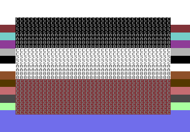](frames/0707.png) | [PNG](https://raw.githubusercontent.com/libsidplayfp/vice-testprogs/e7aa2aab2e5ac4208fcd53acd4bb237902149e4f/VICII/banking/references/banking.prg.png) |
| 708 | `VICII/border/border-250.prg` | fail | pass | pass | 0/104,064 | [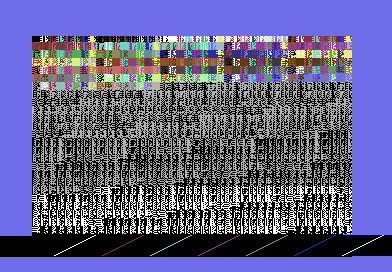](frames/0708.png) | [PNG](https://raw.githubusercontent.com/libsidplayfp/vice-testprogs/e7aa2aab2e5ac4208fcd53acd4bb237902149e4f/VICII/border/references/border-250.prg.png) |
| 709 | `VICII/border/border-251.prg` | pass | pass | pass | 0/104,064 | [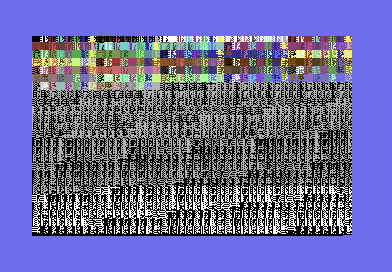](frames/0709.png) | [PNG](https://raw.githubusercontent.com/libsidplayfp/vice-testprogs/e7aa2aab2e5ac4208fcd53acd4bb237902149e4f/VICII/border/references/border-251.prg.png) |
| 710 | `VICII/border/border-252.prg` | pass | pass | pass | 0/104,064 |  | [PNG](https://raw.githubusercontent.com/libsidplayfp/vice-testprogs/e7aa2aab2e5ac4208fcd53acd4bb237902149e4f/VICII/border/references/border-252.prg.png) |
| 711 | `VICII/border/border-bm-idle.prg` | fail | pass | pass | 0/104,064 | [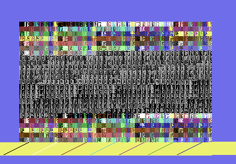](frames/0711.png) | [PNG](https://raw.githubusercontent.com/libsidplayfp/vice-testprogs/e7aa2aab2e5ac4208fcd53acd4bb237902149e4f/VICII/border/references/border-bm-idle.prg.png) |
| 712 | `VICII/border/border-bm-ysh2.prg` | fail | pass | pass | 0/104,064 | [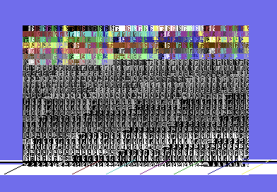](frames/0712.png) | [PNG](https://raw.githubusercontent.com/libsidplayfp/vice-testprogs/e7aa2aab2e5ac4208fcd53acd4bb237902149e4f/VICII/border/references/border-bm-ysh2.prg.png) |
| 713 | `VICII/border/border-bm-ysh.prg` | fail | pass | pass | 0/104,064 |  | [PNG](https://raw.githubusercontent.com/libsidplayfp/vice-testprogs/e7aa2aab2e5ac4208fcd53acd4bb237902149e4f/VICII/border/references/border-bm-ysh.prg.png) |
| 714 | `VICII/border/border-mcbm.prg` | fail | pass | pass | 0/104,064 | [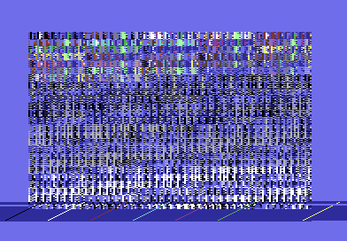](frames/0714.png) | [PNG](https://raw.githubusercontent.com/libsidplayfp/vice-testprogs/e7aa2aab2e5ac4208fcd53acd4bb237902149e4f/VICII/border/references/border-mcbm.prg.png) |
| 715 | `VICII/border/hvborder1.prg` | fail | pass | pass | 0/104,064 | [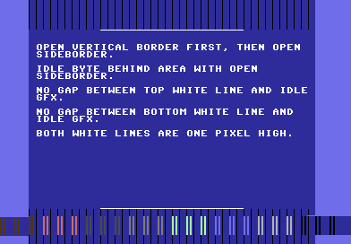](frames/0715.png) | [PNG](https://raw.githubusercontent.com/libsidplayfp/vice-testprogs/e7aa2aab2e5ac4208fcd53acd4bb237902149e4f/VICII/border/references/hvborder1.prg.png) |
| 716 | `VICII/border/hvborder2.prg` | fail | pass | pass | 0/104,064 | [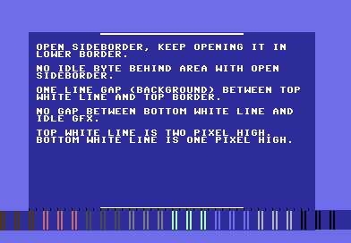](frames/0716.png) | [PNG](https://raw.githubusercontent.com/libsidplayfp/vice-testprogs/e7aa2aab2e5ac4208fcd53acd4bb237902149e4f/VICII/border/references/hvborder2.prg.png) |
| 718 | `VICII/border/vborder-32-08.prg` | pass | pass | pass | 0/104,064 |  | [PNG](https://raw.githubusercontent.com/libsidplayfp/vice-testprogs/e7aa2aab2e5ac4208fcd53acd4bb237902149e4f/VICII/border/references/vborder-32-08.prg.png) |
| 719 | `VICII/border/vborder-32-09.prg` | pass | pass | pass | 0/104,064 |  | [PNG](https://raw.githubusercontent.com/libsidplayfp/vice-testprogs/e7aa2aab2e5ac4208fcd53acd4bb237902149e4f/VICII/border/references/vborder-32-09.prg.png) |
| 720 | `VICII/border/vborder-33-08.prg` | pass | pass | pass | 0/104,064 | [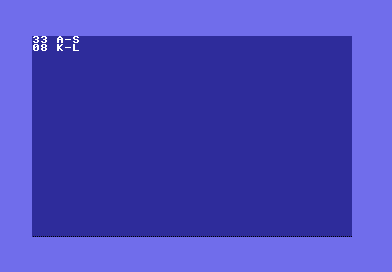](frames/0720.png) | [PNG](https://raw.githubusercontent.com/libsidplayfp/vice-testprogs/e7aa2aab2e5ac4208fcd53acd4bb237902149e4f/VICII/border/references/vborder-33-08.prg.png) |
| 721 | `VICII/border/vborder-33-09.prg` | pass | pass | pass | 0/104,064 | [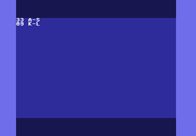](frames/0721.png) | [PNG](https://raw.githubusercontent.com/libsidplayfp/vice-testprogs/e7aa2aab2e5ac4208fcd53acd4bb237902149e4f/VICII/border/references/vborder-33-09.prg.png) |
| 723 | `VICII/border/vborder2-21.prg` | pass | pass | pass | 0/104,064 | [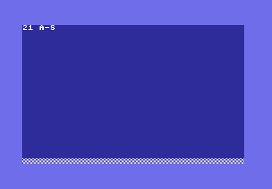](frames/0723.png) | [PNG](https://raw.githubusercontent.com/libsidplayfp/vice-testprogs/e7aa2aab2e5ac4208fcd53acd4bb237902149e4f/VICII/border/references/vborder2-21.prg.png) |
| 724 | `VICII/border/vborder2-22.prg` | fail | pass | pass | 0/104,064 |  | [PNG](https://raw.githubusercontent.com/libsidplayfp/vice-testprogs/e7aa2aab2e5ac4208fcd53acd4bb237902149e4f/VICII/border/references/vborder2-22.prg.png) |
| 725 | `VICII/border/vborder2-35.prg` | fail | pass | pass | 0/104,064 |  | [PNG](https://raw.githubusercontent.com/libsidplayfp/vice-testprogs/e7aa2aab2e5ac4208fcd53acd4bb237902149e4f/VICII/border/references/vborder2-35.prg.png) |
| 726 | `VICII/border/vborder2-36.prg` | fail | pass | pass | 0/104,064 |  | [PNG](https://raw.githubusercontent.com/libsidplayfp/vice-testprogs/e7aa2aab2e5ac4208fcd53acd4bb237902149e4f/VICII/border/references/vborder2-36.prg.png) |
| 727 | `VICII/border/vborder2-63.prg` | pass | pass | pass | 0/104,064 |  | [PNG](https://raw.githubusercontent.com/libsidplayfp/vice-testprogs/e7aa2aab2e5ac4208fcd53acd4bb237902149e4f/VICII/border/references/vborder2-63.prg.png) |
| 728 | `VICII/border/vborder2-64.prg` | pass | pass | pass | 0/104,064 | [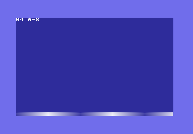](frames/0728.png) | [PNG](https://raw.githubusercontent.com/libsidplayfp/vice-testprogs/e7aa2aab2e5ac4208fcd53acd4bb237902149e4f/VICII/border/references/vborder2-64.prg.png) |
| 733 | `VICII/colorfetchbug/bitmap.prg` | fail | pass | pass | 0/104,064 | [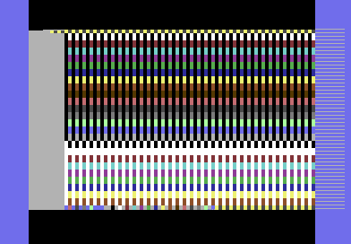](frames/0733.png) | [PNG](https://raw.githubusercontent.com/libsidplayfp/vice-testprogs/e7aa2aab2e5ac4208fcd53acd4bb237902149e4f/VICII/colorfetchbug/references/bitmap.prg.png) |
| 734 | `VICII/colorfetchbug/main.prg` | fail | pass | pass | 0/104,064 | [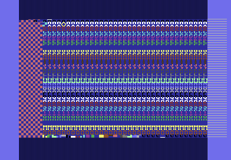](frames/0734.png) | [PNG](https://raw.githubusercontent.com/libsidplayfp/vice-testprogs/e7aa2aab2e5ac4208fcd53acd4bb237902149e4f/VICII/colorfetchbug/references/main.prg.png) |
| 735 | `VICII/colorfetchbug/main2.prg` | fail | pass | pass | 0/104,064 | [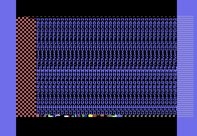](frames/0735.png) | [PNG](https://raw.githubusercontent.com/libsidplayfp/vice-testprogs/e7aa2aab2e5ac4208fcd53acd4bb237902149e4f/VICII/colorfetchbug/references/main2.prg.png) |
| 736 | `VICII/colorfetchbug/main3.prg` | fail | pass | pass | 0/104,064 | [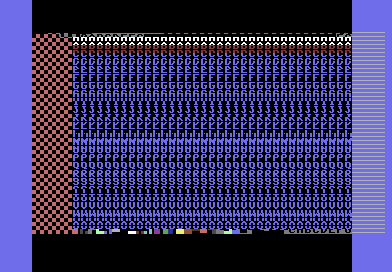](frames/0736.png) | [PNG](https://raw.githubusercontent.com/libsidplayfp/vice-testprogs/e7aa2aab2e5ac4208fcd53acd4bb237902149e4f/VICII/colorfetchbug/references/main3.prg.png) |
| 737 | `VICII/colorfetchbug/main4.prg` | fail | pass | pass | 0/104,064 | [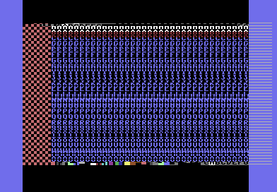](frames/0737.png) | [PNG](https://raw.githubusercontent.com/libsidplayfp/vice-testprogs/e7aa2aab2e5ac4208fcd53acd4bb237902149e4f/VICII/colorfetchbug/references/main4.prg.png) |
| 739 | `VICII/colorsplit/colorsplit.prg` | pass | pass | pass | 0/104,064 | [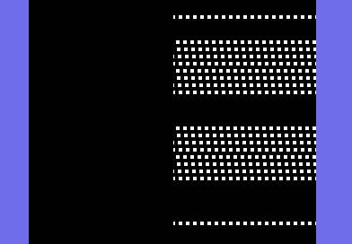](frames/0739.png) | [PNG](https://raw.githubusercontent.com/libsidplayfp/vice-testprogs/e7aa2aab2e5ac4208fcd53acd4bb237902149e4f/VICII/colorsplit/references/colorsplit.prg.png) |
| 753 | `VICII/D011Test/disable-bad.prg` | fail | pass | pass | 0/104,064 | [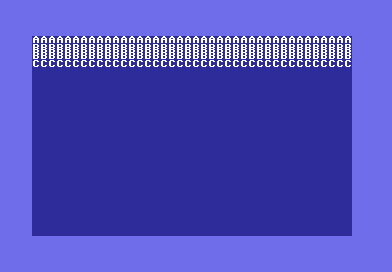](frames/0753.png) | [PNG](https://raw.githubusercontent.com/libsidplayfp/vice-testprogs/e7aa2aab2e5ac4208fcd53acd4bb237902149e4f/VICII/D011Test/references/disable-bad.prg.png) |
| 754 | `VICII/D011Test/disable-bad_ntsc.prg` | fail | pass | pass | 0/89,856 | [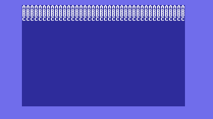](frames/0754.png) | [PNG](https://raw.githubusercontent.com/libsidplayfp/vice-testprogs/e7aa2aab2e5ac4208fcd53acd4bb237902149e4f/VICII/D011Test/references/disable-bad_ntsc.prg.png) |
| 755 | `VICII/D011Test/disable-bad_ntscold.prg` | missing_reference | missing_reference | missing_reference | — | — | — |
| 756 | `VICII/dentest/den01-48-0.prg` | pass | pass | pass | 0/104,064 |  | [PNG](https://raw.githubusercontent.com/libsidplayfp/vice-testprogs/e7aa2aab2e5ac4208fcd53acd4bb237902149e4f/VICII/dentest/references/den01-48-0.prg.png) |
| 757 | `VICII/dentest/den01-48-1.prg` | pass | pass | pass | 0/104,064 |  | [PNG](https://raw.githubusercontent.com/libsidplayfp/vice-testprogs/e7aa2aab2e5ac4208fcd53acd4bb237902149e4f/VICII/dentest/references/den01-48-1.prg.png) |
| 758 | `VICII/dentest/den01-48-2.prg` | pass | pass | pass | 0/104,064 |  | [PNG](https://raw.githubusercontent.com/libsidplayfp/vice-testprogs/e7aa2aab2e5ac4208fcd53acd4bb237902149e4f/VICII/dentest/references/den01-48-2.prg.png) |
| 759 | `VICII/dentest/den01-49-0.prg` | pass | pass | pass | 0/104,064 |  | [PNG](https://raw.githubusercontent.com/libsidplayfp/vice-testprogs/e7aa2aab2e5ac4208fcd53acd4bb237902149e4f/VICII/dentest/references/den01-49-0.prg.png) |
| 760 | `VICII/dentest/den01-49-1.prg` | fail | pass | pass | 0/104,064 |  | [PNG](https://raw.githubusercontent.com/libsidplayfp/vice-testprogs/e7aa2aab2e5ac4208fcd53acd4bb237902149e4f/VICII/dentest/references/den01-49-1.prg.png) |
| 761 | `VICII/dentest/den01-49-2.prg` | pass | pass | pass | 0/104,064 | [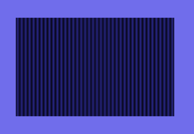](frames/0761.png) | [PNG](https://raw.githubusercontent.com/libsidplayfp/vice-testprogs/e7aa2aab2e5ac4208fcd53acd4bb237902149e4f/VICII/dentest/references/den01-49-2.prg.png) |
| 762 | `VICII/dentest/den10-48-0.prg` | pass | pass | pass | 0/104,064 |  | [PNG](https://raw.githubusercontent.com/libsidplayfp/vice-testprogs/e7aa2aab2e5ac4208fcd53acd4bb237902149e4f/VICII/dentest/references/den10-48-0.prg.png) |
| 763 | `VICII/dentest/den10-48-1.prg` | pass | pass | pass | 0/104,064 |  | [PNG](https://raw.githubusercontent.com/libsidplayfp/vice-testprogs/e7aa2aab2e5ac4208fcd53acd4bb237902149e4f/VICII/dentest/references/den10-48-1.prg.png) |
| 764 | `VICII/dentest/den10-48-2.prg` | pass | pass | pass | 0/104,064 | [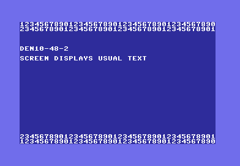](frames/0764.png) | [PNG](https://raw.githubusercontent.com/libsidplayfp/vice-testprogs/e7aa2aab2e5ac4208fcd53acd4bb237902149e4f/VICII/dentest/references/den10-48-2.prg.png) |
| 765 | `VICII/dentest/den10-51-0.prg` | pass | pass | pass | 0/104,064 |  | [PNG](https://raw.githubusercontent.com/libsidplayfp/vice-testprogs/e7aa2aab2e5ac4208fcd53acd4bb237902149e4f/VICII/dentest/references/den10-51-0.prg.png) |
| 766 | `VICII/dentest/den10-51-1.prg` | fail | pass | pass | 0/104,064 |  | [PNG](https://raw.githubusercontent.com/libsidplayfp/vice-testprogs/e7aa2aab2e5ac4208fcd53acd4bb237902149e4f/VICII/dentest/references/den10-51-1.prg.png) |
| 767 | `VICII/dentest/den10-51-2.prg` | pass | pass | pass | 0/104,064 |  | [PNG](https://raw.githubusercontent.com/libsidplayfp/vice-testprogs/e7aa2aab2e5ac4208fcd53acd4bb237902149e4f/VICII/dentest/references/den10-51-2.prg.png) |
| 768 | `VICII/dentest/den10-51-3.prg` | pass | pass | pass | 0/104,064 | [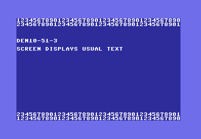](frames/0768.png) | [PNG](https://raw.githubusercontent.com/libsidplayfp/vice-testprogs/e7aa2aab2e5ac4208fcd53acd4bb237902149e4f/VICII/dentest/references/den10-51-3.prg.png) |
| 769 | `VICII/dentest/denrsel-0.prg` | pass | pass | pass | 0/104,064 |  | [PNG](https://raw.githubusercontent.com/libsidplayfp/vice-testprogs/e7aa2aab2e5ac4208fcd53acd4bb237902149e4f/VICII/dentest/references/denrsel-0.prg.png) |
| 770 | `VICII/dentest/denrsel-1.prg` | fail | pass | pass | 0/104,064 | [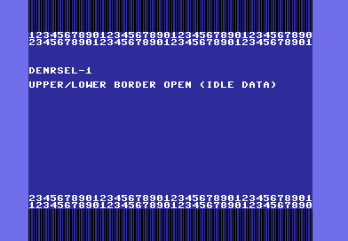](frames/0770.png) | [PNG](https://raw.githubusercontent.com/libsidplayfp/vice-testprogs/e7aa2aab2e5ac4208fcd53acd4bb237902149e4f/VICII/dentest/references/denrsel-1.prg.png) |
| 771 | `VICII/dentest/denrsel-2.prg` | fail | pass | pass | 0/104,064 |  | [PNG](https://raw.githubusercontent.com/libsidplayfp/vice-testprogs/e7aa2aab2e5ac4208fcd53acd4bb237902149e4f/VICII/dentest/references/denrsel-2.prg.png) |
| 772 | `VICII/dentest/denrsel55.prg` | pass | pass | pass | 0/104,064 | [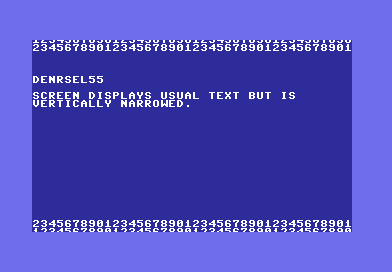](frames/0772.png) | [PNG](https://raw.githubusercontent.com/libsidplayfp/vice-testprogs/e7aa2aab2e5ac4208fcd53acd4bb237902149e4f/VICII/dentest/references/denrsel55.prg.png) |
| 773 | `VICII/dentest/denrsel-63.prg` | pass | pass | pass | 0/104,064 | [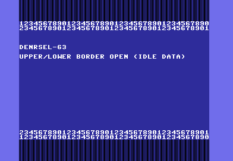](frames/0773.png) | [PNG](https://raw.githubusercontent.com/libsidplayfp/vice-testprogs/e7aa2aab2e5ac4208fcd53acd4bb237902149e4f/VICII/dentest/references/denrsel-63.prg.png) |
| 774 | `VICII/dentest/denrsel-s0.prg` | pass | pass | pass | 0/104,064 |  | [PNG](https://raw.githubusercontent.com/libsidplayfp/vice-testprogs/e7aa2aab2e5ac4208fcd53acd4bb237902149e4f/VICII/dentest/references/denrsel-s0.prg.png) |
| 775 | `VICII/dentest/denrsel-s1.prg` | fail | pass | pass | 0/104,064 |  | [PNG](https://raw.githubusercontent.com/libsidplayfp/vice-testprogs/e7aa2aab2e5ac4208fcd53acd4bb237902149e4f/VICII/dentest/references/denrsel-s1.prg.png) |
| 776 | `VICII/dentest/denrsel-s2.prg` | fail | pass | pass | 0/104,064 | [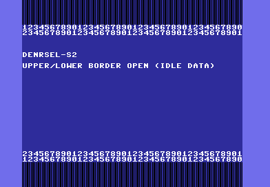](frames/0776.png) | [PNG](https://raw.githubusercontent.com/libsidplayfp/vice-testprogs/e7aa2aab2e5ac4208fcd53acd4bb237902149e4f/VICII/dentest/references/denrsel-s2.prg.png) |
| 777 | `VICII/dentest/den01-48-0_ntsc.prg` | pass | pass | pass | 0/89,856 |  | [PNG](https://raw.githubusercontent.com/libsidplayfp/vice-testprogs/e7aa2aab2e5ac4208fcd53acd4bb237902149e4f/VICII/dentest/references/den01-48-0_ntsc.prg.png) |
| 778 | `VICII/dentest/den01-48-1_ntsc.prg` | pass | pass | pass | 0/89,856 |  | [PNG](https://raw.githubusercontent.com/libsidplayfp/vice-testprogs/e7aa2aab2e5ac4208fcd53acd4bb237902149e4f/VICII/dentest/references/den01-48-1_ntsc.prg.png) |
| 779 | `VICII/dentest/den01-48-2_ntsc.prg` | pass | pass | pass | 0/89,856 |  | [PNG](https://raw.githubusercontent.com/libsidplayfp/vice-testprogs/e7aa2aab2e5ac4208fcd53acd4bb237902149e4f/VICII/dentest/references/den01-48-2_ntsc.prg.png) |
| 780 | `VICII/dentest/den01-49-0_ntsc.prg` | pass | pass | pass | 0/89,856 | [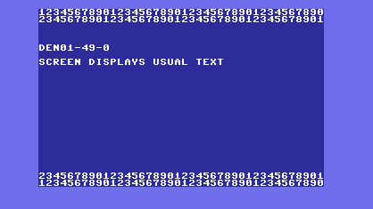](frames/0780.png) | [PNG](https://raw.githubusercontent.com/libsidplayfp/vice-testprogs/e7aa2aab2e5ac4208fcd53acd4bb237902149e4f/VICII/dentest/references/den01-49-0_ntsc.prg.png) |
| 781 | `VICII/dentest/den01-49-1_ntsc.prg` | pass | pass | pass | 0/89,856 |  | [PNG](https://raw.githubusercontent.com/libsidplayfp/vice-testprogs/e7aa2aab2e5ac4208fcd53acd4bb237902149e4f/VICII/dentest/references/den01-49-1_ntsc.prg.png) |
| 782 | `VICII/dentest/den01-49-2_ntsc.prg` | pass | pass | pass | 0/89,856 | [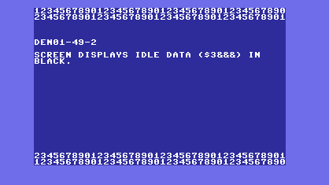](frames/0782.png) | [PNG](https://raw.githubusercontent.com/libsidplayfp/vice-testprogs/e7aa2aab2e5ac4208fcd53acd4bb237902149e4f/VICII/dentest/references/den01-49-2_ntsc.prg.png) |
| 783 | `VICII/dentest/den10-48-0_ntsc.prg` | pass | pass | pass | 0/89,856 |  | [PNG](https://raw.githubusercontent.com/libsidplayfp/vice-testprogs/e7aa2aab2e5ac4208fcd53acd4bb237902149e4f/VICII/dentest/references/den10-48-0_ntsc.prg.png) |
| 784 | `VICII/dentest/den10-48-1_ntsc.prg` | pass | pass | pass | 0/89,856 |  | [PNG](https://raw.githubusercontent.com/libsidplayfp/vice-testprogs/e7aa2aab2e5ac4208fcd53acd4bb237902149e4f/VICII/dentest/references/den10-48-1_ntsc.prg.png) |
| 785 | `VICII/dentest/den10-48-2_ntsc.prg` | pass | pass | pass | 0/89,856 | [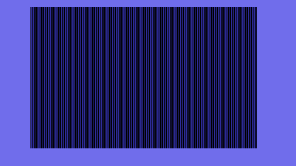](frames/0785.png) | [PNG](https://raw.githubusercontent.com/libsidplayfp/vice-testprogs/e7aa2aab2e5ac4208fcd53acd4bb237902149e4f/VICII/dentest/references/den10-48-2_ntsc.prg.png) |
| 786 | `VICII/dentest/den10-51-0_ntsc.prg` | pass | pass | pass | 0/89,856 |  | [PNG](https://raw.githubusercontent.com/libsidplayfp/vice-testprogs/e7aa2aab2e5ac4208fcd53acd4bb237902149e4f/VICII/dentest/references/den10-51-0_ntsc.prg.png) |
| 787 | `VICII/dentest/den10-51-1_ntsc.prg` | pass | pass | pass | 0/89,856 |  | [PNG](https://raw.githubusercontent.com/libsidplayfp/vice-testprogs/e7aa2aab2e5ac4208fcd53acd4bb237902149e4f/VICII/dentest/references/den10-51-1_ntsc.prg.png) |
| 788 | `VICII/dentest/den10-51-2_ntsc.prg` | pass | pass | pass | 0/89,856 |  | [PNG](https://raw.githubusercontent.com/libsidplayfp/vice-testprogs/e7aa2aab2e5ac4208fcd53acd4bb237902149e4f/VICII/dentest/references/den10-51-2_ntsc.prg.png) |
| 789 | `VICII/dentest/den10-51-3_ntsc.prg` | pass | pass | pass | 0/89,856 | [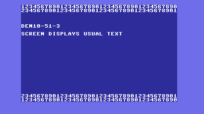](frames/0789.png) | [PNG](https://raw.githubusercontent.com/libsidplayfp/vice-testprogs/e7aa2aab2e5ac4208fcd53acd4bb237902149e4f/VICII/dentest/references/den10-51-3_ntsc.prg.png) |
| 790 | `VICII/dentest/denrsel-0_ntsc.prg` | pass | pass | pass | 0/89,856 |  | [PNG](https://raw.githubusercontent.com/libsidplayfp/vice-testprogs/e7aa2aab2e5ac4208fcd53acd4bb237902149e4f/VICII/dentest/references/denrsel-0_ntsc.prg.png) |
| 791 | `VICII/dentest/denrsel-1_ntsc.prg` | pass | pass | pass | 0/89,856 |  | [PNG](https://raw.githubusercontent.com/libsidplayfp/vice-testprogs/e7aa2aab2e5ac4208fcd53acd4bb237902149e4f/VICII/dentest/references/denrsel-1_ntsc.prg.png) |
| 792 | `VICII/dentest/denrsel-2_ntsc.prg` | pass | pass | pass | 0/89,856 |  | [PNG](https://raw.githubusercontent.com/libsidplayfp/vice-testprogs/e7aa2aab2e5ac4208fcd53acd4bb237902149e4f/VICII/dentest/references/denrsel-2_ntsc.prg.png) |
| 793 | `VICII/dentest/denrsel-63_ntsc.prg` | pass | pass | pass | 0/89,856 | [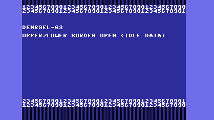](frames/0793.png) | [PNG](https://raw.githubusercontent.com/libsidplayfp/vice-testprogs/e7aa2aab2e5ac4208fcd53acd4bb237902149e4f/VICII/dentest/references/denrsel-63_ntsc.prg.png) |
| 794 | `VICII/dentest/denrsel-s0_ntsc.prg` | pass | pass | pass | 0/89,856 |  | [PNG](https://raw.githubusercontent.com/libsidplayfp/vice-testprogs/e7aa2aab2e5ac4208fcd53acd4bb237902149e4f/VICII/dentest/references/denrsel-s0_ntsc.prg.png) |
| 795 | `VICII/dentest/denrsel-s1_ntsc.prg` | pass | pass | pass | 0/89,856 |  | [PNG](https://raw.githubusercontent.com/libsidplayfp/vice-testprogs/e7aa2aab2e5ac4208fcd53acd4bb237902149e4f/VICII/dentest/references/denrsel-s1_ntsc.prg.png) |
| 796 | `VICII/dentest/denrsel-s2_ntsc.prg` | pass | pass | pass | 0/89,856 |  | [PNG](https://raw.githubusercontent.com/libsidplayfp/vice-testprogs/e7aa2aab2e5ac4208fcd53acd4bb237902149e4f/VICII/dentest/references/denrsel-s2_ntsc.prg.png) |
| 797 | `VICII/dentest/denrsel55_ntsc.prg` | pass | pass | pass | 0/89,856 | [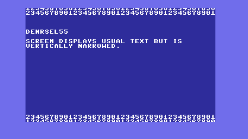](frames/0797.png) | [PNG](https://raw.githubusercontent.com/libsidplayfp/vice-testprogs/e7aa2aab2e5ac4208fcd53acd4bb237902149e4f/VICII/dentest/references/denrsel55_ntsc.prg.png) |
| 798 | `VICII/dentest/den01-48-0_ntscold.prg` | missing_reference | missing_reference | missing_reference | — | — | — |
| 799 | `VICII/dentest/den01-48-1_ntscold.prg` | missing_reference | missing_reference | missing_reference | — | — | — |
| 800 | `VICII/dentest/den01-48-2_ntscold.prg` | missing_reference | missing_reference | missing_reference | — | — | — |
| 801 | `VICII/dentest/den01-49-0_ntscold.prg` | missing_reference | missing_reference | missing_reference | — | — | — |
| 802 | `VICII/dentest/den01-49-1_ntscold.prg` | missing_reference | missing_reference | missing_reference | — | — | — |
| 803 | `VICII/dentest/den01-49-2_ntscold.prg` | missing_reference | missing_reference | missing_reference | — | — | — |
| 804 | `VICII/dentest/den10-48-0_ntscold.prg` | missing_reference | missing_reference | missing_reference | — | — | — |
| 805 | `VICII/dentest/den10-48-1_ntscold.prg` | missing_reference | missing_reference | missing_reference | — | — | — |
| 806 | `VICII/dentest/den10-48-2_ntscold.prg` | missing_reference | missing_reference | missing_reference | — | — | — |
| 807 | `VICII/dentest/den10-51-0_ntscold.prg` | missing_reference | missing_reference | missing_reference | — | — | — |
| 808 | `VICII/dentest/den10-51-1_ntscold.prg` | missing_reference | missing_reference | missing_reference | — | — | — |
| 809 | `VICII/dentest/den10-51-2_ntscold.prg` | missing_reference | missing_reference | missing_reference | — | — | — |
| 810 | `VICII/dentest/den10-51-3_ntscold.prg` | missing_reference | missing_reference | missing_reference | — | — | — |
| 811 | `VICII/dentest/denrsel-0_ntscold.prg` | missing_reference | missing_reference | missing_reference | — | — | — |
| 812 | `VICII/dentest/denrsel-1_ntscold.prg` | missing_reference | missing_reference | missing_reference | — | — | — |
| 813 | `VICII/dentest/denrsel-2_ntscold.prg` | missing_reference | missing_reference | missing_reference | — | — | — |
| 814 | `VICII/dentest/denrsel-63_ntscold.prg` | missing_reference | missing_reference | missing_reference | — | — | — |
| 815 | `VICII/dentest/denrsel-s0_ntscold.prg` | missing_reference | missing_reference | missing_reference | — | — | — |
| 816 | `VICII/dentest/denrsel-s1_ntscold.prg` | missing_reference | missing_reference | missing_reference | — | — | — |
| 817 | `VICII/dentest/denrsel-s2_ntscold.prg` | missing_reference | missing_reference | missing_reference | — | — | — |
| 818 | `VICII/dentest/denrsel55_ntscold.prg` | missing_reference | missing_reference | missing_reference | — | — | — |
| 820 | `VICII/dmadelay/test1-2a-03.prg` | pass | pass | pass | 0/104,064 |  | [PNG](https://raw.githubusercontent.com/libsidplayfp/vice-testprogs/e7aa2aab2e5ac4208fcd53acd4bb237902149e4f/VICII/dmadelay/references/test1-2a-03.prg.png) |
| 821 | `VICII/dmadelay/test1-2a-04.prg` | pass | pass | pass | 0/104,064 | [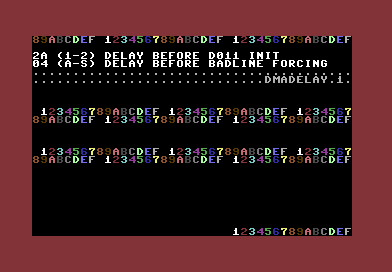](frames/0821.png) | [PNG](https://raw.githubusercontent.com/libsidplayfp/vice-testprogs/e7aa2aab2e5ac4208fcd53acd4bb237902149e4f/VICII/dmadelay/references/test1-2a-04.prg.png) |
| 822 | `VICII/dmadelay/test1-2a-10.prg` | pass | pass | pass | 0/104,064 |  | [PNG](https://raw.githubusercontent.com/libsidplayfp/vice-testprogs/e7aa2aab2e5ac4208fcd53acd4bb237902149e4f/VICII/dmadelay/references/test1-2a-10.prg.png) |
| 823 | `VICII/dmadelay/test1-2a-11.prg` | pass | pass | pass | 0/104,064 |  | [PNG](https://raw.githubusercontent.com/libsidplayfp/vice-testprogs/e7aa2aab2e5ac4208fcd53acd4bb237902149e4f/VICII/dmadelay/references/test1-2a-11.prg.png) |
| 824 | `VICII/dmadelay/test1-2a-16.prg` | pass | pass | pass | 0/104,064 |  | [PNG](https://raw.githubusercontent.com/libsidplayfp/vice-testprogs/e7aa2aab2e5ac4208fcd53acd4bb237902149e4f/VICII/dmadelay/references/test1-2a-16.prg.png) |
| 825 | `VICII/dmadelay/test1-2a-17.prg` | pass | pass | pass | 0/104,064 |  | [PNG](https://raw.githubusercontent.com/libsidplayfp/vice-testprogs/e7aa2aab2e5ac4208fcd53acd4bb237902149e4f/VICII/dmadelay/references/test1-2a-17.prg.png) |
| 826 | `VICII/dmadelay/test1-2a-18.prg` | pass | pass | pass | 0/104,064 |  | [PNG](https://raw.githubusercontent.com/libsidplayfp/vice-testprogs/e7aa2aab2e5ac4208fcd53acd4bb237902149e4f/VICII/dmadelay/references/test1-2a-18.prg.png) |
| 828 | `VICII/dmadelay/test2-28-05.prg` | pass | pass | pass | 0/104,064 | [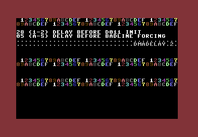](frames/0828.png) | [PNG](https://raw.githubusercontent.com/libsidplayfp/vice-testprogs/e7aa2aab2e5ac4208fcd53acd4bb237902149e4f/VICII/dmadelay/references/test2-28-05.prg.png) |
| 829 | `VICII/dmadelay/test2-28-06.prg` | pass | pass | pass | 0/104,064 |  | [PNG](https://raw.githubusercontent.com/libsidplayfp/vice-testprogs/e7aa2aab2e5ac4208fcd53acd4bb237902149e4f/VICII/dmadelay/references/test2-28-06.prg.png) |
| 830 | `VICII/dmadelay/test2-28-11.prg` | pass | pass | pass | 0/104,064 |  | [PNG](https://raw.githubusercontent.com/libsidplayfp/vice-testprogs/e7aa2aab2e5ac4208fcd53acd4bb237902149e4f/VICII/dmadelay/references/test2-28-11.prg.png) |
| 831 | `VICII/dmadelay/test2-28-12.prg` | pass | pass | pass | 0/104,064 | [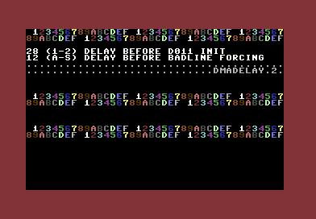](frames/0831.png) | [PNG](https://raw.githubusercontent.com/libsidplayfp/vice-testprogs/e7aa2aab2e5ac4208fcd53acd4bb237902149e4f/VICII/dmadelay/references/test2-28-12.prg.png) |
| 832 | `VICII/dmadelay/test2-28-16.prg` | pass | pass | pass | 0/104,064 |  | [PNG](https://raw.githubusercontent.com/libsidplayfp/vice-testprogs/e7aa2aab2e5ac4208fcd53acd4bb237902149e4f/VICII/dmadelay/references/test2-28-16.prg.png) |
| 833 | `VICII/dmadelay/test2-28-17.prg` | pass | pass | pass | 0/104,064 |  | [PNG](https://raw.githubusercontent.com/libsidplayfp/vice-testprogs/e7aa2aab2e5ac4208fcd53acd4bb237902149e4f/VICII/dmadelay/references/test2-28-17.prg.png) |
| 834 | `VICII/dmadelay/test2-28-18.prg` | pass | pass | pass | 0/104,064 | [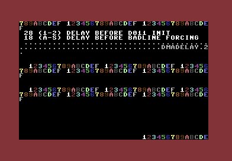](frames/0834.png) | [PNG](https://raw.githubusercontent.com/libsidplayfp/vice-testprogs/e7aa2aab2e5ac4208fcd53acd4bb237902149e4f/VICII/dmadelay/references/test2-28-18.prg.png) |
| 836 | `VICII/dmadelay/test3-28-07.prg` | pass | pass | pass | 0/104,064 | [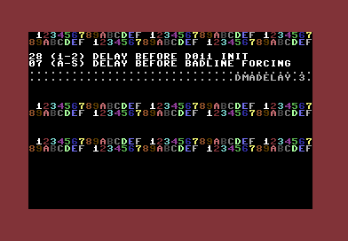](frames/0836.png) | [PNG](https://raw.githubusercontent.com/libsidplayfp/vice-testprogs/e7aa2aab2e5ac4208fcd53acd4bb237902149e4f/VICII/dmadelay/references/test3-28-07.prg.png) |
| 837 | `VICII/dmadelay/test3-28-08.prg` | pass | pass | pass | 0/104,064 |  | [PNG](https://raw.githubusercontent.com/libsidplayfp/vice-testprogs/e7aa2aab2e5ac4208fcd53acd4bb237902149e4f/VICII/dmadelay/references/test3-28-08.prg.png) |
| 838 | `VICII/dmadelay/test3-28-13.prg` | pass | pass | pass | 0/104,064 |  | [PNG](https://raw.githubusercontent.com/libsidplayfp/vice-testprogs/e7aa2aab2e5ac4208fcd53acd4bb237902149e4f/VICII/dmadelay/references/test3-28-13.prg.png) |
| 839 | `VICII/dmadelay/test3-28-14.prg` | pass | pass | pass | 0/104,064 |  | [PNG](https://raw.githubusercontent.com/libsidplayfp/vice-testprogs/e7aa2aab2e5ac4208fcd53acd4bb237902149e4f/VICII/dmadelay/references/test3-28-14.prg.png) |
| 840 | `VICII/dmadelay/test3-28-18.prg` | pass | pass | pass | 0/104,064 |  | [PNG](https://raw.githubusercontent.com/libsidplayfp/vice-testprogs/e7aa2aab2e5ac4208fcd53acd4bb237902149e4f/VICII/dmadelay/references/test3-28-18.prg.png) |
| 841 | `VICII/dmadelay/test3-28-19.prg` | pass | pass | pass | 0/104,064 |  | [PNG](https://raw.githubusercontent.com/libsidplayfp/vice-testprogs/e7aa2aab2e5ac4208fcd53acd4bb237902149e4f/VICII/dmadelay/references/test3-28-19.prg.png) |
| 842 | `VICII/dmadelay/test3-28-1a.prg` | pass | pass | pass | 0/104,064 |  | [PNG](https://raw.githubusercontent.com/libsidplayfp/vice-testprogs/e7aa2aab2e5ac4208fcd53acd4bb237902149e4f/VICII/dmadelay/references/test3-28-1a.prg.png) |
| 844 | `VICII/dmadelay/test1-2e-03-ntsc.prg` | pass | pass | pass | 0/89,856 |  | [PNG](https://raw.githubusercontent.com/libsidplayfp/vice-testprogs/e7aa2aab2e5ac4208fcd53acd4bb237902149e4f/VICII/dmadelay/references/test1-2e-03-ntsc.prg.png) |
| 845 | `VICII/dmadelay/test1-2e-04-ntsc.prg` | pass | pass | pass | 0/89,856 |  | [PNG](https://raw.githubusercontent.com/libsidplayfp/vice-testprogs/e7aa2aab2e5ac4208fcd53acd4bb237902149e4f/VICII/dmadelay/references/test1-2e-04-ntsc.prg.png) |
| 846 | `VICII/dmadelay/test1-2e-10-ntsc.prg` | pass | pass | pass | 0/89,856 |  | [PNG](https://raw.githubusercontent.com/libsidplayfp/vice-testprogs/e7aa2aab2e5ac4208fcd53acd4bb237902149e4f/VICII/dmadelay/references/test1-2e-10-ntsc.prg.png) |
| 847 | `VICII/dmadelay/test1-2e-11-ntsc.prg` | pass | pass | pass | 0/89,856 | [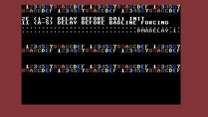](frames/0847.png) | [PNG](https://raw.githubusercontent.com/libsidplayfp/vice-testprogs/e7aa2aab2e5ac4208fcd53acd4bb237902149e4f/VICII/dmadelay/references/test1-2e-11-ntsc.prg.png) |
| 848 | `VICII/dmadelay/test1-2e-16-ntsc.prg` | pass | pass | pass | 0/89,856 |  | [PNG](https://raw.githubusercontent.com/libsidplayfp/vice-testprogs/e7aa2aab2e5ac4208fcd53acd4bb237902149e4f/VICII/dmadelay/references/test1-2e-16-ntsc.prg.png) |
| 849 | `VICII/dmadelay/test1-2e-17-ntsc.prg` | pass | pass | pass | 0/89,856 |  | [PNG](https://raw.githubusercontent.com/libsidplayfp/vice-testprogs/e7aa2aab2e5ac4208fcd53acd4bb237902149e4f/VICII/dmadelay/references/test1-2e-17-ntsc.prg.png) |
| 850 | `VICII/dmadelay/test1-2e-18-ntsc.prg` | pass | pass | pass | 0/89,856 | [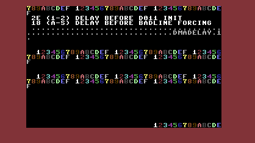](frames/0850.png) | [PNG](https://raw.githubusercontent.com/libsidplayfp/vice-testprogs/e7aa2aab2e5ac4208fcd53acd4bb237902149e4f/VICII/dmadelay/references/test1-2e-18-ntsc.prg.png) |
| 852 | `VICII/dmadelay/test2-2c-05-ntsc.prg` | pass | pass | pass | 0/89,856 |  | [PNG](https://raw.githubusercontent.com/libsidplayfp/vice-testprogs/e7aa2aab2e5ac4208fcd53acd4bb237902149e4f/VICII/dmadelay/references/test2-2c-05-ntsc.prg.png) |
| 853 | `VICII/dmadelay/test2-2c-06-ntsc.prg` | pass | pass | pass | 0/89,856 |  | [PNG](https://raw.githubusercontent.com/libsidplayfp/vice-testprogs/e7aa2aab2e5ac4208fcd53acd4bb237902149e4f/VICII/dmadelay/references/test2-2c-06-ntsc.prg.png) |
| 854 | `VICII/dmadelay/test2-2c-11-ntsc.prg` | pass | pass | pass | 0/89,856 |  | [PNG](https://raw.githubusercontent.com/libsidplayfp/vice-testprogs/e7aa2aab2e5ac4208fcd53acd4bb237902149e4f/VICII/dmadelay/references/test2-2c-11-ntsc.prg.png) |
| 855 | `VICII/dmadelay/test2-2c-12-ntsc.prg` | pass | pass | pass | 0/89,856 |  | [PNG](https://raw.githubusercontent.com/libsidplayfp/vice-testprogs/e7aa2aab2e5ac4208fcd53acd4bb237902149e4f/VICII/dmadelay/references/test2-2c-12-ntsc.prg.png) |
| 856 | `VICII/dmadelay/test2-2c-16-ntsc.prg` | pass | pass | pass | 0/89,856 |  | [PNG](https://raw.githubusercontent.com/libsidplayfp/vice-testprogs/e7aa2aab2e5ac4208fcd53acd4bb237902149e4f/VICII/dmadelay/references/test2-2c-16-ntsc.prg.png) |
| 857 | `VICII/dmadelay/test2-2c-17-ntsc.prg` | pass | pass | pass | 0/89,856 |  | [PNG](https://raw.githubusercontent.com/libsidplayfp/vice-testprogs/e7aa2aab2e5ac4208fcd53acd4bb237902149e4f/VICII/dmadelay/references/test2-2c-17-ntsc.prg.png) |
| 858 | `VICII/dmadelay/test2-2c-18-ntsc.prg` | pass | pass | pass | 0/89,856 |  | [PNG](https://raw.githubusercontent.com/libsidplayfp/vice-testprogs/e7aa2aab2e5ac4208fcd53acd4bb237902149e4f/VICII/dmadelay/references/test2-2c-18-ntsc.prg.png) |
| 860 | `VICII/dmadelay/test3-2c-07-ntsc.prg` | pass | pass | pass | 0/89,856 | [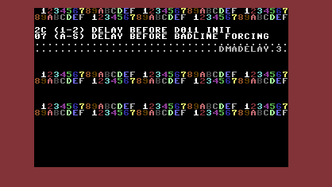](frames/0860.png) | [PNG](https://raw.githubusercontent.com/libsidplayfp/vice-testprogs/e7aa2aab2e5ac4208fcd53acd4bb237902149e4f/VICII/dmadelay/references/test3-2c-07-ntsc.prg.png) |
| 861 | `VICII/dmadelay/test3-2c-08-ntsc.prg` | pass | pass | pass | 0/89,856 |  | [PNG](https://raw.githubusercontent.com/libsidplayfp/vice-testprogs/e7aa2aab2e5ac4208fcd53acd4bb237902149e4f/VICII/dmadelay/references/test3-2c-08-ntsc.prg.png) |
| 862 | `VICII/dmadelay/test3-2c-13-ntsc.prg` | pass | pass | pass | 0/89,856 |  | [PNG](https://raw.githubusercontent.com/libsidplayfp/vice-testprogs/e7aa2aab2e5ac4208fcd53acd4bb237902149e4f/VICII/dmadelay/references/test3-2c-13-ntsc.prg.png) |
| 863 | `VICII/dmadelay/test3-2c-14-ntsc.prg` | pass | pass | pass | 0/89,856 | [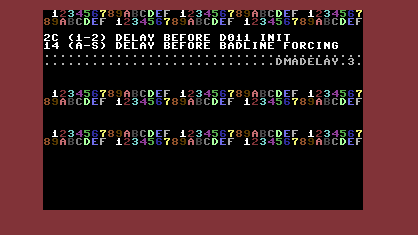](frames/0863.png) | [PNG](https://raw.githubusercontent.com/libsidplayfp/vice-testprogs/e7aa2aab2e5ac4208fcd53acd4bb237902149e4f/VICII/dmadelay/references/test3-2c-14-ntsc.prg.png) |
| 864 | `VICII/dmadelay/test3-2c-18-ntsc.prg` | pass | pass | pass | 0/89,856 |  | [PNG](https://raw.githubusercontent.com/libsidplayfp/vice-testprogs/e7aa2aab2e5ac4208fcd53acd4bb237902149e4f/VICII/dmadelay/references/test3-2c-18-ntsc.prg.png) |
| 865 | `VICII/dmadelay/test3-2c-19-ntsc.prg` | pass | pass | pass | 0/89,856 | [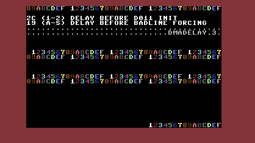](frames/0865.png) | [PNG](https://raw.githubusercontent.com/libsidplayfp/vice-testprogs/e7aa2aab2e5ac4208fcd53acd4bb237902149e4f/VICII/dmadelay/references/test3-2c-19-ntsc.prg.png) |
| 866 | `VICII/dmadelay/test3-2c-1a-ntsc.prg` | pass | pass | pass | 0/89,856 |  | [PNG](https://raw.githubusercontent.com/libsidplayfp/vice-testprogs/e7aa2aab2e5ac4208fcd53acd4bb237902149e4f/VICII/dmadelay/references/test3-2c-1a-ntsc.prg.png) |
| 869 | `VICII/fldscroll/fldscroll-20-60.prg` | fail | pass | pass | 0/104,064 | [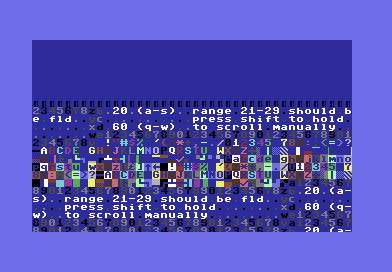](frames/0869.png) | [PNG](https://raw.githubusercontent.com/libsidplayfp/vice-testprogs/e7aa2aab2e5ac4208fcd53acd4bb237902149e4f/VICII/fldscroll/references/fldscroll-20-60.prg.png) |
| 870 | `VICII/fldscroll/fldscroll-21-60.prg` | pass | pass | pass | 0/104,064 |  | [PNG](https://raw.githubusercontent.com/libsidplayfp/vice-testprogs/e7aa2aab2e5ac4208fcd53acd4bb237902149e4f/VICII/fldscroll/references/fldscroll-21-60.prg.png) |
| 871 | `VICII/fldscroll/fldscroll-22-60.prg` | pass | pass | pass | 0/104,064 | [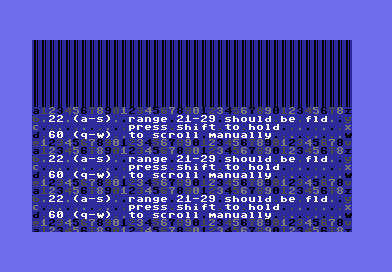](frames/0871.png) | [PNG](https://raw.githubusercontent.com/libsidplayfp/vice-testprogs/e7aa2aab2e5ac4208fcd53acd4bb237902149e4f/VICII/fldscroll/references/fldscroll-22-60.prg.png) |
| 872 | `VICII/fldscroll/fldscroll-29-60.prg` | fail | pass | pass | 0/104,064 |  | [PNG](https://raw.githubusercontent.com/libsidplayfp/vice-testprogs/e7aa2aab2e5ac4208fcd53acd4bb237902149e4f/VICII/fldscroll/references/fldscroll-29-60.prg.png) |
| 873 | `VICII/fldscroll/fldscroll-2A-60.prg` | fail | pass | pass | 0/104,064 | [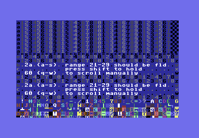](frames/0873.png) | [PNG](https://raw.githubusercontent.com/libsidplayfp/vice-testprogs/e7aa2aab2e5ac4208fcd53acd4bb237902149e4f/VICII/fldscroll/references/fldscroll-2A-60.prg.png) |
| 874 | `VICII/fldscroll/fldscroll-2B-60.prg` | fail | pass | pass | 0/104,064 | [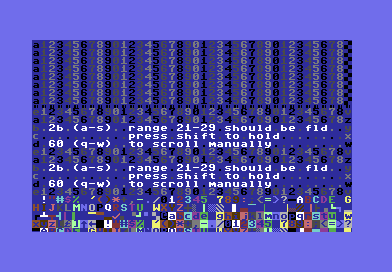](frames/0874.png) | [PNG](https://raw.githubusercontent.com/libsidplayfp/vice-testprogs/e7aa2aab2e5ac4208fcd53acd4bb237902149e4f/VICII/fldscroll/references/fldscroll-2B-60.prg.png) |
| 875 | `VICII/flibug/blackmail-ee.prg` | pass | pass | pass | 0/104,064 | [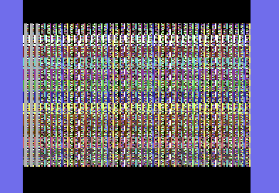](frames/0875.png) | [PNG](https://raw.githubusercontent.com/libsidplayfp/vice-testprogs/e7aa2aab2e5ac4208fcd53acd4bb237902149e4f/VICII/flibug/references/blackmail-ee.prg.png) |
| 876 | `VICII/flibug/blackmail-fixed.prg` | pass | pass | pass | 0/104,064 |  | [PNG](https://raw.githubusercontent.com/libsidplayfp/vice-testprogs/e7aa2aab2e5ac4208fcd53acd4bb237902149e4f/VICII/flibug/references/blackmail-fixed.prg.png) |
| 884 | `VICII/frodotests/text26.prg` | pass | pass | pass | 0/104,064 | [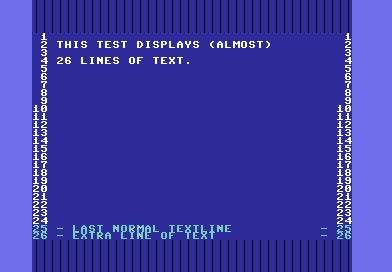](frames/0884.png) | [PNG](https://raw.githubusercontent.com/libsidplayfp/vice-testprogs/e7aa2aab2e5ac4208fcd53acd4bb237902149e4f/VICII/frodotests/references/text26.prg.png) |
| 885 | `VICII/gfxfetch/gfxfetch.prg` | pass | pass | pass | 0/104,064 | [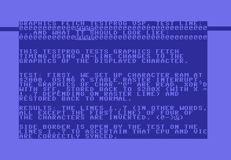](frames/0885.png) | [PNG](https://raw.githubusercontent.com/libsidplayfp/vice-testprogs/e7aa2aab2e5ac4208fcd53acd4bb237902149e4f/VICII/gfxfetch/references/gfxfetch.prg.png) |
| 886 | `VICII/gfxfetch/gfxfetch_ntsc.prg` | pass | pass | pass | 0/89,856 |  | [PNG](https://raw.githubusercontent.com/libsidplayfp/vice-testprogs/e7aa2aab2e5ac4208fcd53acd4bb237902149e4f/VICII/gfxfetch/references/gfxfetch_ntsc.prg.png) |
| 887 | `VICII/gfxfetch/gfxfetch_ntscold.prg` | missing_reference | missing_reference | missing_reference | — | — | — |
| 888 | `VICII/greydot/greydot.prg` | pass | pass | pass | 0/104,064 |  | [PNG](https://raw.githubusercontent.com/libsidplayfp/vice-testprogs/e7aa2aab2e5ac4208fcd53acd4bb237902149e4f/VICII/greydot/references/greydot.prg.png) |
| 891 | `VICII/lp-trigger/test1.prg` | fail | pass | pass | 0/104,064 |  | [PNG](https://raw.githubusercontent.com/libsidplayfp/vice-testprogs/e7aa2aab2e5ac4208fcd53acd4bb237902149e4f/VICII/lp-trigger/references/test1.prg.png) |
| 900 | `VICII/rasterirq/rasterirq_hold.prg` | pass | pass | pass | 0/104,064 |  | [PNG](https://raw.githubusercontent.com/libsidplayfp/vice-testprogs/e7aa2aab2e5ac4208fcd53acd4bb237902149e4f/VICII/rasterirq/references/rasterirq_hold.prg.png) |
| 901 | `VICII/screenpos/screenpos.prg` | pass | pass | pass | 0/104,064 |  | [PNG](https://raw.githubusercontent.com/libsidplayfp/vice-testprogs/e7aa2aab2e5ac4208fcd53acd4bb237902149e4f/VICII/screenpos/references/screenpos.prg.png) |
| 902 | `VICII/sb_sprite_fetch/sbsprf24-163.prg` | fail | pass | pass | 0/104,064 |  | [PNG](https://raw.githubusercontent.com/libsidplayfp/vice-testprogs/e7aa2aab2e5ac4208fcd53acd4bb237902149e4f/VICII/sb_sprite_fetch/references/sbsprf24-163.prg.png) |
| 903 | `VICII/sb_sprite_fetch/sbsprf24-164.prg` | fail | pass | pass | 0/104,064 |  | [PNG](https://raw.githubusercontent.com/libsidplayfp/vice-testprogs/e7aa2aab2e5ac4208fcd53acd4bb237902149e4f/VICII/sb_sprite_fetch/references/sbsprf24-164.prg.png) |
| 904 | `VICII/screenpos/screenpos_ntsc.prg` | pass | pass | pass | 0/89,856 |  | [PNG](https://raw.githubusercontent.com/libsidplayfp/vice-testprogs/e7aa2aab2e5ac4208fcd53acd4bb237902149e4f/VICII/screenpos/references/screenpos_ntsc.prg.png) |
| 905 | `VICII/screenpos/screenpos_ntscold.prg` | missing_reference | missing_reference | missing_reference | — | — | — |
| 907 | `VICII/split-tests/fetchsplit/fetchsplit.prg` | pass | pass | pass | 0/104,064 |  | [PNG](https://raw.githubusercontent.com/libsidplayfp/vice-testprogs/e7aa2aab2e5ac4208fcd53acd4bb237902149e4f/VICII/split-tests/fetchsplit/references/fetchsplit.prg.png) |
| 908 | `VICII/split-tests/fetchsplit/fetchsplit.prg` | website-setup-unavailable | fail | fail | 154/104,064 |  | [PNG](https://raw.githubusercontent.com/libsidplayfp/vice-testprogs/e7aa2aab2e5ac4208fcd53acd4bb237902149e4f/VICII/split-tests/fetchsplit/references/fetchsplit.prg-8565.png) |
| 910 | `VICII/split-tests/modesplit/modesplit.prg` | fail | pass | pass | 0/104,064 |  | [PNG](https://raw.githubusercontent.com/libsidplayfp/vice-testprogs/e7aa2aab2e5ac4208fcd53acd4bb237902149e4f/VICII/split-tests/modesplit/references/modesplit.prg.png) |
| 911 | `VICII/split-tests/modesplit/modesplit.prg` | website-setup-unavailable | fail | fail | 100/104,064 |  | [PNG](https://raw.githubusercontent.com/libsidplayfp/vice-testprogs/e7aa2aab2e5ac4208fcd53acd4bb237902149e4f/VICII/split-tests/modesplit/references/modesplit.prg-8565.png) |
| 912 | `VICII/split-tests/modesplit/modesplit.prg` | fail | fail | fail | 26/89,856 |  | [PNG](https://raw.githubusercontent.com/libsidplayfp/vice-testprogs/e7aa2aab2e5ac4208fcd53acd4bb237902149e4f/VICII/split-tests/modesplit/references/modesplit.prg-ntsc.png) |
| 913 | `VICII/split-tests/modesplit/modesplit.prg` | missing_reference | missing_reference | missing_reference | — | — | — |
| 915 | `VICII/vicii_timing/vicii_reg_timing.prg` | fail | pass | pass | 0/104,064 |  | [PNG](https://raw.githubusercontent.com/libsidplayfp/vice-testprogs/e7aa2aab2e5ac4208fcd53acd4bb237902149e4f/VICII/vicii_timing/references/vicii_reg_timing.prg.png) |
| 916 | `VICII/vicii_timing/vicii_reg_timing-a5.prg` | fail | pass | pass | 0/104,064 |  | [PNG](https://raw.githubusercontent.com/libsidplayfp/vice-testprogs/e7aa2aab2e5ac4208fcd53acd4bb237902149e4f/VICII/vicii_timing/references/vicii_reg_timing-a5.prg.png) |
| 917 | `VICII/vicii_timing/vicii_reg_timing-ff.prg` | fail | pass | pass | 0/104,064 |  | [PNG](https://raw.githubusercontent.com/libsidplayfp/vice-testprogs/e7aa2aab2e5ac4208fcd53acd4bb237902149e4f/VICII/vicii_timing/references/vicii_reg_timing-ff.prg.png) |
| 918 | `VICII/vicii_timing/vicii_reg_timing.prg` | website-setup-unavailable | pass | pass | 0/104,064 |  | [PNG](https://raw.githubusercontent.com/libsidplayfp/vice-testprogs/e7aa2aab2e5ac4208fcd53acd4bb237902149e4f/VICII/vicii_timing/references/vicii_reg_timing.prg-8565.png) |
| 919 | `VICII/vicii_timing/vicii_reg_timing-a5.prg` | website-setup-unavailable | fail | fail | 7/104,064 |  | [PNG](https://raw.githubusercontent.com/libsidplayfp/vice-testprogs/e7aa2aab2e5ac4208fcd53acd4bb237902149e4f/VICII/vicii_timing/references/vicii_reg_timing-a5.prg-8565.png) |
| 920 | `VICII/vicii_timing/vicii_reg_timing-ff.prg` | website-setup-unavailable | fail | fail | 14/104,064 |  | [PNG](https://raw.githubusercontent.com/libsidplayfp/vice-testprogs/e7aa2aab2e5ac4208fcd53acd4bb237902149e4f/VICII/vicii_timing/references/vicii_reg_timing-ff.prg-8565.png) |
| 921 | `VICII/videomode/rmwtest.prg` | pass | pass | pass | 0/104,064 |  | [PNG](https://raw.githubusercontent.com/libsidplayfp/vice-testprogs/e7aa2aab2e5ac4208fcd53acd4bb237902149e4f/VICII/videomode/references/rmwtest.prg.png) |
| 922 | `VICII/videomode/rmwtest.prg` | website-setup-unavailable | pass | pass | 0/104,064 |  | [PNG](https://raw.githubusercontent.com/libsidplayfp/vice-testprogs/e7aa2aab2e5ac4208fcd53acd4bb237902149e4f/VICII/videomode/references/rmwtest.prg-8565.png) |
| 923 | `VICII/videomode/rmwtest_ntsc.prg` | pass | pass | pass | 0/89,856 |  | [PNG](https://raw.githubusercontent.com/libsidplayfp/vice-testprogs/e7aa2aab2e5ac4208fcd53acd4bb237902149e4f/VICII/videomode/references/rmwtest_ntsc.prg.png) |
| 924 | `VICII/videomode/rmwtest_ntsc.prg` | website-setup-unavailable | pass | pass | 0/89,856 |  | [PNG](https://raw.githubusercontent.com/libsidplayfp/vice-testprogs/e7aa2aab2e5ac4208fcd53acd4bb237902149e4f/VICII/videomode/references/rmwtest_ntsc.prg-8562.png) |
| 925 | `VICII/videomode/rmwtest_ntscold.prg` | missing_reference | missing_reference | missing_reference | — | — | — |
| 926 | `VICII/videomode/videomode1.prg` | pass | pass | pass | 0/104,064 |  | [PNG](https://raw.githubusercontent.com/libsidplayfp/vice-testprogs/e7aa2aab2e5ac4208fcd53acd4bb237902149e4f/VICII/videomode/references/videomode1.prg.png) |
| 927 | `VICII/videomode/videomode2.prg` | fail | pass | pass | 0/104,064 |  | [PNG](https://raw.githubusercontent.com/libsidplayfp/vice-testprogs/e7aa2aab2e5ac4208fcd53acd4bb237902149e4f/VICII/videomode/references/videomode2.prg.png) |
| 928 | `VICII/videomode/videomode-v.prg` | fail | fail | fail | 5/104,064 |  | [PNG](https://raw.githubusercontent.com/libsidplayfp/vice-testprogs/e7aa2aab2e5ac4208fcd53acd4bb237902149e4f/VICII/videomode/references/videomode-v.prg.png) |
| 929 | `VICII/videomode/videomode-w.prg` | fail | fail | fail | 83/104,064 |  | [PNG](https://raw.githubusercontent.com/libsidplayfp/vice-testprogs/e7aa2aab2e5ac4208fcd53acd4bb237902149e4f/VICII/videomode/references/videomode-w.prg.png) |
| 930 | `VICII/videomode/videomode-x.prg` | fail | fail | fail | 10/104,064 |  | [PNG](https://raw.githubusercontent.com/libsidplayfp/vice-testprogs/e7aa2aab2e5ac4208fcd53acd4bb237902149e4f/VICII/videomode/references/videomode-x.prg.png) |
| 931 | `VICII/videomode/videomode-y.prg` | fail | fail | fail | 1/104,064 |  | [PNG](https://raw.githubusercontent.com/libsidplayfp/vice-testprogs/e7aa2aab2e5ac4208fcd53acd4bb237902149e4f/VICII/videomode/references/videomode-y.prg.png) |
| 932 | `VICII/videomode/videomode-z.prg` | pass | pass | pass | 0/104,064 |  | [PNG](https://raw.githubusercontent.com/libsidplayfp/vice-testprogs/e7aa2aab2e5ac4208fcd53acd4bb237902149e4f/VICII/videomode/references/videomode-z.prg.png) |
| 933 | `VICII/videomode/videomode1.prg` | website-setup-unavailable | pass | pass | 0/104,064 |  | [PNG](https://raw.githubusercontent.com/libsidplayfp/vice-testprogs/e7aa2aab2e5ac4208fcd53acd4bb237902149e4f/VICII/videomode/references/videomode1.prg-8565.png) |
| 934 | `VICII/videomode/videomode2.prg` | website-setup-unavailable | pass | pass | 0/104,064 |  | [PNG](https://raw.githubusercontent.com/libsidplayfp/vice-testprogs/e7aa2aab2e5ac4208fcd53acd4bb237902149e4f/VICII/videomode/references/videomode2.prg-8565.png) |
| 935 | `VICII/videomode/videomode-v.prg` | website-setup-unavailable | pass | pass | 0/104,064 |  | [PNG](https://raw.githubusercontent.com/libsidplayfp/vice-testprogs/e7aa2aab2e5ac4208fcd53acd4bb237902149e4f/VICII/videomode/references/videomode-v.prg-8565.png) |
| 936 | `VICII/videomode/videomode-w.prg` | website-setup-unavailable | pass | pass | 0/104,064 |  | [PNG](https://raw.githubusercontent.com/libsidplayfp/vice-testprogs/e7aa2aab2e5ac4208fcd53acd4bb237902149e4f/VICII/videomode/references/videomode-w.prg-8565.png) |
| 937 | `VICII/videomode/videomode-x.prg` | website-setup-unavailable | pass | pass | 0/104,064 |  | [PNG](https://raw.githubusercontent.com/libsidplayfp/vice-testprogs/e7aa2aab2e5ac4208fcd53acd4bb237902149e4f/VICII/videomode/references/videomode-x.prg-8565.png) |
| 938 | `VICII/videomode/videomode-y.prg` | website-setup-unavailable | pass | pass | 0/104,064 |  | [PNG](https://raw.githubusercontent.com/libsidplayfp/vice-testprogs/e7aa2aab2e5ac4208fcd53acd4bb237902149e4f/VICII/videomode/references/videomode-y.prg-8565.png) |
| 939 | `VICII/videomode/videomode-z.prg` | website-setup-unavailable | pass | pass | 0/104,064 |  | [PNG](https://raw.githubusercontent.com/libsidplayfp/vice-testprogs/e7aa2aab2e5ac4208fcd53acd4bb237902149e4f/VICII/videomode/references/videomode-z.prg-8565.png) |
| 940 | `VICII/videomode/videomode-v_ntsc.prg` | fail | fail | fail | 122/89,856 |  | [PNG](https://raw.githubusercontent.com/libsidplayfp/vice-testprogs/e7aa2aab2e5ac4208fcd53acd4bb237902149e4f/VICII/videomode/references/videomode-v_ntsc.prg.png) |
| 941 | `VICII/videomode/videomode-w_ntsc.prg` | fail | fail | fail | 79/89,856 |  | [PNG](https://raw.githubusercontent.com/libsidplayfp/vice-testprogs/e7aa2aab2e5ac4208fcd53acd4bb237902149e4f/VICII/videomode/references/videomode-w_ntsc.prg.png) |
| 942 | `VICII/videomode/videomode-x_ntsc.prg` | fail | fail | fail | 44/89,856 |  | [PNG](https://raw.githubusercontent.com/libsidplayfp/vice-testprogs/e7aa2aab2e5ac4208fcd53acd4bb237902149e4f/VICII/videomode/references/videomode-x_ntsc.prg.png) |
| 943 | `VICII/videomode/videomode-y_ntsc.prg` | fail | fail | fail | 912/89,856 |  | [PNG](https://raw.githubusercontent.com/libsidplayfp/vice-testprogs/e7aa2aab2e5ac4208fcd53acd4bb237902149e4f/VICII/videomode/references/videomode-y_ntsc.prg.png) |
| 944 | `VICII/videomode/videomode-z_ntsc.prg` | fail | pass | pass | 0/89,856 |  | [PNG](https://raw.githubusercontent.com/libsidplayfp/vice-testprogs/e7aa2aab2e5ac4208fcd53acd4bb237902149e4f/VICII/videomode/references/videomode-z_ntsc.prg.png) |
| 945 | `VICII/videomode/videomode2_ntsc.prg` | fail | fail | fail | 982/89,856 |  | [PNG](https://raw.githubusercontent.com/libsidplayfp/vice-testprogs/e7aa2aab2e5ac4208fcd53acd4bb237902149e4f/VICII/videomode/references/videomode2_ntsc.prg.png) |
| 946 | `VICII/videomode/videomode1_ntsc.prg` | pass | pass | pass | 0/89,856 |  | [PNG](https://raw.githubusercontent.com/libsidplayfp/vice-testprogs/e7aa2aab2e5ac4208fcd53acd4bb237902149e4f/VICII/videomode/references/videomode1_ntsc.prg.png) |
| 947 | `VICII/videomode/videomode-v_ntsc.prg` | missing_reference | missing_reference | missing_reference | — | — | — |
| 948 | `VICII/videomode/videomode-w_ntsc.prg` | missing_reference | missing_reference | missing_reference | — | — | — |
| 949 | `VICII/videomode/videomode-x_ntsc.prg` | missing_reference | missing_reference | missing_reference | — | — | — |
| 950 | `VICII/videomode/videomode-y_ntsc.prg` | missing_reference | missing_reference | missing_reference | — | — | — |
| 951 | `VICII/videomode/videomode-z_ntsc.prg` | missing_reference | missing_reference | missing_reference | — | — | — |
| 952 | `VICII/videomode/videomode2_ntsc.prg` | missing_reference | missing_reference | missing_reference | — | — | — |
| 953 | `VICII/videomode/videomode1_ntsc.prg` | missing_reference | missing_reference | missing_reference | — | — | — |
| 954 | `VICII/videomode/videomode1_ntscold.prg` | website-setup-unavailable | pass | pass | 0/89,856 |  | [PNG](https://raw.githubusercontent.com/libsidplayfp/vice-testprogs/e7aa2aab2e5ac4208fcd53acd4bb237902149e4f/VICII/videomode/references/videomode1_ntscold.prg.png) |
| 955 | `VICII/videomode/videomode2_ntscold.prg` | website-setup-unavailable | fail | fail | 924/89,856 |  | [PNG](https://raw.githubusercontent.com/libsidplayfp/vice-testprogs/e7aa2aab2e5ac4208fcd53acd4bb237902149e4f/VICII/videomode/references/videomode2_ntscold.prg.png) |
| 956 | `VICII/videomode/videomode-v_ntscold.prg` | website-setup-unavailable | fail | fail | 149/89,856 |  | [PNG](https://raw.githubusercontent.com/libsidplayfp/vice-testprogs/e7aa2aab2e5ac4208fcd53acd4bb237902149e4f/VICII/videomode/references/videomode-v_ntscold.prg.png) |
| 957 | `VICII/videomode/videomode-w_ntscold.prg` | website-setup-unavailable | fail | fail | 83/89,856 |  | [PNG](https://raw.githubusercontent.com/libsidplayfp/vice-testprogs/e7aa2aab2e5ac4208fcd53acd4bb237902149e4f/VICII/videomode/references/videomode-w_ntscold.prg.png) |
| 958 | `VICII/videomode/videomode-x_ntscold.prg` | website-setup-unavailable | fail | fail | 83/89,856 |  | [PNG](https://raw.githubusercontent.com/libsidplayfp/vice-testprogs/e7aa2aab2e5ac4208fcd53acd4bb237902149e4f/VICII/videomode/references/videomode-x_ntscold.prg.png) |
| 959 | `VICII/videomode/videomode-y_ntscold.prg` | website-setup-unavailable | fail | fail | 888/89,856 |  | [PNG](https://raw.githubusercontent.com/libsidplayfp/vice-testprogs/e7aa2aab2e5ac4208fcd53acd4bb237902149e4f/VICII/videomode/references/videomode-y_ntscold.prg.png) |
| 960 | `VICII/videomode/videomode-z_ntscold.prg` | website-setup-unavailable | pass | pass | 0/89,856 |  | [PNG](https://raw.githubusercontent.com/libsidplayfp/vice-testprogs/e7aa2aab2e5ac4208fcd53acd4bb237902149e4f/VICII/videomode/references/videomode-z_ntscold.prg.png) |
| 965 | `VICII/sequencer-bug/bug.prg` | pass | pass | pass | 0/104,064 |  | [PNG](https://raw.githubusercontent.com/libsidplayfp/vice-testprogs/e7aa2aab2e5ac4208fcd53acd4bb237902149e4f/VICII/sequencer-bug/references/bug.prg.png) |
| 968 | `VICII/spritebug/spritebug-104.prg` | pass | pass | pass | 0/104,064 |  | [PNG](https://raw.githubusercontent.com/libsidplayfp/vice-testprogs/e7aa2aab2e5ac4208fcd53acd4bb237902149e4f/VICII/spritebug/references/spritebug-104.prg.png) |
| 969 | `VICII/spritebug/spritebug-105.prg` | pass | pass | pass | 0/104,064 |  | [PNG](https://raw.githubusercontent.com/libsidplayfp/vice-testprogs/e7aa2aab2e5ac4208fcd53acd4bb237902149e4f/VICII/spritebug/references/spritebug-105.prg.png) |
| 970 | `VICII/spritebug/spritebug-106.prg` | pass | pass | pass | 0/104,064 |  | [PNG](https://raw.githubusercontent.com/libsidplayfp/vice-testprogs/e7aa2aab2e5ac4208fcd53acd4bb237902149e4f/VICII/spritebug/references/spritebug-106.prg.png) |
| 984 | `VICII/spritecrunch/spritecrunch-3b-00.prg` | pass | pass | pass | 0/104,064 |  | [PNG](https://raw.githubusercontent.com/libsidplayfp/vice-testprogs/e7aa2aab2e5ac4208fcd53acd4bb237902149e4f/VICII/spritecrunch/references/spritecrunch-3b-00.prg.png) |
| 985 | `VICII/spritecrunch/spritecrunch-3c-00.prg` | pass | pass | pass | 0/104,064 |  | [PNG](https://raw.githubusercontent.com/libsidplayfp/vice-testprogs/e7aa2aab2e5ac4208fcd53acd4bb237902149e4f/VICII/spritecrunch/references/spritecrunch-3c-00.prg.png) |
| 986 | `VICII/spritecrunch/spritecrunch-3d-00.prg` | pass | pass | pass | 0/104,064 |  | [PNG](https://raw.githubusercontent.com/libsidplayfp/vice-testprogs/e7aa2aab2e5ac4208fcd53acd4bb237902149e4f/VICII/spritecrunch/references/spritecrunch-3d-00.prg.png) |
| 988 | `VICII/spritecrunch/spritecrunch2-07.prg` | pass | pass | pass | 0/104,064 |  | [PNG](https://raw.githubusercontent.com/libsidplayfp/vice-testprogs/e7aa2aab2e5ac4208fcd53acd4bb237902149e4f/VICII/spritecrunch/references/spritecrunch2-07.prg.png) |
| 989 | `VICII/spritecrunch/spritecrunch2-08.prg` | pass | pass | pass | 0/104,064 |  | [PNG](https://raw.githubusercontent.com/libsidplayfp/vice-testprogs/e7aa2aab2e5ac4208fcd53acd4bb237902149e4f/VICII/spritecrunch/references/spritecrunch2-08.prg.png) |
| 990 | `VICII/spritecrunch/spritecrunch2-09.prg` | pass | pass | pass | 0/104,064 |  | [PNG](https://raw.githubusercontent.com/libsidplayfp/vice-testprogs/e7aa2aab2e5ac4208fcd53acd4bb237902149e4f/VICII/spritecrunch/references/spritecrunch2-09.prg.png) |
| 991 | `VICII/spritecrunch/spritecrunch2-25.prg` | fail | pass | pass | 0/104,064 |  | [PNG](https://raw.githubusercontent.com/libsidplayfp/vice-testprogs/e7aa2aab2e5ac4208fcd53acd4bb237902149e4f/VICII/spritecrunch/references/spritecrunch2-25.prg.png) |
| 992 | `VICII/spritecrunch/spritecrunch2-26.prg` | fail | pass | pass | 0/104,064 |  | [PNG](https://raw.githubusercontent.com/libsidplayfp/vice-testprogs/e7aa2aab2e5ac4208fcd53acd4bb237902149e4f/VICII/spritecrunch/references/spritecrunch2-26.prg.png) |
| 993 | `VICII/spritecrunch/spritecrunch2-27.prg` | fail | pass | pass | 0/104,064 |  | [PNG](https://raw.githubusercontent.com/libsidplayfp/vice-testprogs/e7aa2aab2e5ac4208fcd53acd4bb237902149e4f/VICII/spritecrunch/references/spritecrunch2-27.prg.png) |
| 994 | `VICII/spritecrunch/spritecrunch2-28.prg` | fail | pass | pass | 0/104,064 |  | [PNG](https://raw.githubusercontent.com/libsidplayfp/vice-testprogs/e7aa2aab2e5ac4208fcd53acd4bb237902149e4f/VICII/spritecrunch/references/spritecrunch2-28.prg.png) |
| 995 | `VICII/spritecrunch/spritecrunch2-29.prg` | fail | pass | pass | 0/104,064 |  | [PNG](https://raw.githubusercontent.com/libsidplayfp/vice-testprogs/e7aa2aab2e5ac4208fcd53acd4bb237902149e4f/VICII/spritecrunch/references/spritecrunch2-29.prg.png) |
| 996 | `VICII/spritedma/d017-54.prg` | pass | pass | pass | 0/104,064 |  | [PNG](https://raw.githubusercontent.com/libsidplayfp/vice-testprogs/e7aa2aab2e5ac4208fcd53acd4bb237902149e4f/VICII/spritedma/references/d017-54.prg.png) |
| 997 | `VICII/spritedma/d017-57.prg` | pass | pass | pass | 0/104,064 |  | [PNG](https://raw.githubusercontent.com/libsidplayfp/vice-testprogs/e7aa2aab2e5ac4208fcd53acd4bb237902149e4f/VICII/spritedma/references/d017-57.prg.png) |
| 998 | `VICII/spritedma/d017-54_ntsc.prg` | fail | pass | pass | 0/89,856 |  | [PNG](https://raw.githubusercontent.com/libsidplayfp/vice-testprogs/e7aa2aab2e5ac4208fcd53acd4bb237902149e4f/VICII/spritedma/references/d017-54_ntsc.prg.png) |
| 999 | `VICII/spritedma/d017-57_ntsc.prg` | fail | pass | pass | 0/89,856 |  | [PNG](https://raw.githubusercontent.com/libsidplayfp/vice-testprogs/e7aa2aab2e5ac4208fcd53acd4bb237902149e4f/VICII/spritedma/references/d017-57_ntsc.prg.png) |
| 1000 | `VICII/spritedma/d017-54_ntscold.prg` | missing_reference | missing_reference | missing_reference | — | — | — |
| 1001 | `VICII/spritedma/d017-57_ntscold.prg` | missing_reference | missing_reference | missing_reference | — | — | — |
| 1002 | `VICII/spriteenable/spriteenable1.prg` | fail | pass | pass | 0/104,064 |  | [PNG](https://raw.githubusercontent.com/libsidplayfp/vice-testprogs/e7aa2aab2e5ac4208fcd53acd4bb237902149e4f/VICII/spriteenable/references/spriteenable1.prg.png) |
| 1003 | `VICII/spriteenable/spriteenable2.prg` | fail | pass | pass | 0/104,064 |  | [PNG](https://raw.githubusercontent.com/libsidplayfp/vice-testprogs/e7aa2aab2e5ac4208fcd53acd4bb237902149e4f/VICII/spriteenable/references/spriteenable2.prg.png) |
| 1004 | `VICII/spriteenable/spriteenable3.prg` | pass | pass | pass | 0/104,064 |  | [PNG](https://raw.githubusercontent.com/libsidplayfp/vice-testprogs/e7aa2aab2e5ac4208fcd53acd4bb237902149e4f/VICII/spriteenable/references/spriteenable3.prg.png) |
| 1005 | `VICII/spriteenable/spriteenable4.prg` | fail | pass | pass | 0/104,064 |  | [PNG](https://raw.githubusercontent.com/libsidplayfp/vice-testprogs/e7aa2aab2e5ac4208fcd53acd4bb237902149e4f/VICII/spriteenable/references/spriteenable4.prg.png) |
| 1006 | `VICII/spriteenable/spriteenable5.prg` | pass | pass | pass | 0/104,064 |  | [PNG](https://raw.githubusercontent.com/libsidplayfp/vice-testprogs/e7aa2aab2e5ac4208fcd53acd4bb237902149e4f/VICII/spriteenable/references/spriteenable5.prg.png) |
| 1007 | `VICII/spriteenable/spriteenable1_ntsc.prg` | fail | pass | pass | 0/89,856 |  | [PNG](https://raw.githubusercontent.com/libsidplayfp/vice-testprogs/e7aa2aab2e5ac4208fcd53acd4bb237902149e4f/VICII/spriteenable/references/spriteenable1_ntsc.prg.png) |
| 1008 | `VICII/spriteenable/spriteenable2_ntsc.prg` | fail | pass | pass | 0/89,856 |  | [PNG](https://raw.githubusercontent.com/libsidplayfp/vice-testprogs/e7aa2aab2e5ac4208fcd53acd4bb237902149e4f/VICII/spriteenable/references/spriteenable2_ntsc.prg.png) |
| 1009 | `VICII/spriteenable/spriteenable3_ntsc.prg` | pass | pass | pass | 0/89,856 |  | [PNG](https://raw.githubusercontent.com/libsidplayfp/vice-testprogs/e7aa2aab2e5ac4208fcd53acd4bb237902149e4f/VICII/spriteenable/references/spriteenable3_ntsc.prg.png) |
| 1010 | `VICII/spriteenable/spriteenable4_ntsc.prg` | fail | pass | pass | 0/89,856 |  | [PNG](https://raw.githubusercontent.com/libsidplayfp/vice-testprogs/e7aa2aab2e5ac4208fcd53acd4bb237902149e4f/VICII/spriteenable/references/spriteenable4_ntsc.prg.png) |
| 1011 | `VICII/spriteenable/spriteenable5_ntsc.prg` | fail | pass | pass | 0/89,856 |  | [PNG](https://raw.githubusercontent.com/libsidplayfp/vice-testprogs/e7aa2aab2e5ac4208fcd53acd4bb237902149e4f/VICII/spriteenable/references/spriteenable5_ntsc.prg.png) |
| 1012 | `VICII/spriteenable/spriteenable1_ntscold.prg` | website-setup-unavailable | pass | pass | 0/89,856 |  | [PNG](https://raw.githubusercontent.com/libsidplayfp/vice-testprogs/e7aa2aab2e5ac4208fcd53acd4bb237902149e4f/VICII/spriteenable/references/spriteenable1_ntscold.prg.png) |
| 1013 | `VICII/spriteenable/spriteenable2_ntscold.prg` | website-setup-unavailable | pass | pass | 0/89,856 |  | [PNG](https://raw.githubusercontent.com/libsidplayfp/vice-testprogs/e7aa2aab2e5ac4208fcd53acd4bb237902149e4f/VICII/spriteenable/references/spriteenable2_ntscold.prg.png) |
| 1014 | `VICII/spriteenable/spriteenable3_ntscold.prg` | website-setup-unavailable | pass | pass | 0/89,856 |  | [PNG](https://raw.githubusercontent.com/libsidplayfp/vice-testprogs/e7aa2aab2e5ac4208fcd53acd4bb237902149e4f/VICII/spriteenable/references/spriteenable3_ntscold.prg.png) |
| 1015 | `VICII/spriteenable/spriteenable4_ntscold.prg` | website-setup-unavailable | pass | pass | 0/89,856 |  | [PNG](https://raw.githubusercontent.com/libsidplayfp/vice-testprogs/e7aa2aab2e5ac4208fcd53acd4bb237902149e4f/VICII/spriteenable/references/spriteenable4_ntscold.prg.png) |
| 1016 | `VICII/spriteenable/spriteenable5_ntscold.prg` | website-setup-unavailable | pass | pass | 0/89,856 |  | [PNG](https://raw.githubusercontent.com/libsidplayfp/vice-testprogs/e7aa2aab2e5ac4208fcd53acd4bb237902149e4f/VICII/spriteenable/references/spriteenable5_ntscold.prg.png) |
| 1018 | `VICII/spritefetchbug/test-136-2a.prg` | fail | fail | fail | 166/104,064 |  | [PNG](https://raw.githubusercontent.com/libsidplayfp/vice-testprogs/e7aa2aab2e5ac4208fcd53acd4bb237902149e4f/VICII/spritefetchbug/references/test-136-2a.prg.png) |
| 1019 | `VICII/spritefetchbug/test-136-2a.prg` | missing_reference | missing_reference | missing_reference | — | — | — |
| 1023 | `VICII/spritepriorities/test1.prg` | fail | pass | pass | 0/104,064 |  | [PNG](https://raw.githubusercontent.com/libsidplayfp/vice-testprogs/e7aa2aab2e5ac4208fcd53acd4bb237902149e4f/VICII/spritepriorities/references/test1.prg.png) |
| 1025 | `VICII/spritesplit/ss-exp-unexp-hires.prg` | pass | pass | pass | 0/104,064 |  | [PNG](https://raw.githubusercontent.com/libsidplayfp/vice-testprogs/e7aa2aab2e5ac4208fcd53acd4bb237902149e4f/VICII/spritesplit/references/ss-exp-unexp-hires.prg.png) |
| 1026 | `VICII/spritesplit/ss-exp-unexp-hires.prg` | website-setup-unavailable | pass | pass | 0/104,064 |  | [PNG](https://raw.githubusercontent.com/libsidplayfp/vice-testprogs/e7aa2aab2e5ac4208fcd53acd4bb237902149e4f/VICII/spritesplit/references/ss-exp-unexp-hires.prg-8565.png) |
| 1027 | `VICII/spritesplit/ss-exp-unexp-mc.prg` | pass | pass | pass | 0/104,064 |  | [PNG](https://raw.githubusercontent.com/libsidplayfp/vice-testprogs/e7aa2aab2e5ac4208fcd53acd4bb237902149e4f/VICII/spritesplit/references/ss-exp-unexp-mc.prg.png) |
| 1028 | `VICII/spritesplit/ss-exp-unexp-mc.prg` | website-setup-unavailable | pass | pass | 0/104,064 |  | [PNG](https://raw.githubusercontent.com/libsidplayfp/vice-testprogs/e7aa2aab2e5ac4208fcd53acd4bb237902149e4f/VICII/spritesplit/references/ss-exp-unexp-mc.prg-8565.png) |
| 1029 | `VICII/spritesplit/ss-hires-color.prg` | pass | pass | pass | 0/104,064 |  | [PNG](https://raw.githubusercontent.com/libsidplayfp/vice-testprogs/e7aa2aab2e5ac4208fcd53acd4bb237902149e4f/VICII/spritesplit/references/ss-hires-color.prg.png) |
| 1030 | `VICII/spritesplit/ss-hires-color.prg` | website-setup-unavailable | pass | pass | 0/104,064 |  | [PNG](https://raw.githubusercontent.com/libsidplayfp/vice-testprogs/e7aa2aab2e5ac4208fcd53acd4bb237902149e4f/VICII/spritesplit/references/ss-hires-color.prg-8565.png) |
| 1031 | `VICII/spritesplit/ss-hires-mc-exp.prg` | fail | pass | pass | 0/104,064 |  | [PNG](https://raw.githubusercontent.com/libsidplayfp/vice-testprogs/e7aa2aab2e5ac4208fcd53acd4bb237902149e4f/VICII/spritesplit/references/ss-hires-mc-exp.prg.png) |
| 1032 | `VICII/spritesplit/ss-hires-mc-exp.prg` | website-setup-unavailable | pass | pass | 0/104,064 |  | [PNG](https://raw.githubusercontent.com/libsidplayfp/vice-testprogs/e7aa2aab2e5ac4208fcd53acd4bb237902149e4f/VICII/spritesplit/references/ss-hires-mc-exp.prg-8565.png) |
| 1033 | `VICII/spritesplit/ss-hires-mc.prg` | fail | pass | pass | 0/104,064 |  | [PNG](https://raw.githubusercontent.com/libsidplayfp/vice-testprogs/e7aa2aab2e5ac4208fcd53acd4bb237902149e4f/VICII/spritesplit/references/ss-hires-mc.prg.png) |
| 1034 | `VICII/spritesplit/ss-hires-mc.prg` | website-setup-unavailable | pass | pass | 0/104,064 |  | [PNG](https://raw.githubusercontent.com/libsidplayfp/vice-testprogs/e7aa2aab2e5ac4208fcd53acd4bb237902149e4f/VICII/spritesplit/references/ss-hires-mc.prg-8565.png) |
| 1035 | `VICII/spritesplit/ss-mc-color0.prg` | pass | pass | pass | 0/104,064 |  | [PNG](https://raw.githubusercontent.com/libsidplayfp/vice-testprogs/e7aa2aab2e5ac4208fcd53acd4bb237902149e4f/VICII/spritesplit/references/ss-mc-color0.prg.png) |
| 1036 | `VICII/spritesplit/ss-mc-color0.prg` | website-setup-unavailable | pass | pass | 0/104,064 |  | [PNG](https://raw.githubusercontent.com/libsidplayfp/vice-testprogs/e7aa2aab2e5ac4208fcd53acd4bb237902149e4f/VICII/spritesplit/references/ss-mc-color0.prg-8565.png) |
| 1037 | `VICII/spritesplit/ss-mc-color1.prg` | pass | pass | pass | 0/104,064 |  | [PNG](https://raw.githubusercontent.com/libsidplayfp/vice-testprogs/e7aa2aab2e5ac4208fcd53acd4bb237902149e4f/VICII/spritesplit/references/ss-mc-color1.prg.png) |
| 1038 | `VICII/spritesplit/ss-mc-color1.prg` | website-setup-unavailable | pass | pass | 0/104,064 |  | [PNG](https://raw.githubusercontent.com/libsidplayfp/vice-testprogs/e7aa2aab2e5ac4208fcd53acd4bb237902149e4f/VICII/spritesplit/references/ss-mc-color1.prg-8565.png) |
| 1039 | `VICII/spritesplit/ss-mc-color2.prg` | pass | pass | pass | 0/104,064 |  | [PNG](https://raw.githubusercontent.com/libsidplayfp/vice-testprogs/e7aa2aab2e5ac4208fcd53acd4bb237902149e4f/VICII/spritesplit/references/ss-mc-color2.prg.png) |
| 1040 | `VICII/spritesplit/ss-mc-color2.prg` | website-setup-unavailable | pass | pass | 0/104,064 |  | [PNG](https://raw.githubusercontent.com/libsidplayfp/vice-testprogs/e7aa2aab2e5ac4208fcd53acd4bb237902149e4f/VICII/spritesplit/references/ss-mc-color2.prg-8565.png) |
| 1041 | `VICII/spritesplit/ss-mc-hires-exp.prg` | fail | pass | pass | 0/104,064 |  | [PNG](https://raw.githubusercontent.com/libsidplayfp/vice-testprogs/e7aa2aab2e5ac4208fcd53acd4bb237902149e4f/VICII/spritesplit/references/ss-mc-hires-exp.prg.png) |
| 1042 | `VICII/spritesplit/ss-mc-hires-exp.prg` | website-setup-unavailable | pass | pass | 0/104,064 |  | [PNG](https://raw.githubusercontent.com/libsidplayfp/vice-testprogs/e7aa2aab2e5ac4208fcd53acd4bb237902149e4f/VICII/spritesplit/references/ss-mc-hires-exp.prg-8565.png) |
| 1043 | `VICII/spritesplit/ss-mc-hires.prg` | fail | pass | pass | 0/104,064 |  | [PNG](https://raw.githubusercontent.com/libsidplayfp/vice-testprogs/e7aa2aab2e5ac4208fcd53acd4bb237902149e4f/VICII/spritesplit/references/ss-mc-hires.prg.png) |
| 1044 | `VICII/spritesplit/ss-mc-hires.prg` | website-setup-unavailable | pass | pass | 0/104,064 |  | [PNG](https://raw.githubusercontent.com/libsidplayfp/vice-testprogs/e7aa2aab2e5ac4208fcd53acd4bb237902149e4f/VICII/spritesplit/references/ss-mc-hires.prg-8565.png) |
| 1045 | `VICII/spritesplit/ss-pri-exp.prg` | fail | pass | pass | 0/104,064 |  | [PNG](https://raw.githubusercontent.com/libsidplayfp/vice-testprogs/e7aa2aab2e5ac4208fcd53acd4bb237902149e4f/VICII/spritesplit/references/ss-pri-exp.prg.png) |
| 1046 | `VICII/spritesplit/ss-pri-exp.prg` | website-setup-unavailable | pass | pass | 0/104,064 |  | [PNG](https://raw.githubusercontent.com/libsidplayfp/vice-testprogs/e7aa2aab2e5ac4208fcd53acd4bb237902149e4f/VICII/spritesplit/references/ss-pri-exp.prg-8565.png) |
| 1047 | `VICII/spritesplit/ss-pri-mc-exp.prg` | fail | pass | pass | 0/104,064 |  | [PNG](https://raw.githubusercontent.com/libsidplayfp/vice-testprogs/e7aa2aab2e5ac4208fcd53acd4bb237902149e4f/VICII/spritesplit/references/ss-pri-mc-exp.prg.png) |
| 1048 | `VICII/spritesplit/ss-pri-mc-exp.prg` | website-setup-unavailable | pass | pass | 0/104,064 |  | [PNG](https://raw.githubusercontent.com/libsidplayfp/vice-testprogs/e7aa2aab2e5ac4208fcd53acd4bb237902149e4f/VICII/spritesplit/references/ss-pri-mc-exp.prg-8565.png) |
| 1049 | `VICII/spritesplit/ss-pri-mc.prg` | fail | pass | pass | 0/104,064 |  | [PNG](https://raw.githubusercontent.com/libsidplayfp/vice-testprogs/e7aa2aab2e5ac4208fcd53acd4bb237902149e4f/VICII/spritesplit/references/ss-pri-mc.prg.png) |
| 1050 | `VICII/spritesplit/ss-pri-mc.prg` | website-setup-unavailable | pass | pass | 0/104,064 |  | [PNG](https://raw.githubusercontent.com/libsidplayfp/vice-testprogs/e7aa2aab2e5ac4208fcd53acd4bb237902149e4f/VICII/spritesplit/references/ss-pri-mc.prg-8565.png) |
| 1051 | `VICII/spritesplit/ss-pri.prg` | fail | pass | pass | 0/104,064 |  | [PNG](https://raw.githubusercontent.com/libsidplayfp/vice-testprogs/e7aa2aab2e5ac4208fcd53acd4bb237902149e4f/VICII/spritesplit/references/ss-pri.prg.png) |
| 1052 | `VICII/spritesplit/ss-pri.prg` | website-setup-unavailable | pass | pass | 0/104,064 |  | [PNG](https://raw.githubusercontent.com/libsidplayfp/vice-testprogs/e7aa2aab2e5ac4208fcd53acd4bb237902149e4f/VICII/spritesplit/references/ss-pri.prg-8565.png) |
| 1053 | `VICII/spritesplit/ss-unexp-exp-hires.prg` | pass | pass | pass | 0/104,064 |  | [PNG](https://raw.githubusercontent.com/libsidplayfp/vice-testprogs/e7aa2aab2e5ac4208fcd53acd4bb237902149e4f/VICII/spritesplit/references/ss-unexp-exp-hires.prg.png) |
| 1054 | `VICII/spritesplit/ss-unexp-exp-hires.prg` | website-setup-unavailable | pass | pass | 0/104,064 |  | [PNG](https://raw.githubusercontent.com/libsidplayfp/vice-testprogs/e7aa2aab2e5ac4208fcd53acd4bb237902149e4f/VICII/spritesplit/references/ss-unexp-exp-hires.prg-8565.png) |
| 1055 | `VICII/spritesplit/ss-unexp-exp-mc.prg` | pass | pass | pass | 0/104,064 |  | [PNG](https://raw.githubusercontent.com/libsidplayfp/vice-testprogs/e7aa2aab2e5ac4208fcd53acd4bb237902149e4f/VICII/spritesplit/references/ss-unexp-exp-mc.prg.png) |
| 1056 | `VICII/spritesplit/ss-unexp-exp-mc.prg` | website-setup-unavailable | pass | pass | 0/104,064 |  | [PNG](https://raw.githubusercontent.com/libsidplayfp/vice-testprogs/e7aa2aab2e5ac4208fcd53acd4bb237902149e4f/VICII/spritesplit/references/ss-unexp-exp-mc.prg-8565.png) |
| 1057 | `VICII/spritesplit/ss-xpos.prg` | fail | pass | pass | 0/104,064 |  | [PNG](https://raw.githubusercontent.com/libsidplayfp/vice-testprogs/e7aa2aab2e5ac4208fcd53acd4bb237902149e4f/VICII/spritesplit/references/ss-xpos.prg.png) |
| 1058 | `VICII/spritesplit/ss-xpos.prg` | website-setup-unavailable | pass | pass | 0/104,064 |  | [PNG](https://raw.githubusercontent.com/libsidplayfp/vice-testprogs/e7aa2aab2e5ac4208fcd53acd4bb237902149e4f/VICII/spritesplit/references/ss-xpos.prg-8565.png) |
| 1320 | `C64/carts/ultimax` | website-setup-unavailable | pass | pass | 0/104,064 |  | [PNG](https://raw.githubusercontent.com/libsidplayfp/vice-testprogs/e7aa2aab2e5ac4208fcd53acd4bb237902149e4f/C64/carts/ultimax/references/8k-vic-ef.crt.png) |
| 1321 | `C64/carts/ultimax` | website-setup-unavailable | pass | pass | 0/104,064 |  | [PNG](https://raw.githubusercontent.com/libsidplayfp/vice-testprogs/e7aa2aab2e5ac4208fcd53acd4bb237902149e4f/C64/carts/ultimax/references/8k-vic-rr.crt.png) |
| 1322 | `C64/carts/ultimax` | website-setup-unavailable | pass | pass | 0/104,064 |  | [PNG](https://raw.githubusercontent.com/libsidplayfp/vice-testprogs/e7aa2aab2e5ac4208fcd53acd4bb237902149e4f/C64/carts/ultimax/references/16k-vic-rr.crt.png) |
| 1323 | `C64/carts/ultimax` | website-setup-unavailable | pass | pass | 0/104,064 |  | [PNG](https://raw.githubusercontent.com/libsidplayfp/vice-testprogs/e7aa2aab2e5ac4208fcd53acd4bb237902149e4f/C64/carts/ultimax/references/16k-vic-ef.crt.png) |
| 1324 | `C64/carts/ultimax` | website-setup-unavailable | pass | pass | 0/104,064 |  | [PNG](https://raw.githubusercontent.com/libsidplayfp/vice-testprogs/e7aa2aab2e5ac4208fcd53acd4bb237902149e4f/C64/carts/ultimax/references/ultimax-vic-rr.crt.png) |
| 1325 | `C64/carts/ultimax` | website-setup-unavailable | pass | pass | 0/104,064 |  | [PNG](https://raw.githubusercontent.com/libsidplayfp/vice-testprogs/e7aa2aab2e5ac4208fcd53acd4bb237902149e4f/C64/carts/ultimax/references/ultimax-vic-ef.crt.png) |
| 1339 | `REU/badoublewrite/badoublewrite.prg` | website-setup-unavailable | pass | pass | 0/104,064 |  | [PNG](https://raw.githubusercontent.com/libsidplayfp/vice-testprogs/e7aa2aab2e5ac4208fcd53acd4bb237902149e4f/REU/badoublewrite/references/badoublewrite.prg.png) |
| 1398 | `REU/reutiming2/a.prg` | website-setup-unavailable | pass | pass | 0/104,064 |  | [PNG](https://raw.githubusercontent.com/libsidplayfp/vice-testprogs/e7aa2aab2e5ac4208fcd53acd4bb237902149e4f/REU/reutiming2/references/a.prg.png) |
| 1399 | `REU/reutiming2/a2.prg` | website-setup-unavailable | pass | pass | 0/104,064 |  | [PNG](https://raw.githubusercontent.com/libsidplayfp/vice-testprogs/e7aa2aab2e5ac4208fcd53acd4bb237902149e4f/REU/reutiming2/references/a2.prg.png) |
| 1400 | `REU/reutiming2/a3.prg` | missing_reference | missing_reference | missing_reference | — | — | — |
| 1401 | `REU/reutiming2/a4.prg` | missing_reference | missing_reference | missing_reference | — | — | — |
| 1402 | `REU/reutiming2/b.prg` | website-setup-unavailable | pass | pass | 0/104,064 |  | [PNG](https://raw.githubusercontent.com/libsidplayfp/vice-testprogs/e7aa2aab2e5ac4208fcd53acd4bb237902149e4f/REU/reutiming2/references/b.prg.png) |
| 1403 | `REU/reutiming2/b2.prg` | website-setup-unavailable | pass | pass | 0/104,064 |  | [PNG](https://raw.githubusercontent.com/libsidplayfp/vice-testprogs/e7aa2aab2e5ac4208fcd53acd4bb237902149e4f/REU/reutiming2/references/b2.prg.png) |
| 1404 | `REU/reutiming2/b3.prg` | website-setup-unavailable | pass | pass | 0/104,064 |  | [PNG](https://raw.githubusercontent.com/libsidplayfp/vice-testprogs/e7aa2aab2e5ac4208fcd53acd4bb237902149e4f/REU/reutiming2/references/b3.prg.png) |
| 1405 | `REU/reutiming2/b4.prg` | missing_reference | missing_reference | missing_reference | — | — | — |
| 1406 | `REU/reutiming2/b5.prg` | missing_reference | missing_reference | missing_reference | — | — | — |
| 1407 | `REU/reutiming2/b6.prg` | missing_reference | missing_reference | missing_reference | — | — | — |
| 1408 | `REU/reutiming2/c.prg` | website-setup-unavailable | fail | fail | 337/104,064 |  | [PNG](https://raw.githubusercontent.com/libsidplayfp/vice-testprogs/e7aa2aab2e5ac4208fcd53acd4bb237902149e4f/REU/reutiming2/references/c.prg.png) |
| 1409 | `REU/reutiming2/c2.prg` | website-setup-unavailable | pass | pass | 0/104,064 |  | [PNG](https://raw.githubusercontent.com/libsidplayfp/vice-testprogs/e7aa2aab2e5ac4208fcd53acd4bb237902149e4f/REU/reutiming2/references/c2.prg.png) |
| 1410 | `REU/reutiming2/c3.prg` | missing_reference | missing_reference | missing_reference | — | — | — |
| 1411 | `REU/reutiming2/c4.prg` | missing_reference | missing_reference | missing_reference | — | — | — |
| 1412 | `REU/reutiming2/d.prg` | website-setup-unavailable | pass | pass | 0/104,064 |  | [PNG](https://raw.githubusercontent.com/libsidplayfp/vice-testprogs/e7aa2aab2e5ac4208fcd53acd4bb237902149e4f/REU/reutiming2/references/d.prg.png) |
| 1413 | `REU/reutiming2/d2.prg` | website-setup-unavailable | pass | pass | 0/104,064 |  | [PNG](https://raw.githubusercontent.com/libsidplayfp/vice-testprogs/e7aa2aab2e5ac4208fcd53acd4bb237902149e4f/REU/reutiming2/references/d2.prg.png) |
| 1414 | `REU/reutiming2/d3.prg` | missing_reference | missing_reference | missing_reference | — | — | — |
| 1415 | `REU/reutiming2/d4.prg` | missing_reference | missing_reference | missing_reference | — | — | — |
| 1447 | `REU/xfertiming/xfertiming-cmp.prg` | website-setup-unavailable | pass | pass | 0/104,064 |  | [PNG](https://raw.githubusercontent.com/libsidplayfp/vice-testprogs/e7aa2aab2e5ac4208fcd53acd4bb237902149e4f/REU/xfertiming/references/xfertiming-cmp.prg.png) |
| 1448 | `REU/xfertiming/xfertiming-swap.prg` | website-setup-unavailable | pass | pass | 0/104,064 |  | [PNG](https://raw.githubusercontent.com/libsidplayfp/vice-testprogs/e7aa2aab2e5ac4208fcd53acd4bb237902149e4f/REU/xfertiming/references/xfertiming-swap.prg.png) |
| 1449 | `REU/xfertiming/xfertiming-swap2.prg` | website-setup-unavailable | pass | pass | 0/104,064 |  | [PNG](https://raw.githubusercontent.com/libsidplayfp/vice-testprogs/e7aa2aab2e5ac4208fcd53acd4bb237902149e4f/REU/xfertiming/references/xfertiming-swap2.prg.png) |
| 1450 | `REU/xfertiming/xfertiming-toreu.prg` | website-setup-unavailable | pass | pass | 0/104,064 |  | [PNG](https://raw.githubusercontent.com/libsidplayfp/vice-testprogs/e7aa2aab2e5ac4208fcd53acd4bb237902149e4f/REU/xfertiming/references/xfertiming-toreu.prg.png) |
| 1451 | `REU/xfertiming/xfertiming-toc64.prg` | website-setup-unavailable | pass | pass | 0/104,064 |  | [PNG](https://raw.githubusercontent.com/libsidplayfp/vice-testprogs/e7aa2aab2e5ac4208fcd53acd4bb237902149e4f/REU/xfertiming/references/xfertiming-toc64.prg.png) |
